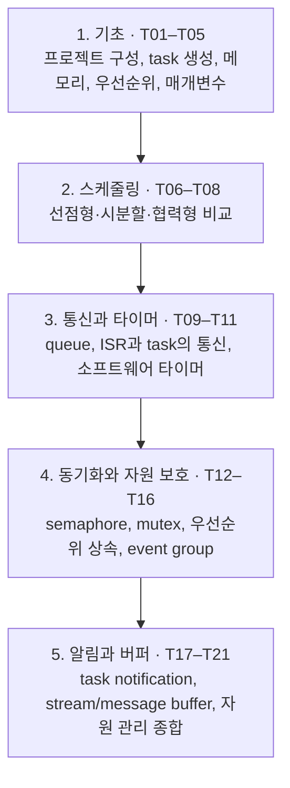

# FreeRTOS 튜토리얼 자습 가이드

이 가이드는 강사의 구두 설명이나 별도의 강의 없이도 학습자가 스스로 FreeRTOS의 핵심 개념을 이해하고, 실습 예제를 완성·실행하며, 발생한 문제를 해결할 수 있도록 돕는 **단계별 자습용 해설서**다.

---

## 1. 학습 대상과 선수 지식

* **학습 대상**: C 언어의 기초(변수, 조건문, 반복문, 함수)를 다뤄본 적이 있으나, 실시간 운영체제(RTOS)를 처음 배우는 임베디드 소프트웨어 입문자 및 전공 학부생.
* **C 언어 복습 지원**: 포인터, 함수 포인터, 구조체, 비트 연산, 변수 수명(생명주기), `sizeof` 등 RTOS에서 자주 쓰이는 C 언어 핵심 문법은 각 단원의 「시작 전 확인」 절에서 실제 예제에 필요한 범위에서 복습한다.
* **실습 환경**: PC의 POSIX 예제를 사용한다. macOS와 Linux ARM64의 실행 조건 및 stack 깊이 호환 패치는 [공통 준비](getting-started.md)에서 확인한다. MCU 보드는 필요하지 않다.

---

## 2. 전체 단원 학습 로드맵

21개 튜토리얼은 RTOS의 기본 실행 단위인 task부터 시작하여 스케줄링, 데이터 통신, 동기화, 고급 자원 관리까지 자연스럽게 실력이 확장되도록 구성되어 있다.

순서대로 학습하면 앞 단원의 개념을 이어 쓸 수 있다. 필요한 주제부터 읽을 때는 각 단원의 「시작 전 확인」 링크를 따른다. 특히 [T18](tutorial_18.md)은 [T17의 알림](tutorial_17.md)과 [T15의 이벤트 비트](tutorial_15.md), [T21](tutorial_21.md)은 [T10의 ISR](tutorial_10.md)·[T13의 mutex](tutorial_13.md)·[T14의 우선순위 상속](tutorial_14.md)을 먼저 확인한다.

---

## 3. 단원별 학습 목차

| 단계 | 번호 | 단원명 | 핵심 개념 및 실습 목표 | 실습 형태 | 가이드 링크 |
| :--- | :---: | :--- | :--- | :---: | :--- |
| **준비** | - | **공통 실습 환경 준비** | 컴파일러·CMake 확인, 소스 코드 구조, 빌드/실행/종료법 | 공통 준비 | [실습 준비 가이드](getting-started.md) |
| **기초** | T01 | 프로젝트 구성 | 베어메탈 프로젝트에 FreeRTOS 커널 소스 추가 및 CMake 빌드 | 관찰·분석 | [T01 가이드](tutorial_1.md) |
| | T02 | task 생성 | `xTaskCreate()`, task 함수 구조, 무한 루프와 scheduler 시작 | TODO 구현 | [T02 가이드](tutorial_2.md) |
| | T03 | 정적 메모리 할당 | `xTaskCreateStatic()`, TCB와 stack 메모리 수동 배치 | TODO 구현 | [T03 가이드](tutorial_3.md) |
| | T04 | task 우선순위 | 우선순위에 따른 실행 순서, 지연과 선점 | TODO 구현 | [T04 가이드](tutorial_4.md) |
| | T05 | task 매개변수 | `pvParameters`를 통한 식별 값 전달, 포인터와 메모리 수명 | TODO 구현 | [T05 가이드](tutorial_5.md) |
| **스케줄링** | T06 | 선점형 + 시분할 | 동일 우선순위 task 간의 Time Slicing 라운드로빈 동작 | 관찰·분석 | [T06 가이드](tutorial_6.md) |
| | T07 | 선점형 (시분할 비활성) | `configUSE_TIME_SLICING 0`, 동일 우선순위에서의 양보 조건 | 관찰·분석 | [T07 가이드](tutorial_7.md) |
| | T08 | 협력형 스케줄링 | `configUSE_PREEMPTION 0`, `taskYIELD()`와 Blocked에 의한 양보 | 관찰·분석 | [T08 가이드](tutorial_8.md) |
| **통신** | T09 | task 간 queue 통신 | FIFO 큐 생성, 데이터 복사 전송(`xQueueSend/Receive`), 대기 시간 | TODO 구현 | [T09 가이드](tutorial_9.md) |
| | T10 | 인터럽트와 queue | Tick Hook ISR 문맥, `xQueueSendFromISR()`, 문맥 전환 요청 | TODO 구현 | [T10 가이드](tutorial_10.md) |
| | T11 | software timer | 타이머 데몬, One-shot 및 Auto-reload 타이머, 콜백 함수 | TODO 구현 | [T11 가이드](tutorial_11.md) |
| **동기화** | T12 | binary semaphore | 이벤트 발생 신호 전달, Take/Give 동작 | TODO 구현 | [T12 가이드](tutorial_12.md) |
| | T13 | mutex | 공유 자원 상호 배제, 소유권(Ownership) 개념 | TODO 구현 | [T13 가이드](tutorial_13.md) |
| | T14 | 우선순위 역전과 상속 | Unbounded Priority Inversion 현상과 커널의 우선순위 상속 메커니즘 | 관찰·분석 | [T14 가이드](tutorial_14.md) |
| | T15 | event group 이벤트 관리 | 다중 비트 이벤트 플래그, AND/OR 대기 조건 | TODO 구현 | [T15 가이드](tutorial_15.md) |
| | T16 | event group 동기화 | 모든 task가 정해진 지점에 도착할 때까지 기다리는 장벽 동기화 | TODO 구현 | [T16 가이드](tutorial_16.md) |
| **경량화** | T17 | task notification (세마포어) | 별도 객체 없는 태스크 직접 알림, 경량 이진 세마포어 에뮬레이션 | TODO 구현 | [T17 가이드](tutorial_17.md) |
| | T18 | task notification (이벤트) | 알림 값 내부 비트를 이벤트 플래그로 활용 | TODO 구현 | [T18 가이드](tutorial_18.md) |
| **버퍼/자원** | T19 | stream buffer | 단일 송신-수신 바이트 스트림 통신, Trigger Level 동작 | TODO 구현 | [T19 가이드](tutorial_19.md) |
| | T20 | message buffer | 메시지 경계가 보존되는 가변 길이 이산 패킷 통신 | TODO 구현 | [T20 가이드](tutorial_20.md) |
| | T21 | 공유 자원 관리 종합 | Critical Section, Scheduler 일시 중지, Mutex의 장단점 비교 | 관찰·분석 | [T21 가이드](tutorial_21.md) |

---

## 4. 각 단원 해설서의 학습 구성

모든 튜토리얼 가이드는 학습자의 자습 흐름이 끊기지 않도록 다음 11단계 표준 구조로 통일되어 있다.

1. **이번 실습에서 할 일**: 무엇을 만들며 어떤 동작을 확인하는지 한눈에 파악
2. **시작 전 확인**: 필요한 C 언어 문법 복습 및 확인해야 할 소스 파일
3. **개념 이해**: 왜 필요한가(동기) → 무엇인가(정의) → 어떻게 동작하는가(원리) → 한계점
4. **실행 흐름 읽기**: task와 ISR 간의 시간대별 상태 전이 및 데이터 이동 흐름도
5. **코드와 API 이해**: 주요 API 함수의 인자·단위·반환값·호출 조건 설명
6. **직접 구현 또는 관찰 준비**: 단계별 힌트(힌트 1 → 구체적 힌트 2) 및 접기 영역 내 정답 해설 코드
7. **빌드와 실행**: 실제 터미널 명령어, 빌드 디렉터리 분리, 안전한 실행/종료 방법
8. **결과 해석**: 콘솔 로그를 줄 단위로 해설하며 정상 출력의 기준 안내
9. **막혔을 때 (트러블슈팅)**: 자주 겪는 컴파일·실행 오류의 원인과 확인·수정·재확인 방법
10. **혼자 확인하기 (자가 점검)**: 개념·실행 추적·조건 변경 문항과 해설
11. **다음 학습**: 다음 단계와의 유기적 연결 및 한국어 커널북 심화 읽기 안내

---

## 5. 학습 권장 요령

1. **직접 타이핑하며 생각하기**: `TODO` 주석이 있는 단원은 해답 코드를 바로 열어보지 말고, 가이드의 「힌트 1」과 「힌트 2」를 읽으며 본인이 직접 소스 파일에 작성해 본다.
2. **참조 해답 활용**: 힌트로 진행하기 어려우면 접기 영역의 해답을 확인하고, 별도 제공되는 완성 코드([`solutions/tutorial_N.c`](solutions/))와 본인의 작성 내용을 비교해 본다.
3. **조건 하나 바꿔보기**: 실습이 정상 동작하면, 가이드의 「자가 점검」에 제시된 대로 우선순위 숫자나 지연 시간 값 하나를 바꾸어 보고 출력이 어떻게 변하는지 관찰해 본다. 먼저 결과를 예측하고 실제 동작과 비교하면 RTOS의 동작 원리를 확인할 수 있다.

지금 바로 [공통 실습 환경 준비 가이드](getting-started.md)를 열고 첫 걸음을 시작해 보자!
