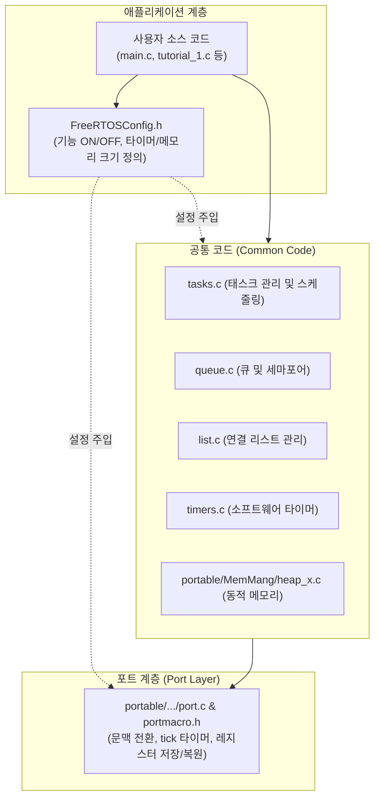
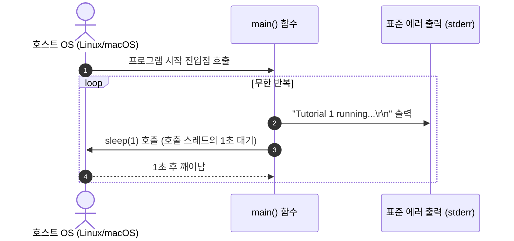

# Tutorial 1: 베어메탈 프로젝트에 FreeRTOS 추가 (Add FreeRTOS to a Bare Metal Project)

[학습 목차](README.md) · [공통 준비](getting-started.md) · [공식 튜토리얼 번역](../docs/tutorial_1/README.md)

이 단원은 베어메탈 프로젝트에 커널을 추가하는 절차를 PC의 POSIX 환경에서 연습한다. 일반 C 프로그램에 FreeRTOS 커널 소스를 결합하고, 빌드 시스템(CMake)을 통해 실행 바이너리를 생성하는 기본 골격을 학습한다.

---

## 1. 이번 실습에서 할 일

* **해결하려는 문제**: 운영체제가 없는 베어메탈(Bare-metal) C 환경에서 FreeRTOS를 처음 도입할 때, 어떤 소스 파일들이 필요하고 이들이 어떻게 결합되어 빌드되는지 이해한다.
* **학습 목표**:
  1. FreeRTOS 소스 트리의 3대 구성 요소(공통 코드, 포트 계층, 설정 파일)의 역할을 설명할 수 있다.
  2. 아직 scheduler가 구동되지 않은 순수 C `main()` 함수와 호스트 OS의 지연 함수(`sleep()`) 동작을 관찰한다.
  3. 이 실습으로 확인한 것(빌드 시스템 연동)과 아직 확인하지 못한 것(task 스케줄링)의 차이를 명확히 구분한다.

---

## 2. 시작 전 확인

### 2.1 C 언어 핵심 복습
* **컴파일과 링크**: 여러 개의 `.c` 소스 파일은 각각 컴파일되어 오브젝트 파일(`.o`)이 되고, 링커(Linker)에 의해 하나의 실행 파일로 합쳐진다. FreeRTOS는 별도의 바이너리 라이브러리로 제공되는 것이 아니라, 애플리케이션 소스 코드와 커널 `.c` 파일들이 **함께 컴파일**되는 소스 레벨 배포 방식을 취한다.
* **프로그램 진입점**: 이 실습의 호스트 C 프로그램은 런타임 초기화 뒤 `main()`으로 진입한다.

### 2.2 확인할 소스 및 설정 파일
* 실습 코드: [`source/tutorials/tutorial_1/source/tutorial_1.c`](../../source/tutorials/tutorial_1/source/tutorial_1.c)
* 설정 파일: [`source/tutorials/tutorial_1/include/FreeRTOSConfig.h`](../../source/tutorials/tutorial_1/include/FreeRTOSConfig.h)
* 빌드 스크립트: [`source/CMakeLists.txt`](../../source/CMakeLists.txt)

> **실습 형태**: 이 단원은 빈칸(`TODO`)이 없는 **사전 완성형 관찰 실습**이다. 코드를 수정하지 않고 구조를 분석한 뒤 빌드와 실행을 검증한다.

---

## 3. 개념 이해

**task**는 커널이 관리하는 실행 흐름이고, **스케줄러**는 실행 가능한 task 중 다음 실행 대상을 고른다. **포트**는 그 결정을 해당 실행 환경의 문맥 전환과 시간 관리 기능으로 연결한다. 이 단원은 커널을 빌드에 포함하지만 task와 스케줄러를 실행하지 않는다.

### 3.1 왜 소스 트리가 3개 축으로 나뉘어 있는가?
FreeRTOS는 손목시계용 소형 8비트 마이크로컨트롤러부터 고성능 32비트/64비트 멀티코어 프로세서(ARM Cortex-M/A, RISC-V, POSIX 등)까지 수십 종의 아키텍처를 지원한다. 모든 하드웨어마다 운영체제를 새로 작성하는 것은 불가능하므로, FreeRTOS는 소스 코드를 철저하게 3개 축으로 분리했다.



### 3.2 3대 구성 요소의 역할

1. **공통 코드 (Common Code)**
   * 여러 포트가 공유하는 C 코드 중심의 커널 본체다.
   * `tasks.c`: task의 상태 전이, 우선순위 스케줄링 알고리즘 담당
   * `list.c`: Ready 상태, Blocked 상태의 task들을 관리하는 이중 연결 리스트
   * `queue.c`: task 간 동기화 및 메시지 전달의 핵심 엔진
   * `timers.c`, `event_groups.c`, `stream_buffer.c`: 부가 동기화 기능
   * `portable/MemMang/heap_x.c`: FreeRTOS 전용 힙 메모리 관리자 (`pvPortMalloc`)

2. **포트 계층 (Port Layer)**
   * 특정 하드웨어 아키텍처와 컴파일러(GCC, IAR, Keil 등)에 종속된 코드다.
   * MCU 포트에는 레지스터 저장·복원과 하드웨어 tick 설정 코드가 들어간다. 이 실습의 POSIX 포트는 호스트 스레드와 신호를 이용한다.
   * 본 튜토리얼에서는 PC 환경에서 동작하도록 작성된 **`FreeRTOS-Kernel/portable/ThirdParty/GCC/Posix`** 포트를 사용한다.

3. **설정 파일 (`FreeRTOSConfig.h`)**
   * 커널의 동작 방식을 사용자 애플리케이션 요구사항에 맞게 커스터마이징하는 헤더 파일이다.
   * 예: 선점형 스케줄링 활성화 여부(`configUSE_PREEMPTION`), 초당 tick 수(`configTICK_RATE_HZ`), 최소 스택 크기(`configMINIMAL_STACK_SIZE`) 등을 매크로 `#define`으로 결정한다.
   * 선택 기능을 끄면 관련 코드나 저장 공간을 줄일 수 있다. 실제 크기는 설정과 빌드 결과로 확인한다.

---

## 4. 실행 흐름 읽기

Tutorial 1의 예제 코드는 FreeRTOS 커널 소스와 함께 링크되었지만, **아직 FreeRTOS의 scheduler를 구동하지 않은 상태**이다. 순수 C 프로그램의 `main()` 함수가 호스트 OS의 스레드에서 직접 동작한다.



---

## 5. 코드와 API 이해

`source/tutorials/tutorial_1/source/tutorial_1.c`의 전체 코드를 살펴본다:

```c
#include <stdio.h>
#include <unistd.h>

int main( void )
{
    for( ; ; )
    {
        fprintf( stderr, "Tutorial 1 running...\r\n" );

        /* Sleep for a second. */
        sleep( 1 );
    }

    return 0;
}
```

### 5.1 코드 한 줄 해설
* `#include <unistd.h>`: POSIX 호스트 시스템의 `sleep()` 함수를 사용하기 위해 포함한 헤더다.
* `for( ; ; )`: 임베디드 시스템에서 시스템이 꺼질 때까지 영원히 실행되는 전형적인 무한 루프(Infinite Loop) 구조다.
* `fprintf( stderr, ... )`: `stdout` 대신 버퍼링 없이 즉시 화면에 출력되는 표준 에러 스트림(`stderr`)에 로그를 찍는다.
* `sleep( 1 )`: 호출한 호스트 스레드를 약 1초 동안 대기시킨다. 프로세스에 다른 스레드가 있다면 그 스레드까지 모두 멈추는 것은 아니다.
  > **주의**: 이 `sleep()`은 FreeRTOS 커널의 지연 함수(`vTaskDelay()`)가 아니다 호출 스레드의 대기를 호스트 운영체제가 관리한다. FreeRTOS task 기반의 지연은 Tutorial 2에서 처음 등장한다.

---

## 6. 직접 구현 또는 관찰 준비

* **관찰 포인트**:
  1. `tutorial_1.c` 코드 내에 `FreeRTOS.h`나 `task.h`가 include되어 있지 않다.
  2. `xTaskCreate()`나 `vTaskStartScheduler()` 같은 FreeRTOS API가 호출되지 않았다.
  3. 그럼에도 불구하고 CMake 빌드 시 커널 공통 소스(`tasks.c`, `list.c` 등)가 에러 없이 함께 컴파일되고 링크된다.

---

## 7. 빌드와 실행

학습용 사본(`FreeRTOS-Tutorials-practice/`) 루트에서 터미널을 열고 다음 명령을 차례대로 실행한다:

```bash
# 1. 빌드 폴더 준비 및 튜토리얼 1 대상 설정
cmake -S source -B build/tutorial_1 -DTUTORIAL=1

# 2. 컴파일 및 링크
cmake --build build/tutorial_1

# 3. 실행 바이너리 구동
./build/tutorial_1/freertos_example
```

* **종료 방법**: 터미널에서 **`Ctrl + C`**를 누르면 실행이 중단된다.

---

## 8. 결과 해석

### 8.1 출력 예시

반복 문자열은 같아야 하지만 출력 간격은 호스트 부하에 따라 달라질 수 있다.

```text
Tutorial 1 running...
Tutorial 1 running...
Tutorial 1 running...
Tutorial 1 running...
```

### 8.2 출력 해석 및 판정 기준
* **반드시 만족할 조건**: 대략 1초 간격으로 `Tutorial 1 running...` 문자열이 한 줄씩 계속 출력되어야 한다.
* **달라도 정상인 부분**: `sleep(1)`은 호스트 OS의 스케줄링 정책에 의존하므로 출력 간격이 정확히 1초로 고정되지는 않는다. 호스트 부하나 출력 처리에 따른 지연 크기도 일정하지 않다.
* **실패 증상**: 빌드 시 `undefined reference to ...` 링커 오류가 발생하면 오류에 나온 심벌과 해당 소스가 빌드 대상에 포함되어 있는지 확인한다.

---

## 9. 막혔을 때 (트러블슈팅)

| 증상 | 원인 | 해결 방법 |
| :--- | :--- | :--- |
| `cmake` 설정 중 `FreeRTOS-Kernel` 경로 에러 발생 | 커널 서브모듈 미다운로드 | `git submodule update --init --recursive` 실행 |
| 빌드 마지막에 `Error 1` 표시 | 실제 원인은 앞선 첫 오류에 있음 | 위쪽의 최초 컴파일·링크 오류를 읽고 누락 파일·심벌을 확인한 뒤 같은 단원 명령으로 다시 빌드 |
| 아무런 문자열도 출력되지 않음 | 다른 단원 실행 또는 출력 리다이렉션 가능성 | 실행 경로가 `build/tutorial_1`인지 확인하고 `./build/tutorial_1/freertos_example 2>&1`로 오류까지 확인 |

---

## 10. 혼자 확인하기 (자가 점검)

### 질문 1 (개념)
FreeRTOS 소스 코드를 하드웨어 독립적인 **Common Code**와 하드웨어 종속적인 **Port Layer**로 분리해 둔 가장 결정적인 이유는 무엇인가?

<details>
<summary>정답 및 해설 확인</summary>

* **정답**: 수많은 마이크로컨트롤러(ARM, RISC-V, PIC 등) 및 다양한 컴파일러로 이식(Porting)할 때, 공통 커널 알고리즘(`tasks.c`, `queue.c`)을 전혀 수정하지 않고 오직 아키텍처 의존적인 포트 코드(`port.c`, `portmacro.h`)만 교체하여 재사용성을 극대화하기 위함이다.
</details>

### 질문 2 (실행 추적)
Tutorial 1의 예제가 1초 간격으로 정상 출력되었다고 해서, 현재 FreeRTOS 커널의 스케줄링과 멀티태스킹이 정상 작동하고 있다고 단정할 수 있는가?

<details>
<summary>정답 및 해설 확인</summary>

* **정답**: 단정할 수 없다(아니다).
* **이유**: Tutorial 1은 단지 FreeRTOS 소스 코드가 애플리케이션과 함께 문제없이 컴파일·링크되는 빌드 환경을 확인한 것일 뿐이다. 실행된 코드는 호스트 운영체제의 기본 스레드에서 구동된 일반 C `main()` 함수와 호스트 `sleep()` 시스템 콜이며, FreeRTOS의 scheduler(`vTaskStartScheduler()`)는 아직 시작조차 하지 않았다.
</details>

### 질문 3 (한 조건 변형과 실행 추적)
`main()`의 `sleep(1)`을 `sleep(3)`으로 바꾼다.

실행 전에 바뀔 결과와 유지될 조건을 각각 적는다. 자기 풀이와 변경 전 파일은 [공통 보존·복구 절차](getting-started.md#solution-workflow)로 남긴다. 한 조건만 수정하고 `cmake --build build/tutorial_1`으로 다시 빌드한 뒤 실행해 예측과 비교한다. 아래 해설은 변형의 예상 결과이며, 직접 얻은 로그와 구분한다.

<details>
<summary>예상 결과와 해설 확인</summary>

출력 간격이 대략 3초로 늘지만 문자열과 반복 구조는 같다. FreeRTOS 스케줄러를 새로 시작한 것은 아니다.
</details>

**복구와 재확인**: 변경한 한 값(추가한 코드라면 그 한 줄)을 원래대로 돌리고 같은 단원을 다시 빌드·실행한다. 원래 조건의 8절 결과와 비교한다. 설명이 어려우면 [관련 개념 다시 읽기](#5-코드와-api-이해)로 돌아간다.

---

## 11. 다음 학습

Tutorial 1을 통해 프로젝트 빌드와 커널 파일 연동을 마쳤다.
이제 **[Tutorial 2: task 생성 (Task Creation)](tutorial_2.md)**으로 넘어가서, task 함수를 작성하고 `xTaskCreate()`와 `vTaskStartScheduler()`를 호출한다.

* **한국어 커널북 심화 읽기**:
  * [2.2.5–2.2.6절: 공통 소스와 포트 전용 소스](https://github.com/yunju-baek/FreeRTOS-Kernel-Book-ko/blob/27d03c61cd2a6cf5a6fa6333082218ef706f5b89/ko/ch02.md)
  * [2.2.3절: FreeRTOS 설정 파일 (FreeRTOSConfig.h)](https://github.com/yunju-baek/FreeRTOS-Kernel-Book-ko/blob/27d03c61cd2a6cf5a6fa6333082218ef706f5b89/ko/ch02.md)
