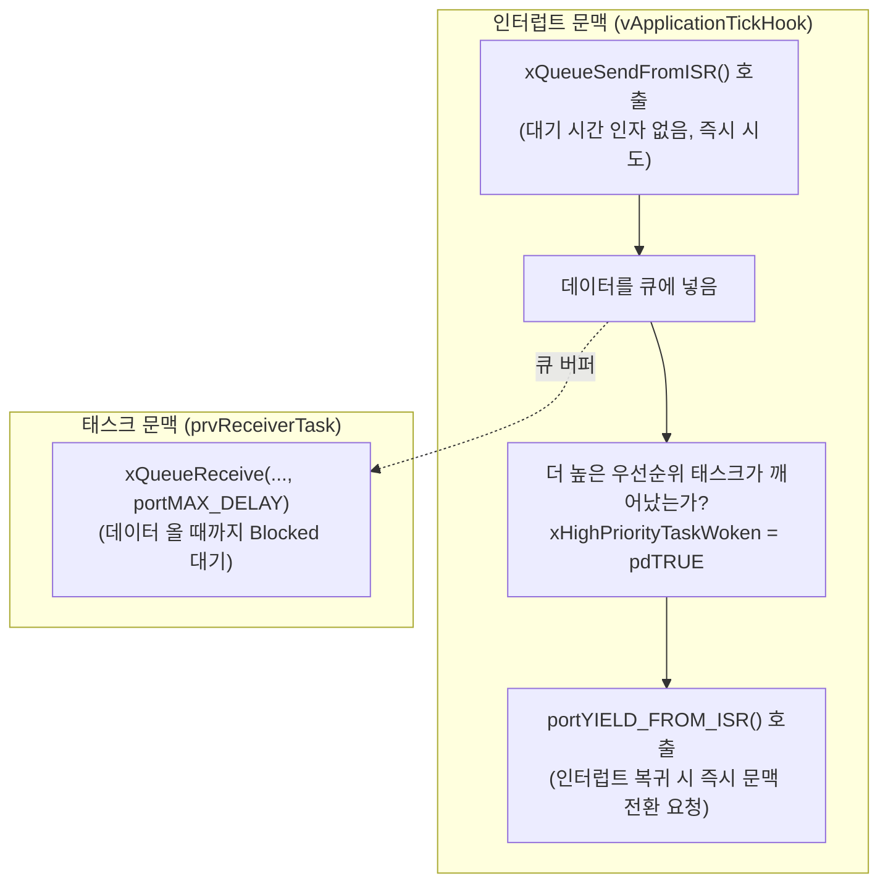
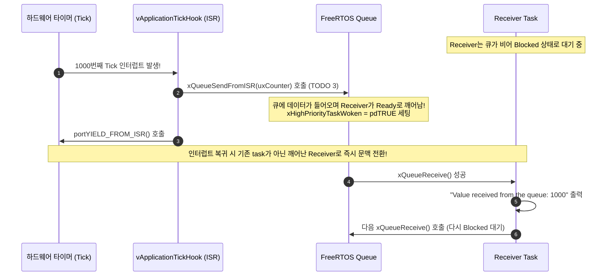

# Tutorial 10: 인터럽트와 task 간의 queue 통신 (Using Queues for Communication between Interrupts and Tasks)

이 단원에서는 하드웨어 인터럽트 서비스 루틴(ISR)에서 발생한 데이터를 task로 안전하게 전달하는 **`FromISR` 전용 API**와 **지연된 인터럽트 처리(Deferred Interrupt Processing)**의 기초를 실습한다.

---

## 1. 이번 실습에서 할 일

* **해결하려는 문제**: 인터럽트 문맥(ISR)은 절대 대기(Block)하거나 잠들 수 없으므로, 일반 task용 API를 ISR에서 호출하면 시스템이 크래시된다. ISR 전용 API 규칙을 이해하고 적용한다.
* **학습 목표**:
  1. 일반 FreeRTOS API와 `...FromISR` 접미사가 붙은 ISR 전용 API의 차이를 명확히 설명할 수 있다.
  2. Tick Hook 인터럽트 핸들러에서 `xQueueSendFromISR()`을 호출하여 큐로 데이터를 전송한다.
  3. `pxHigherPriorityTaskWoken` 매개변수와 `portYIELD_FROM_ISR()` 매크로의 동작 원리를 이해한다.

---

## 2. 시작 전 확인

### 2.1 임베디드 인터럽트 핵심 복습
* **인터럽트 문맥 (Interrupt Context)**: 하드웨어 이벤트(타이머, UART 수신, GPIO 핀 변화 등)가 발생하면 CPU는 현재 실행 중이던 task를 즉시 멈추고 인터럽트 벡터로 점프하여 ISR을 실행한다.
* **ISR의 황금률**:
  1. **절대 잠들지 말 것 (Never Block)**: ISR은 자신만의 독립된 task 스택이나 TCB가 없으므로 `vTaskDelay()`를 부르거나 큐가 비워질 때까지 기다릴 수 없다.
  2. **최대한 빨리 끝낼 것 (Short and Fast)**: ISR이 길어지면 다른 중요한 하드웨어 인터럽트를 놓치거나 시스템 실시간성이 붕괴된다.

### 2.2 확인할 소스 및 설정 파일
* 실습 코드: [`source/tutorials/tutorial_10/source/tutorial_10.c`](../../source/tutorials/tutorial_10/source/tutorial_10.c)
* 설정 파일: [`source/tutorials/tutorial_10/include/FreeRTOSConfig.h`](../../source/tutorials/tutorial_10/include/FreeRTOSConfig.h)
  * `configUSE_TICK_HOOK`이 `1`로 켜져 있어 매 1ms tick 인터럽트마다 `vApplicationTickHook()` 함수가 호출된다.
* 참조 해답: [`ko/guides/solutions/tutorial_10.c`](solutions/tutorial_10.c)

> **실습 형태**: 이 단원은 `tutorial_10.c` 내부의 **`TODO 1`, `TODO 2`, `TODO 3`을 완성하는 구현 실습**이다.

---

## 3. 개념 이해

### 3.1 왜 일반 API를 ISR에서 쓰면 안 되는가?
`xQueueSend()`의 3번째 인자는 `xTicksToWait`(대기 시간)이다. 만약 큐가 꽉 차 있으면 커널은 호출자를 Blocked 상태로 만들어 재우려고 시도한다.  
하지만 **ISR은 운영체제의 스케줄링 대상(task)이 아니므로 재울 수 없다!** 만약 ISR에서 일반 API를 호출하면 커널 내부 assert에 걸리거나 시스템이 멈춘다.  
따라서 FreeRTOS는 ISR에서 호출할 수 있는 함수들을 별도로 분리하고 이름 끝에 **`FromISR`**을 붙여 두었다.



### 3.2 `pxHigherPriorityTaskWoken`과 `portYIELD_FROM_ISR`
1. ISR이 큐에 데이터를 밀어 넣음으로써, 그동안 큐에서 데이터가 오길 애타게 기다리던 높은 우선순위 task가 **Blocked → Ready 상태**로 깨어날 수 있다.
2. 하지만 지금은 인터럽트 처리 중이므로 즉시 문맥 전환을 할 수 없다. 그래서 커널은 `pxHigherPriorityTaskWoken` 변수의 값을 `pdTRUE`로 세팅해 준다.
3. ISR의 맨 마지막 줄에서 `portYIELD_FROM_ISR( xHighPriorityTaskWoken );`을 호출하면, 인터럽트 핸들러가 종료되는 순간 **원래 중단되었던 task로 돌아가지 않고, 방금 깨어난 높은 우선순위 task로 곧장 CPU를 스위칭**한다! (이를 통해 인터럽트 처리 지연을 제로로 만든다.)

---

## 4. 실행 흐름 읽기



---

## 5. 코드와 API 이해

### 5.1 `xQueueSendFromISR()` API 상세 분석
```c
BaseType_t xQueueSendFromISR( QueueHandle_t xQueue,
                              const void * pvItemToQueue,
                              BaseType_t * const pxHigherPriorityTaskWoken );
```
* 일반 `xQueueSend`와 달리 `xTicksToWait` 인자가 아예 없다 (기다리지 않고 즉시 시도).
* `pxHigherPriorityTaskWoken`: 이 큐 전송으로 인해 더 높은 우선순위 task가 깨어났는지 여부를 커널이 기록해 주는 출력용 포인터 변수다 (`&( xHighPriorityTaskWoken )`).
* **반환값**: 성공 시 `pdPASS`, 큐가 꽉 차서 실패하면 즉시 `errQUEUE_FULL`을 반환한다.

### 5.2 `portYIELD_FROM_ISR()` 매크로
* ISR의 맨 마지막에서 호출한다.
* 인자로 전달된 변수(`xHighPriorityTaskWoken`)가 `pdTRUE`이면 펜딩 인터럽트(PendSV 등)를 걸어 인터럽트가 끝나는 시점에 즉시 스케줄러를 가동시킨다.

---

## 6. 직접 구현 또는 관찰 준비

`source/tutorials/tutorial_10/source/tutorial_10.c` 파일을 열고 세 개의 TODO를 완성한다.

### 6.1 TODO 1: 큐 생성 (`main` 함수)
66~74행 주석: 크기 5, 항목 크기 `sizeof( UBaseType_t )`의 큐를 생성한다.

<details>
<summary>TODO 1 해답 코드 보기</summary>

```c
    xQueue = xQueueCreate( 5, sizeof( UBaseType_t ) );
```
</details>

### 6.2 TODO 2: task에서 큐 수신 (`prvReceiverTask`)
101~108행 주석: 큐에서 데이터를 무기한 대기하여 꺼낸다.

<details>
<summary>TODO 2 해답 코드 보기</summary>

```c
        xQueueReceive( xQueue, &( uxReceivedValue ), portMAX_DELAY );
```
</details>

### 6.3 TODO 3: ISR에서 큐 송신 (`vApplicationTickHook`)
125~133행 주석 부분을 찾는다:
* **주의**: 일반 `xQueueSend`가 아니라 반드시 **`xQueueSendFromISR`**을 호출해야 한다!

<details>
<summary>TODO 3 해답 코드 보기</summary>

```c
        xQueueSendResult = xQueueSendFromISR( xQueue,
                                              &( uxCounter ),
                                              &( xHighPriorityTaskWoken ) );
```
</details>

> 전체 완성 코드는 [`ko/guides/solutions/tutorial_10.c`](solutions/tutorial_10.c)에서 확인할 수 있다.

---

## 7. 빌드와 실행

저장소 루트에서 다음 명령을 실행한다:

```bash
# 1. CMake 빌드 구성 (Tutorial 10 지정)
cmake -B build -S source -DTUTORIAL=10

# 2. 컴파일 및 빌드
cmake --build build

# 3. 바이너리 실행
./build/freertos_example
```

* **종료 방법**: 터미널에서 **`Ctrl + C`**를 누른다.

---

## 8. 결과 해석

### 8.1 정상 실행 출력 화면
```text
Value received from the queue: 1000
Number of items in the queue: 0.
Value received from the queue: 2000
Number of items in the queue: 0.
Value received from the queue: 3000
Number of items in the queue: 0.
```

### 8.2 판정 기준 및 해석
* **결과의 특징**: 1초(1000 tick)마다 `uxCounter` 값이 1000씩 증가하며 출력된다.
* **원리 확인**: `vApplicationTickHook`은 1ms마다 한 번씩 불린다. 코드의 `if( ( uxCounter % 1000 ) == 0 )` 조건이 정확히 1000번째 tick 인터럽트(즉 1초)마다 참이 되어 큐로 숫자를 쐈고, 수신 task가 이를 받아서 즉시 출력했음을 검증한다.

---

## 9. 막혔을 때 (트러블슈팅)

| 증상 | 원인 | 해결 방법 |
| :--- | :--- | :--- |
| 컴파일 경고 또는 크래시 발생 | TODO 3에서 `xQueueSendFromISR` 대신 일반 `xQueueSend`를 호출했음 | 반드시 `xQueueSendFromISR`로 교체 |
| 출력이 1000배 빠르게 쏟아짐 | `% 1000 == 0` 조건을 누락했음 | 1000틱마다 송신하는 if 조건 블록 안에서 호출했는지 확인 |

---

## 10. 혼자 확인하기 (자가 점검)

### 질문 1 (핵심 규칙)
`xQueueSendFromISR()` 함수에는 일반 `xQueueSend()` 함수에 있는 `xTicksToWait` 매개변수가 왜 존재하지 않는가?

<details>
<summary>정답 및 해설 확인</summary>

* **정답**: 인터럽트 서비스 루틴(ISR)은 절대 Blocked 상태(대기 상태)로 들어갈 수 없기 때문이다.
* **이유**: ISR은 특정 task 문맥이 아닌 시스템 최상위 권한에서 실행되므로, 빈자리가 날 때까지 잠들어 기다린다는 개념 자체가 불가능하다. 즉시 쓸 수 없으면 에러를 내고 바로 리턴해야 한다.
</details>

### 질문 2 (지연된 인터럽트 처리 패턴)
실무에서 고속 통신(예: UART 패킷 수신) 인터럽트가 발생했을 때, 복잡한 데이터 파싱과 파일 저장을 ISR 내부에서 직접 하지 않고, 큐를 통해 별도의 task로 넘겨서 처리하는 설계 패턴을 무엇이라고 부르는가?

<details>
<summary>정답 및 해설 확인</summary>

* **정답**: **인터럽트 처리의 지연 수행 (Deferred Interrupt Processing)**.
* **이유**: ISR은 최소한의 데이터만 큐에 넣고 즉시 복귀하여 다른 인터럽트를 놓치지 않게 하고, 시간이 오래 걸리는 무거운 연산은 일반 task가 CPU를 받아 여유롭게 처리하게 만들기 위함이다.
</details>

---

## 11. 다음 학습

인터럽트와 task 간의 데이터 전송을 완벽히 마스터했다!  
이제 **[Tutorial 11: software timer (Software Timers)](tutorial_11.md)**로 넘어가서, 하드웨어 타이머 개수가 부족할 때 커널이 소프트웨어적으로 무제한 타이머를 만들어 주는 소프트웨어 타이머 데몬과 콜백 함수를 배워보자!

* **한국어 커널북 심화 읽기**:
  * [7.2장: FromISR API의 규칙](https://github.com/yunju-baek/FreeRTOS-Kernel-Book-ko/blob/27d03c61cd2a6cf5a6fa6333082218ef706f5b89/ko/ch07.md)
  * [7.7장: 인터럽트와 큐 통신](https://github.com/yunju-baek/FreeRTOS-Kernel-Book-ko/blob/27d03c61cd2a6cf5a6fa6333082218ef706f5b89/ko/ch07.md)
