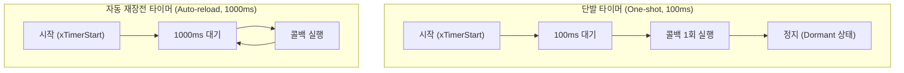
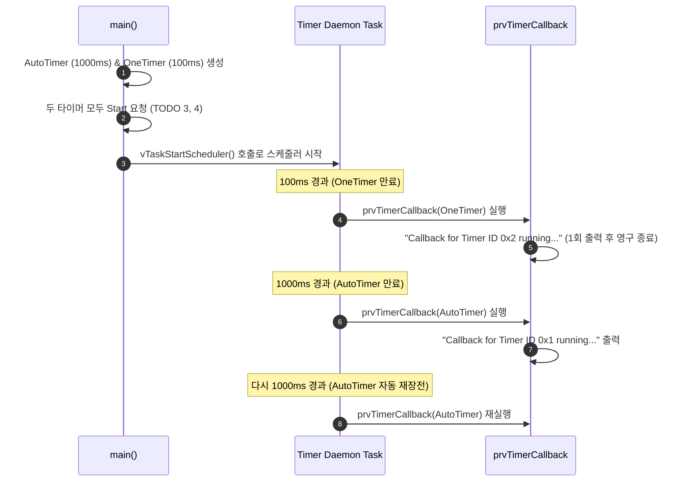

# Tutorial 11: software timer (Software Timers)

이 단원에서는 하드웨어 타이머 개수의 제약을 극복하고, 미래의 특정 시점이나 주기적인 작업을 예약 실행할 수 있게 해주는 **software timer(소프트웨어 타이머)**의 생성과 동작 원리를 배운다.

---

## 1. 이번 실습에서 할 일

* **해결하려는 문제**: 하드웨어 타이머 장치가 부족한 임베디드 MCU에서 수십 개의 독립된 타이머를 소프트웨어적으로 생성하고 주기적/단발성 이벤트를 처리한다.
* **학습 목표**:
  1. **단발 타이머(One-shot timer)**와 **자동 재장전 타이머(Auto-reload timer)**의 동작 차이를 설명할 수 있다.
  2. `xTimerCreate()`와 `xTimerStart()` API를 사용하여 두 타이머를 생성하고 구동한다.
  3. 타이머 콜백 함수가 실행되는 문맥(Timer Daemon Task)의 특성과 콜백 내부에서의 주의점(블로킹 금지)을 이해한다.

---

## 2. 시작 전 확인

### 2.1 C 언어 핵심 복습
* **콜백 함수 (Callback Function)**: 사용자가 직접 호출하는 것이 아니라, 특정 이벤트(타이머 만료, 패킷 도착 등)가 일어났을 때 시스템(커널)에 의해 거꾸로 호출되는 함수다.
* **타이머 식별자 (Timer ID)**: 여러 타이머가 동일한 콜백 함수를 공유할 때, 콜백 내부에서 `pvTimerGetTimerID( xTimer )`를 호출하여 어떤 타이머가 만료된 것인지 식별할 수 있다.

### 2.2 확인할 소스 및 설정 파일
* 실습 코드: [`source/tutorials/tutorial_11/source/tutorial_11.c`](../../source/tutorials/tutorial_11/source/tutorial_11.c)
* 설정 파일: [`source/tutorials/tutorial_11/include/FreeRTOSConfig.h`](../../source/tutorials/tutorial_11/include/FreeRTOSConfig.h)
  * `configUSE_TIMERS`가 `1`로 설정되어 있어야 소프트웨어 타이머 데몬 task가 활성화된다.
* 참조 해답: [`ko/guides/solutions/tutorial_11.c`](solutions/tutorial_11.c)

> **실습 형태**: `tutorial_11.c` 내부의 **`TODO 1`, `TODO 2`, `TODO 3`, `TODO 4`를 완성하는 구현 실습**이다.

---

## 3. 개념 이해

### 3.1 소프트웨어 타이머의 2가지 유형
1. **단발 타이머 (One-shot Timer)**:
   * 시작된 후 설정된 주기가 만료되면 콜백 함수를 **딱 1회만 실행**하고 멈춘다. (수동으로 다시 `xTimerStart`를 부르지 않는 한 재시작하지 않음).
   * 예: 통신 타임아웃 감시, 버튼 길게 누름 판정 등.
2. **자동 재장전 타이머 (Auto-reload Timer)**:
   * 주기가 만료되어 콜백을 실행한 뒤, 커널이 타이머를 **자동으로 다시 시작**시켜 주기적으로 콜백이 반복 실행된다.
   * 예: 1초마다 센서 값 읽기, 하트비트 LED 점멸 등.



### 3.2 타이머 콜백은 누가 실행하는가? (Timer Service Task)
FreeRTOS의 소프트웨어 타이머 콜백은 인터럽트 핸들러가 실행하는 것이 아니라, 커널이 내부적으로 띄우는 **`prvTimerTask`(Timer Service / Daemon Task)**라는 전용 task가 실행한다.
* **매우 중요한 제약 사항**:
  * 타이머 콜백 함수 내부에서 `vTaskDelay()`를 호출하거나, 데이터가 올 때까지 무한정 기다리는 `xQueueReceive(..., portMAX_DELAY)` 같은 **블로킹 API를 절대 호출해서는 안 된다!**
  * 타이머 콜백이 잠들면 Timer Daemon Task 전체가 멈추어 시스템의 다른 모든 소프트웨어 타이머 동작이 일제히 마비되기 때문이다.

---

## 4. 실행 흐름 읽기



---

## 5. 코드와 API 이해

### 5.1 `xTimerCreate()` API
```c
TimerHandle_t xTimerCreate( const char * const pcTimerName,
                            const TickType_t xTimerPeriodInTicks,
                            const UBaseType_t uxAutoReload,
                            void * const pvTimerID,
                            TimerCallbackFunction_t pxCallbackFunction );
```
* `pcTimerName`: 디버깅용 타이머 이름 문자열.
* `xTimerPeriodInTicks`: 타이머 만료 주기 (`pdMS_TO_TICKS( ms )`).
* `uxAutoReload`: `pdTRUE`이면 자동 재장전, `pdFALSE`이면 단발 타이머.
* `pvTimerID`: 타이머 식별용 ID 값 (포인터 형태).
* `pxCallbackFunction`: 만료 시 실행할 콜백 함수 포인터.

### 5.2 `xTimerStart()` API
```c
BaseType_t xTimerStart( TimerHandle_t xTimer, TickType_t xTicksToWait );
```
* 타이머를 활성화(Dormant → Running) 상태로 전환한다.
* `xTicksToWait`: 타이머 명령 큐가 가득 찼을 때 대기할 시간 (통상 0).

---

## 6. 직접 구현 또는 관찰 준비

`source/tutorials/tutorial_11/source/tutorial_11.c` 파일을 열고 4개의 TODO를 채운다.

### 6.1 TODO 1: Auto-reload 타이머 생성 (1000ms)
49~60행 주석: 이름 `"AutoTimer"`, 주기 `pdMS_TO_TICKS( 1000 )`, `pdTRUE`, ID `(void*)1`, 콜백 `prvTimerCallback`.

<details>
<summary>TODO 1 해답 코드 보기</summary>

```c
    xAutoReloadTimer = xTimerCreate( "AutoTimer",
                                     pdMS_TO_TICKS( 1000 ),
                                     pdTRUE,
                                     ( void * ) 1,
                                     prvTimerCallback );
```
</details>

### 6.2 TODO 2: One-shot 타이머 생성 (100ms)
65~76행 주석: 이름 `"OneTimer"`, 주기 `pdMS_TO_TICKS( 100 )`, `pdFALSE`, ID `(void*)2`, 콜백 `prvTimerCallback`.

<details>
<summary>TODO 2 해답 코드 보기</summary>

```c
    xOneShotTimer = xTimerCreate( "OneTimer",
                                  pdMS_TO_TICKS( 100 ),
                                  pdFALSE,
                                  ( void * ) 2,
                                  prvTimerCallback );
```
</details>

### 6.3 TODO 3 & 4: 두 타이머 시작
81~100행 주석: `xTimerStart()`로 각각 구동한다.

<details>
<summary>TODO 3 & 4 해답 코드 보기</summary>

```c
    xTimerStartResult = xTimerStart( xAutoReloadTimer, 0 );
    configASSERT( xTimerStartResult == pdPASS );

    xTimerStartResult = xTimerStart( xOneShotTimer, 0 );
    configASSERT( xTimerStartResult == pdPASS );
```
</details>

> 전체 완성 코드는 [`ko/guides/solutions/tutorial_11.c`](solutions/tutorial_11.c)에서 확인할 수 있다.

---

## 7. 빌드와 실행

저장소 루트에서 다음 명령을 실행한다:

```bash
# 1. CMake 빌드 구성 (Tutorial 11 지정)
cmake -B build -S source -DTUTORIAL=11

# 2. 컴파일 및 빌드
cmake --build build

# 3. 바이너리 실행
./build/freertos_example
```

* **종료 방법**: 터미널에서 **`Ctrl + C`**를 누른다.

---

## 8. 결과 해석

### 8.1 정상 실행 출력 화면
```text
Callback for Timer ID 0x2 running...
Callback for Timer ID 0x1 running...
Callback for Timer ID 0x1 running...
Callback for Timer ID 0x1 running...
Callback for Timer ID 0x1 running...
```

### 8.2 판정 기준 및 해석
* **결과의 특징**:
  1. 프로그램이 시작되고 아주 잠깐(100ms) 후 `Timer ID 0x2`(One-shot)가 **단 한 번** 출력된다.
  2. 그 후 1초(1000ms)마다 `Timer ID 0x1`(Auto-reload)이 **주기적으로 반복** 출력된다.
* **검증**: 단발 타이머가 정확히 1회 실행 후 저절로 비활성화되었으며, 자동 재장전 타이머는 계속 살아 숨쉬고 있음을 확인한다.

---

## 9. 막혔을 때 (트러블슈팅)

| 증상 | 원인 | 해결 방법 |
| :--- | :--- | :--- |
| `0x2`가 출력되지 않음 | TODO 4의 `xTimerStart(xOneShotTimer, 0)` 누락 | TODO 4 시작 코드 호출 여부 확인 |
| `0x2`도 1초마다 계속 나옴 | TODO 2에서 `pdFALSE` 대신 `pdTRUE`를 넘겼음 | 단발 타이머의 3번째 인자가 `pdFALSE`인지 확인 |

---

## 10. 혼자 확인하기 (자가 점검)

### 질문 1 (주의사항)
소프트웨어 타이머 콜백 함수 내부에서 `vTaskDelay(pdMS_TO_TICKS(500))`를 호출하면 왜 시스템 전체에 치명적인 문제가 발생하는가?

<details>
<summary>정답 및 해설 확인</summary>

* **정답**: 타이머 콜백을 실행하는 주체는 시스템의 유일한 **Timer Daemon Task**이기 때문이다.
* **이유**: 콜백이 500ms 동안 잠들면 데몬 task 자체가 멈추므로, 같은 시간 동안 대기 중인 다른 모든 소프트웨어 타이머의 만료 처리가 500ms 동안 일제히 지연되는 대재앙이 일어난다.
</details>

### 질문 2 (식별자 활용)
콜백 함수가 단 하나뿐인데 어떻게 `0x1`과 `0x2`를 구별하여 출력할 수 있었는가?

<details>
<summary>정답 및 해설 확인</summary>

* **정답**: `pvTimerGetTimerID( xTimer )` API 덕분이다.
* **원리**: 콜백 함수의 인자로 넘어온 타이머 핸들(`xTimer`)을 통해 커널 내부 TCB에 등록해 두었던 `pvTimerID` 값을 꺼내왔기 때문이다.
</details>

---

## 11. 다음 학습

소프트웨어 타이머를 통해 주기적 작업을 관리하는 법을 배웠다.  
이제 **[Tutorial 12: semaphore (Semaphore)](tutorial_12.md)**로 넘어가서, task와 task, 또는 인터럽트와 task 간에 특정 이벤트의 발생을 알리고 동기화하는 **이진 세마포어(Binary Semaphore)**를 배워보자!

* **한국어 커널북 심화 읽기**:
  * [6장: software timer 관리 (Software Timer Management)](https://github.com/yunju-baek/FreeRTOS-Kernel-Book-ko/blob/27d03c61cd2a6cf5a6fa6333082218ef706f5b89/ko/ch06.md)
