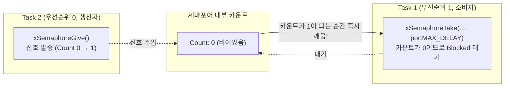
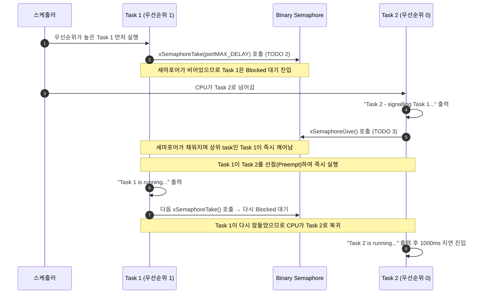

# Tutorial 12: semaphore

[학습 목차](README.md) · [공통 준비](getting-started.md) · [공식 튜토리얼 번역](../docs/tutorial_12/README.md) · [이전 단원](tutorial_11.md)

이 단원에서는 특정 이벤트의 발생을 알리고 두 task 간의 실행 타이밍을 맞추는 **이진 세마포어(Binary Semaphore)**의 신호 동기화(Synchronization) 메커니즘을 배운다.

---

## 1. 이번 실습에서 할 일

* **해결하려는 문제**: 데이터 전송 없이 "어떤 사건이 일어났다"는 신호(Flag)만을 전달하여, 대기 중인 task를 Ready로 만드는 동기화 기법을 익힌다.
* **학습 목표**:
  1. 이진 세마포어(Binary Semaphore)의 생성(`xSemaphoreCreateBinary`), 획득(`Take`), 반환/신호(`Give`) 동작을 구현한다.
  2. 세마포어가 비어있을 때 상위 task가 Blocked 상태로 대기하고, 하위 task가 신호를 보낼 때 즉시 선점되어 깨어나는 과정을 관찰한다.
  3. 세마포어(동기화/신호)와 뮤텍스(자원 보호/소유권)의 개념적 차이를 미리 이해한다.

---

## 2. 시작 전 확인

### 2.1 개념 복습
* **세마포어(Semaphore)의 어원**: 철도 신호기(깃발 신호)에서 유래했다. 깃발이 올라가 있으면(자원 있음 또는 이벤트 발생) 지나갈 수 있고, 깃발이 내려가 있으면(자원 없음) 멈춰서 기다려야 한다.
* **이진 세마포어 (Binary Semaphore)**: 세마포어 내부의 카운트 값이 오직 `0` 또는 `1`만 가질 수 있는 세마포어다.
* **소유권 없음(No Ownership)**: 세마포어는 신호 전달용이므로, **A task가 Take(대기)하고 B task가 Give(신호 발송)**할 수 있다. (소유한 자만 반납할 수 있는 Mutex와의 결정적 차이점)

### 2.2 확인할 소스 및 설정 파일
* 실습 코드: [`source/tutorials/tutorial_12/source/tutorial_12.c`](../../source/tutorials/tutorial_12/source/tutorial_12.c)
* 설정 파일: [`source/tutorials/tutorial_12/include/FreeRTOSConfig.h`](../../source/tutorials/tutorial_12/include/FreeRTOSConfig.h)
* 참조 해답: [`ko/guides/solutions/tutorial_12.c`](solutions/tutorial_12.c)

> **실습 형태**: `tutorial_12.c` 내부의 **`TODO 1`, `TODO 2`, `TODO 3`을 완성하는 구현 실습**이다.

---

## 3. 개념 이해

### 3.1 이진 세마포어의 신호 전달 흐름



1. `xSemaphoreCreateBinary()`로 세마포어를 생성하면 초기 상태는 **비어있는 상태(Count = 0)**다.
2. 높은 우선순위의 Task 1이 먼저 실행되어 `xSemaphoreTake()`를 호출하지만, 카운트가 0이므로 즉시 **Blocked 상태**로 들어간다.
3. 이제 낮은 우선순위의 Task 2가 실행되어 어떤 작업을 마친 뒤 `xSemaphoreGive()`를 호출한다.
4. 세마포어에 신호가 들어오는 순간, 커널은 대기 중이던 높은 우선순위의 Task 1을 깨우고, **Task 1이 Task 2를 즉시 선점(Preemption)**하여 실행된다

---

## 4. 실행 흐름 읽기



---

## 5. 코드와 API 이해

### 5.1 `xSemaphoreCreateBinary()` API
```c
SemaphoreHandle_t xSemaphoreCreateBinary( void );
```
* 이진 세마포어를 동적으로 생성한다.
* 초기 카운트는 `0`이다. 생성 직후 Take는 대기 시간이 양수이면 Blocked로 들어가며, 시간이 `0`이면 즉시 실패한다.

### 5.2 `xSemaphoreTake()` API
```c
BaseType_t xSemaphoreTake( SemaphoreHandle_t xSemaphore, TickType_t xBlockTime );
```
* 세마포어의 카운트를 1 감소시키려고 시도한다. 카운트가 0이면 지정한 범위에서 대기한다. `0`은 즉시 시도이며, 이 설정에서 `portMAX_DELAY`는 신호를 무기한 기다린다. 성공은 `pdTRUE`, 대기 만료 등 실패는 `pdFALSE`다.

### 5.3 `xSemaphoreGive()` API
```c
BaseType_t xSemaphoreGive( SemaphoreHandle_t xSemaphore );
```
* 비어 있으면 카운트를 1로 만들고 `pdTRUE`를 반환한다. 이미 1이면 더 누적하지 않고 실패(`pdFALSE`)한다. 대기 task가 있으면 Ready로 만들며, 이 예제에서는 높은 우선순위 Task 1이 선점한다.

---

## 6. 직접 구현 또는 관찰 준비

전체 참조 해답은 [tutorial_12.c](solutions/tutorial_12.c)에 있다. 먼저 TODO별 힌트를 따라 작성하고, [자기 코드 보존·해답 적용·복구 절차](getting-started.md#solution-workflow)에 따라 비교한다.

`source/tutorials/tutorial_12/source/tutorial_12.c` 파일을 열고 세 개의 TODO를 완성한다.

### 6.1 TODO 1: 이진 세마포어 생성 (`main` 함수)
71~74행 주석: `xSemaphoreCreateBinary()`를 호출하여 `xSemaphore`에 대입한다.

* **TODO 1 힌트 1**: 새 이진 세마포어는 비어 있는 상태여야 수신 task가 신호를 기다린다.
* **TODO 1 힌트 2**: `main`에서 인자 없는 생성 함수를 호출하고 `xSemaphore`에 핸들을 저장한다.

<details>
<summary>TODO 1 해답 코드 보기</summary>

```c
    xSemaphore = xSemaphoreCreateBinary();
```

**이유**: 새 이진 세마포어는 비어 있는 상태여야 수신 task가 신호를 기다린다.
</details>

### 6.2 TODO 2: 세마포어 획득/대기 (`prvTask1`)
100~105행 주석: `portMAX_DELAY`로 세마포어를 대기한다.

* **TODO 2 힌트 1**: 수신자는 신호가 없을 때 대기하여 다른 task에 실행 기회를 준다.
* **TODO 2 힌트 2**: `prvTask1`에서 같은 세마포어 핸들과 `portMAX_DELAY`로 Take한다.

<details>
<summary>TODO 2 해답 코드 보기</summary>

```c
        xSemaphoreTake( xSemaphore, portMAX_DELAY );
```

**이유**: 수신자는 신호가 없을 때 대기하여 다른 task에 실행 기회를 준다.
</details>

### 6.3 TODO 3: 세마포어 신호 전달 (`prvTask2`)
125~131행 주석: `xSemaphoreGive()`를 호출하여 반환값을 `xSemaphoreGiveResult`에 대입한다.

* **TODO 3 힌트 1**: 송신자의 Give가 신호를 만들며 높은 우선순위 수신자가 Ready가 된다.
* **TODO 3 힌트 2**: `prvTask2`에서 핸들을 Give하고 결과를 `xSemaphoreGiveResult`에 저장하여 바로 뒤 검사를 연결한다.

<details>
<summary>TODO 3 해답 코드 보기</summary>

```c
        xSemaphoreGiveResult = xSemaphoreGive( xSemaphore );
```

**이유**: 송신자의 Give가 신호를 만들며 높은 우선순위 수신자가 Ready가 된다.
</details>

> 전체 완성 코드는 [`ko/guides/solutions/tutorial_12.c`](solutions/tutorial_12.c)에서 확인할 수 있다.

---

## 7. 빌드와 실행

[공통 준비](getting-started.md)의 학습용 사본 루트에서 다음 명령을 실행한다:

```bash
# 1. CMake 빌드 구성 (Tutorial 12 지정)
cmake -S source -B build/tutorial_12 -DTUTORIAL=12

# 2. 컴파일 및 빌드
cmake --build build/tutorial_12

# 3. 바이너리 실행
./build/tutorial_12/freertos_example
```

* **종료 방법**: 터미널에서 **`Ctrl + C`**를 누른다.

---

## 8. 결과 해석

### 8.1 출력 예시

각 신호의 signalling → Task 1 → Task 2 순서를 확인한다. 묶음 사이의 실제 시간 간격은 고정하지 않는다.

```text
Task 2 - signalling Task 1...
Task 1 is running...
Task 2 is running...
Task 2 - signalling Task 1...
Task 1 is running...
Task 2 is running...
```

### 8.2 출력 순서 정밀 분석
출력 순서를 주의 깊게 보자:
1. `Task 2 - signalling Task 1...`
2. **`Task 1 is running...`** (Task 2의 다음 출력보다 먼저 실행)
3. `Task 2 is running...`

* **왜 이런 순서가 나오는가?**:
  * Task 2의 코드 순서는 분명히 `signalling` 출력 → `xSemaphoreGive` → `Task 2 is running...` 출력이다.
  * 그런데 `xSemaphoreGive`가 불리는 바로 그 순간, 대기하던 **우선순위가 더 높은 Task 1이 즉시 깨어나 Task 2의 실행권을 선점하기 때문**이다
  * 따라서 Task 1의 출력이 먼저 나오고, Task 1이 다시 대기하러 들어간 뒤에야 비로소 Task 2가 이어서 `Task 2 is running...`을 출력한다.

---

## 9. 막혔을 때 (트러블슈팅)

| 증상 | 원인 | 해결 방법 |
| :--- | :--- | :--- |
| `Task 1 is running...`이 아예 안 나옴 | TODO 3에서 `xSemaphoreGive` 호출 누락 | Task 2에서 신호를 정상 발송하고 있는지 확인 |
| 출력 없이 멈춤 | 생성·Give 결과 검사에서 assertion 가능성 | TODO 1의 핸들 대입과 TODO 3의 반환값을 확인. 이 설정의 assertion은 메시지를 출력하지 않음 |

---

## 10. 혼자 확인하기 (자가 점검)

### 질문 1 (동작 추적)
로그에서 `Task 1 is running...`이 `Task 2 is running...`보다 **먼저** 출력되는 이유를 선점(Preemption)의 관점에서 설명하라.

<details>
<summary>정답 및 해설 확인</summary>

* **정답**: Task 1(우선순위 1)이 Task 2(우선순위 0)보다 우선순위가 더 높기 때문이다.
* **설명**: Task 2가 `xSemaphoreGive()`를 호출하여 세마포어를 채우는 순간, 커널은 대기 중이던 상위 우선순위 Task 1을 즉시 Ready로 깨운다. 선점형 스케줄러는 실행 가능한 상위 task가 나타나면 현재 하위 task를 즉시 중단시키고 상위 task에게 CPU를 넘기므로, Task 2의 다음 줄이 실행되기 전에 Task 1이 먼저 실행되는 것이다.
</details>

### 질문 2 (세마포어와 큐의 관계)
FreeRTOS 내부 구현 관점에서, 이진 세마포어는 사실상 어떤 형태의 큐와 동일한가?

<details>
<summary>정답 및 해설 확인</summary>

* **정답**: 길이 1, 항목 크기 0인 큐의 관리 구조를 이용한다. 사용 코드는 `xSemaphoreCreateBinary()`로 작성한다.
* **설명**: 세마포어는 실제 데이터를 주고받을 필요 없이 "신호가 채워졌는가(1), 비어있는가(0)"라는 상태 플래그만 관리하면 되기 때문이다.
</details>

### 질문 3 (조건 변경과 결과 예측)
`prvTask2`의 지연값만 1000ms에서 500ms로 바꾼다.

실행 전에 어떤 결과가 달라지고 어떤 동작이 그대로 유지될지 적는다. 직접 작성한 코드와 수정 전 파일은 [공통 보존·복구 절차](getting-started.md#solution-workflow)에 따라 보관한다. 위에서 지정한 조건 하나만 바꾸고 `cmake --build build/tutorial_12` 명령으로 다시 빌드한다. 실행 결과를 예측과 비교한 뒤 아래 해설을 확인한다. 해설은 예상 결과를 설명한 것이므로 직접 얻은 로그와 구분한다.

<details>
<summary>예상 결과와 해설 확인</summary>

신호 주기가 짧아져 출력 묶음이 더 자주 나타나지만 signalling → Task 1 → Task 2 순서는 유지될 것으로 예상한다. 우선순위와 Give/Take는 그대로다.
</details>

**복구와 재확인**: `prvTask2`의 지연 시간을 500ms에서 1000ms로 되돌린다. 같은 단원을 다시 빌드하고 실행하여 [8절의 결과](#8-결과-해석)와 비교한다. 결과를 설명하기 어려우면 [관련 개념 다시 읽기](#8-결과-해석)로 돌아간다.

---

## 11. 다음 학습

세마포어를 통한 동기화를 배웠다.
그런데 세마포어를 "공유 자원 보호(상호 배제)" 목적으로 쓰면 어떻게 될까? 누가 잠갔는지 소유권이 없어 엉뚱한 task가 신호를 날릴 수도 있고, 악명 높은 '우선순위 역전' 문제에 취약해진다.

이제 **[Tutorial 13: mutex](tutorial_13.md)**으로 넘어가서, 공유 자원 독점 접근을 위해 고안된 **소유권(Ownership)**을 가진 동기화 객체인 **Mutex(뮤텍스)**를 배운다.

* **한국어 커널북 심화 읽기**:
  * [7.4장: binary semaphore를 통한 동기화](https://github.com/yunju-baek/FreeRTOS-Kernel-Book-ko/blob/27d03c61cd2a6cf5a6fa6333082218ef706f5b89/ko/ch07.md)
