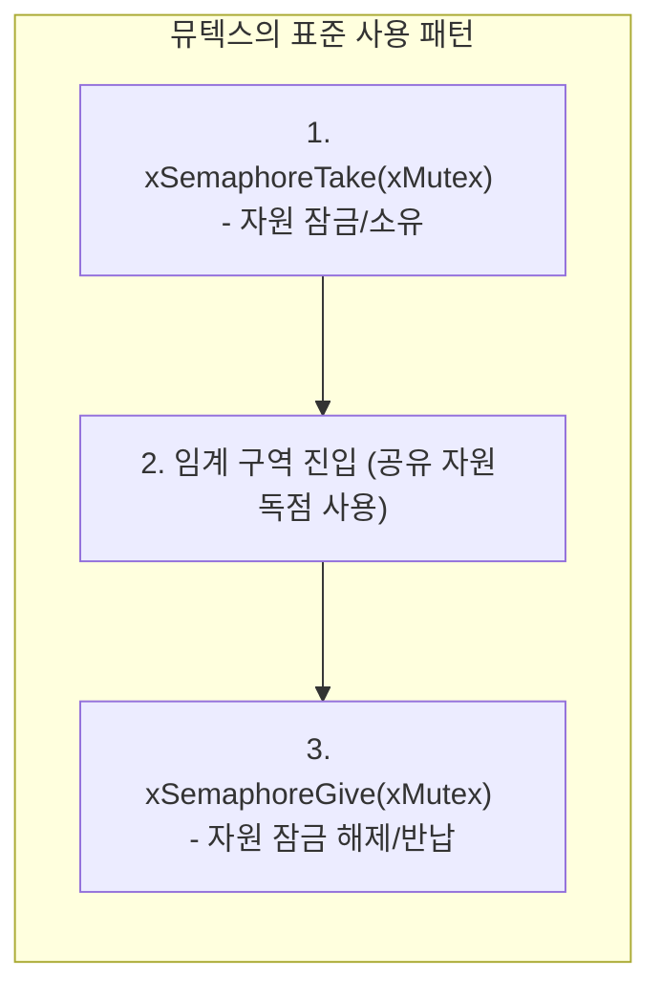
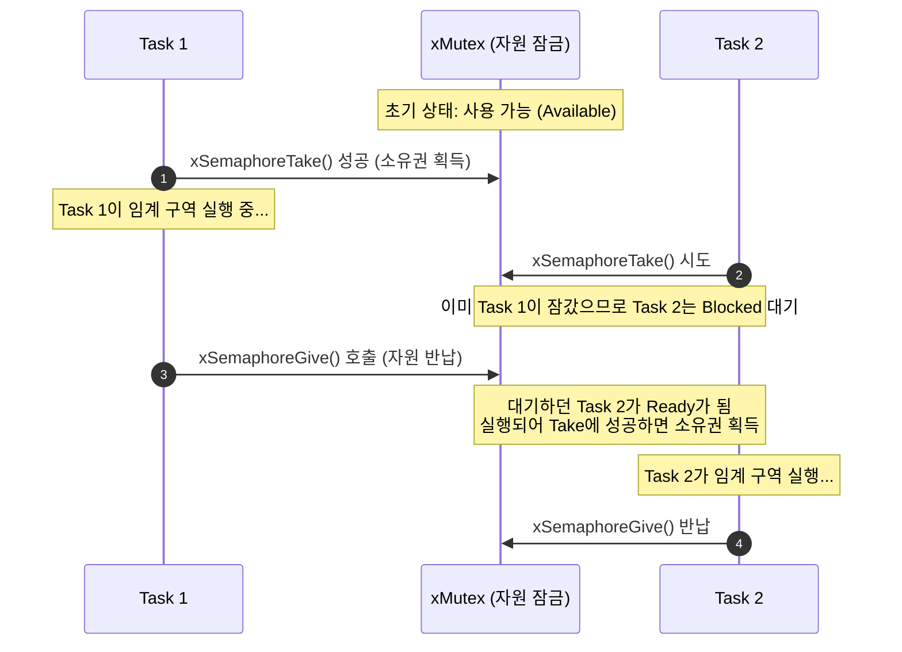

# Tutorial 13: mutex

[학습 목차](README.md) · [공통 준비](getting-started.md) · [공식 튜토리얼 번역](../docs/tutorial_13/README.md) · [이전 단원](tutorial_12.md)

이 단원에서는 공유 자원(Shared Resource)에 여러 task가 동시에 접근할 때 발생하는 데이터 오염을 막고, 오직 한 번에 하나의 task만 안전하게 접근하도록 보장하는 **Mutex(뮤텍스, 상호 배제)**를 배운다.

---

## 1. 이번 실습에서 할 일

* **해결하려는 문제**: 프린터, 직렬 통신 포트, 공유 메모리 등 하나의 task만 독점해야 하는 자원에 여러 task가 동시 접근하는 충돌을 방지한다.
* **학습 목표**:
  1. 상호 배제(Mutual Exclusion)의 개념과 Mutex의 역할을 설명할 수 있다.
  2. `xSemaphoreCreateMutex()`로 뮤텍스를 생성하고, `Take`와 `Give`의 대칭적 호출 구조를 구현한다.
  3. 세마포어(신호 전달, 소유권 없음)와 뮤텍스(자원 보호, **소유권 있음**)의 결정적 차이를 명확히 이해한다.

---

## 2. 시작 전 확인

### 2.1 개념 복습
* **임계 구역 (Critical Section)**: 공유 자원에 접근하는 코드 영역으로, 반드시 한 번에 하나의 실행 흐름만 진입해야 하는 보호 구역이다.
* **소유권 (Ownership)**:
  * Mutex를 `Take`(잠금)한 task는 해당 Mutex의 **소유자(Owner)**가 된다.
  * **자신이 잠근 Mutex는 반드시 자기 자신만이 `Give`(잠금 해제)할 수 있다.** (다른 task가 엉뚱하게 가로채서 잠금을 푸는 행위는 금지된다.)

### 2.2 확인할 소스 및 설정 파일
* 실습 코드: [`source/tutorials/tutorial_13/source/tutorial_13.c`](../../source/tutorials/tutorial_13/source/tutorial_13.c)
* 설정 파일: [`source/tutorials/tutorial_13/include/FreeRTOSConfig.h`](../../source/tutorials/tutorial_13/include/FreeRTOSConfig.h)
  * `configUSE_MUTEXES`가 `1`로 설정되어 있어야 한다.
* 참조 해답: [`ko/guides/solutions/tutorial_13.c`](solutions/tutorial_13.c)

> **실습 형태**: `tutorial_13.c` 내부의 **`TODO 1`부터 `TODO 5`까지 5개의 빈칸을 완성하는 구현 실습**이다.

---

## 3. 개념 이해

### 3.1 세마포어와 뮤텍스 비교

| 비교 항목 | 이진 세마포어 (Binary Semaphore) | 뮤텍스 (Mutex) |
| :--- | :--- | :--- |
| **주요 목적** | **이벤트 신호 전달 및 동기화** ("작업 끝났다") | **공유 자원 상호 배제** ("내가 쓰는 중이니 건들지 마") |
| **소유권 (Ownership)**| **없음** (A task가 기다리고 B task가 신호 발송 가능) | **있음** (A task가 잠갔으면 오직 A task만 풀어야 함) |
| **초기 상태** | 통상 **비어있음 (0)** (신호 기다림) | **사용 가능 (1)** (누구든 먼저 와서 잠글 수 있음) |
| **우선순위 상속** | 없음 (우선순위 역전 버그에 취약) | **내장됨** (우선순위 역전 문제 자동 완화) |



---

## 4. 실행 흐름 읽기

아래는 잠금 경합을 설명하는 개념 흐름이다. 실제 예제에서 매 반복마다 반드시 Task 2가 mutex에서 대기하는 것은 아니다.



---

## 5. 코드와 API 이해

### 5.1 `xSemaphoreCreateMutex()` API
```c
SemaphoreHandle_t xSemaphoreCreateMutex( void );
```
* 뮤텍스를 생성한다. 초기 상태는 **사용 가능(Available, 토큰이 들어있는 상태)**이다.
* 따라서 가장 먼저 `Take`를 호출하는 task는 블록되지 않고 즉시 통과한다.

### 5.2 `Take`와 `Give`의 대칭성
```c
xSemaphoreTake( xMutex, portMAX_DELAY ); /* 1. 진입 전 잠금 */
{
    /* 2. 임계 구역 (공유 자원 접근) */
    fprintf( stderr, "Task 1 is running...\r\n" );
}
xSemaphoreGive( xMutex );                /* 3. 진출 후 반납 */
```
* 자원을 다 썼으면 소유한 task가 `Give`해야 다른 task가 획득할 수 있다. 유한 대기나 `0`을 쓰는 코드에서는 Take 성공을 확인한 경우에만 자원에 접근하고 Give한다. 이 예제는 `INCLUDE_vTaskSuspend=1`에서 `portMAX_DELAY`로 기다린다.

---

## 6. 직접 구현 또는 관찰 준비

전체 참조 해답은 [tutorial_13.c](solutions/tutorial_13.c)에 있다. 먼저 TODO별 힌트를 따라 작성하고, [자기 코드 보존·해답 적용·복구 절차](getting-started.md#solution-workflow)에 따라 비교한다.

`source/tutorials/tutorial_13/source/tutorial_13.c` 파일을 열고 5개의 TODO를 완성한다.

### 6.1 TODO 1: 뮤텍스 생성 (`main` 함수)
71~74행: `xSemaphoreCreateMutex()`를 호출하여 `xMutex`에 대입한다.

* **TODO 1 힌트 1**: 공유 자원 잠금에는 소유권이 있는 객체를 사용한다.
* **TODO 1 힌트 2**: `main`에서 mutex 생성 함수를 호출하여 `xMutex`에 저장한다.

<details>
<summary>TODO 1 해답 코드 보기</summary>

```c
    xMutex = xSemaphoreCreateMutex();
```

**이유**: 공유 자원 잠금에는 소유권이 있는 객체를 사용한다.
</details>

### 6.2 TODO 2 & 3: Task 1의 Take와 Give
101~120행: 임계 구역 전후로 `xSemaphoreTake`와 `xSemaphoreGive`를 작성한다.

* **TODO 2 힌트 1**: Task 1은 출력 구역에 들어가기 전에 mutex를 획득해야 한다.
* **TODO 2 힌트 2**: `prvTask1`의 출력 앞에서 `xMutex`를 `portMAX_DELAY`로 Take한다.
* **TODO 3 힌트 1**: 획득한 task가 자원 사용 뒤 직접 반납한다.
* **TODO 3 힌트 2**: `prvTask1`의 출력 뒤에 같은 mutex를 Give하고 결과를 `xSemaphoreGiveResult`에 저장한다.

<details>
<summary>TODO 2 & 3 해답 코드 보기</summary>

```c
        xSemaphoreTake( xMutex, portMAX_DELAY );

        {
            fprintf( stderr, "Task 1 is running...\r\n" );
        }

        xSemaphoreGiveResult = xSemaphoreGive( xMutex );
```

**이유**: Task 1은 출력 구역에 들어가기 전에 mutex를 획득해야 한다. 획득한 task가 자원 사용 뒤 직접 반납한다.
</details>

### 6.3 TODO 4 & 5: Task 2의 Take와 Give
138~157행: Task 2에도 동일하게 뮤텍스 획득과 반납을 작성한다.

* **TODO 4 힌트 1**: Task 2도 같은 잠금 규칙을 따라야 상호 배제가 된다.
* **TODO 4 힌트 2**: `prvTask2`의 출력 앞에서 Task 1과 같은 `xMutex`를 Take한다. 별도 mutex를 만들지 않는다.
* **TODO 5 힌트 1**: Task 2가 사용을 끝낸 mutex를 반납해야 다음 반복도 진행한다.
* **TODO 5 힌트 2**: `prvTask2`의 출력 뒤 Give하고 검사에 쓰이는 결과 변수에 대입한다. 지연은 잠금 밖에 둔다.

<details>
<summary>TODO 4 & 5 해답 코드 보기</summary>

```c
        xSemaphoreTake( xMutex, portMAX_DELAY );

        {
            fprintf( stderr, "Task 2 is running...\r\n" );
        }

        xSemaphoreGiveResult = xSemaphoreGive( xMutex );
```

**이유**: Task 2도 같은 잠금 규칙을 따라야 상호 배제가 된다. Task 2가 사용을 끝낸 mutex를 반납해야 다음 반복도 진행한다.
</details>

> 전체 완성 코드는 [`ko/guides/solutions/tutorial_13.c`](solutions/tutorial_13.c)에서 확인할 수 있다.

---

## 7. 빌드와 실행

[공통 준비](getting-started.md)의 학습용 사본 루트에서 다음 명령을 실행한다:

```bash
# 1. CMake 빌드 구성 (Tutorial 13 지정)
cmake -S source -B build/tutorial_13 -DTUTORIAL=13

# 2. 컴파일 및 빌드
cmake --build build/tutorial_13

# 3. 바이너리 실행
./build/tutorial_13/freertos_example
```

* **종료 방법**: 터미널에서 **`Ctrl + C`**를 누른다.

---

## 8. 결과 해석

### 8.1 출력 예시

두 task가 같은 mutex로 보호한 구역을 반복 실행한다. 줄별 교대와 처음 실행하는 task는 고정하지 않는다.

```text
Task 1 is running...
Task 2 is running...
Task 1 is running...
Task 2 is running...
```

### 8.2 판정 기준 및 해석
* 두 task가 각각 `vTaskDelay(pdMS_TO_TICKS(1000))`으로 지연하며 로그를 반복한다. 첫 실행 순서와 정확한 간격은 고정하지 않는다. 상호 배제는 두 task가 같은 mutex의 Take/Give로 출력 구역을 감싼 코드에서 확인한다.
* 만약 하나의 task가 뮤텍스를 쥐고 오랫동안 놓아주지 않는다면, 다른 task는 그 시간 동안 `xSemaphoreTake`에서 안전하게 대기 상태(Blocked)를 유지한다.

---

## 9. 막혔을 때 (트러블슈팅)

| 증상 | 원인 | 해결 방법 |
| :--- | :--- | :--- |
| Give 주변에서 출력 없이 멈춤 | 잘못된 소유자 또는 Take/Give 불일치로 assertion 가능성 | 같은 task가 Take에 성공한 mutex를 Give하는지 확인. 이 설정은 assertion 메시지를 출력하지 않음 |
| `Task 1`만 한 번 출력되고 멈춤 | `xSemaphoreGive` 호출이 누락되어 자원이 영원히 잠김 | 임계 구역 직후 반드시 `Give`를 호출했는지 확인 |

---

## 10. 혼자 확인하기 (자가 점검)

### 질문 1 (비교 분석)
Tutorial 12의 이진 세마포어와 Tutorial 13의 뮤텍스는 둘 다 `xSemaphoreTake()`와 `xSemaphoreGive()` 함수를 쓰는데, 생성 직후의 **초기 카운트 값**은 어떻게 다른가?

<details>
<summary>정답 및 해설 확인</summary>

* **정답**:
  * **이진 세마포어**: 초기 카운트가 **`0` (비어있음)**이다. 신호가 발생할 때까지 먼저 기다려야 하기 때문이다.
  * **뮤텍스**: 초기 카운트가 **`1` (사용 가능)**이다. 처음 접근하는 task가 즉시 자원을 획득하고 들어갈 수 있어야 하기 때문이다.
</details>

### 질문 2 (소유권 원칙)
Task A가 뮤텍스를 획득하여 자원을 사용 중인데, 인터럽트 핸들러(ISR)나 다른 Task B에서 `xSemaphoreGive( xMutex );`를 강제로 호출하면 어떻게 되는가?

<details>
<summary>정답 및 해설 확인</summary>

* **정답**: 지원되지 않는 오용이다. 이 구성에서는 소유자 검사 assertion으로 멈출 수 있다. 정상적인 실패 반환을 받아 복구할 수 있다고 가정해서는 안 된다.
* **이유**: 뮤텍스는 **소유권(Ownership)**이 있는 객체이므로, 오직 그 뮤텍스를 획득한 당사자 task만이 반납할 수 있다. 특히 ISR은 task가 아니므로 뮤텍스를 소유할 수 없어 ISR 내부에서는 뮤텍스 API 호출이 전면 금지된다.
</details>

### 질문 3 (조건 변경과 결과 예측)
`prvTask1`의 지연값만 1000ms에서 500ms로 바꾸고 Task 2는 그대로 둔다.

실행 전에 어떤 결과가 달라지고 어떤 동작이 그대로 유지될지 적는다. 직접 작성한 코드와 수정 전 파일은 [공통 보존·복구 절차](getting-started.md#solution-workflow)에 따라 보관한다. 위에서 지정한 조건 하나만 바꾸고 `cmake --build build/tutorial_13` 명령으로 다시 빌드한다. 실행 결과를 예측과 비교한 뒤 아래 해설을 확인한다. 해설은 예상 결과를 설명한 것이므로 직접 얻은 로그와 구분한다.

<details>
<summary>예상 결과와 해설 확인</summary>

Task 1의 출력 빈도가 더 높아질 수 있어 줄별 교대가 깨진다. 두 task가 같은 mutex를 Take/Give하는 보호 규칙은 유지된다.
</details>

**복구와 재확인**: `prvTask1`의 지연 시간을 500ms에서 1000ms로 되돌린다. 같은 단원을 다시 빌드하고 실행하여 [8절의 결과](#8-결과-해석)와 비교한다. 결과를 설명하기 어려우면 [관련 개념 다시 읽기](#5-코드와-api-이해)로 돌아간다.

---

## 11. 다음 학습

뮤텍스를 쓰다 보면 실시간 시스템에서 가장 위험한 버그 중 하나인 **우선순위 역전(Priority Inversion)** 문제와 마주치게 된다.


이제 **[Tutorial 14: 우선순위 역전과 우선순위 상속 (Priority Inversion and Priority Inheritance)](tutorial_14.md)**으로 넘어가서, 뮤텍스의 우선순위 상속이 어떤 대기를 완화하고 어떤 한계가 있는지 살펴본다.

* **한국어 커널북 심화 읽기**:
  * [8.3장: mutex (상호 배제)](https://github.com/yunju-baek/FreeRTOS-Kernel-Book-ko/blob/27d03c61cd2a6cf5a6fa6333082218ef706f5b89/ko/ch08.md)
