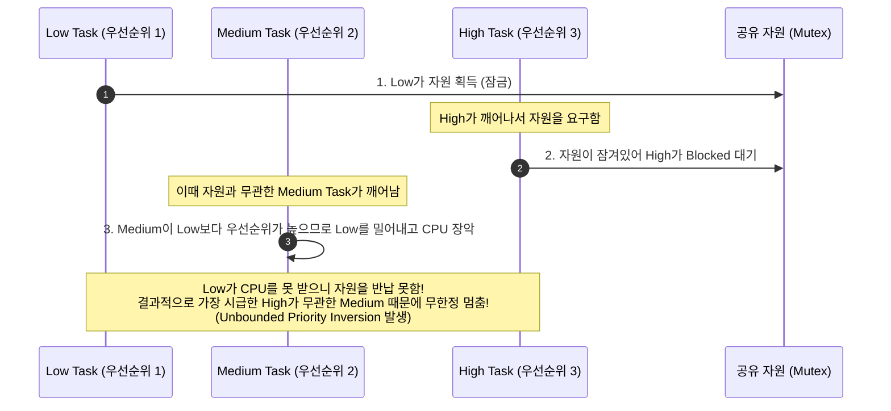
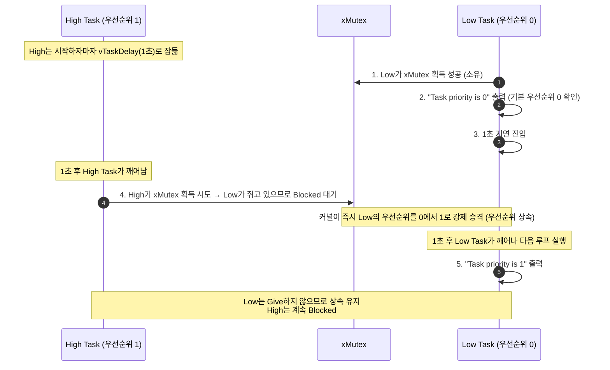

# Tutorial 14: 우선순위 역전과 우선순위 상속 (Priority Inversion and Priority Inheritance)

[학습 목차](README.md) · [공통 준비](getting-started.md) · [공식 튜토리얼 번역](../docs/tutorial_14/README.md) · [이전 단원](tutorial_13.md)

이 단원에서는 공유 자원을 동기화할 때 발생할 수 있는 가장  실시간 시스템 결함인 **우선순위 역전(Priority Inversion)**과, FreeRTOS 뮤텍스가 이를 방어하기 위해 제공하는 **우선순위 상속(Priority Inheritance)** 메커니즘을 관찰한다.

---

## 1. 이번 실습에서 할 일

* **해결하려는 문제**: 낮은 우선순위 task가 점유한 뮤텍스 때문에 높은 우선순위 task가 실행을 차단당하는 역전 현상의 위험성을 이해한다.
* **학습 목표**:
  1. 우선순위 역전(Priority Inversion)과 유계 없는 역전(Unbounded Priority Inversion)의 발생 경로를 설명할 수 있다.
  2. FreeRTOS 뮤텍스에 내장된 **우선순위 상속(Priority Inheritance)**에 의해 하위 task의 우선순위가 일시적으로 승격(`0 → 1`)되는 과정을 직접 확인한다.
  3. `uxTaskPriorityGet()` API를 통해 task의 현재 유효 우선순위를 동적으로 모니터링한다.

---

## 2. 시작 전 확인

### 2.1 개념 복습
* **우선순위 역전 (Priority Inversion)**: 높은 우선순위 task(H)가 실행되어야 함에도 불구하고, 낮은 우선순위 task(L)가 쥔 자원을 기다리느라 엉뚱한 중간 우선순위 task(M)가 먼저 실행되어 시스템의 우선순위 질서가 뒤집히는 현상이다.
* 이 단원의 실습에는 High와 Low 두 task만 있다. 아래 Medium이 등장하는 그림은 일반적인 역전 원리를 설명하는 별도 사례다.

### 2.2 확인할 소스 및 설정 파일
* 실습 코드: [`source/tutorials/tutorial_14/source/tutorial_14.c`](../../source/tutorials/tutorial_14/source/tutorial_14.c)
* 설정 파일: [`source/tutorials/tutorial_14/include/FreeRTOSConfig.h`](../../source/tutorials/tutorial_14/include/FreeRTOSConfig.h)

> **실습 형태**: 이 단원은 코드가 사전에 완성되어 있는 **관찰 및 동적 상태 분석 실습**이다.

---

## 3. 개념 이해

### 3.1 task 세 개로 살펴보는 우선순위 역전
우선순위 상속이 없는 잠금을 사용하고 task 3개가 있다고 가정한다. 실제 FreeRTOS mutex의 상속 효과는 다음 절에서 비교한다:
* **H (High)**: 긴급 제어 작업 (우선순위 3)
* **M (Medium)**: 긴 연산 작업 (우선순위 2)
* **L (Low)**: 센서 로깅 작업 (우선순위 1)



### 3.2 해결책: 우선순위 상속 (Priority Inheritance)
FreeRTOS의 Mutex는 이 문제를 방어하기 위해 **우선순위 상속** 알고리즘을 기본 내장하고 있다:

> **"높은 우선순위 task(H)가 자원을 기다리며 Blocked 상태에 빠지면, 해당 자원을 쥐고 있는 낮은 우선순위 task(L)의 우선순위를 일시적으로 H의 우선순위로 끌어올린다"**

* **효과**: Low Task의 우선순위가 순간적으로 High와 같아지므로, 중간 우선순위인 Medium Task가 선점하지 못한다. Low가 자원을 처리할 실행 기회를 얻도록 돕는다. 하지만 상속이 자원을 자동 반납하거나 교착을 해소하지는 않는다. 여러 mutex를 소유한 FreeRTOS task는 모두 반납할 때까지 상속 우선순위를 유지할 수 있다.

---

## 4. 실행 흐름 읽기

`tutorial_14.c`에서는 Low가 자신의 우선순위를 출력하여 상속에 따른 상승을 관찰한다. **Low에는 `xSemaphoreGive()`가 없다.** 따라서 High는 Take에서 계속 Blocked이며 이 실습은 정상적인 자원 반납이나 High의 재개를 보여 주지 않는다:



---

## 5. 코드와 API 이해

`source/tutorials/tutorial_14/source/tutorial_14.c`의 핵심 코드:

### 5.1 High Task
```c
static void prvHighPriorityTask( void * pvParams )
{
    for( ;; )
    {
        /* 1. Low Task가 먼저 뮤텍스를 잡을 수 있도록 1초 잠듦 */
        vTaskDelay( pdMS_TO_TICKS( 1000 ) );

        /* 2. 깨어나서 뮤텍스 요구 → Low가 쥐고 있으므로 Blocked 됨! */
        xSemaphoreTake( xMutex, portMAX_DELAY );
    }
}
```

### 5.2 Low Task
```c
static void prvLowPriorityTask( void * pvParams )
{
    /* 1. 시작하자마자 뮤텍스를 먼저 획득 */
    xSemaphoreTake( xMutex, portMAX_DELAY );

    for( ;; )
    {
        /* 2. 자신의 현재 유효 우선순위를 출력 */
        fprintf( stderr, "Task priority is %lu\r\n", uxTaskPriorityGet( NULL ) );

        vTaskDelay( pdMS_TO_TICKS( 1000 ) );
    }
}
```
* `uxTaskPriorityGet( NULL )`: `NULL`을 넘기면 호출한 task의 현재 유효 우선순위를 반환한다.
* Low가 지연 중이면 상속받아도 여전히 Blocked다. 지연이 끝나 Ready가 된 뒤 높은 유효 우선순위로 선택된다.

---

## 6. 직접 구현 또는 관찰 준비

* **실행 전 예측 질문**:
  1. Low Task의 첫 번째 출력은 어떤 우선순위 숫자가 찍힐까?
  2. High Task가 뮤텍스를 얻으려고 시도하여 대기 상태에 들어간 뒤, 그 뒤 Low의 출력은 어떤 우선순위를 보여 줄까? Low가 반납하지 않으면 High는 어디에 머무는가?

---

## 7. 빌드와 실행

[공통 준비](getting-started.md)의 학습용 사본 루트에서 다음 명령을 실행한다:

```bash
# 1. CMake 빌드 구성 (Tutorial 14 지정)
cmake -S source -B build/tutorial_14 -DTUTORIAL=14

# 2. 컴파일 및 빌드
cmake --build build/tutorial_14

# 3. 바이너리 실행
./build/tutorial_14/freertos_example
```

* **종료 방법**: 터미널에서 **`Ctrl + C`**를 누른다.

---

## 8. 결과 해석

### 8.1 출력 예시

기본 우선순위 0에서 상속된 1로 바뀐 뒤 유지되는 관계를 확인한다. 기본값이 출력되는 줄 수나 상승 시점을 고정하지 않는다.

```text
Task priority is 0
Task priority is 1
Task priority is 1
Task priority is 1
Task priority is 1
```

### 8.2 출력 결과 정밀 분석
* **첫 번째 줄 (`Task priority is 0`)**:
  * High Task가 아직 `vTaskDelay(1000)`로 잠들어 있는 동안, Low Task는 자신의 본래 기본 우선순위인 `0`으로 실행되었다.
* **두 번째 줄 이후 (`Task priority is 1`)**:
  * 1초 뒤 High Task가 깨어나 `xMutex`를 잡으려다 실패하여 Blocked 상태로 대기하자, **커널이 Low Task의 우선순위를 High의 우선순위인 `1`로 즉시 승격(상속)**시켰다
  * 따라서 `uxTaskPriorityGet(NULL)` 결과가 `1`로 바뀌어 출력되는 것이다.

---

## 9. 막혔을 때 (트러블슈팅)

| 증상 | 원인 | 해결 방법 |
| :--- | :--- | :--- |
| 충분히 기다려도 계속 `0`만 출력 | High가 Take까지 도달하지 않았거나 대상 객체·우선순위가 다를 수 있음 | High 생성과 시작 지연, 같은 `xMutex` 사용, 우선순위 1을 확인. High가 획득하지 못해 대기하는 것은 원래 상속 조건임 |
| 다른 단원 문자열 출력 | 실행 경로·구성 불일치 가능성 | `build/tutorial_14` 실행 경로와 7절의 구성 명령 확인 |

---

## 10. 혼자 확인하기 (자가 점검)

### 질문 1 (개념)
우선순위 상속(Priority Inheritance)이 상호 배제 뮤텍스(Mutex)에는 내장되어 있지만, 이진 세마포어(Binary Semaphore)에는 내장될 수 없는 이유는 무엇인가?

<details>
<summary>정답 및 해설 확인</summary>

* **정답**: 이진 세마포어에는 **소유권(Ownership)의 개념이 없기 때문**이다.
* **이유**: 세마포어는 "누가 신호를 쥐고 있는지" 커널이 알 수 없고 알 필요도 없다. 반면 뮤텍스는 어떤 task가 `Take`했는지 TCB 소유자 포인터가 명확히 기록되므로, 상위 task가 대기할 때 "어느 task의 우선순위를 올려주어야 하는지" 대상을 정확히 특정할 수 있다.
</details>

### 질문 2 (한계 인식)
우선순위 상속은 우선순위 역전 문제를 "완전히 없애주는 것"인가, 아니면 "피해를 최소화하는 것"인가?

<details>
<summary>정답 및 해설 확인</summary>

* **정답**: **피해를 최소화하는 완화책(Mitigation)**이다.
* **이유**: 하위 task가 자원을 반납할 때까지 상위 task가 기다려야 한다는 본질적인 '역전' 자체는 자원 독점 규칙상 피할 수 없다. 우선순위 상속은 중간 우선순위 task에 의한 지연을 완화한다. 실제 대기 시간의 상한은 자원 보유 시간과 중첩 잠금 등으로 따로 분석해야 한다. 이 원본은 Low가 영구 보유하므로 High가 끝내 진행하지 못한다.
</details>

### 질문 3 (조건 변경과 결과 예측)
`prvHighPriorityTask`의 시작 지연만 1000ms에서 2000ms로 바꾸고 Low의 지연은 유지한다.

실행 전에 어떤 결과가 달라지고 어떤 동작이 그대로 유지될지 적는다. 직접 작성한 코드와 수정 전 파일은 [공통 보존·복구 절차](getting-started.md#solution-workflow)에 따라 보관한다. 위에서 지정한 조건 하나만 바꾸고 `cmake --build build/tutorial_14` 명령으로 다시 빌드한다. 실행 결과를 예측과 비교한 뒤 아래 해설을 확인한다. 해설은 예상 결과를 설명한 것이므로 직접 얻은 로그와 구분한다.

<details>
<summary>예상 결과와 해설 확인</summary>

High가 Take를 시도하는 시점이 늦어져 Low가 기본 우선순위 0을 더 오래 유지할 것으로 예상한다. 이후 1을 상속해도 Low는 Give하지 않고 High는 계속 Blocked다. 0이 찍히는 줄 수를 고정하지 않는다.
</details>

**복구와 재확인**: `prvHighPriorityTask`가 시작할 때 적용하는 지연 시간을 2000ms에서 1000ms로 되돌린다. 같은 단원을 다시 빌드하고 실행하여 [8절의 결과](#8-결과-해석)와 비교한다. 결과를 설명하기 어려우면 [관련 개념 다시 읽기](#4-실행-흐름-읽기)로 돌아간다.

---

## 11. 다음 학습

큐, 타이머, 세마포어와 뮤텍스의 역할 및 우선순위 상속을 살펴보았다.
하지만 지금까지의 동기화는 "단 하나의 사건(Event)"만 다루었다. 만약 "여러 개의 복합 조건이 동시에 만족되었을 때(예: 배터리 정상 AND SD카드 장착 AND 네트워크 연결)" task를 깨우고 싶다면 어떻게 해야 할까?

이제 **[Tutorial 15: event group을 통한 이벤트 관리 (Event Management using Event Groups)](tutorial_15.md)**으로 넘어가서, 이 예제 설정에서 24개의 사용자 비트 플래그를 제공하는 **Event Group**을 배운다.

* **한국어 커널북 심화 읽기**:
  * [8.3.2장: 우선순위 역전 (Priority Inversion)](https://github.com/yunju-baek/FreeRTOS-Kernel-Book-ko/blob/27d03c61cd2a6cf5a6fa6333082218ef706f5b89/ko/ch08.md)
  * [8.3.3장: 우선순위 상속 (Priority Inheritance)](https://github.com/yunju-baek/FreeRTOS-Kernel-Book-ko/blob/27d03c61cd2a6cf5a6fa6333082218ef706f5b89/ko/ch08.md)
