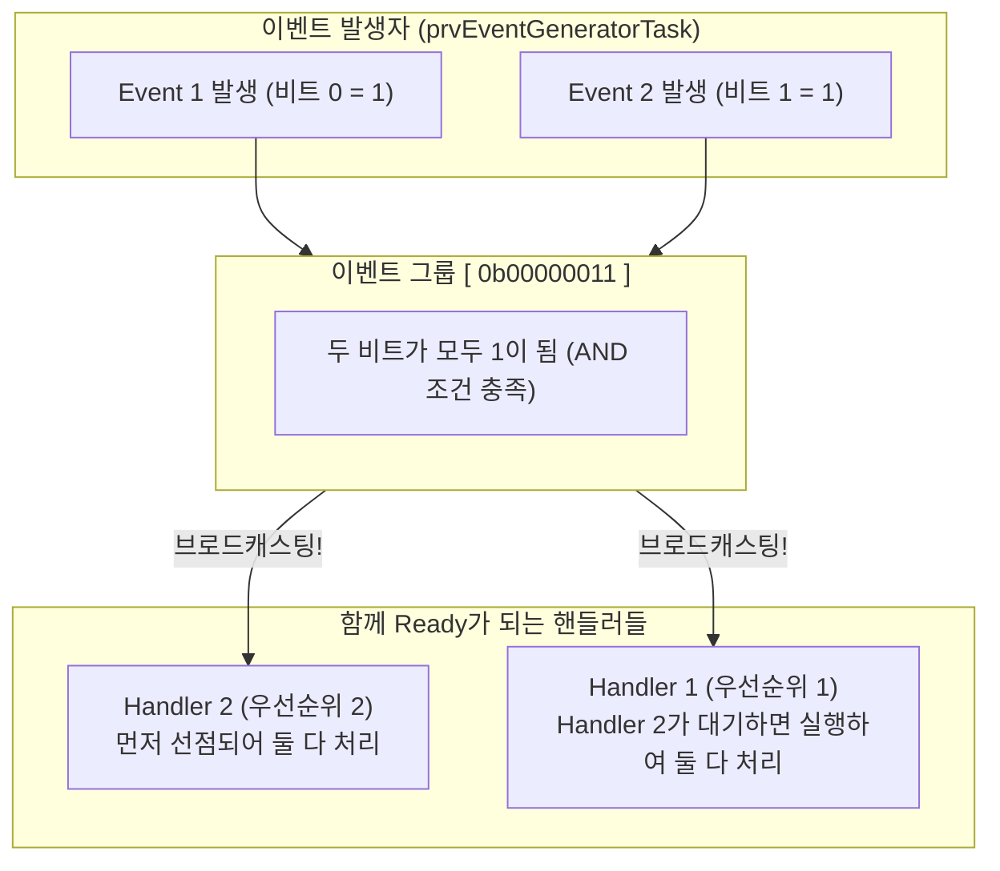
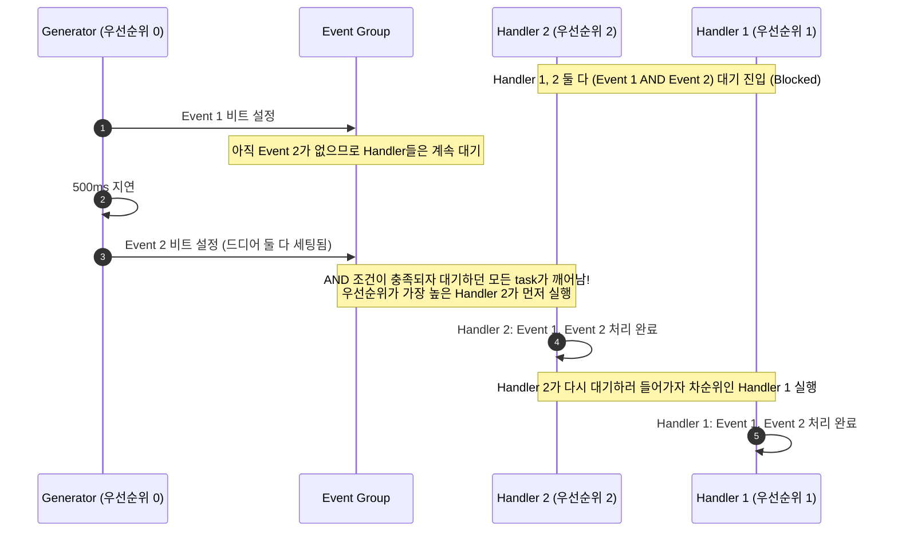

# Tutorial 15: event group을 통한 이벤트 관리 (Event Management using Event Groups)

[학습 목차](README.md) · [공통 준비](getting-started.md) · [공식 튜토리얼 번역](../docs/tutorial_15/README.md) · [이전 단원](tutorial_14.md)

이 단원에서는 여러 개의 복합적인 사건(이벤트)을 비트 플래그로 묶어서 관리하고, 여러 task에 이벤트를 동시에 전파(브로드캐스팅)할 수 있는 **event group(이벤트 그룹)**을 배운다.

---

## 1. 이번 실습에서 할 일

* **해결하려는 문제**: 큐 한 항목이나 세마포어 한 토큰은 한 수신자가 소비한다. 여러 비트의 조합(AND/OR 조건)을 기다리고, 조건을 만족했을 때 대기 중이던 여러 task를 한꺼번에 깨우는 고급 동기화를 구현한다.
* **학습 목표**:
  1. 이벤트 그룹의 비트 플래그 구조(`EventBits_t`)와 큐/세마포어 대비 2대 차이점을 설명할 수 있다.
  2. `xEventGroupCreate()`, `xEventGroupSetBits()`, `xEventGroupWaitBits()` API를 활용해 생성, 비트 설정, 복합 대기를 구현한다.
  3. `xWaitForAllBits` 매개변수(`pdTRUE` = AND 조건, `pdFALSE` = OR 조건)와 `xClearOnExit`의 동작을 이해한다.

---

## 2. 시작 전 확인

### 2.1 C 언어 비트 연산 복습
* **비트 마스크 (Bitmask)**:
  * `EVENT_1_BIT ( 1UL << 0UL )` → `0b00000001` (10진수 1)
  * `EVENT_2_BIT ( 1UL << 1UL )` → `0b00000010` (10진수 2)
  * 비트 결합(OR): `( EVENT_1_BIT | EVENT_2_BIT )` → `0b00000011` (10진수 3)
  * 특정 비트 검사(AND): `if( ( value & EVENT_1_BIT ) != 0 )` → 1번 비트가 1인지 판별

### 2.2 확인할 소스 및 설정 파일
* 실습 코드: [`source/tutorials/tutorial_15/source/tutorial_15.c`](../../source/tutorials/tutorial_15/source/tutorial_15.c)
* 설정 파일: [`source/tutorials/tutorial_15/include/FreeRTOSConfig.h`](../../source/tutorials/tutorial_15/include/FreeRTOSConfig.h)
* 참조 해답: [`ko/guides/solutions/tutorial_15.c`](solutions/tutorial_15.c)

> **실습 형태**: `tutorial_15.c` 내부의 **`TODO 1`부터 `TODO 5`까지 5개의 빈칸을 완성하는 구현 실습**이다.

---

## 3. 개념 이해

### 3.1 큐·세마포어와 이벤트 그룹의 2대 결정적 차이

1. **복합 조건 대기 (AND / OR 조건)**:
   * 세마포어는 오직 1개의 신호만 기다릴 수 있다.
   * 이벤트 그룹은 "Event 1 또는 Event 2 중 아무거나 발생(OR)"하거나, "Event 1과 Event 2가 **둘 다 모두 발생(AND)**"할 때까지 Blocked 상태로 대기할 수 있다.
2. **다중 task 동시 기상 (브로드캐스팅)**:
   * 큐나 세마포어는 신호가 들어오면 대기 중이던 여러 task 중 **단 하나만** 깨운다 (토큰 소모).
   * 이벤트 그룹은 조건이 충족되면 그 비트 설정으로 조건을 만족한 대기 task들을 함께 Ready로 만든다. 단일 코어에서는 이들이 동시에 실행하는 것이 아니라 우선순위에 따라 하나씩 실행한다.



---

## 4. 실행 흐름 읽기



---

## 5. 코드와 API 이해

### 5.1 `xEventGroupCreate()` API
```c
EventGroupHandle_t xEventGroupCreate( void );
```
* 이벤트 그룹을 생성한다. 사용 가능한 비트 수는 CPU 비트 수가 아니라 커널의 tick-width 설정에 의해 결정된다. 16·32·64비트 설정에서 제어용 8비트를 제외한 8·24·56비트를 쓴다. 이 예제의 설정은 사용자 비트 24개다. POSIX 호스트가 64비트라는 이유만으로 56개를 사용할 수 있는 것은 아니다. 초기값은 모든 비트가 0이다.

### 5.2 `xEventGroupSetBits()` API
```c
EventBits_t xEventGroupSetBits( EventGroupHandle_t xEventGroup,
                                const EventBits_t uxBitsToSet );
```
* 지정한 비트를 `1`로 세팅한다. (기존 비트들은 그대로 유지되고 `uxBitsToSet` 비트들만 1로 켜짐).

### 5.3 `xEventGroupWaitBits()` API
```c
EventBits_t xEventGroupWaitBits( EventGroupHandle_t xEventGroup,
                                 const EventBits_t uxBitsToWaitFor,
                                 const BaseType_t xClearOnExit,
                                 const BaseType_t xWaitForAllBits,
                                 TickType_t xTicksToWait );
```
* `uxBitsToWaitFor`: 기다릴 비트들의 OR 마스크 (`EVENT_1_BIT | EVENT_2_BIT`).
* `xClearOnExit`: `pdTRUE`로 주면 조건을 충족하여 깨어날 때 해당 비트들을 자동으로 0으로 클리어해 준다.
* `xWaitForAllBits`:
  * `pdTRUE` (AND): 지정한 모든 비트가 다 1이 되어야 깨어남.
  * `pdFALSE` (OR): 지정한 비트 중 하나라도 1이 되면 깨어남.
* **반환값**: 조건 충족 시 클리어하기 전 비트 값이다. 유한 대기가 만료된 경우에도 비트 값을 반환하므로 필요한 마스크를 검사하여 성공을 판단한다. 이 예제의 `portMAX_DELAY`는 설정상 무기한 대기다.

---

## 6. 직접 구현 또는 관찰 준비

전체 참조 해답은 [tutorial_15.c](solutions/tutorial_15.c)에 있다. 먼저 TODO별 힌트를 따라 작성하고, [자기 코드 보존·해답 적용·복구 절차](getting-started.md#solution-workflow)에 따라 비교한다.

`source/tutorials/tutorial_15/source/tutorial_15.c` 파일을 열고 5개의 TODO를 완성한다.

### 6.1 TODO 1: 이벤트 그룹 생성 (`main` 함수)
87~90행: `xEventGroupCreate()`를 호출하여 `xEventGroup`에 대입한다.

* **TODO 1 힌트 1**: 두 핸들러와 발생자는 같은 이벤트 그룹을 공유한다.
* **TODO 1 힌트 2**: `main`에서 인자 없는 생성 함수의 반환값을 `xEventGroup`에 저장한다.

<details>
<summary>TODO 1 해답 코드 보기</summary>

```c
    xEventGroup = xEventGroupCreate();
```

**이유**: 두 핸들러와 발생자는 같은 이벤트 그룹을 공유한다.
</details>

### 6.2 TODO 2 & 3: 이벤트 비트 세팅 (`prvEventGeneratorTask`)
118~139행: `EVENT_1_BIT`와 `EVENT_2_BIT`를 순차적으로 세팅한다.

* **TODO 2 힌트 1**: 첫 사건은 그 사건에 대응하는 비트만 켜야 한다.
* **TODO 2 힌트 2**: Generator의 첫 TODO에서 `EVENT_1_BIT`를 같은 그룹에 SetBits한다.
* **TODO 3 힌트 1**: 두 번째 사건의 비트를 추가하면 AND 조건이 완성된다.
* **TODO 3 힌트 2**: Generator의 지연 뒤 TODO에서 `EVENT_2_BIT`를 SetBits한다. 기존 첫 비트를 덮어쓰는 대입이 아니다.

<details>
<summary>TODO 2 & 3 해답 코드 보기</summary>

```c
        /* TODO 2 */
        xEventGroupSetBits( xEventGroup, EVENT_1_BIT );

        vTaskDelay( pdMS_TO_TICKS( 500 ) );

        /* TODO 3 */
        xEventGroupSetBits( xEventGroup, EVENT_2_BIT );
```

**이유**: 첫 사건은 그 사건에 대응하는 비트만 켜야 한다. 두 번째 사건의 비트를 추가하면 AND 조건이 완성된다.
</details>

### 6.3 TODO 4 & 5: 이벤트 복합 대기 (`prvEventHandlerTask1 & 2`)
158~168행, 193~203행: 두 핸들러 task 모두 AND 조건(`pdTRUE`)과 자동 클리어(`pdTRUE`)로 대기한다.

* **TODO 4 힌트 1**: Handler 1은 두 사건이 모두 올 때까지 기다리고 받은 비트를 검사한다.
* **TODO 4 힌트 2**: 대기 마스크는 두 비트의 OR다. 자동 클리어·모든 비트 대기 인자를 모두 참으로 하고 반환값을 `xEventBitsValue`에 저장한다.
* **TODO 5 힌트 1**: Handler 2에도 같은 조건을 적용해야 같은 설정에서 두 대기가 풀린다.
* **TODO 5 힌트 2**: Handler 2의 WaitBits에도 같은 마스크·두 참 인자·`portMAX_DELAY`를 전달하고 자기 지역 변수에 결과를 저장한다.

<details>
<summary>TODO 4 & 5 해답 코드 보기</summary>

```c
        xEventBitsValue = xEventGroupWaitBits( xEventGroup,
                                               ( EVENT_1_BIT | EVENT_2_BIT ),
                                               pdTRUE,
                                               pdTRUE,
                                               portMAX_DELAY );
```

**이유**: Handler 1은 두 사건이 모두 올 때까지 기다리고 받은 비트를 검사한다. Handler 2에도 같은 조건을 적용해야 같은 설정에서 두 대기가 풀린다.
</details>

> 전체 완성 코드는 [`ko/guides/solutions/tutorial_15.c`](solutions/tutorial_15.c)에서 확인할 수 있다.

---

## 7. 빌드와 실행

[공통 준비](getting-started.md)의 학습용 사본 루트에서 다음 명령을 실행한다:

```bash
# 1. CMake 빌드 구성 (Tutorial 15 지정)
cmake -S source -B build/tutorial_15 -DTUTORIAL=15

# 2. 컴파일 및 빌드
cmake --build build/tutorial_15

# 3. 바이너리 실행
./build/tutorial_15/freertos_example
```

* **종료 방법**: 터미널에서 **`Ctrl + C`**를 누른다.

---

## 8. 결과 해석

### 8.1 출력 예시

두 사건이 모두 설정된 뒤 Handler 2와 Handler 1이 처리한다. 명목 지연 500ms를 정확한 벽시계 간격으로 보지 않는다.

```text
Generating event 1...
Generating event 2...
Handler Task 2: Handling  event 1...
Handler Task 2: Handling  event 2...
Handler Task 1: Handling  event 1...
Handler Task 1: Handling  event 2...
Generated both the events...
```

### 8.2 출력 순서 정밀 분석
* `Generating event 1...` 직후에는 Handler들이 전혀 깨어나지 않는다 (AND 조건 미충족)
* 500ms 뒤 `Generating event 2...`가 호출되는 순간, **우선순위가 가장 높은 Handler Task 2가 먼저 깨어나 Event 1, 2를 처리**하고, 이어서 **Handler Task 1도 깨어나 Event 1, 2를 모두 처리**한다.
* 두 번째 비트 설정이 두 대기의 AND 조건을 모두 만족시킨다. 반환값에는 각 task가 해석할 비트가 보존되므로 자동 클리어를 사용해도 두 핸들러가 처리할 수 있다.

---

## 9. 막혔을 때 (트러블슈팅)

| 증상 | 원인 | 해결 방법 |
| :--- | :--- | :--- |
| Event 1만 발생했는데 핸들러가 깨어남 | `xWaitForAllBits`에 `pdTRUE` 대신 `pdFALSE`(OR)를 전달했음 | 4번째 인자를 `pdTRUE`로 수정 |
| 한 핸들러만 깨어나고 다른 핸들러는 안 깨어남 | `xEventGroupWaitBits` 인자 불일치 | 두 핸들러의 대기 인자가 동일한지 확인 |

---

## 10. 혼자 확인하기 (자가 점검)

### 질문 1 (개념)
`xEventGroupWaitBits()`의 4번째 인자 `xWaitForAllBits`를 `pdFALSE`로 바꾸면 핸들러 task들은 언제 깨어나는가?

<details>
<summary>정답 및 해설 확인</summary>

* **정답**: Event 1 또는 Event 2 중 **어느 하나라도 먼저 세팅되는 순간(OR 조건)** 즉시 깨어난다.
* **설명**: `pdFALSE`는 지정한 비트 마스크 중 단 하나라도 1이 되면 대기를 해제하라는 의미이기 때문이다.
</details>

### 질문 2 (세마포어와의 브로드캐스팅 비교)
만약 이 예제를 이벤트 그룹 대신 이진 세마포어로 구현하여 세마포어를 한 번 Give 했다면, Handler 1과 Handler 2가 모두 깨어날 수 있는가?

<details>
<summary>정답 및 해설 확인</summary>

* **정답**: 절대 불가능하다.
* **이유**: 세마포어는 신호를 1회 획득(Take)하면 카운트가 0으로 소모되므로, 우선순위가 더 높은 Handler 2 혼자만 깨어나고 Handler 1은 계속 잠들어 있게 된다. 이벤트 그룹에서는 같은 비트 설정으로 여러 대기 조건을 함께 만족시킬 수 있다.
</details>

### 질문 3 (한 조건 변형과 실행 추적)
Generator의 두 비트 설정 사이 첫 번째 지연만 500ms에서 1000ms로 바꾼다. 두 번째 지연은 유지한다.

실행 전에 바뀔 결과와 유지될 조건을 각각 적는다. 자기 풀이와 변경 전 파일은 [공통 보존·복구 절차](getting-started.md#solution-workflow)로 남긴다. 한 조건만 수정하고 `cmake --build build/tutorial_15`으로 다시 빌드한 뒤 실행해 예측과 비교한다. 아래 해설은 변형의 예상 결과이며, 직접 얻은 로그와 구분한다.

<details>
<summary>예상 결과와 해설 확인</summary>

두 핸들러의 AND 조건 충족이 늦어진다. 첫 비트만 설정되었을 때는 처리하지 않고 두 번째 비트 뒤 두 핸들러가 처리하는 관계는 유지된다.
</details>

**복구와 재확인**: 변경한 한 값(추가한 코드라면 그 한 줄)을 원래대로 돌리고 같은 단원을 다시 빌드·실행한다. 원래 조건의 8절 결과와 비교한다. 설명이 어려우면 [관련 개념 다시 읽기](#4-실행-흐름-읽기)로 돌아간다.

---

## 11. 다음 학습

이벤트 그룹을 통한 이벤트 관리와 브로드캐스팅을 배웠다.
이벤트 그룹의 또 다른 강력한 기능은, 여러 task가 각자의 초기화나 연산을 마친 뒤 **"모든 task가 약속 장소에 다 모일 때까지 아무도 출발하지 않는" 랑데부(장벽, Barrier) 동기화**다.

이제 **[Tutorial 16: event group을 통한 task 동기화 (Task Synchronization using Event Groups)](tutorial_16.md)**으로 넘어가서 `xEventGroupSync()`의 동작을 살펴본다.

* **한국어 커널북 심화 읽기**:
  * [9.2장: event group의 특성](https://github.com/yunju-baek/FreeRTOS-Kernel-Book-ko/blob/27d03c61cd2a6cf5a6fa6333082218ef706f5b89/ko/ch09.md)
  * [9.3장: event group을 이용한 이벤트 관리](https://github.com/yunju-baek/FreeRTOS-Kernel-Book-ko/blob/27d03c61cd2a6cf5a6fa6333082218ef706f5b89/ko/ch09.md)
