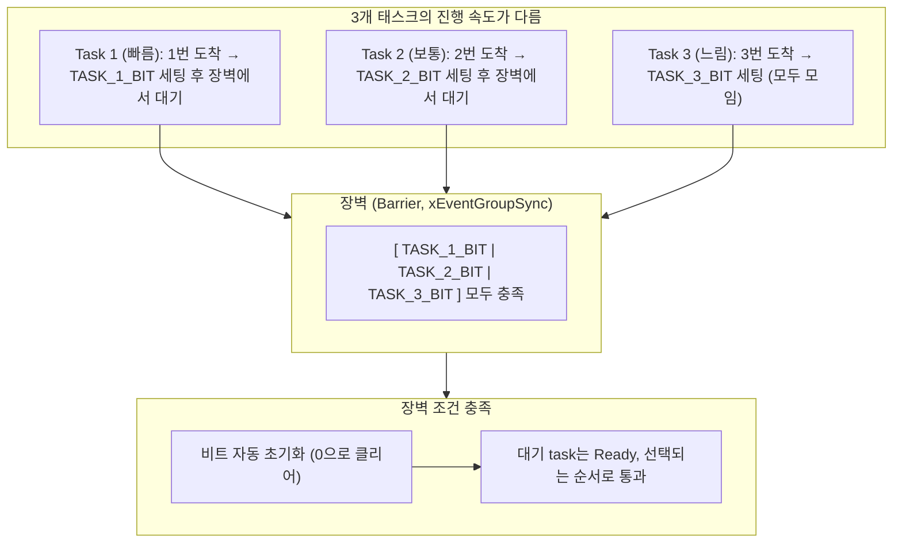
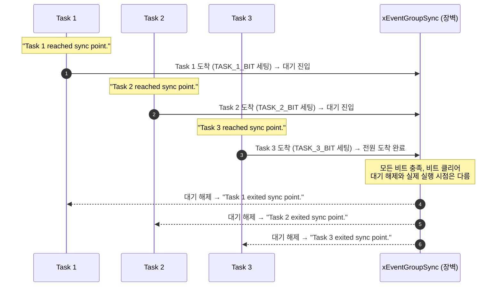

# Tutorial 16: event group을 통한 task 동기화 (Task Synchronization using Event Groups)

[학습 목차](README.md) · [공통 준비](getting-started.md) · [공식 튜토리얼 번역](../docs/tutorial_16/README.md) · [이전 단원](tutorial_15.md)

이 단원에서는 작업을 나누어 수행하는 여러 task가 각자의 작업을 마친 뒤, **모든 task가 약속된 동기화 지점(Sync Point)에 다 도착할 때까지 대기했다가 모두 도착하면 다음 단계로 진행할 수 있게 되는 장벽 동기화(Barrier / Rendezvous Synchronization)**를 배운다.

---

## 1. 이번 실습에서 할 일

* **해결하려는 문제**: 3개의 task(예: 센서 초기화, 통신망 접속, 파일시스템 마운트)가 각자 걸리는 시간이 다를 때, 모든 초기화가 끝난 뒤에만 다음 작업을 시작하도록 한다.
* **학습 목표**:
  1. 랑데부(Rendezvous) 또는 장벽(Barrier) 동기화의 개념과 필요성을 설명할 수 있다.
  2. `xEventGroupSync()` API를 사용하여 각 task가 "나 도착했다"고 알리는 동시에 "다른 모든 task의 도착"을 대기하는 원자적(Atomic) 동작을 구현한다.
  3. 모든 task가 동기화 지점에 도달했을 때 비트가 자동으로 클리어되며 대기가 풀린 뒤 차례로 실행하는 과정을 관찰한다.

---

## 2. 시작 전 확인

### 2.1 개념 복습
* **장벽 동기화 (Barrier Synchronization)**: 육상 경기에서 모든 선수가 출발선에 설 때까지 출발 신호를 주지 않는 것처럼, 지정된 모든 task가 동기화 지점에 도달할 때까지 먼저 도착한 task들을 대기시키는 기법이다.
* **Rendezvous(랑데부)**: 우주선 도킹처럼 서로 다른 궤도를 돌던 독립적인 task들이 정확히 한 시점에 만나는 약속 지점을 뜻한다.

### 2.2 확인할 소스 및 설정 파일
* 실습 코드: [`source/tutorials/tutorial_16/source/tutorial_16.c`](../../source/tutorials/tutorial_16/source/tutorial_16.c)
* 설정 파일: [`source/tutorials/tutorial_16/include/FreeRTOSConfig.h`](../../source/tutorials/tutorial_16/include/FreeRTOSConfig.h)
* 참조 해답: [`ko/guides/solutions/tutorial_16.c`](solutions/tutorial_16.c)

> **실습 형태**: `tutorial_16.c` 내부의 **`TODO 1`부터 `TODO 4`까지 4개의 빈칸을 완성하는 구현 실습**이다.

---

## 3. 개념 이해

### 3.1 `xEventGroupSync`의 원자적 동작

다음 그림의 빠름·보통·느림은 도착 순서의 개념 예시다. 원본은 세 task 모두 같은 1000ms 지연을 사용하며 고정된 속도 순위를 지정하지 않는다.
만약 이 기능을 `SetBits()`와 `WaitBits()`로 따로따로 구현하려 한다면 레이스 컨디션(경쟁 상태)이 발생하기 쉽다.
`xEventGroupSync()`는 **"내 비트를 세팅함과 동시에 다른 모든 비트를 대기"**하는 동작을 단 하나의 API 내부에서 원자적으로 처리한다.



1. 각 task는 자신만의 고유한 비트를 할당받는다:
   * Task 1: `TASK_1_BIT ( 1UL << 0 )`
   * Task 2: `TASK_2_BIT ( 1UL << 1 )`
   * Task 3: `TASK_3_BIT ( 1UL << 2 )`
2. 동기화 지점에 도달하면 각자 자기 비트를 1로 켜고, 3개 비트가 모두 1이 될 때까지 기다린다.
3. 마지막 세 번째 task가 도착하여 자기 비트를 켜는 순간, 3개 비트가 모두 1이 되며 대기 중인 task들이 Ready가 된다. 마지막 도착 task와 대기에서 풀린 task는 스케줄링 순서에 따라 다음 코드를 실행한다.
4. 커널은 장벽을 통과시키는 순간 해당 비트들을 자동으로 0으로 클리어해 주므로 다음 주기에서 장벽을 그대로 재사용할 수 있다.

---

## 4. 실행 흐름 읽기



---

## 5. 코드와 API 이해

### 5.1 `xEventGroupSync()` API 상세 분석
```c
EventBits_t xEventGroupSync( EventGroupHandle_t xEventGroup,
                             const EventBits_t uxBitsToSet,
                             const EventBits_t uxBitsToWaitFor,
                             TickType_t xTicksToWait );
```

| 매개변수 | 예제에서 사용한 값 | 상세 설명 |
| :--- | :--- | :--- |
| `xEventGroup` | `xEventGroup` | 대상 이벤트 그룹 핸들. |
| `uxBitsToSet` | `TASK_N_BIT` | 자신이 동기화 지점에 도달했음을 알리기 위해 **1로 세팅할 자기 자신의 비트**. |
| `uxBitsToWaitFor` | `( TASK_1_BIT \| TASK_2_BIT \| TASK_3_BIT )` | 장벽을 통과하기 위해 **1이 되기를 기다리는 모든 비트들의 마스크**. |
| `xTicksToWait` | `portMAX_DELAY` | 모든 비트가 모일 때까지 무기한 대기. |

* **자동 클리어 동작**: 모든 비트가 모여 대기가 풀릴 때, `uxBitsToWaitFor`에 지정된 비트들은 커널에 의해 **자동으로 0으로 클리어**된다. 따라서 다음 루프에서 별도로 비트를 지울 필요가 없다.

---

## 6. 직접 구현 또는 관찰 준비

전체 참조 해답은 [tutorial_16.c](solutions/tutorial_16.c)에 있다. 먼저 TODO별 힌트를 따라 작성하고, [자기 코드 보존·해답 적용·복구 절차](getting-started.md#solution-workflow)에 따라 비교한다.

`source/tutorials/tutorial_16/source/tutorial_16.c` 파일을 열고 4개의 TODO를 완성한다.

### 6.1 TODO 1: 이벤트 그룹 생성 (`main` 함수)
88~91행: `xEventGroupCreate()` 호출.

* **TODO 1 힌트 1**: 세 task의 도착 비트를 하나의 객체에 모은다.
* **TODO 1 힌트 2**: `main`에서 이벤트 그룹을 생성하고 `xEventGroup`에 저장한다.

<details>
<summary>TODO 1 해답 코드 보기</summary>

```c
    xEventGroup = xEventGroupCreate();
```

**이유**: 세 task의 도착 비트를 하나의 객체에 모은다.
</details>

### 6.2 TODO 2: Task 1의 동기화 지점 (`prvTask1`)
119~126행: 자기 비트 `TASK_1_BIT`를 세팅하고 3개 비트 전부를 기다린다.

* **TODO 2 힌트 1**: Task 1은 자기 도착만 알리고 세 task 모두의 도착을 기다린다.
* **TODO 2 힌트 2**: `prvTask1`의 Sync에서 설정 비트는 `TASK_1_BIT`, 대기 마스크는 세 비트의 OR, 대기는 `portMAX_DELAY`다.

<details>
<summary>TODO 2 해답 코드 보기</summary>

```c
        xEventGroupSync( xEventGroup,
                         TASK_1_BIT,
                         ( TASK_1_BIT | TASK_2_BIT | TASK_3_BIT ),
                         portMAX_DELAY );
```

**이유**: Task 1은 자기 도착만 알리고 세 task 모두의 도착을 기다린다.
</details>

### 6.3 TODO 3 & 4: Task 2와 Task 3의 동기화 지점
146~153행, 173~180행: 각각 `TASK_2_BIT`, `TASK_3_BIT`를 세팅하도록 작성한다.

* **TODO 3 힌트 1**: Task 2도 자기 비트와 전체 대기 마스크를 구별한다.
* **TODO 3 힌트 2**: `prvTask2`에서는 두 번째 인자만 `TASK_2_BIT`로 한다. 세 task를 기다리는 마스크는 유지한다.
* **TODO 4 힌트 1**: Task 3의 도착도 구별해야 세 비트가 모두 채워진다.
* **TODO 4 힌트 2**: `prvTask3`에서는 설정 비트를 `TASK_3_BIT`로 두고 나머지 조건을 맞춘다.

<details>
<summary>TODO 3 & 4 해답 코드 보기</summary>

```c
        /* Task 2 */
        xEventGroupSync( xEventGroup,
                         TASK_2_BIT,
                         ( TASK_1_BIT | TASK_2_BIT | TASK_3_BIT ),
                         portMAX_DELAY );

        /* Task 3 */
        xEventGroupSync( xEventGroup,
                         TASK_3_BIT,
                         ( TASK_1_BIT | TASK_2_BIT | TASK_3_BIT ),
                         portMAX_DELAY );
```

**이유**: Task 2도 자기 비트와 전체 대기 마스크를 구별한다. Task 3의 도착도 구별해야 세 비트가 모두 채워진다.
</details>

> 전체 완성 코드는 [`ko/guides/solutions/tutorial_16.c`](solutions/tutorial_16.c)에서 확인할 수 있다.

---

## 7. 빌드와 실행

[공통 준비](getting-started.md)의 학습용 사본 루트에서 다음 명령을 실행한다:

```bash
# 1. CMake 빌드 구성 (Tutorial 16 지정)
cmake -S source -B build/tutorial_16 -DTUTORIAL=16

# 2. 컴파일 및 빌드
cmake --build build/tutorial_16

# 3. 바이너리 실행
./build/tutorial_16/freertos_example
```

* **종료 방법**: 터미널에서 **`Ctrl + C`**를 누른다.

---

## 8. 결과 해석

### 8.1 출력 예시

같은 반복 회차의 모든 도착 뒤에만 해당 회차의 출발이 가능하다. 도착·출발 순서와 로그의 묶음 경계는 고정하지 않는다.

```text
Task 1 reached sync point.
Task 2 reached sync point.
Task 3 reached sync point.
Task 3 exited sync point.
Task 1 exited sync point.
Task 2 exited sync point.
```

### 8.2 판정 기준 및 해석

각 task의 첫 번째·두 번째 등 **같은 반복 회차**를 연결해 읽는다. 그 회차의 세 `reached` 로그가 모두 나온 뒤에야 어느 task든 해당 회차의 `exited`를 출력할 수 있다. 도착 순서와 빠져나오는 순서는 고정하지 않는다.

다음 회차의 빠른 task가 출력한 `reached`가 이전 회차의 다른 task의 `exited`와 섞일 수도 있다. 따라서 전체 로그를 무조건 6줄씩 나누거나 동시 실행의 증거로 읽으면 안 된다. 장벽은 순서 조건을 맞추며 한 코어에서 세 task를 동시에 실행시키지 않는다.

---

## 9. 막혔을 때 (트러블슈팅)

| 증상 | 원인 | 해결 방법 |
| :--- | :--- | :--- |
| `reached sync point`만 2개 찍히고 영원히 멈춤 | 특정 task의 `uxBitsToSet` 비트 번호를 오타 냈음 | 각 task의 생성 성공과 `TASK_1_BIT`, `TASK_2_BIT`, `TASK_3_BIT`가 서로 다르게 설정되는지 확인 |
| `exited`가 즉시 출력됨 | `uxBitsToWaitFor`에 자기 비트 1개만 전달했음 | 기다릴 비트 마스크에 3개 비트의 OR 결합을 넘겼는지 확인 |

---

## 10. 혼자 확인하기 (자가 점검)

### 질문 1 (개념)
`xEventGroupSync()`에서 모든 task가 장벽을 통과할 때, 개발자가 명시적으로 `xEventGroupClearBits()`를 호출하지 않아도 다음 루프에서 장벽이 정상 동작하는 이유는 무엇인가?

<details>
<summary>정답 및 해설 확인</summary>

* **정답**: `xEventGroupSync()`는 대기가 풀리는 순간 `uxBitsToWaitFor`에 지정된 비트들을 커널 내부에서 **자동으로 0으로 클리어**해주기 때문이다.
</details>

### 질문 2 (실무 응용)
이러한 장벽 동기화(Barrier Synchronization) 패턴은 실무 임베디드 펌웨어에서 주로 어떤 상황에 가장 유용하게 쓰이는가?

<details>
<summary>정답 및 해설 확인</summary>

* **정답**: **멀티태스크 시스템 부팅 및 초기화 시퀀스**.
* **설명**: 네트워크 스택, 파일시스템, 센서 드라이버가 각자 독립된 task에서 비동기적으로 초기화를 수행한 뒤, 모든 모듈의 준비가 완료되었을 때 비로소 다음 단계의 작업을 시작하도록 할 때 유용하다.
</details>

### 질문 3 (한 조건 변형과 실행 추적)
`prvTask1`의 장벽 뒤 지연값만 1000ms에서 2000ms로 바꾼다.

실행 전에 바뀔 결과와 유지될 조건을 각각 적는다. 자기 풀이와 변경 전 파일은 [공통 보존·복구 절차](getting-started.md#solution-workflow)로 남긴다. 한 조건만 수정하고 `cmake --build build/tutorial_16`으로 다시 빌드한 뒤 실행해 예측과 비교한다. 아래 해설은 변형의 예상 결과이며, 직접 얻은 로그와 구분한다.

<details>
<summary>예상 결과와 해설 확인</summary>

첫 회차 뒤 Task 1의 다음 도착이 늦어진다. 다른 task는 다음 장벽에서 기다리며 같은 회차의 모든 reached 뒤에만 exited가 나오는 조건은 유지된다. 도착·출발 순서를 고정하지 않는다.
</details>

**복구와 재확인**: 변경한 한 값(추가한 코드라면 그 한 줄)을 원래대로 돌리고 같은 단원을 다시 빌드·실행한다. 원래 조건의 8절 결과와 비교한다. 설명이 어려우면 [관련 개념 다시 읽기](#8-결과-해석)로 돌아간다.

---

## 11. 다음 학습

이벤트 그룹은 복합 이벤트와 다자간 동기화에 매우 훌륭하지만, 별도의 EventGroup 커널 객체를 메모리에 생성해야 하고 문맥 전환 비용이 다소 발생한다.
만약 어떤 특정 task에게만 신호를 보내고 싶다면, 굳이 무거운 큐나 세마포어 객체를 만들 필요가 있을까?

이제 **[Tutorial 17: task notification을 경량 binary semaphore처럼 사용 (Using Task Notifications as a Light Weight Binary Semaphore)](tutorial_17.md)**으로 넘어가서, 별도 통신 객체를 추가하지 않고 TCB의 알림 저장 공간을 사용하는 태스크 알림을 배운다.

* **한국어 커널북 심화 읽기**:
  * [9.4장: event group을 이용한 task 동기화](https://github.com/yunju-baek/FreeRTOS-Kernel-Book-ko/blob/27d03c61cd2a6cf5a6fa6333082218ef706f5b89/ko/ch09.md)
