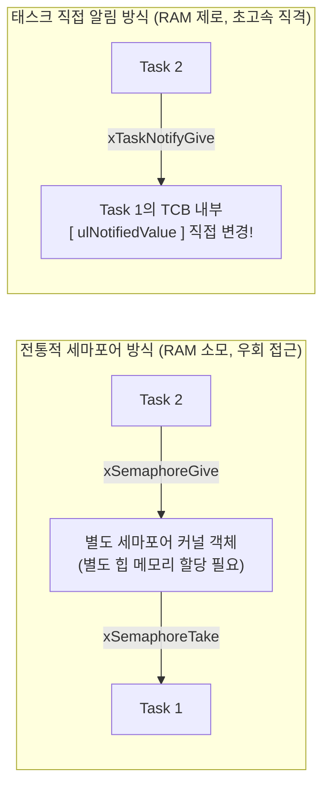
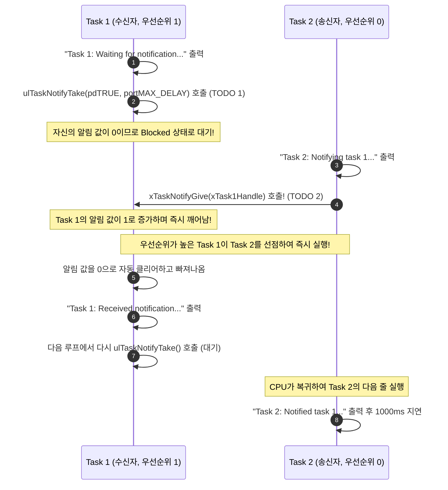

# Tutorial 17: task notification을 경량 binary semaphore처럼 사용 (Using Task Notifications as a Light Weight Binary Semaphore)

이 단원에서는 별도의 세마포어나 큐 커널 객체를 메모리에 만들지 않고도, task의 TCB 내부에 내장된 정수 변수를 직접 조작하여 **최대 45% 더 빠르고 RAM을 전혀 쓰지 않는 task notification(태스크 알림)**을 배운다.

---

## 1. 이번 실습에서 할 일

* **해결하려는 문제**: 단 하나의 task에게 신호나 이벤트를 전달할 때, 굳이 무거운 별도 세마포어 객체(`SemaphoreHandle_t`)를 생성하여 RAM을 낭비하고 오버헤드를 유발하는 구조를 혁신한다.
* **학습 목표**:
  1. 태스크 알림(Task Notification)의 메모리 구조와 세마포어 대비 2대 장점(속도 45% 향상, RAM 0바이트)을 설명할 수 있다.
  2. `ulTaskNotifyTake()`와 `xTaskNotifyGive()` API를 사용하여 이진 세마포어와 100% 동일한 신호 대기/발송 동작을 구현한다.
  3. 태스크 알림의 사용 조건과 2가지 명확한 제약 사항(수신자 1명 한정, 송신자 블로킹 불가)을 이해한다.

---

## 2. 시작 전 확인

### 2.1 개념 복습
* **별도 통신 객체 방식 (Tutorial 12)**:
  * 세마포어라는 제3의 우체통(객체)을 힙 메모리에 만들고, Task 2가 우체통에 편지를 넣고 Task 1이 우체통에서 편지를 꺼냈다.
* **태스크 직접 알림 방식 (Tutorial 17, 현재 단원)**:
  * 우체통을 만들지 않는다! **Task 1의 가슴팍(TCB)에 이미 붙어있는 알림함**에 Task 2가 직접 신호를 꽂아 넣는다.

### 2.2 확인할 소스 및 설정 파일
* 실습 코드: [`source/tutorials/tutorial_17/source/tutorial_17.c`](../../source/tutorials/tutorial_17/source/tutorial_17.c)
* 설정 파일: [`source/tutorials/tutorial_17/include/FreeRTOSConfig.h`](../../source/tutorials/tutorial_17/include/FreeRTOSConfig.h)
  * `configUSE_TASK_NOTIFICATIONS`가 `1`로 활성화되어 있어야 한다 (FreeRTOS 기본값은 항상 1).
* 참조 해답: [`ko/guides/solutions/tutorial_17.c`](solutions/tutorial_17.c)

> **실습 형태**: `tutorial_17.c` 내부의 **`TODO 1`과 `TODO 2`를 완성하는 구현 실습**이다.

---

## 3. 개념 이해

### 3.1 태스크 알림의 압도적 장점 2가지
1. **메모리 오버헤드 제로 (0 Bytes RAM)**:
   * 모든 FreeRTOS task는 태어날 때부터 TCB 내부에 32비트 정수형 알림 값(`ulNotifiedValue`)과 알림 상태(`ucNotifyState`)를 이미 기본으로 가지고 있다.
   * 따라서 세마포어나 큐를 만들기 위해 단 1바이트의 RAM도 추가로 할당할 필요가 없다!
2. **현저히 빠른 실행 속도 (최대 45% 속도 향상)**:
   * 세마포어 객체에 접근하기 위해 락을 걸고 대기열 리스트를 탐색하는 복잡한 커널 연산이 생략되므로, 세마포어 대비 문맥 전환 속도가 약 45%나 빠르다.



### 3.2 태스크 알림의 2가지 한계점 (반드시 알아야 할 제약)
이처럼 강력한 태스크 알림이지만 만능은 아니다:
1. **수신자는 오직 1개 task여야 한다**: 알림 값이 특정 task의 TCB 안에만 있으므로, 여러 task가 하나의 알림을 공유하거나 브로드캐스팅할 수는 없다.
2. **송신자는 블로킹 대기를 할 수 없다**: 큐처럼 "큐가 가득 찼으니 빈자리 날 때까지 송신자가 잠든다"는 동작이 불가능하다.

---

## 4. 실행 흐름 읽기



---

## 5. 코드와 API 이해

### 5.1 `ulTaskNotifyTake()` API
```c
uint32_t ulTaskNotifyTake( BaseType_t xClearCountOnExit, TickType_t xTicksToWait );
```
* **역할**: 이진 세마포어나 계수 세마포어의 `xSemaphoreTake()`를 완벽히 대체한다.
* `xClearCountOnExit`:
  * `pdTRUE`: 알림을 받고 대기에서 빠져나올 때 알림 값을 **`0`으로 리셋**한다. (이진 세마포어 완벽 에뮬레이션!)
  * `pdFALSE`: 알림 값을 1 감소시킨다. (계수 세마포어 에뮬레이션).
* `xTicksToWait`: 알림이 올 때까지 대기할 시간 (`portMAX_DELAY`).

### 5.2 `xTaskNotifyGive()` API
```c
BaseType_t xTaskNotifyGive( TaskHandle_t xTaskToNotify );
```
* **역할**: 세마포어의 `xSemaphoreGive()`를 대체한다.
* `xTaskToNotify`: 알림을 받을 대상 task의 **핸들(포인터)**을 넘겨준다 (`xTask1Handle`).

---

## 6. 직접 구현 또는 관찰 준비

`source/tutorials/tutorial_17/source/tutorial_17.c` 파일을 열고 두 개의 TODO를 완성한다.

### 6.1 TODO 1: 알림 대기 (`prvTask1`)
93~98행: `ulTaskNotifyTake( pdTRUE, portMAX_DELAY )`를 호출한다.

<details>
<summary>TODO 1 해답 코드 보기</summary>

```c
        ulTaskNotifyTake( pdTRUE, portMAX_DELAY );
```
</details>

### 6.2 TODO 2: 알림 발송 (`prvTask2`)
116~121행: Task 1의 핸들(`xTask1Handle`)을 전달하여 알림을 보낸다.

<details>
<summary>TODO 2 해답 코드 보기</summary>

```c
        xTaskNotifyGive( xTask1Handle );
```
</details>

> 전체 완성 코드는 [`ko/guides/solutions/tutorial_17.c`](solutions/tutorial_17.c)에서 확인할 수 있다.

---

## 7. 빌드와 실행

저장소 루트에서 다음 명령을 실행한다:

```bash
# 1. CMake 빌드 구성 (Tutorial 17 지정)
cmake -B build -S source -DTUTORIAL=17

# 2. 컴파일 및 빌드
cmake --build build

# 3. 바이너리 실행
./build/freertos_example
```

* **종료 방법**: 터미널에서 **`Ctrl + C`**를 누른다.

---

## 8. 결과 해석

### 8.1 정상 실행 출력 화면
```text
Task 1: Waiting for notification...
Task 2: Notifying task 1...
Task 1: Received notification...
Task 1: Waiting for notification...
Task 2: Notified task 1...
Task 2: Notifying task 1...
Task 1: Received notification...
Task 1: Waiting for notification...
Task 2: Notified task 1...
```

### 8.2 판정 기준 및 해석
* Tutorial 12의 이진 세마포어와 완전히 동일한 출력 순서가 재현된다:
  1. `Task 2: Notifying task 1...`
  2. `xTaskNotifyGive` 호출 즉시 Task 1이 선점하여 `Task 1: Received notification...` 출력
  3. Task 1이 다시 대기하러 들어간 뒤 `Task 2: Notified task 1...` 출력
* 세마포어 객체를 일체 만들지 않고도 완벽하게 동일한 동기화가 훨씬 빠르고 가볍게 수행됨을 확인한다.

---

## 9. 막혔을 때 (트러블슈팅)

| 증상 | 원인 | 해결 방법 |
| :--- | :--- | :--- |
| `Task 1: Received notification`이 안 뜸 | TODO 2에서 대상 핸들에 `NULL`을 넘겼음 | `xTask1Handle` 핸들이 올바르게 전달되었는지 확인 |
| 컴파일 경고: `implicit declaration of function` | 헤더 누락 | `FreeRTOS.h`와 `task.h`가 포함되어 있는지 확인 |

---

## 10. 혼자 확인하기 (자가 점검)

### 질문 1 (비용 비교)
실무에서 1:1 동기화(단일 task에게 이벤트 전달)를 구현할 때, 이진 세마포어 대신 태스크 알림(`Task Notification`)을 강력히 권장하는 2대 기술적 이유는 무엇인가?

<details>
<summary>정답 및 해설 확인</summary>

* **정답**:
  1. **RAM 소모량 제로**: 세마포어 커널 객체를 위한 힙 또는 정적 메모리가 전혀 필요 없다.
  2. **실행 속도 대폭 향상**: 커널 객체 잠금 및 탐색 비용이 생략되어 최대 45% 더 빠르다.
</details>

### 질문 2 (적용 한계)
태스크 알림으로 이진 세마포어를 대체할 수 **없는** 시나리오는 무엇인가?

<details>
<summary>정답 및 해설 확인</summary>

* **정답**: 하나의 이벤트를 여러 개의 task가 동시에 기다려야 하는 경우 (다대일 또는 브로드캐스팅 시나리오).
* **이유**: 태스크 알림은 특정 task 1개의 TCB에만 속해있기 때문이다. 이 경우에는 Tutorial 15의 이벤트 그룹이나 일반 세마포어를 사용해야 한다.
</details>

---

## 11. 다음 학습

태스크 알림을 이진 세마포어처럼 쓰는 법을 배웠다.  
그런데 태스크 알림 값은 단순한 숫자가 아니라 **32비트 정수**다. 그렇다면 이 32비트 중 각 비트를 독립된 플래그로 쓰면 **이벤트 그룹(Event Group)**처럼 사용할 수도 있지 않을까?

이제 **[Tutorial 18: task notification을 경량 event group처럼 사용 (Using Task Notifications as a Light Weight Event Group)](tutorial_18.md)**으로 넘어가서 태스크 알림의 무한한 변신을 완성해 보자!

* **한국어 커널북 심화 읽기**:
  * [10.3.2–10.3.4장: task notification give/take API](https://github.com/yunju-baek/FreeRTOS-Kernel-Book-ko/blob/27d03c61cd2a6cf5a6fa6333082218ef706f5b89/ko/ch10.md)
