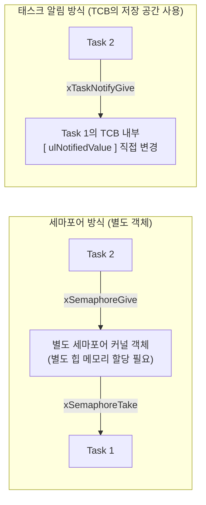
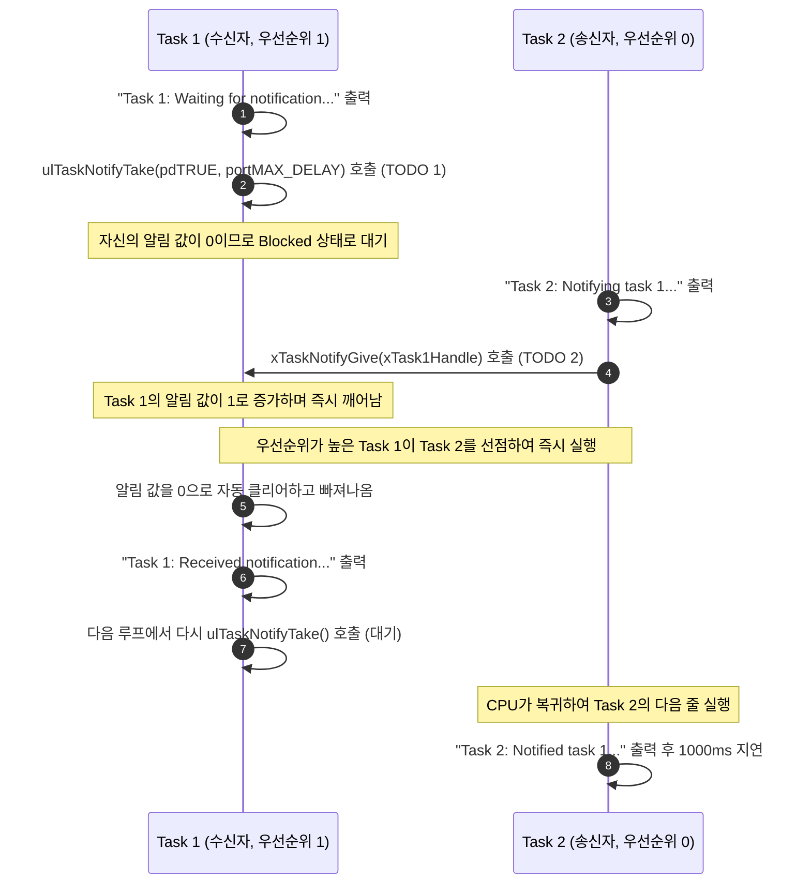

# Tutorial 17: task notification을 경량 binary semaphore처럼 사용 (Using Task Notifications as a Light Weight Binary Semaphore)

[학습 목차](README.md) · [공통 준비](getting-started.md) · [공식 튜토리얼 번역](../docs/tutorial_17/README.md) · [이전 단원](tutorial_16.md)

이 단원에서는 별도의 세마포어나 큐 커널 객체를 메모리에 만들지 않고도, task의 TCB 내부에 내장된 정수 변수를 직접 조작하여 **task notification(태스크 알림)**을 배운다.

---

## 1. 이번 실습에서 할 일

* **해결하려는 문제**: 단 하나의 task에게 신호나 이벤트를 전달할 때, 별도의 세마포어 객체 대신 수신 task의 알림 저장 공간을 이용한다.
* **학습 목표**:
  1. 태스크 알림(Task Notification)의 메모리 구조와 별도 객체가 필요 없다는 특징을 설명할 수 있다.
  2. `ulTaskNotifyTake()`와 `xTaskNotifyGive()` API를 사용하여 신호 대기·발송을 구현하고 이진 세마포어와 알림 누적값의 차이를 설명한다.
  3. 태스크 알림의 사용 조건과 2가지 명확한 제약 사항(수신자 1명 한정, 송신자 블로킹 불가)을 이해한다.

---

## 2. 시작 전 확인

[T12의 이진 세마포어 신호 순서](tutorial_12.md#8-결과-해석)를 먼저 확인하면 두 방식의 공통점과 차이를 비교하기 쉽다.

### 2.1 개념 복습
* **별도 통신 객체 방식 (Tutorial 12)**:
  * 세마포어라는 제3의 우체통(객체)을 힙 메모리에 만들고, Task 2가 우체통에 편지를 넣고 Task 1이 우체통에서 편지를 꺼냈다.
* **태스크 직접 알림 방식 (Tutorial 17, 현재 단원)**:
  * 별도 통신 객체를 만들지 않는다. Task 2가 Task 1의 TCB에 있는 알림 저장 공간을 직접 갱신한다.

### 2.2 확인할 소스 및 설정 파일
* 실습 코드: [`source/tutorials/tutorial_17/source/tutorial_17.c`](../../source/tutorials/tutorial_17/source/tutorial_17.c)
* 설정 파일: [`source/tutorials/tutorial_17/include/FreeRTOSConfig.h`](../../source/tutorials/tutorial_17/include/FreeRTOSConfig.h)
  * `configUSE_TASK_NOTIFICATIONS`가 `1`로 활성화되어 있어야 한다 (별도 정의가 없을 때 기본값은 1).
* 참조 해답: [`ko/guides/solutions/tutorial_17.c`](solutions/tutorial_17.c)

> **실습 형태**: `tutorial_17.c` 내부의 **`TODO 1`과 `TODO 2`를 완성하는 구현 실습**이다.

---

## 3. 개념 이해

### 3.1 별도 객체와 TCB 저장 공간의 차이

알림을 활성화한 task의 TCB에는 알림 엔트리마다 `uint32_t` 값과 `uint8_t` 상태가 들어간다. 두 필드의 합은 5바이트이며 실제 TCB 크기에는 정렬·패딩과 엔트리 수가 영향을 준다. 따라서 메모리 비용이 0은 아니다.

이미 있는 알림 저장 공간을 활용하므로 별도 세마포어 객체를 만들지 않는 장점이 있다. 특정 수신 task를 직접 지정하므로 처리 경로를 단순화할 수 있지만, 실행 속도 차이는 환경과 호출 패턴별로 측정해야 한다.

알림의 **값**과 **대기 중/수신 대기 없음/알림 도착 상태**는 별도로 관리된다. 이 단원은 값이 0보다 큰지 기다리는 Take를 쓰고, 다음 단원은 알림의 도착 상태를 기다리는 Wait를 쓴다.



### 3.2 태스크 알림의 2가지 한계점 (반드시 알아야 할 제약)
알림의 수신 대상과 대기 방식은 다음과 같다:
1. **알림을 받는 task는 1개다**: 알림 값이 특정 task의 TCB 안에만 있으므로, 하나의 알림 대상을 여러 수신 task가 공유할 수는 없다. **여러 송신자가 수신 task 하나에 보내는 다대일 통신은 가능**하다. 여러 수신자에게 전파하려면 별도 설계가 필요하다.
2. **송신자는 블로킹 대기를 할 수 없다**: 큐처럼 "큐가 가득 찼으니 빈자리 날 때까지 송신자가 잠든다"는 동작이 불가능하다.

---

## 4. 실행 흐름 읽기



---

## 5. 코드와 API 이해

### 5.1 `ulTaskNotifyTake()` API
```c
uint32_t ulTaskNotifyTake( BaseType_t xClearCountOnExit, TickType_t xTicksToWait );
```
* **역할**: 자신의 알림 값이 0보다 클 때까지 기다리고 값을 소비한다. 특정 수신 task의 신호 대기에 사용할 수 있다.
* `xClearCountOnExit`:
  * `pdTRUE`: 알림을 받고 대기에서 빠져나올 때 알림 값을 **`0`으로 리셋**한다. (누적된 알림을 한 번에 비움)
  * `pdFALSE`: 알림 값을 1 감소시킨다. (계수 세마포어 에뮬레이션).
* `xTicksToWait`: 알림 값이 0일 때의 최대 대기 시간이다. 이 설정에서 `portMAX_DELAY`는 무기한 대기다.
* **반환값**: 클리어·감소 전 알림 값이며 시간 만료는 `0`이다.

### 5.2 `xTaskNotifyGive()` API
```c
BaseType_t xTaskNotifyGive( TaskHandle_t xTaskToNotify );
```
* **역할**: 대상의 알림 값을 1 증가시킨다. 수신 전에 여러 번 호출하면 2 이상으로 누적될 수 있다. 이미 찬 이진 세마포어의 Give가 실패하는 동작과 다르다.
* `xTaskToNotify`: 알림을 받을 대상 task의 **핸들(포인터)**을 넘겨준다 (`xTask1Handle`).

---

## 6. 직접 구현 또는 관찰 준비

전체 참조 해답은 [tutorial_17.c](solutions/tutorial_17.c)에 있다. 먼저 TODO별 힌트를 따라 작성하고, [자기 코드 보존·해답 적용·복구 절차](getting-started.md#solution-workflow)에 따라 비교한다.

`source/tutorials/tutorial_17/source/tutorial_17.c` 파일을 열고 두 개의 TODO를 완성한다.

### 6.1 TODO 1: 알림 대기 (`prvTask1`)
93~98행: `ulTaskNotifyTake( pdTRUE, portMAX_DELAY )`를 호출한다.

* **TODO 1 힌트 1**: 자신의 알림 값이 생길 때까지 기다렸다가 누적값을 비운다.
* **TODO 1 힌트 2**: `prvTask1`의 Take에 클리어 참과 `portMAX_DELAY`를 전달한다. 대상 핸들 인자는 없다.

<details>
<summary>TODO 1 해답 코드 보기</summary>

```c
        ulTaskNotifyTake( pdTRUE, portMAX_DELAY );
```

**이유**: 자신의 알림 값이 생길 때까지 기다렸다가 누적값을 비운다.
</details>

### 6.2 TODO 2: 알림 발송 (`prvTask2`)
116~121행: Task 1의 핸들(`xTask1Handle`)을 전달하여 알림을 보낸다.

* **TODO 2 힌트 1**: 송신은 알림을 받을 task를 직접 지정한다.
* **TODO 2 힌트 2**: `prvTask2`에서 생성 시 보관한 `xTask1Handle`로 Give한다. 세마포어 핸들이 아니다.

<details>
<summary>TODO 2 해답 코드 보기</summary>

```c
        xTaskNotifyGive( xTask1Handle );
```

**이유**: 송신은 알림을 받을 task를 직접 지정한다.
</details>

> 전체 완성 코드는 [`ko/guides/solutions/tutorial_17.c`](solutions/tutorial_17.c)에서 확인할 수 있다.

---

## 7. 빌드와 실행

[공통 준비](getting-started.md)의 학습용 사본 루트에서 다음 명령을 실행한다:

```bash
# 1. CMake 빌드 구성 (Tutorial 17 지정)
cmake -S source -B build/tutorial_17 -DTUTORIAL=17

# 2. 컴파일 및 빌드
cmake --build build/tutorial_17

# 3. 바이너리 실행
./build/tutorial_17/freertos_example
```

* **종료 방법**: 터미널에서 **`Ctrl + C`**를 누른다.

---

## 8. 결과 해석

### 8.1 출력 예시

높은 우선순위 수신자가 Notifying과 Notified 사이에 처리하는 관계를 확인한다. 실행 속도 개선 비율은 이 출력으로 측정하지 않는다.

```text
Task 1: Waiting for notification...
Task 2: Notifying task 1...
Task 1: Received notification...
Task 1: Waiting for notification...
Task 2: Notified task 1...
Task 2: Notifying task 1...
Task 1: Received notification...
Task 1: Waiting for notification...
Task 2: Notified task 1...
```

### 8.2 판정 기준 및 해석
* Tutorial 12의 이진 세마포어와 비슷한한 출력 순서가 재현된다:
  1. `Task 2: Notifying task 1...`
  2. `xTaskNotifyGive` 호출 즉시 Task 1이 선점하여 `Task 1: Received notification...` 출력
  3. Task 1이 다시 대기하러 들어간 뒤 `Task 2: Notified task 1...` 출력
* 별도 세마포어 객체 없이 이 예제의 신호 전달 순서가 구현됨을 확인한다. 이 로그는 메모리 사용량이나 실행 속도를 측정한 결과가 아니다.

---

## 9. 막혔을 때 (트러블슈팅)

| 증상 | 원인 | 해결 방법 |
| :--- | :--- | :--- |
| `Task 1: Received notification`이 안 뜸 | TODO 2에서 대상 핸들에 `NULL`을 넘겼음 | `xTask1Handle` 핸들이 올바르게 전달되었는지 확인 |
| 컴파일 경고: `implicit declaration of function` | 헤더 누락 | `FreeRTOS.h`와 `task.h`가 포함되어 있는지 확인 |

---

## 10. 혼자 확인하기 (자가 점검)

### 질문 1 (비용 비교)
태스크 알림은 별도 세마포어 객체를 만들지 않는데도 왜 RAM 비용이 0이라고 말할 수 없는가?

<details>
<summary>정답 및 해설 확인</summary>

수신 task의 TCB에 값·상태 저장 공간이 있기 때문이다. 별도 객체의 추가 할당을 피하는 것과 저장 공간 자체가 없는 것은 다르다. 이 실습은 속도 향상 비율을 측정하지 않는다.
</details>

### 질문 2 (적용 한계)
송신 task 3개가 수신 task 1개에 알림을 보낼 수 있는가? 수신 task 3개가 같은 알림을 함께 기다리는 경우와 어떻게 다른가?

<details>
<summary>정답 및 해설 확인</summary>

여러 송신자가 같은 task 핸들에 보내는 다대일 통신은 가능하다. 알림 저장 공간은 수신 task 하나에 속하므로 여러 수신자가 같은 알림을 소비하는 통신은 그대로 대체할 수 없다. 또한 수신 전에 Give가 두 번 이루어졌다면 Take의 반환값은 2일 수 있고 `pdTRUE`는 누적값을 모두 지운다.
</details>

### 질문 3 (조건 변경과 결과 예측)
`prvTask2`의 지연값만 1000ms에서 500ms로 바꾼다.

실행 전에 어떤 결과가 달라지고 어떤 동작이 그대로 유지될지 적는다. 직접 작성한 코드와 수정 전 파일은 [공통 보존·복구 절차](getting-started.md#solution-workflow)에 따라 보관한다. 위에서 지정한 조건 하나만 바꾸고 `cmake --build build/tutorial_17` 명령으로 다시 빌드한다. 실행 결과를 예측과 비교한 뒤 아래 해설을 확인한다. 해설은 예상 결과를 설명한 것이므로 직접 얻은 로그와 구분한다.

<details>
<summary>예상 결과와 해설 확인</summary>

알림 빈도는 늘어나지만 Notifying → Received → Waiting → Notified 순서는 유지될 것으로 예상한다. 이것만으로 처리 속도 향상 비율이나 알림의 최대 누적값을 측정할 수는 없다.
</details>

**복구와 재확인**: `prvTask2`의 지연 시간을 500ms에서 1000ms로 되돌린다. 같은 단원을 다시 빌드하고 실행하여 [8절의 결과](#8-결과-해석)와 비교한다. 결과를 설명하기 어려우면 [관련 개념 다시 읽기](#5-코드와-api-이해)로 돌아간다.

---

## 11. 다음 학습

태스크 알림을 이진 세마포어처럼 쓰는 법을 배웠다.
그런데 태스크 알림 값은 단순한 숫자가 아니라 **32비트 정수**다. 그렇다면 이 32비트 중 각 비트를 독립된 플래그로 쓰면 **이벤트 그룹(Event Group)**처럼 사용할 수도 있지 않을까?

이제 **[Tutorial 18: task notification을 경량 event group처럼 사용 (Using Task Notifications as a Light Weight Event Group)](tutorial_18.md)**으로 넘어가서 알림 값을 비트 플래그로 해석하는 방법과 이벤트 그룹과의 차이를 살펴본다.

* **한국어 커널북 심화 읽기**:
  * [10.3.2–10.3.4장: task notification give/take API](https://github.com/yunju-baek/FreeRTOS-Kernel-Book-ko/blob/27d03c61cd2a6cf5a6fa6333082218ef706f5b89/ko/ch10.md)
