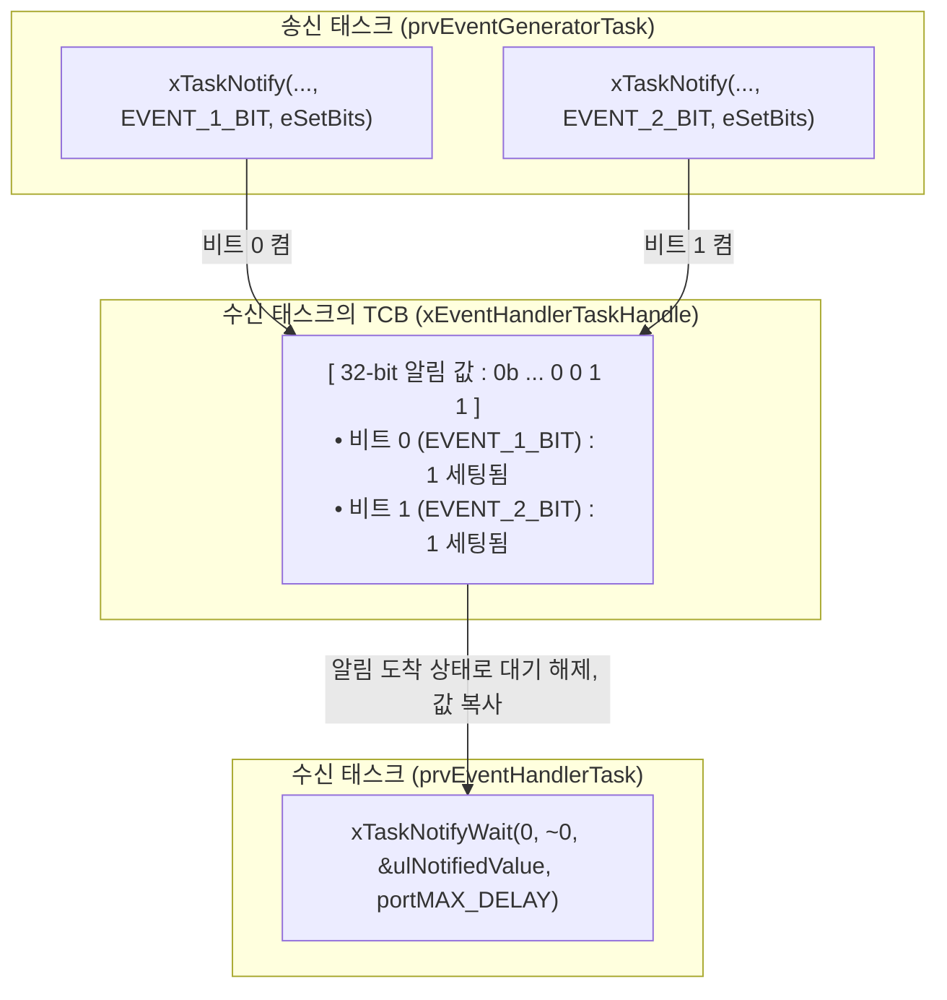
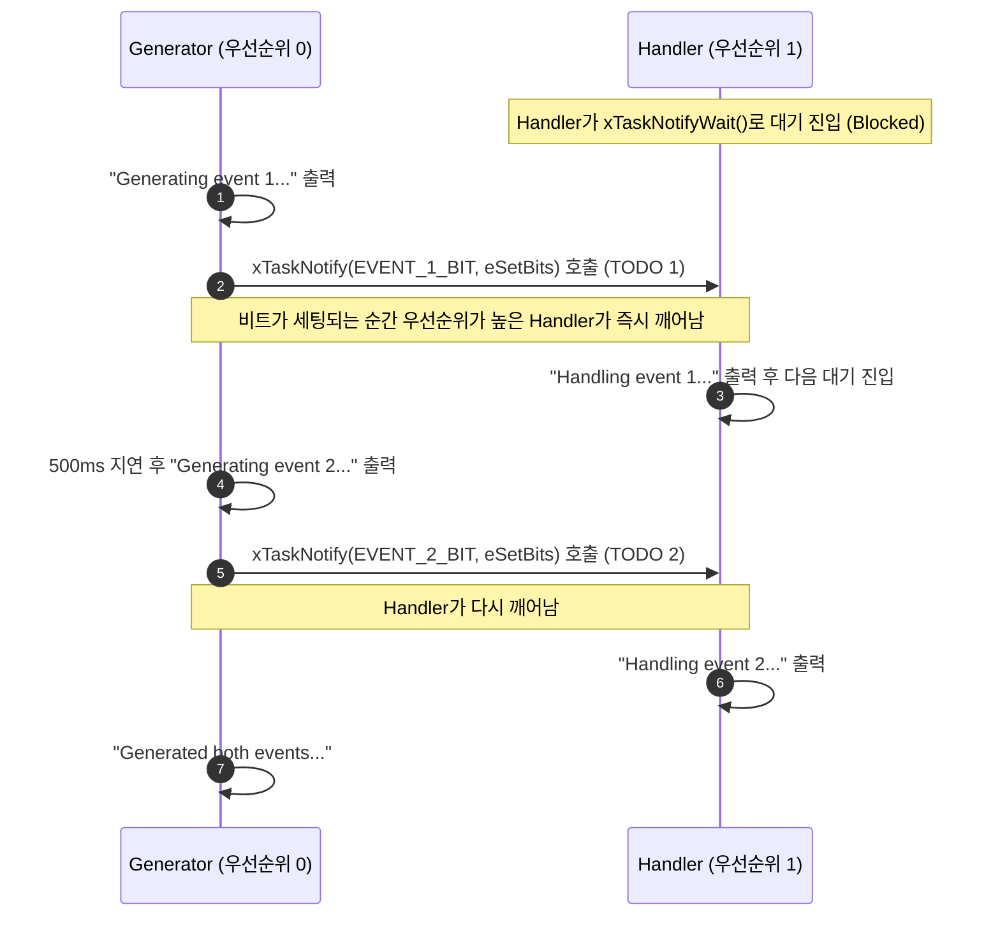

# Tutorial 18: task notification을 경량 event group처럼 사용 (Using Task Notifications as a Light Weight Event Group)

[학습 목차](README.md) · [공통 준비](getting-started.md) · [공식 튜토리얼 번역](../docs/tutorial_18/README.md) · [이전 단원](tutorial_17.md)

이 단원에서는 task의 32비트 알림 값 내부의 개별 비트들을 이벤트 플래그로 활용하여, 별도의 이벤트 그룹 객체 없이도 **비트 단위 이벤트 전달**을 구현하는 기법을 배운다.

---

## 1. 이번 실습에서 할 일

* **해결하려는 문제**: 특정 task에게 여러 종류의 비트 이벤트(예: 0번 비트 = 버튼 눌림, 1번 비트 = 타이머 만료)를 전달할 때, 별도의 EventGroup 객체 없이 태스크 알림만으로 가볍고 빠르게 처리한다.
* **학습 목표**:
  1. 태스크 알림의 32비트 정수 값을 비트 단위 이벤트 플래그로 활용하는 원리를 이해한다.
  2. `xTaskNotify()`의 `eSetBits` 액션과 `xTaskNotifyWait()` API를 사용하여 비트 설정 및 대기를 구현한다.
  3. 전용 이벤트 그룹(Tutorial 15)과 태스크 알림 기반 이벤트 플래그(Tutorial 18)의 차이점과 적용 기준을 명확히 구분한다.

---

## 2. 시작 전 확인

먼저 [T17의 알림 값·상태·수신자](tutorial_17.md#3-개념-이해)와 [T15의 AND/OR 조건](tutorial_15.md#5-코드와-api-이해)을 확인한다.

### 2.1 C 언어 비트 반전 연산자 `~`
* `~0`: 정수 0의 비트를 반전한다. 이 API의 `uint32_t` 인자로 변환하면 모든 32비트가 1인 마스크(`0xFFFFFFFF`)가 된다.
* `xTaskNotifyWait()`의 두 번째 인자 `ulBitsToClearOnExit`에 `~0`을 넘기면, 알림을 받은 뒤 대기를 마칠 때 비트 32개를 모두 `0`으로 지운다는 뜻이다.

### 2.2 확인할 소스 및 설정 파일
* 실습 코드: [`source/tutorials/tutorial_18/source/tutorial_18.c`](../../source/tutorials/tutorial_18/source/tutorial_18.c)
* 설정 파일: [`source/tutorials/tutorial_18/include/FreeRTOSConfig.h`](../../source/tutorials/tutorial_18/include/FreeRTOSConfig.h)
* 참조 해답: [`ko/guides/solutions/tutorial_18.c`](solutions/tutorial_18.c)

> **실습 형태**: `tutorial_18.c` 내부의 **`TODO 1`, `TODO 2`, `TODO 3`을 완성하는 구현 실습**이다.

---

## 3. 개념 이해

### 3.1 태스크 알림 값의 비트 필드 활용
FreeRTOS task의 알림 값(`ulNotifiedValue`)은 부호 없는 32비트 정수(`uint32_t`)다. 비트 32개를 플래그로 사용할 수 있다. 같은 이벤트가 여러 번 와도 해당 비트 하나만 켜지므로 발생 횟수는 보존하지 않는다.

**알림 값**은 비트 정보이고, **알림 도착 상태(pending)**는 아직 처리할 알림이 있는가를 나타낸다. `xTaskNotifyWait()`는 특정 비트 조합이 아니라 알림 도착을 기다린다. `eSetBits` 송신은 값에 OR 연산을 하고 도착 상태도 설정한다.



### 3.2 전용 이벤트 그룹(T15)과의 결정적 차이
* **공통점**: 여러 비트 플래그를 개별적으로 세팅하고 확인할 수 있다.
* **태스크 알림(T18)의 제약**:
  * **알림을 받는 task는 1개다** (브로드캐스팅 불가).
  * `xEventGroupSync` 같은 장벽이나 `xEventGroupWaitBits`의 AND/OR 비트 조건 대기는 제공하지 않는다. Wait에서 돌아온 뒤 받은 비트를 코드로 검사한다.
* **장점**: 수신자가 1개라면 이벤트 그룹 객체를 따로 만들 필요가 없어 추가 객체 저장 공간을 줄일 수 있다. TCB의 알림 값·상태 공간은 필요하며 속도 차이는 따로 측정해야 한다.

---

## 4. 실행 흐름 읽기



---

## 5. 코드와 API 이해

### 5.1 `xTaskNotify()` API (다목적 알림 전송)
```c
BaseType_t xTaskNotify( TaskHandle_t xTaskToNotify,
                        uint32_t ulValue,
                        eNotifyAction eAction );
```
* `eAction`: 알림 값을 어떻게 다룰지 지정하는 옵션이다:
  * **`eSetBits`**: 전달된 `ulValue` 비트들을 대상 task의 알림 값에 비트 OR(`|`)로 켠다. (비트 플래그 전달)
  * `eIncrement`: 알림 값을 1 증가시킨다 (계수 세마포어).
  * `eSetValueWithOverwrite`: 새 값으로 무조건 덮어쓴다 (메일박스).

### 5.2 `xTaskNotifyWait()` API (알림 도착 대기와 값 읽기)
```c
BaseType_t xTaskNotifyWait( uint32_t ulBitsToClearOnEntry,
                            uint32_t ulBitsToClearOnExit,
                            uint32_t * pulNotificationValue,
                            TickType_t xTicksToWait );
```
* `ulBitsToClearOnEntry`: 아직 pending 알림이 없을 때, 대기를 시작하며 지울 비트 마스크다. 이미 알림이 도착했다면 적용하지 않는다. `0`은 지우지 않는다.
* `ulBitsToClearOnExit`: 알림을 성공적으로 받았을 때 값을 복사한 뒤 지울 마스크다. `~0`은 모든 비트를 지우고 `0`은 값을 남긴다. 알림 도착 상태의 해제와 값의 클리어는 별개다.
* `pulNotificationValue`: 클리어하기 전 알림 값을 복사받을 변수 주소다.
* **반환값**: 알림을 받으면 `pdTRUE`, 시간 만료 등으로 받지 못하면 `pdFALSE`다. 비트 값 자체를 반환하는 함수가 아니다. 이 예제는 설정상 무기한 대기하며 성공 뒤 두 비트를 검사한다.

---

## 6. 직접 구현 또는 관찰 준비

전체 참조 해답은 [tutorial_18.c](solutions/tutorial_18.c)에 있다. 먼저 TODO별 힌트를 따라 작성하고, [자기 코드 보존·해답 적용·복구 절차](getting-started.md#solution-workflow)에 따라 비교한다.

`source/tutorials/tutorial_18/source/tutorial_18.c` 파일을 열고 세 개의 TODO를 완성한다.

### 6.1 TODO 1: Event 1 비트 알림 (`prvEventGeneratorTask`)
100~107행: `EVENT_1_BIT`를 `eSetBits` 액션으로 전송한다.

* **TODO 1 힌트 1**: 이벤트 종류를 알림 값의 비트로 전달하면서 기존 비트를 보존한다.
* **TODO 1 힌트 2**: Generator에서 수신 task 핸들·`EVENT_1_BIT`·OR 동작인 `eSetBits`를 선택한다.

<details>
<summary>TODO 1 해답 코드 보기</summary>

```c
        xTaskNotify( xEventHandlerTaskHandle, EVENT_1_BIT, eSetBits );
```

**이유**: 이벤트 종류를 알림 값의 비트로 전달하면서 기존 비트를 보존한다.
</details>

### 6.2 TODO 2: Event 2 비트 알림 (`prvEventGeneratorTask`)
115~122행: `EVENT_2_BIT`를 `eSetBits` 액션으로 전송한다.

* **TODO 2 힌트 1**: 두 번째 알림은 같은 수신자의 다른 비트를 켠다.
* **TODO 2 힌트 2**: 두 번째 송신에는 `EVENT_2_BIT`를 쓰고 대상 핸들과 동작 옵션은 유지한다.

<details>
<summary>TODO 2 해답 코드 보기</summary>

```c
        xTaskNotify( xEventHandlerTaskHandle, EVENT_2_BIT, eSetBits );
```

**이유**: 두 번째 알림은 같은 수신자의 다른 비트를 켠다.
</details>

### 6.3 TODO 3: 알림 대기 및 비트 수신 (`prvEventHandlerTask`)
142~150행: `xTaskNotifyWait()`를 호출하여 `ulNotifiedValue`에 비트 상태를 복사받는다.

* **TODO 3 힌트 1**: 수신자는 알림 도착을 기다린 뒤 복사된 값의 비트를 검사한다.
* **TODO 3 힌트 2**: Handler의 Wait는 진입 마스크 0, 종료 마스크 `~0`, 출력 변수 주소 `&ulNotifiedValue`, 무기한 대기 순서다.

<details>
<summary>TODO 3 해답 코드 보기</summary>

```c
        xTaskNotifyWait( 0, ~0, &( ulNotifiedValue ), portMAX_DELAY );
```

**이유**: 수신자는 알림 도착을 기다린 뒤 복사된 값의 비트를 검사한다.
</details>

> 전체 완성 코드는 [`ko/guides/solutions/tutorial_18.c`](solutions/tutorial_18.c)에서 확인할 수 있다.

---

## 7. 빌드와 실행

[공통 준비](getting-started.md)의 학습용 사본 루트에서 다음 명령을 실행한다:

```bash
# 1. CMake 빌드 구성 (Tutorial 18 지정)
cmake -S source -B build/tutorial_18 -DTUTORIAL=18

# 2. 컴파일 및 빌드
cmake --build build/tutorial_18

# 3. 바이너리 실행
./build/tutorial_18/freertos_example
```

* **종료 방법**: 터미널에서 **`Ctrl + C`**를 누른다.

---

## 8. 결과 해석

### 8.1 출력 예시

원본은 각 사건 뒤 해당 비트를 처리한다. 별도 객체가 없다는 사실과 정량 성능을 구별하며 실제 출력 간격은 고정하지 않는다.

```text
Generating event 1...
Handling event 1...
Generating event 2...
Handling event 2...
Generated both events...
Generating event 1...
Handling event 1...
Generating event 2...
Handling event 2...
Generated both events...
```

### 8.2 판정 기준 및 해석
* `Generating event 1...`이 호출되자마자 Handler가 깨어나 `Handling event 1...`을 즉시 처리하고, 이어서 `event 2`도 발생 즉시 처리된다.
* 전용 이벤트 그룹 객체를 일체 생성하지 않고도, 단일 정수형 알림 값을 통해 비트 단위 이벤트 수신이 이루어졌음을 확인한다.

---

## 9. 막혔을 때 (트러블슈팅)

| 증상 | 원인 | 해결 방법 |
| :--- | :--- | :--- |
| 새 이벤트를 보낼 때 이전 이벤트도 다시 처리됨 | 종료 마스크가 0이면 이전 비트가 누적됨 | TODO 3의 종료 마스크를 확인. 0이어도 다음 알림 수신이 영구 중단되는 것은 아님 |
| 첫 처리 뒤 아무 출력도 없음 | 새 알림이 없거나 대상 핸들·송신 경로 오류 가능성 | Generator가 반복하는지와 두 `xTaskNotify`의 대상 핸들을 확인 |
| 컴파일 에러: `eSetBits undeclared` | 헤더 누락 | `task.h`가 포함되어 있는지 확인 |

---

## 10. 혼자 확인하기 (자가 점검)

### 질문 1 (비교 설계)
단일 수신 task가 4개의 서로 다른 하드웨어 인터럽트(타이머, 버튼, 센서, 통신)로부터 각각의 비트 플래그를 수신하고자 할 때, 이벤트 그룹 대신 태스크 알림(`xTaskNotifyFromISR`)을 쓰는 것이 권장되는 이유는 무엇인가?

<details>
<summary>정답 및 해설 확인</summary>

* **정답**: 수신자가 하나로 정해져 있다면 TCB의 알림 값·상태를 이용해 별도 이벤트 그룹 없이 전달할 수 있기 때문이다. ISR에서는 해당 FromISR API와 포트의 호출 조건을 지켜야 하며, 속도는 이 실습에서 측정하지 않았다.
</details>

### 질문 2 (액션 옵션)
`xTaskNotify()`의 `eAction` 인자에 `eSetBits` 대신 `eSetValueWithOverwrite`를 쓰면 어떤 동작으로 바뀌는가?

<details>
<summary>정답 및 해설 확인</summary>

* **정답**: 기존 비트들을 보존하며 1로 켜는 비트 플래그 동작이 아니라, 이전 값을 완전히 덮어써 버리는 **값 1개를 저장하는 우체통(Mailbox)** 동작으로 바뀐다.
</details>

### 질문 3 (조건 변경과 결과 예측)
Handler의 `xTaskNotifyWait` 두 번째 인자만 `~0`에서 `0`으로 바꾼다.

실행 전에 어떤 결과가 달라지고 어떤 동작이 그대로 유지될지 적는다. 직접 작성한 코드와 수정 전 파일은 [공통 보존·복구 절차](getting-started.md#solution-workflow)에 따라 보관한다. 위에서 지정한 조건 하나만 바꾸고 `cmake --build build/tutorial_18` 명령으로 다시 빌드한다. 실행 결과를 예측과 비교한 뒤 아래 해설을 확인한다. 해설은 예상 결과를 설명한 것이므로 직접 얻은 로그와 구분한다.

<details>
<summary>예상 결과와 해설 확인</summary>

다음 알림도 계속 받을 수 있다. 다만 이전 비트가 남아 있으므로 Event 2 알림에서 Event 1도 처리하는 등 누적 비트가 재해석될 것으로 예상한다. 알림 값 보존과 pending 상태 해제를 구별한다.
</details>

**복구와 재확인**: Handler의 `xTaskNotifyWait` 호출에서 두 번째 인자를 `0`에서 `~0`으로 되돌린다. 같은 단원을 다시 빌드하고 실행하여 [8절의 결과](#8-결과-해석)와 비교한다. 결과를 설명하기 어려우면 [관련 개념 다시 읽기](#5-코드와-api-이해)로 돌아간다.

---

## 11. 다음 학습

태스크 알림을 값의 누적과 비트 플래그로 사용하는 두 방식을 비교했다.
이제 튜토리얼의 마지막 대단원인 **고급 버퍼와 자원 관리(T19~T21)**로 진입한다.

다음 단원인 **[Tutorial 19: stream buffer](tutorial_19.md)**으로 넘어가서, UART나 오디오 스트리밍처럼 고정 크기 패킷이 아닌 연속된 바이트 스트림을  전송하는 **Stream Buffer**를 배운다.

* **한국어 커널북 심화 읽기**:
  * [10.3.5·10.3.6장: task notification notify/wait API](https://github.com/yunju-baek/FreeRTOS-Kernel-Book-ko/blob/27d03c61cd2a6cf5a6fa6333082218ef706f5b89/ko/ch10.md)
