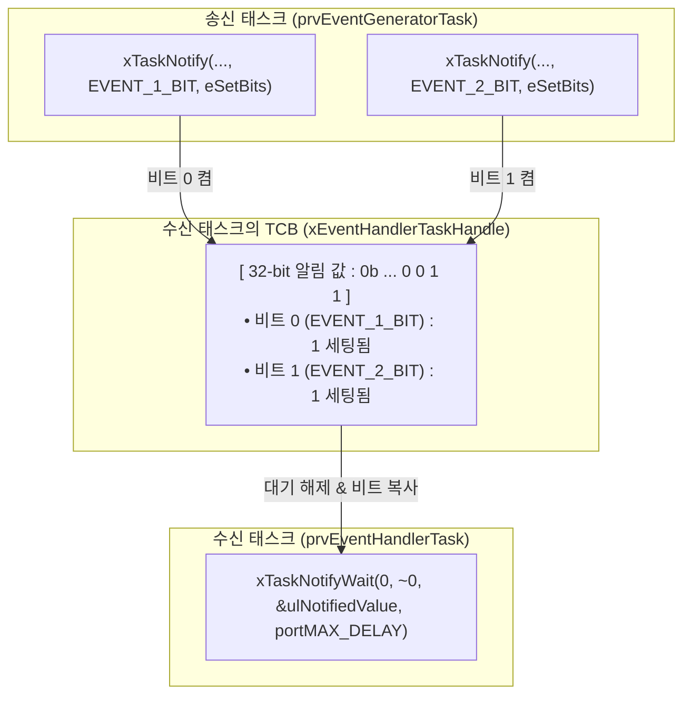
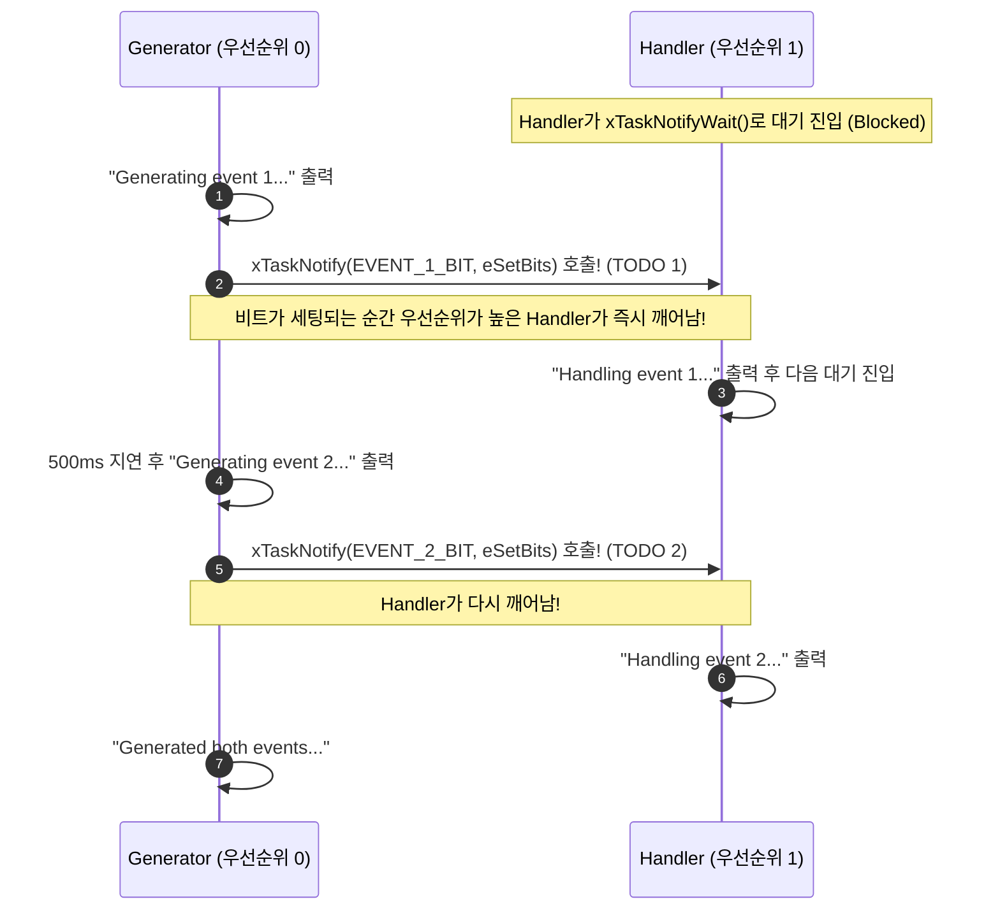

# Tutorial 18: task notification을 경량 event group처럼 사용 (Using Task Notifications as a Light Weight Event Group)

이 단원에서는 task의 32비트 알림 값 내부의 개별 비트들을 이벤트 플래그로 활용하여, 별도의 이벤트 그룹 객체 없이도 초경량 **비트 단위 다중 이벤트 동기화(Event Group 에뮬레이션)**를 구현하는 기법을 배운다.

---

## 1. 이번 실습에서 할 일

* **해결하려는 문제**: 특정 task에게 여러 종류의 비트 이벤트(예: 0번 비트 = 버튼 눌림, 1번 비트 = 타이머 만료)를 전달할 때, 별도의 EventGroup 객체 없이 태스크 알림만으로 가볍고 빠르게 처리한다.
* **학습 목표**:
  1. 태스크 알림의 32비트 정수 값을 비트 단위 이벤트 플래그로 활용하는 원리를 이해한다.
  2. `xTaskNotify()`의 `eSetBits` 액션과 `xTaskNotifyWait()` API를 사용하여 비트 설정 및 대기를 구현한다.
  3. 전용 이벤트 그룹(Tutorial 15)과 태스크 알림 기반 이벤트 플래그(Tutorial 18)의 차이점과 적용 기준을 명확히 구분한다.

---

## 2. 시작 전 확인

### 2.1 C 언어 비트 반전 연산자 `~`
* `~0`: 모든 비트가 1인 값(`0xFFFFFFFF`)을 의미한다.
* `xTaskNotifyWait()`의 두 번째 인자 `ulBitsToClearOnExit`에 `~0`을 넘기면, 알림을 받고 대기에서 빠져나갈 때 32개의 모든 비트를 한꺼번에 `0`으로 깨끗이 클리어하라는 의미가 된다.

### 2.2 확인할 소스 및 설정 파일
* 실습 코드: [`source/tutorials/tutorial_18/source/tutorial_18.c`](../../source/tutorials/tutorial_18/source/tutorial_18.c)
* 설정 파일: [`source/tutorials/tutorial_18/include/FreeRTOSConfig.h`](../../source/tutorials/tutorial_18/include/FreeRTOSConfig.h)
* 참조 해답: [`ko/guides/solutions/tutorial_18.c`](solutions/tutorial_18.c)

> **실습 형태**: `tutorial_18.c` 내부의 **`TODO 1`, `TODO 2`, `TODO 3`을 완성하는 구현 실습**이다.

---

## 3. 개념 이해

### 3.1 태스크 알림 값의 비트 필드 활용
FreeRTOS task의 알림 값(`ulNotifiedValue`)은 부호 없는 32비트 정수(`uint32_t`)다. 따라서 최대 32개의 서로 다른 이벤트를 비트 플래그로 동시에 관리할 수 있다!



### 3.2 전용 이벤트 그룹(T15)과의 결정적 차이
* **공통점**: 여러 비트 플래그를 개별적으로 세팅하고 확인할 수 있다.
* **태스크 알림(T18)의 제약**:
  * **수신자는 오직 1개 task여야 한다** (브로드캐스팅 불가).
  * `xEventGroupSync`와 같은 다자간 장벽(Barrier) 동기화는 지원하지 않는다.
* **장점**: 수신자가 1개라면 이벤트 그룹 객체를 따로 만들 필요가 없어 RAM을 아끼고 속도가 훨씬 빠르다.

---

## 4. 실행 흐름 읽기



---

## 5. 코드와 API 이해

### 5.1 `xTaskNotify()` API (다목적 알림 전송)
```c
BaseType_t xTaskNotify( TaskHandle_t xTaskToNotify,
                        uint32_t ulValue,
                        eNotifyAction eAction );
```
* `eAction`: 알림 값을 어떻게 다룰지 지정하는 마법의 옵션이다:
  * **`eSetBits`**: 전달된 `ulValue` 비트들을 대상 task의 알림 값에 비트 OR(`|`)로 켠다. (이벤트 그룹 에뮬레이션)
  * `eIncrement`: 알림 값을 1 증가시킨다 (계수 세마포어).
  * `eSetValueWithOverwrite`: 새 값으로 무조건 덮어쓴다 (메일박스).

### 5.2 `xTaskNotifyWait()` API (비트 대기 및 읽기)
```c
BaseType_t xTaskNotifyWait( uint32_t ulBitsToClearOnEntry,
                            uint32_t ulBitsToClearOnExit,
                            uint32_t * pulNotificationValue,
                            TickType_t xTicksToWait );
```
* `ulBitsToClearOnEntry`: 대기를 시작하기 전에 지울 비트 마스크 (`0`: 아무것도 안 지움).
* `ulBitsToClearOnExit`: 대기가 풀려 빠져나갈 때 지울 비트 마스크 (`~0`: 모든 비트 리셋).
* `pulNotificationValue`: 대기가 풀린 시점의 **알림 값(비트 상태)을 복사받을 변수 주소**.

---

## 6. 직접 구현 또는 관찰 준비

`source/tutorials/tutorial_18/source/tutorial_18.c` 파일을 열고 세 개의 TODO를 완성한다.

### 6.1 TODO 1: Event 1 비트 알림 (`prvEventGeneratorTask`)
100~107행: `EVENT_1_BIT`를 `eSetBits` 액션으로 전송한다.

<details>
<summary>TODO 1 해답 코드 보기</summary>

```c
        xTaskNotify( xEventHandlerTaskHandle, EVENT_1_BIT, eSetBits );
```
</details>

### 6.2 TODO 2: Event 2 비트 알림 (`prvEventGeneratorTask`)
115~122행: `EVENT_2_BIT`를 `eSetBits` 액션으로 전송한다.

<details>
<summary>TODO 2 해답 코드 보기</summary>

```c
        xTaskNotify( xEventHandlerTaskHandle, EVENT_2_BIT, eSetBits );
```
</details>

### 6.3 TODO 3: 알림 대기 및 비트 수신 (`prvEventHandlerTask`)
142~150행: `xTaskNotifyWait()`를 호출하여 `ulNotifiedValue`에 비트 상태를 복사받는다.

<details>
<summary>TODO 3 해답 코드 보기</summary>

```c
        xTaskNotifyWait( 0, ~0, &( ulNotifiedValue ), portMAX_DELAY );
```
</details>

> 전체 완성 코드는 [`ko/guides/solutions/tutorial_18.c`](solutions/tutorial_18.c)에서 확인할 수 있다.

---

## 7. 빌드와 실행

저장소 루트에서 다음 명령을 실행한다:

```bash
# 1. CMake 빌드 구성 (Tutorial 18 지정)
cmake -B build -S source -DTUTORIAL=18

# 2. 컴파일 및 빌드
cmake --build build

# 3. 바이너리 실행
./build/freertos_example
```

* **종료 방법**: 터미널에서 **`Ctrl + C`**를 누른다.

---

## 8. 결과 해석

### 8.1 정상 실행 출력 화면
```text
Generating event 1...
Handling event 1...
Generating event 2...
Handling event 2...
Generated both events...
Generating event 1...
Handling event 1...
Generating event 2...
Handling event 2...
Generated both events...
```

### 8.2 판정 기준 및 해석
* `Generating event 1...`이 호출되자마자 Handler가 깨어나 `Handling event 1...`을 즉시 처리하고, 이어서 `event 2`도 발생 즉시 처리된다.
* 전용 이벤트 그룹 객체를 일체 생성하지 않고도, 단일 정수형 알림 값을 통해 완벽한 비트 단위 이벤트 수신이 이루어졌음을 확인한다.

---

## 9. 막혔을 때 (트러블슈팅)

| 증상 | 원인 | 해결 방법 |
| :--- | :--- | :--- |
| `Handling event`가 한 번 출력된 후 다시는 안 나옴 | `ulBitsToClearOnExit`에 0을 주어 비트가 계속 켜져 있음 | `ulBitsToClearOnExit`에 `~0`을 넘겨 빠져나올 때 비트를 리셋하도록 수정 |
| 컴파일 에러: `eSetBits undeclared` | 헤더 누락 | `task.h`가 포함되어 있는지 확인 |

---

## 10. 혼자 확인하기 (자가 점검)

### 질문 1 (비교 설계)
단일 수신 task가 4개의 서로 다른 하드웨어 인터럽트(타이머, 버튼, 센서, 통신)로부터 각각의 비트 플래그를 수신하고자 할 때, 이벤트 그룹 대신 태스크 알림(`xTaskNotifyFromISR`)을 쓰는 것이 권장되는 이유는 무엇인가?

<details>
<summary>정답 및 해설 확인</summary>

* **정답**: 수신자가 1개 task로 고정되어 있는 환경에서는 태스크 알림이 RAM을 0바이트 소모하고 인터럽트 응답 속도가 훨씬 빠르기 때문이다.
</details>

### 질문 2 (액션 옵션)
`xTaskNotify()`의 `eAction` 인자에 `eSetBits` 대신 `eSetValueWithOverwrite`를 쓰면 어떤 동작으로 바뀌는가?

<details>
<summary>정답 및 해설 확인</summary>

* **정답**: 기존 비트들을 보존하며 1로 켜는 비트 플래그 동작이 아니라, 이전 값을 완전히 덮어써 버리는 **1개짜리 우체통(Mailbox)** 동작으로 바뀐다.
</details>

---

## 11. 다음 학습

태스크 알림의 모든 활용법(T17, T18)을 완벽하게 익혔다!  
이제 튜토리얼의 마지막 대단원인 **고급 버퍼와 자원 관리(T19~T21)**로 진입한다.

다음 단원인 **[Tutorial 19: stream buffer (Stream Buffer)](tutorial_19.md)**으로 넘어가서, UART나 오디오 스트리밍처럼 고정 크기 패킷이 아닌 연속된 바이트 스트림을 가장 효율적으로 전송하는 **Stream Buffer**를 배워보자!

* **한국어 커널북 심화 읽기**:
  * [10.3.5·10.3.6장: task notification notify/wait API](https://github.com/yunju-baek/FreeRTOS-Kernel-Book-ko/blob/27d03c61cd2a6cf5a6fa6333082218ef706f5b89/ko/ch10.md)
