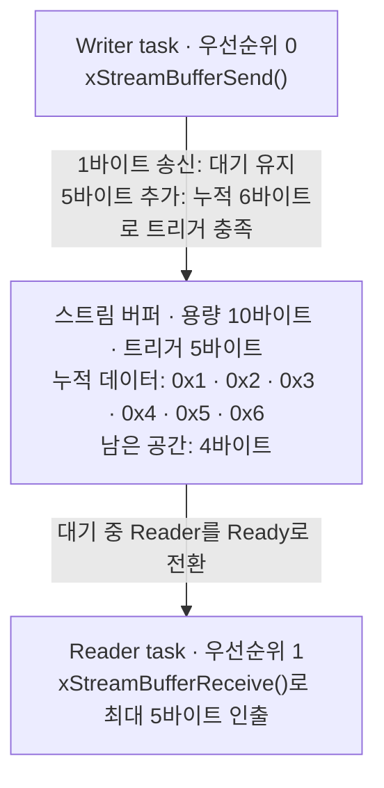
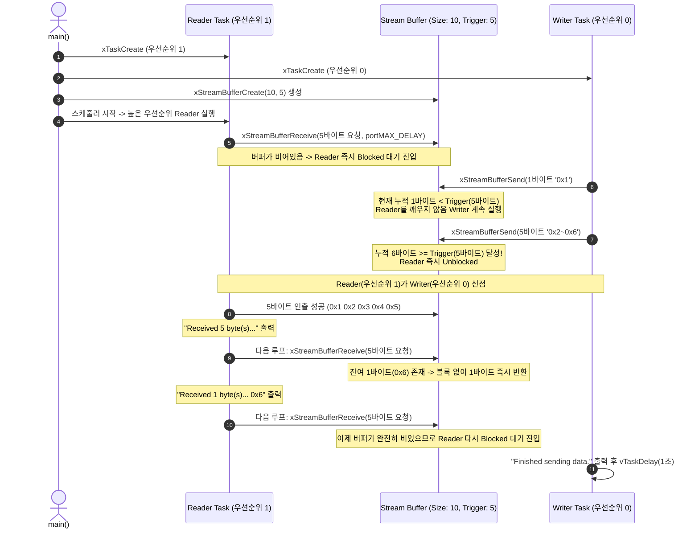

# Tutorial 19: stream buffer

[학습 목차](README.md) · [공통 준비](getting-started.md) · [공식 튜토리얼 번역](../docs/tutorial_19/README.md) · [이전 단원](tutorial_18.md)

이 단원에서는 UART 시리얼 수신이나 오디오 데이터 스트리밍처럼 고정 크기 메시지가 아닌 연속된 바이트 흐름을 단일 송신자(Writer)에서 단일 수신자(Reader)로 매우 적은 오버헤드로 고속 전송할 수 있는 **스트림 버퍼(Stream Buffer)**의 동작 원리와 트리거 레벨(Trigger Level) 제어 메커니즘을 배운다.

---

## 1. 이번 실습에서 할 일

* **해결하려는 문제**: 센서나 UART 통신 인터럽트에서 바이트 단위로 유입되는 데이터를 큐(Queue)에 한 바이트씩 넣으면 큐 메타데이터와 컨텍스트 스위칭 오버헤드가 과도하게 발생한다. 이를 원형 링 버퍼 기반의 연속 바이트 스트림으로 안전하고 효율적으로 전송한다.
* **학습 목표**:
  1. 스트림 버퍼(Stream Buffer)가 일반 큐(Queue)와 어떻게 다르며, 왜 단일 송신자/단일 수신자(SPSC: Single-Producer Single-Consumer) 환경에 최적화되어 있는지 이해한다.
  2. 스트림 버퍼를 생성하고 `xTriggerLevelBytes`(트리거 레벨)가 수신 task의 대기 해제 시점에 미치는 영향을 파악한다.
  3. `xStreamBufferSend()`와 `xStreamBufferReceive()` API를 구현하고, 요청한 바이트 수와 실제 수신된 바이트 수의 관계를 확인한다.

---

## 2. 시작 전 확인

### 2.1 C 언어 바이트 배열과 버퍼 포인터
* `uint8_t ucRxData[ 5 ]`: 수신 버퍼로 사용할 5바이트 크기의 배열이다.
* `&( ucRxData[ 0 ] )`: 배열의 시작 메모리 주소를 가리키는 포인터로, `xStreamBufferReceive()`나 `xStreamBufferSend()`의 데이터 버퍼 인자로 전달된다.
* `size_t`: 스트림 버퍼 API가 실제로 전송하거나 수신한 바이트 수를 반환할 때 사용하는 부호 없는 정수형 타입이다.

### 2.2 확인할 소스 및 설정 파일
* 실습 코드: [`source/tutorials/tutorial_19/source/tutorial_19.c`](../../source/tutorials/tutorial_19/source/tutorial_19.c)
* 설정 파일: [`source/tutorials/tutorial_19/include/FreeRTOSConfig.h`](../../source/tutorials/tutorial_19/include/FreeRTOSConfig.h)
* 참조 해답: [`ko/guides/solutions/tutorial_19.c`](solutions/tutorial_19.c)

> **실습 형태**: `tutorial_19.c` 내부의 **`TODO 1`, `TODO 2`, `TODO 3`, `TODO 4`를 완성하는 구현 실습**이다.

---

## 3. 개념 이해

### 3.1 스트림 버퍼(Stream Buffer)란?
스트림 버퍼는 FreeRTOS에서 **단일 송신자(Writer task 또는 ISR)와 단일 수신자(Reader task 또는 ISR)** 사이에서 연속적인 바이트 데이터를 주고받도록 특화 설계된 링 버퍼(Circular Buffer) 구조체다.



### 3.2 큐(Queue) vs 스트림 버퍼(Stream Buffer)
| 비교 항목 | 큐 (Queue, Tutorial 9) | 스트림 버퍼 (Stream Buffer, Tutorial 19) |
| :--- | :--- | :--- |
| **데이터 단위** | 고정 크기 메시지/아이템 (예: 구조체) | 연속된 바이트 열 (연속 데이터) |
| **다중 접근** | 여러 송신자/수신자 동시 안전 접근 가능 (내부 락 존재) | 기본 사용 계약은 **송신자 1개, 수신자 1개** |
| **메모리 및 오버헤드** | 큐 제어 구조와 고정 크기 항목 저장 공간 필요 | 버퍼 제어 구조와 바이트 저장 공간 필요; 크기·속도는 구성별로 판단 |
| **주요 용도** | task 간 이벤트/명령 패킷 교환 | UART/SPI/I2C 연속 스트림 수신, DMA 버퍼 연동 |

> **중요 제약**: 이 실습은 송신자 1개·수신자 1개 조건을 유지한다. 복수 송신자나 복수 수신자의 무보호 동시 호출은 지원 계약을 벗어난다. 그런 통신에는 큐를 먼저 검토한다. 고정 커널 헤더가 안내하는 다중 접근 방법은 해당 호출 전체를 임계 구역으로 직렬화하고 대기 시간을 0으로 두는 방식이다. ISR까지 포함한 모든 상황에 뮤텍스 하나를 덧붙이면 된다고 일반화할 수 없다.

### 3.3 트리거 레벨(Trigger Level)의 원리
* 스트림 버퍼를 생성할 때 `xTriggerLevelBytes`를 지정한다.
* 데이터를 수신하려는 Reader task가 버퍼가 비어 블록(`Blocked`)되었을 때, 송신자가 데이터를 넣더라도 **송신에 의한 대기 해제는 누적 바이트가 `xTriggerLevelBytes` 이상일 때 일어난다. 유한 대기 시간이 만료되면 트리거 미만의 데이터도 반환할 수 있다.**
* **이유**: 바이트가 1개 들어올 때마다 수신 task를 매번 깨우면 빈번한 컨텍스트 스위칭으로 CPU 성능이 낭비된다. 적정량(예: 5바이트)이 모였을 때 한 번에 깨워 처리하도록 하여 시스템 효율을 극대화한다.

---

## 4. 실행 흐름 읽기

실습 코드에서는 Reader task의 우선순위가 1로 Writer task(우선순위 0)보다 높다.



---

## 5. 코드와 API 이해

### 5.1 `xStreamBufferCreate`
```c
StreamBufferHandle_t xStreamBufferCreate( size_t xBufferSizeBytes,
                                         size_t xTriggerLevelBytes );
```
* **역할**: 스트림 버퍼를 동적으로 생성한다.
* **`xBufferSizeBytes`**: 버퍼가 보관할 수 있는 최대 바이트 수다. (실습에서는 10바이트)
* **`xTriggerLevelBytes`**: 블록 대기 중인 Reader task를 깨우기 위해 버퍼에 최소한 쌓여야 하는 바이트 수다. (실습에서는 5바이트)
* **반환값**: 성공 시 버퍼 핸들(`StreamBufferHandle_t`), 힙 메모리 부족 시 `NULL`.

### 5.2 `xStreamBufferReceive`
```c
size_t xStreamBufferReceive( StreamBufferHandle_t xStreamBuffer,
                             void * pvRxData,
                             size_t xBufferLengthBytes,
                             TickType_t xTicksToWait );
```
* **역할**: 스트림 버퍼에서 최대 `xBufferLengthBytes`만큼 데이터를 읽어 `pvRxData`에 복사한다.
* **동작 특성**:
  * 버퍼가 비어 있고 대기 시간이 양수이면 지정한 범위에서 기다린다. `0`은 즉시 시도하며, 이 설정의 `portMAX_DELAY`는 무기한 대기다.
  * **버퍼에 단 1바이트라도 있으면 블록되지 않고 현재 있는 만큼(최대 `xBufferLengthBytes`)을 즉시 읽고 실제 읽은 바이트 수를 반환한다.**
* **반환값**: 실제로 읽어서 `pvRxData`에 복사한 바이트 수(`size_t`).

### 5.3 `xStreamBufferSend`
```c
size_t xStreamBufferSend( StreamBufferHandle_t xStreamBuffer,
                          const void * pvTxData,
                          size_t xDataLengthBytes,
                          TickType_t xTicksToWait );
```
* **역할**: `pvTxData`에서 `xDataLengthBytes`만큼의 데이터를 스트림 버퍼에 기록한다.
* **동작 특성**:
  * 버퍼에 여유 공간이 부족하면 공간이 생길 때까지 `xTicksToWait` 동안 대기할 수 있다.
  * 기록 후 버퍼에 담긴 총 데이터 양이 `xTriggerLevelBytes` 이상이 되면, 대기 중이던 Reader task를 깨운다.
* **반환값**: 실제로 기록된 바이트 수다. 요청보다 작을 수 있으므로 모두 보냈는지 확인해야 한다.

---

## 6. 직접 구현 또는 관찰 준비

전체 참조 해답은 [tutorial_19.c](solutions/tutorial_19.c)에 있다. 먼저 TODO별 힌트를 따라 작성하고, [자기 코드 보존·해답 적용·복구 절차](getting-started.md#solution-workflow)에 따라 비교한다.

실습 파일: [`source/tutorials/tutorial_19/source/tutorial_19.c`](../../source/tutorials/tutorial_19/source/tutorial_19.c)

### 6.1 TODO 1: 스트림 버퍼 생성
`main()` 함수 내부에서 10바이트 용량, 5바이트 트리거 레벨을 가진 스트림 버퍼를 생성한다.

* **TODO 1 힌트 1**: 저장 용량과 대기 해제 임계값은 서로 다른 인자다.
* **TODO 1 힌트 2**: `main`에서 10바이트 용량과 5바이트 트리거를 사용하고 핸들을 `xStreamBuffer`에 저장한다.

<details>
<summary>TODO 1 해답 코드 보기</summary>

```c
    /*
     * TODO 1 - Create a stream buffer of size 10 using xStreamBufferCreate API.
     */
    xStreamBuffer = xStreamBufferCreate( 10, 5 );
```

**이유**: 저장 용량과 대기 해제 임계값은 서로 다른 인자다.
</details>

### 6.2 TODO 2: 데이터 수신 구현
`prvReaderTask()` 함수 내부에서 최대 5바이트를 수신하도록 구현한다.

* **TODO 2 힌트 1**: 수신 배열 크기를 넘기지 않게 읽고 실제 읽은 길이를 저장한다.
* **TODO 2 힌트 2**: Reader의 `ucRxData` 시작 주소, 최대 5바이트와 `portMAX_DELAY`를 넘기고 `uxReceivedBytes`에 대입한다.

<details>
<summary>TODO 2 해답 코드 보기</summary>

```c
    /*
     * TODO 2 - Read data from the steam buffer using xStreamBufferReceive API.
     */
    uxReceivedBytes = xStreamBufferReceive( xStreamBuffer,
                                           &( ucRxData[ 0 ] ),
                                           5,
                                           portMAX_DELAY );
```

**이유**: 수신 배열 크기를 넘기지 않게 읽고 실제 읽은 길이를 저장한다.
</details>

### 6.3 TODO 3: 1바이트 데이터 송신
`prvWriterTask()` 함수 내부에서 첫 번째 1바이트(`ucTxData[0]`)를 송신한다.

* **TODO 3 힌트 1**: 첫 송신은 배열의 첫 바이트만 기록하여 트리거 미만 상태를 만든다.
* **TODO 3 힌트 2**: Writer에서 `ucTxData[0]`의 주소와 길이 1을 사용하고 실제 길이를 `uxSentBytes`에 저장한다.

<details>
<summary>TODO 3 해답 코드 보기</summary>

```c
    /*
     * TODO 3 - Send 1 byte to the stream buffer using xStreamBufferSend API.
     */
    uxSentBytes = xStreamBufferSend( xStreamBuffer,
                                    &( ucTxData[ 0 ] ),
                                    1,
                                    portMAX_DELAY );
```

**이유**: 첫 송신은 배열의 첫 바이트만 기록하여 트리거 미만 상태를 만든다.
</details>

### 6.4 TODO 4: 5바이트 데이터 송신
`prvWriterTask()` 함수 내부에서 나머지 5바이트(`&(ucTxData[1])`)를 송신한다.

* **TODO 4 힌트 1**: 첫 바이트를 중복하지 않고 나머지 연속 바이트를 보낸다.
* **TODO 4 힌트 2**: 같은 Writer에서 `ucTxData[1]`의 주소부터 길이 5를 보낸다. 핸들과 대기 조건은 그대로다.

<details>
<summary>TODO 4 해답 코드 보기</summary>

```c
    /*
     * TODO 4 - Send 5 bytes to the stream buffer using xStreamBufferSend API.
     */
    uxSentBytes = xStreamBufferSend( xStreamBuffer,
                                    &( ucTxData[ 1 ] ),
                                    5,
                                    portMAX_DELAY );
```

**이유**: 첫 바이트를 중복하지 않고 나머지 연속 바이트를 보낸다.
</details>

---

## 7. 빌드와 실행

[공통 준비](getting-started.md)의 학습용 사본 루트에서 다음 명령을 실행한다:

```bash
# 1. CMake 빌드 구성 (Tutorial 19 지정)
cmake -S source -B build/tutorial_19 -DTUTORIAL=19

# 2. 컴파일 및 빌드
cmake --build build/tutorial_19

# 3. 바이너리 실행
./build/tutorial_19/freertos_example
```

* **종료 방법**: 터미널에서 **`Ctrl + C`**를 누른다.

---

## 8. 결과 해석

### 8.1 출력 예시

원본 조건에서는 바이트 1~6을 5바이트와 1바이트로 나누어 읽는다. 반복 사이의 벽시계 간격은 고정하지 않는다.

```text
Sending 1 byte...
Sending 5 bytes...
Received 5 byte(s)...
0x1 0x2 0x3 0x4 0x5
Received 1 byte(s)...
0x6
Finished sending data.
Sending 1 byte...
Sending 5 bytes...
Received 5 byte(s)...
0x1 0x2 0x3 0x4 0x5
Received 1 byte(s)...
0x6
Finished sending data.
```

### 8.2 판정 기준 및 단계별 상세 분석
1. **1바이트 송신 시 Reader가 깨어나지 않음**:
   * Writer가 `Sending 1 byte...`를 출력하고 1바이트(`0x1`)를 넣었지만, 트리거 레벨이 5이므로 누적 1바이트 상태에서는 Reader가 깨어나지 않는다.
   * 따라서 곧바로 Writer의 `Sending 5 bytes...` 로그가 이어서 출력된다
2. **5바이트 추가 송신 후 합계 6바이트로 트리거 발동**:
   * Writer가 5바이트를 추가로 버퍼에 넣는 순간 누적 바이트가 6바이트가 되어 트리거 레벨(5)을 만족한다.
   * 즉시 더 높은 우선순위의 Reader가 깨어나 Writer를 선점한다.
3. **Reader의 2단계 분할 수신**:
   * Reader의 수신 버퍼는 최대 5바이트(`xBufferLengthBytes = 5`)를 요청했으므로, 버퍼에 있던 6바이트 중 앞선 5바이트(`0x1 0x2 0x3 0x4 0x5`)만 먼저 꺼낸다.
   * `Reader`는 다음 루프에서 다시 `xStreamBufferReceive`를 호출한다. 이때 버퍼에 남아있던 잔여 1바이트(`0x6`)가 즉시 반환되어 `Received 1 byte(s)... 0x6`을 출력한다.
   * 버퍼가 완전히 빈 뒤에야 비로소 Reader가 다시 Blocked 상태가 되고, Writer가 돌아와 `Finished sending data.`를 출력하고 1초 지연에 들어간다.

---

## 9. 막혔을 때 (트러블슈팅)

| 증상 | 원인 | 해결 방법 |
| :--- | :--- | :--- |
| `Sending 1 byte...` 직후에 Reader가 깨어나 1바이트를 읽음 | `xTriggerLevelBytes`를 1로 설정함 | `xStreamBufferCreate(10, 5)`처럼 트리거 레벨을 5로 설정했는지 확인 |
| 컴파일 에러: `StreamBufferHandle_t undeclared` | 헤더 파일 누락 | `#include "stream_buffer.h"`가 포함되어 있는지 확인 |
| 생성 뒤 출력 없이 멈춤 | TODO 누락, 잘못된 크기·핸들 또는 할당 실패 가능성 | 생성 인자와 핸들 대입을 먼저 확인. 이 빌드의 `heap_3`는 호스트 `malloc`을 사용하므로 `configTOTAL_HEAP_SIZE`를 늘려 해결한다고 보지 않음 |

---

## 10. 혼자 확인하기 (자가 점검)

### 질문 1 (트리거 레벨과 블록 대기)
스트림 버퍼에 데이터가 2바이트 들어있는 상태에서 Reader task가 `xStreamBufferReceive(..., 5, portMAX_DELAY)`를 호출했다. 이때 `xTriggerLevelBytes`가 5라면 Reader task는 Blocked로 기다리는가, 아니면 2바이트를 즉시 읽고 반환하는가?

<details>
<summary>정답 및 해설 확인</summary>

* **정답**: 블록되지 않고 2바이트를 즉시 읽고 반환한다.
* **해설**: 트리거 레벨(`xTriggerLevelBytes`)은 **버퍼가 완전히 비어서 Reader가 블록 상태에 들어갔을 때, 다시 깨어나는 기준**으로만 동작한다. 이미 버퍼에 1바이트 이상의 데이터가 존재한다면 `xStreamBufferReceive()`는 트리거 레벨과 무관하게 현재 존재하는 데이터를 요청한 최대 한도 내에서 즉시 반환한다.
</details>

### 질문 2 (설계 제약 조건)
스트림 버퍼를 2개 이상의 Writer task가 공유하여 동시에 `xStreamBufferSend()`를 호출하도록 시스템을 구성하면 어떤 문제가 발생할 수 있으며, 이를 해결하려면 어떻게 해야 하는가?

<details>
<summary>정답 및 해설 확인</summary>

* **정답**: 무보호 동시 호출은 데이터 손상의 원인이 될 수 있다. 먼저 여러 송신자를 지원하는 큐를 검토한다. 스트림 버퍼를 유지하려면 3.2절과 고정 커널 헤더의 직렬화·대기 시간 조건을 따라야 한다. task만 있는 별도 직렬화 설계와 ISR도 있는 설계의 조건을 혼동하지 않는다.
</details>

### 질문 3 (조건 변경과 결과 예측)
`main()`의 `xStreamBufferCreate`에서 두 번째 인자만 `5`에서 `1`로 바꾼다.

실행 전에 어떤 결과가 달라지고 어떤 동작이 그대로 유지될지 적는다. 직접 작성한 코드와 수정 전 파일은 [공통 보존·복구 절차](getting-started.md#solution-workflow)에 따라 보관한다. 위에서 지정한 조건 하나만 바꾸고 `cmake --build build/tutorial_19` 명령으로 다시 빌드한다. 실행 결과를 예측과 비교한 뒤 아래 해설을 확인한다. 해설은 예상 결과를 설명한 것이므로 직접 얻은 로그와 구분한다.

<details>
<summary>예상 결과와 해설 확인</summary>

첫 1바이트 송신 직후 Reader가 실행되어 1바이트를 먼저 읽고, 다음 송신의 5바이트를 이어 읽을 것으로 예상한다. 전체 바이트 순서 1~6은 유지되지만 원본의 5+1 수신 묶음과 달라진다.
</details>

**복구와 재확인**: `main()`의 `xStreamBufferCreate` 호출에서 두 번째 인자를 `1`에서 `5`로 되돌린다. 같은 단원을 다시 빌드하고 실행하여 [8절의 결과](#8-결과-해석)와 비교한다. 결과를 설명하기 어려우면 [관련 개념 다시 읽기](#3-개념-이해)로 돌아간다.

---

## 11. 다음 학습

스트림 버퍼에서 바이트 순서와 트리거·수신 크기의 관계를 살펴보았다.

다음 단원인 **[Tutorial 20: message buffer](tutorial_20.md)**으로 넘어가서, 스트림 버퍼를 기반으로 가변 길이의 이산 메시지(Discrete Message) 경계를 자동으로 보존해 주는 **Message Buffer**를 배운다.

* **공식 FreeRTOS 심화 문서**:
  * [FreeRTOS Official Stream Buffer API Reference](https://www.freertos.org/RTOS-stream-buffer-API.html)
  * *(참고: 이 커널북에는 스트림·메시지 버퍼의 독립 장이 없으므로 공식 API 문서를 참조한다.)*
