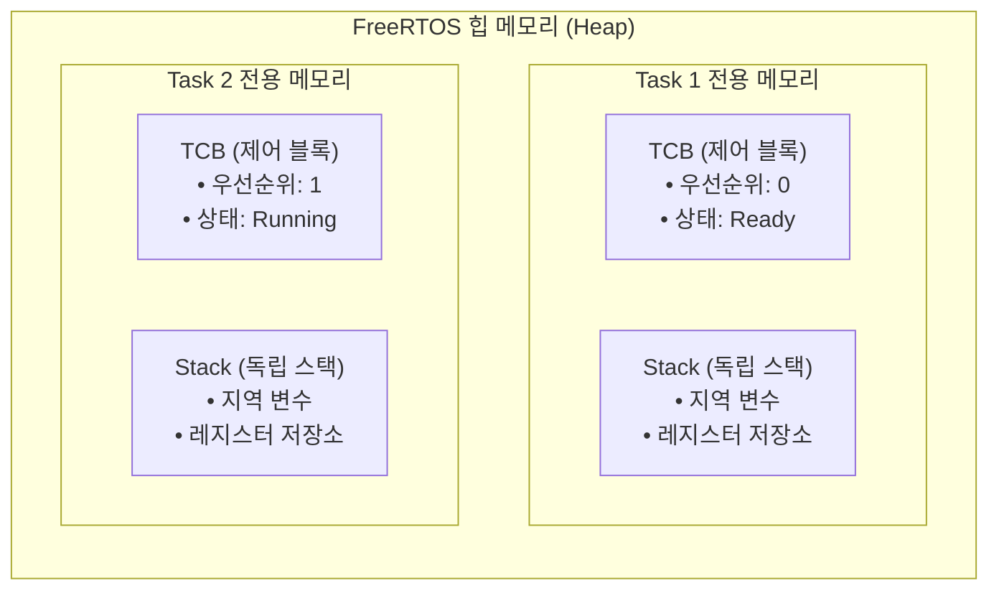
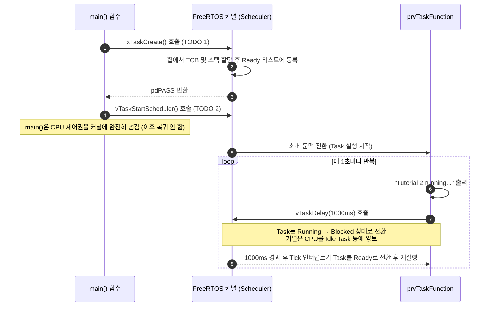

# Tutorial 2: task 생성 (Task Creation)

이 단원에서는 FreeRTOS의 가장 기본적인 실행 단위인 **task(태스크)**를 동적으로 생성하고, 커널의 **scheduler(스케줄러)**를 구동하여 task가 독립적으로 실행되는 과정을 직접 구현한다.

---

## 1. 이번 실습에서 할 일

* **해결하려는 문제**: 단일 루프(`main`) 구조를 벗어나, 운영체제가 관리하는 독립된 실행 흐름인 task를 생성하고 스케줄러에게 CPU 제어권을 넘긴다.
* **학습 목표**:
  1. FreeRTOS task 함수의 프로토타입 규칙과 무한 루프 구조를 설명할 수 있다.
  2. `xTaskCreate()` API의 6가지 매개변수와 반환값(`pdPASS`/`pdFAIL`)의 의미를 이해하고 올바르게 호출한다.
  3. `vTaskStartScheduler()`를 호출하여 커널 멀티태스킹을 시작하고, `vTaskDelay()`를 통한 상태 전이(Running → Blocked)를 관찰한다.

---

## 2. 시작 전 확인

### 2.1 C 언어 핵심 복습
* **함수 포인터 (Function Pointer)**: 함수도 메모리의 특정 주소(코드 영역)에 위치한다. 함수의 이름은 곧 그 함수가 시작되는 메모리 주소를 뜻한다. `xTaskCreate()`의 첫 번째 인자로 함수 이름(`prvTaskFunction`)을 넘기는 것은 커널에게 "이 주소에서 task 코드를 시작하라"고 알려주는 함수 포인터 전달이다.
* **`void *` 포인터 (Generic Pointer)**: 어떠한 데이터 타입의 주소라도 가리킬 수 있는 만능 포인터다. task 생성 시 매개변수나 인자로 넘길 데이터가 없다면 `NULL`을 전달한다.

### 2.2 확인할 소스 및 설정 파일
* 실습 코드: [`source/tutorials/tutorial_2/source/tutorial_2.c`](../../source/tutorials/tutorial_2/source/tutorial_2.c)
* 설정 파일: [`source/tutorials/tutorial_2/include/FreeRTOSConfig.h`](../../source/tutorials/tutorial_2/include/FreeRTOSConfig.h)
* 참조 해답: [`ko/guides/solutions/tutorial_2.c`](solutions/tutorial_2.c)

> **실습 형태**: 이 단원은 `tutorial_2.c` 파일 내부의 **`TODO 1`과 `TODO 2`를 직접 완성하는 구현 실습**이다.

---

## 3. 개념 이해

### 3.1 task(태스크)란 무엇인가?
일반 C 프로그램에서는 `main()` 함수에서 호출된 함수가 작업을 마치고 `return`해야 다음 줄이 실행된다. 하지만 RTOS의 **task**는 마치 자신 혼자만 CPU를 독점해서 사용하는 것처럼 동작하는 **독립적인 소형 프로그램(스레드)**이다.

각 task는 서로의 실행에 간섭하지 않기 위해 다음 두 가지 요소를 반드시 독립적으로 갖는다:
1. **스택 (Stack)**: 해당 task 내부에서 선언된 지역 변수, 함수 호출 기록(복귀 주소), CPU 레지스터 값을 임시 저장하는 메모리 공간.
2. **TCB (Task Control Block)**: task의 이름, 우선순위, 현재 상태(Ready, Blocked 등), 스택 포인터의 위치 등 커널이 task를 관리하기 위한 메타데이터 구조체.



### 3.2 task 함수가 절대 return하면 안 되는 이유
FreeRTOS task 함수는 반드시 다음과 같은 표준 형태를 가져야 한다:

```c
void TaskFunction( void *pvParameters )
{
    /* 1. 작업 초기화 (1회 실행) */

    /* 2. 무한 루프 내에서 작업 반복 */
    for( ;; )
    {
        /* 실제 task 로직 */
        vTaskDelay( ... ); /* CPU 양보 및 대기 */
    }

    /* 절대 루프를 빠져나와 함수 끝에 도달하면 안 됨! */
    /* 만약 task를 종료해야 한다면 반드시 vTaskDelete( NULL ); 을 호출해야 함 */
}
```

일반 함수는 `return` 시 자신을 호출한 부모 함수로 되돌아간다. 하지만 task 함수는 scheduler에 의해 문맥 전환(Context Switch)으로 점프해 들어온 것이므로, 함수 끝에 도달하여 return 명령(`RET`)이 실행되면 돌아갈 유효한 부모 스택 프레임이 없어 **시스템 충돌(HardFault 또는 크래시)**이 발생한다. 따라서 반드시 무한 루프(`for(;;)`)로 동작해야 한다.

---

## 4. 실행 흐름 읽기

`main()` 함수가 시작되어 task가 생성되고 스케줄러가 구동되는 전체 타임라인은 다음과 같다:



---

## 5. 코드와 API 이해

### 5.1 `xTaskCreate()` API 상세 분석
task를 동적으로 생성하는 가장 핵심적인 함수다:

```c
BaseType_t xTaskCreate( TaskFunction_t pxTaskCode,
                       const char * const pcName,
                       const configSTACK_DEPTH_TYPE usStackDepth,
                       void * const pvParameters,
                       UBaseType_t uxPriority,
                       TaskHandle_t * const pxCreatedTask );
```

| 매개변수 | 예제에서 사용한 값 | 상세 의미 및 설정 이유 |
| :--- | :--- | :--- |
| `pxTaskCode` | `prvTaskFunction` | task로 실행할 C 함수의 시작 주소 (함수 포인터). |
| `pcName` | `"Task"` | 디버깅 및 트레이스 시 식별할 문자열 이름 (커널 동작에는 영향 없음). |
| `usStackDepth` | `configMINIMAL_STACK_SIZE` | **스택의 깊이**. 바이트 수가 아니라 `StackType_t` 단위(보통 4바이트 워드)임에 주의! POSIX 포트에서는 pthread 최소 요구 크기로 정의됨. |
| `pvParameters` | `NULL` | task 함수에 넘겨줄 인자 포인터. 이번 실습에서는 전달할 데이터가 없으므로 `NULL`. |
| `uxPriority` | `tskIDLE_PRIORITY` | task의 우선순위. `0`은 유휴(Idle) task와 동일한 최하위 우선순위임. |
| `pxCreatedTask` | `NULL` | 생성된 task를 추후 제어(삭제, 우선순위 변경 등)하기 위한 핸들(포인터)을 받을 변수. 제어가 필요 없으면 `NULL`. |

* **반환값**:
  * `pdPASS` (1): task 생성 성공 (힙 메모리 할당 완료).
  * `errCOULD_NOT_ALLOCATE_REQUIRED_MEMORY` (-1): 힙 메모리가 부족하여 TCB나 스택을 할당하지 못함.

### 5.2 `vTaskStartScheduler()` API
* 커널 scheduler를 시작한다. 내부적으로 시스템 틱(Tick) 타이머 인터럽트를 켜고, 생성된 task 중 가장 우선순위가 높은 task의 문맥을 복원하여 실행을 시작한다.
* **중요한 특성**: scheduler가 성공적으로 시작되면 **이 함수는 결코 리턴하지 않는다!** 즉, `main()` 함수의 `vTaskStartScheduler()` 아래에 있는 코드는 메모리 부족 등으로 스케줄러 시작에 실패하지 않는 한 절대 실행되지 않는다.

### 5.3 `vTaskDelay()`와 `pdMS_TO_TICKS()`
* `vTaskDelay( xTicksToDelay )`: task를 지정한 tick 수만큼 **Blocked 상태(이벤트 또는 시간 대기)**로 전이시킨다. Blocked 상태인 동안에는 CPU를 전혀 낭비하지 않으므로 다른 task나 시스템이 절전 모드로 진입할 수 있다.
* `pdMS_TO_TICKS( ms )`: 밀리초(ms) 단위의 시간을 커널 tick 수로 변환해 주는 매크로다. 시스템의 `configTICK_RATE_HZ`가 1000(1초에 1000틱 = 1틱당 1ms)인 경우 `pdMS_TO_TICKS(1000)`은 1000 tick이 된다.

---

## 6. 직접 구현 또는 관찰 준비

`source/tutorials/tutorial_2/source/tutorial_2.c` 파일을 열고 두 개의 TODO를 채워 넣는다.

### 6.1 TODO 1: `xTaskCreate` 호출하기
`tutorial_2.c`의 46~58행 주석 부분을 찾는다:

* **힌트 1**: 함수의 반환값을 `xTaskCreationResult` 변수에 저장해야 바로 아래의 `configASSERT( xTaskCreationResult == pdPASS );` 검증을 통과한다.
* **힌트 2**: 인자는 주석에 명시된 순서대로 `prvTaskFunction`, `"Task"`, `configMINIMAL_STACK_SIZE`, `NULL`, `tskIDLE_PRIORITY`, `NULL`을 전달한다.

<details>
<summary>TODO 1 해답 코드 보기</summary>

```c
    xTaskCreationResult = xTaskCreate( prvTaskFunction,
                                       "Task",
                                       configMINIMAL_STACK_SIZE,
                                       NULL,
                                       tskIDLE_PRIORITY,
                                       NULL );
```
</details>

### 6.2 TODO 2: `vTaskStartScheduler` 호출하기
`tutorial_2.c`의 62행 주석 부분을 찾는다:

* **힌트 1**: 스케줄러를 시작하는 함수는 인자가 없고 반환값도 없다.

<details>
<summary>TODO 2 해답 코드 보기</summary>

```c
    vTaskStartScheduler();
```
</details>

> 작성한 내용이 맞는지 전체 소스를 비교하고 싶다면 [`ko/guides/solutions/tutorial_2.c`](solutions/tutorial_2.c)를 열어 확인할 수 있다.

---

## 7. 빌드와 실행

저장소 루트에서 다음 명령을 실행하여 빌드하고 실행한다:

```bash
# 1. CMake 빌드 구성 (Tutorial 2 타깃 지정)
cmake -B build -S source -DTUTORIAL=2

# 2. 컴파일 및 빌드
cmake --build build

# 3. 실행
./build/freertos_example
```

* **종료 방법**: 터미널에서 **`Ctrl + C`**를 누른다.

---

## 8. 결과 해석

### 8.1 정상 실행 출력 화면
```text
Tutorial 2 running...
Tutorial 2 running...
Tutorial 2 running...
Tutorial 2 running...
```

### 8.2 출력 해석 및 판정 기준
* **반드시 만족할 조건**: 약 1초(`vTaskDelay(pdMS_TO_TICKS(1000))`) 간격으로 `Tutorial 2 running...` 로그가 계속해서 출력되어야 한다.
* **동작 검증**: 이 문자열은 `main()` 함수가 출력한 것이 아니라, 우리가 생성한 `prvTaskFunction` task가 스케줄러에 의해 선택되어 출력한 것이다.
* **실패 증상**:
  * 프로그램이 아무것도 출력하지 않고 즉시 멈추거나 종료된다면 `TODO 2`의 스케줄러 시작 호출이 누락되었을 가능성이 높다.
  * `Assertion failed` 메시지가 뜬다면 `xTaskCreate` 인자 전달 실패로 힙 할당에 실패한 것이다.

---

## 9. 막혔을 때 (트러블슈팅)

| 증상 | 원인 | 해결 방법 |
| :--- | :--- | :--- |
| `assertion "xTaskCreationResult == pdPASS" failed` 에러 발생 | `xTaskCreate` 반환값을 변수에 대입하지 않았거나 스택 부족 | `xTaskCreationResult = xTaskCreate(...)` 대입문이 올바른지 확인 |
| 실행하자마자 아무 출력 없이 쉘 프롬프트로 복귀함 | `vTaskStartScheduler()` 호출 누락으로 `main()`이 종료됨 | `TODO 2` 자리에 `vTaskStartScheduler();`가 정확히 작성되었는지 확인 |
| 컴파일 에러: `undefined reference to prvTaskFunction` | 함수명 철자 오타 | 첫 번째 인자가 `prvTaskFunction`과 대소문자까지 정확히 일치하는지 확인 |

---

## 10. 혼자 확인하기 (자가 점검)

### 질문 1 (개념)
`xTaskCreate()`의 세 번째 인자인 `usStackDepth`에 숫자 `1024`를 넘기면 이 task에 할당되는 스택 메모리는 총 1024바이트인가?

<details>
<summary>정답 및 해설 확인</summary>

* **정답**: 아니다 (일반적으로 4096바이트이다).
* **이유**: FreeRTOS에서 `usStackDepth`의 단위는 바이트(Byte)가 아니라 **스택 요소의 개수(`StackType_t`)**다. 32비트 MCU나 64비트 POSIX 시스템에서 `StackType_t`는 보통 4바이트(32비트 워드) 크기이므로, `1024`를 전달하면 실제로는 `1024 * 4 = 4096` 바이트의 힙 메모리가 할당된다.
</details>

### 질문 2 (실행 추적)
`tutorial_2.c` 코드 64~68행에는 다음과 같은 코드가 있다:
```c
vTaskStartScheduler();

/* Should not reach here. */
for( ;; )
{
}
```
`vTaskStartScheduler()` 아래에 있는 이 `for(;;)` 루프는 정상적인 실행 상황에서 실행되는가?

<details>
<summary>정답 및 해설 확인</summary>

* **정답**: 절대 실행되지 않는다.
* **이유**: `vTaskStartScheduler()`가 호출되는 순간 커널이 하드웨어 인터럽트를 켜고 가장 우선순위가 높은 task의 스택으로 CPU 스택 포인터를 강제 전환(Context Switch)하기 때문이다. 스케줄러를 시작하기 위한 힙 메모리가 부족하여 스케줄러 진입에 실패하지 않는 한 이 줄로는 제어가 돌아오지 않는다.
</details>

### 질문 3 (비교)
Tutorial 1의 `sleep(1)`과 Tutorial 2의 `vTaskDelay(pdMS_TO_TICKS(1000))`의 가장 결정적인 시스템적 차이는 무엇인가?

<details>
<summary>정답 및 해설 확인</summary>

* **정답**: CPU를 낭비하는 주체와 멀티태스킹 지원 여부다.
* `sleep(1)`은 호스트 운영체제 수준에서 프로세스 전체를 멈추게 만든다. 반면 `vTaskDelay()`는 호출한 특정 task만 **Blocked 상태**로 변경하고, CPU 제어권을 커널 스케줄러에 즉시 양보하여 같은 시간 동안 다른 Ready 상태의 task들이 CPU를 사용할 수 있도록 보장한다.
</details>

### 질문 4 (조건 변형 실험)
`tutorial_2.c`의 `prvTaskFunction` 내부에서 지연 시간을 다음과 같이 200ms로 변경해 보자:
```c
vTaskDelay( pdMS_TO_TICKS( 200 ) );
```
다시 빌드하고 실행하면 터미널 출력 속도는 어떻게 달라지는가?

<details>
<summary>정답 및 해설 확인</summary>

* **정답**: 1초에 약 5번씩 로그가 빠르게 출력된다.
* **원리**: 200ms 동안만 Blocked 상태로 대기한 뒤 매 200ms마다 Ready 상태로 복귀하여 다시 실행되기 때문이다.
</details>

---

## 11. 다음 학습

`xTaskCreate()`는 매우 편리하지만, 힙 메모리를 동적으로 할당하므로 임베디드 안전 필수(Safety-critical) 시스템에서는 힙 고갈이나 메모리 단편화(Fragmentation) 위험이 따를 수 있다.

이제 **[Tutorial 3: 정적 메모리 할당 (Static Allocation)](tutorial_3.md)**으로 넘어가서, 힙 메모리를 쓰지 않고 컴파일 타임에 TCB와 스택 메모리를 직접 할당하는 정적 할당 기법을 배워보자!

* **한국어 커널북 심화 읽기**:
  * [4.2장: task 함수 형태](https://github.com/yunju-baek/FreeRTOS-Kernel-Book-ko/blob/27d03c61cd2a6cf5a6fa6333082218ef706f5b89/ko/ch04.md)
  * [4.4장: task 생성 (xTaskCreate)](https://github.com/yunju-baek/FreeRTOS-Kernel-Book-ko/blob/27d03c61cd2a6cf5a6fa6333082218ef706f5b89/ko/ch04.md)
