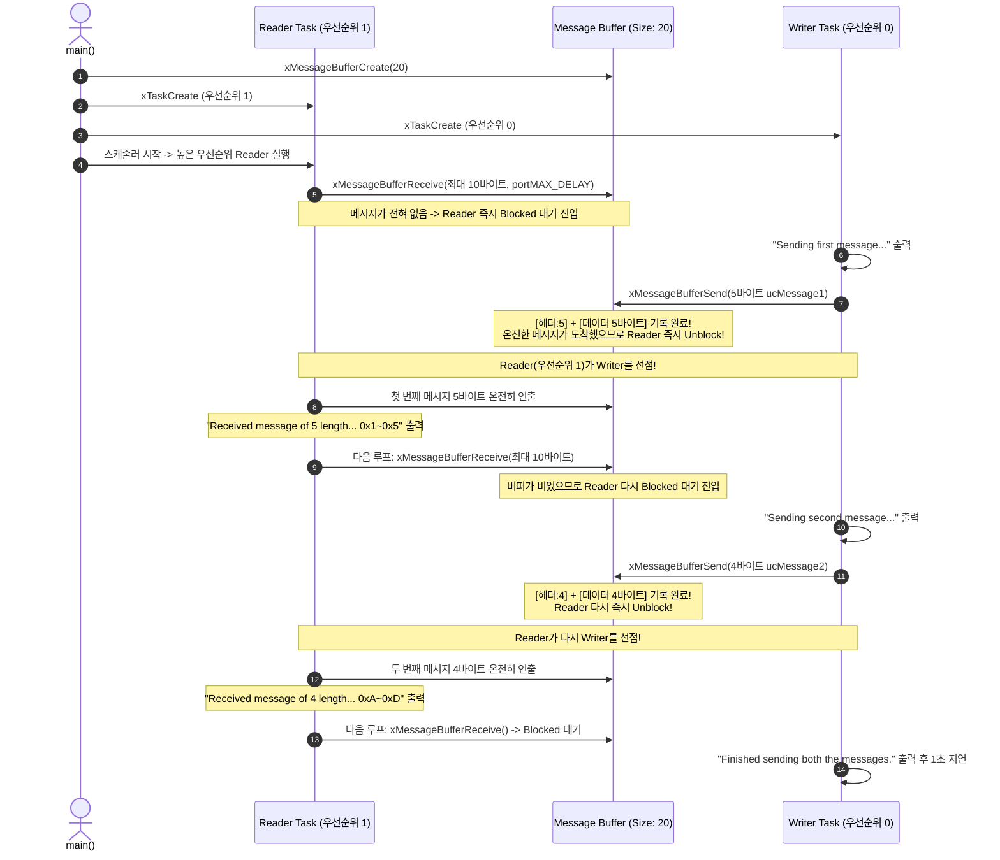

# Tutorial 20: message buffer (Message Buffer)

이 단원에서는 스트림 버퍼(Stream Buffer)를 기반으로 구축되어, 패킷 경계가 없는 단순 바이트 열이 아니라 **가변 길이의 이산 메시지(Discrete Message)**를 온전한 한 단위로 안전하게 주고받을 수 있는 **메시지 버퍼(Message Buffer)**의 동작 원리와 내부 구조를 배운다.

---

## 1. 이번 실습에서 할 일

* **해결하려는 문제**: 스트림 버퍼는 바이트를 쪼개어 읽을 수 있어 송신자가 보낸 패킷의 시작과 끝(경계)을 수신자가 직접 파싱해야 한다. 또한 일반 큐는 크기가 다른 다양한 길이의 메시지를 담기에 메모리 낭비가 심하다. 가변 길이의 메시지를 패킷 경계를 보존하면서 단일 송수신자 간에 가장 효율적으로 전송한다.
* **학습 목표**:
  1. 메시지 버퍼(Message Buffer)가 내부적으로 스트림 버퍼를 어떻게 확장하여 메시지 경계를 보존하는지 이해한다.
  2. 메시지 버퍼의 4바이트(또는 `size_t`) 길이 헤더 메커니즘과 실제 버퍼 용량 계산법을 습득한다.
  3. `xMessageBufferCreate()`, `xMessageBufferSend()`, `xMessageBufferReceive()` API를 구현하고, 한 번에 하나의 완전한 메시지가 수신되는 과정을 관찰한다.

---

## 2. 시작 전 확인

### 2.1 C 언어 배열과 가변 길이 데이터
* `uint8_t ucMessage1[ 5 ]`: 5바이트 크기의 첫 번째 메시지 데이터다.
* `uint8_t ucMessage2[ 4 ]`: 4바이트 크기의 두 번째 메시지 데이터다.
* `uint8_t ucRxData[ 10 ]`: 수신자가 수신할 최대 10바이트 용량의 수신 버퍼다. 메시지 버퍼에서는 수신 버퍼의 크기가 유입되는 메시지 크기보다 반드시 크거나 같아야 한다.

### 2.2 확인할 소스 및 설정 파일
* 실습 코드: [`source/tutorials/tutorial_20/source/tutorial_20.c`](../../source/tutorials/tutorial_20/source/tutorial_20.c)
* 설정 파일: [`source/tutorials/tutorial_20/include/FreeRTOSConfig.h`](../../source/tutorials/tutorial_20/include/FreeRTOSConfig.h)
* 참조 해답: [`ko/guides/solutions/tutorial_20.c`](solutions/tutorial_20.c)

> **실습 형태**: `tutorial_20.c` 내부의 **`TODO 1`, `TODO 2`, `TODO 3`, `TODO 4`를 완성하는 구현 실습**이다.

---

## 3. 개념 이해

### 3.1 메시지 버퍼(Message Buffer)란?
메시지 버퍼는 FreeRTOS에서 **단일 송신자(Writer task 또는 ISR)와 단일 수신자(Reader task 또는 ISR)** 사이에서 서로 다른 크기의 가변 길이 메시지들을 온전한 패킷 단위로 전송하는 특수 버퍼다.

메시지 버퍼는 완전히 독립된 커널 객체가 아니라, **스트림 버퍼(Stream Buffer) 위에 얇게 얹혀진 상위 계층 래퍼(Wrapper)**다.

```mermaid
flowchart TD
    subgraph MessageBuffer["Message Buffer 내부 구조 (총 용량 20바이트)"]
        direction LR
        subgraph Pkt1["첫 번째 메시지 (9 Bytes 소모)"]
            H1["[헤더 4B: 길이=5]"]
            D1["[데이터 5B: 0x1, 0x2, 0x3, 0x4, 0x5]"]
        end
        subgraph Pkt2["두 번째 메시지 (8 Bytes 소모)"]
            H2["[헤더 4B: 길이=4]"]
            D2["[데이터 4B: 0xA, 0xB, 0xC, 0xD]"]
        end
        FREE["[잔여 여유 공간: 3 Bytes]"]
    end

    Writer["Writer Task"] -->|xMessageBufferSend()| MessageBuffer
    MessageBuffer -->|xMessageBufferReceive()| Reader["Reader Task"]
```

### 3.2 스트림 버퍼(T19) vs 메시지 버퍼(T20)
| 비교 항목 | 스트림 버퍼 (Stream Buffer, T19) | 메시지 버퍼 (Message Buffer, T20) |
| :--- | :--- | :--- |
| **데이터 형태** | 연속된 바이트 스트림 (경계 없음) | **이산 메시지 (Discrete Message, 경계 보존)** |
| **내부 헤더** | 헤더 없음 (순수 페이로드만 저장) | 메시지마다 **4바이트(또는 `size_t`) 길이 헤더** 자동 삽입 |
| **수신 동작** | 버퍼에 있는 바이트 중 요청한 만큼(일부) 읽기 가능 | **반드시 메시지 1개 전체를 온전히 수신** (부분 수신 불가) |
| **수신 버퍼 크기 부족 시** | 가능한 만큼 잘라서 반환 | **0 반환하고 데이터를 버퍼에 그대로 남겨둠** |
| **트리거 레벨** | 사용자가 설정한 바이트 수에 도달하면 알림 | 메시지 1개가 완전히 저장되는 순간 자동 알림 |

### 3.3 버퍼 용량 계산 시 주의점 (헤더 오버헤드)
* 메시지 버퍼에 5바이트 데이터를 전송하면, 버퍼 내부에는 데이터 5바이트 외에도 **길이 정보를 담는 4바이트 헤더**가 함께 저장된다.
* 따라서 5바이트 메시지 1개를 담으려면 `4 + 5 = 9바이트`의 버퍼 공간이 필요하다.
* 실습 코드에서 20바이트 크기의 메시지 버퍼를 생성하는 이유:
  * 메시지 1: 5바이트 데이터 + 4바이트 헤더 = 9바이트
  * 메시지 2: 4바이트 데이터 + 4바이트 헤더 = 8바이트
  * 총 필요 공간: 17바이트 $\le$ 20바이트 (안전하게 적재 가능!)

---

## 4. 실행 흐름 읽기

실습 코드에서는 Reader task(우선순위 1)가 Writer task(우선순위 0)보다 우선순위가 높다.



---

## 5. 코드와 API 이해

### 5.1 `xMessageBufferCreate`
```c
MessageBufferHandle_t xMessageBufferCreate( size_t xBufferSizeBytes );
```
* **역할**: 지정된 바이트 크기의 메시지 버퍼를 동적으로 생성한다.
* **`xBufferSizeBytes`**: 버퍼가 보관할 수 있는 총 바이트 용량이다.
  > **주의**: 이 크기에는 각 메시지의 **4바이트 헤더 공간**이 반드시 포함되어야 한다.
* **반환값**: 성공 시 버퍼 핸들(`MessageBufferHandle_t`), 힙 부족 시 `NULL`.

### 5.2 `xMessageBufferReceive`
```c
size_t xMessageBufferReceive( MessageBufferHandle_t xMessageBuffer,
                              void * pvRxData,
                              size_t xBufferLengthBytes,
                              TickType_t xTicksToWait );
```
* **역할**: 메시지 버퍼로부터 다음 대기 중인 이산 메시지 **1개를 통째로** 꺼내어 `pvRxData`에 복사한다.
* **동작 특성**:
  * 메시지가 없으면 `xTicksToWait` 동안 Blocked 상태로 대기한다.
  * **중요 (버퍼 크기 검증)**: 수신자가 전달한 `xBufferLengthBytes`가 도착한 메시지의 실제 길이보다 작으면 데이터를 읽지 않고 `0`을 반환하며 메시지는 버퍼에 그대로 보존된다.
* **반환값**: 성공 시 수신한 메시지의 실제 바이트 길이(`size_t`), 실패/타임아웃 시 `0`.

### 5.3 `xMessageBufferSend`
```c
size_t xMessageBufferSend( MessageBufferHandle_t xMessageBuffer,
                           const void * pvTxData,
                           size_t xDataLengthBytes,
                           TickType_t xTicksToWait );
```
* **역할**: `pvTxData`의 데이터를 `xDataLengthBytes` 길이의 메시지로 포장하여 메시지 버퍼에 기록한다. 내부적으로 앞에 4바이트 길이 헤더가 자동으로 붙는다.
* **반환값**: 성공 시 기록된 페이로드 바이트 수(`xDataLengthBytes`), 버퍼 공간 부족으로 타임아웃 시 `0`.

---

## 6. 직접 구현 또는 관찰 준비

실습 파일: [`source/tutorials/tutorial_20/source/tutorial_20.c`](../../source/tutorials/tutorial_20/source/tutorial_20.c)

### 6.1 TODO 1: 메시지 버퍼 생성
`main()` 함수 내부에서 20바이트 크기의 메시지 버퍼를 생성한다.

```c
    /*
     * TODO 1 - Create a message buffer of size 20 using xMessageBufferCreate API.
     */
    xMessageBuffer = xMessageBufferCreate( 20 );
```

### 6.2 TODO 2: 메시지 수신 구현
`prvReaderTask()` 함수 내부에서 최대 10바이트 크기의 메시지를 수신한다.

```c
    /*
     * TODO 2 - Read a message from the message buffer using xMessageBufferReceive API.
     */
    uxReceivedBytes = xMessageBufferReceive( xMessageBuffer,
                                            &( ucRxData[ 0 ] ),
                                            10,
                                            portMAX_DELAY );
```

### 6.3 TODO 3: 첫 번째 메시지(5바이트) 송신
`prvWriterTask()` 함수 내부에서 `ucMessage1` (5바이트)을 송신한다.

```c
    /*
     * TODO 3 - Send the first message to the message buffer using xMessageBufferSend API.
     */
    uxSentBytes = xMessageBufferSend( xMessageBuffer,
                                     &( ucMessage1[ 0 ] ),
                                     5,
                                     portMAX_DELAY );
```

### 6.4 TODO 4: 두 번째 메시지(4바이트) 송신
`prvWriterTask()` 함수 내부에서 `ucMessage2` (4바이트)를 송신한다.

```c
    /*
     * TODO 4 - Send the second message to the message buffer using xMessageBufferSend API.
     */
    uxSentBytes = xMessageBufferSend( xMessageBuffer,
                                     &( ucMessage2[ 0 ] ),
                                     4,
                                     portMAX_DELAY );
```

---

## 7. 빌드와 실행

저장소 루트에서 다음 명령을 실행한다:

```bash
# 1. CMake 빌드 구성 (Tutorial 20 지정)
cmake -B build -S source -DTUTORIAL=20

# 2. 컴파일 및 빌드
cmake --build build

# 3. 바이너리 실행
./build/freertos_example
```

* **종료 방법**: 터미널에서 **`Ctrl + C`**를 누른다.

---

## 8. 결과 해석

### 8.1 정상 실행 출력 화면
```text
Sending first message...
Received message of 5 length...
0x1 0x2 0x3 0x4 0x5 
Sending second message...
Received message of 4 length...
0xA 0xB 0xC 0xD 
Finished sending both the messages.
Sending first message...
Received message of 5 length...
0x1 0x2 0x3 0x4 0x5 
Sending second message...
Received message of 4 length...
0xA 0xB 0xC 0xD 
Finished sending both the messages.
```

### 8.2 판정 기준 및 단계별 상세 분석
1. **메시지 단위의 즉각 수신**:
   * Writer가 `Sending first message...`를 출력하고 5바이트를 전송하자마자 완전한 메시지가 버퍼에 채워졌으므로 Reader가 즉시 깨어난다.
   * 스트림 버퍼(T19)와 달리 사용자가 트리거 레벨을 수동 계산할 필요 없이, **하나의 메시지가 완성되는 순간 Reader가 깨어난다.**
2. **패킷 경계의 완벽한 보존**:
   * 첫 번째 메시지는 길이 5(`0x1 0x2 0x3 0x4 0x5`), 두 번째 메시지는 길이 4(`0xA 0xB 0xC 0xD`)로 정확히 분리되어 수신된다.
   * 두 메시지가 섞이거나 일부만 잘려 나오는 일 없이 완벽한 독립 패킷으로 전달됨을 확인한다.

---

## 9. 막혔을 때 (트러블슈팅)

| 증상 | 원인 | 해결 방법 |
| :--- | :--- | :--- |
| `xMessageBufferReceive`가 데이터를 안 읽고 계속 0을 반환함 | 수신 버퍼 `xBufferLengthBytes`가 메시지 크기보다 작음 | 수신 버퍼 크기를 유입되는 최대 메시지 크기 이상으로 늘림 |
| `xMessageBufferSend`에서 어설션 실패 (`uxSentBytes != 5`) | 버퍼 용량 부족 | 헤더 크기(4바이트)를 고려하여 `xBufferSizeBytes`를 더 크게 생성 |
| 컴파일 에러: `MessageBufferHandle_t undeclared` | 헤더 파일 누락 | `#include "message_buffer.h"`가 포함되어 있는지 확인 |

---

## 10. 혼자 확인하기 (자가 점검)

### 질문 1 (버퍼 용량 계산)
10바이트 크기의 메시지 2개를 동시에 보관할 수 있는 메시지 버퍼를 생성하려고 합니다. 32비트 아키텍처 환경에서 `xMessageBufferCreate( xBufferSizeBytes )`의 인자로 넘겨야 할 최소 버퍼 크기는 몇 바이트일까요?

<details>
<summary>정답 및 해설 확인</summary>

* **정답**: 최소 28바이트 이상이어야 한다.
* **해설**: 32비트 환경에서 `size_t`는 4바이트이므로, 각 메시지마다 4바이트의 길이 헤더가 추가된다. 메시지 1개당 필요한 공간은 `4(헤더) + 10(데이터) = 14바이트`이다. 2개를 동시에 담아야 하므로 `14 * 2 = 28바이트`의 공간이 필수적이다.
</details>

### 질문 2 (스트림 버퍼와의 결정적 차이)
수신 버퍼 크기가 3바이트인 Reader task가 5바이트짜리 데이터가 들어있는 버퍼를 읽으려고 할 때, 스트림 버퍼(`xStreamBufferReceive`)와 메시지 버퍼(`xMessageBufferReceive`)의 동작 차이는 무엇인가?

<details>
<summary>정답 및 해설 확인</summary>

* **정답**: 스트림 버퍼는 3바이트를 먼저 잘라서 읽고 성공(3 반환)하지만, 메시지 버퍼는 메시지가 손상되는 것을 방지하기 위해 단 1바이트도 읽지 않고 0을 반환하며 메시지를 버퍼에 그대로 남겨둔다.
</details>

---

## 11. 다음 학습

메시지 버퍼를 통해 패킷 경계가 완벽히 보존되는 가변 길이 메시지 통신을 마스터했다!

이제 FreeRTOS 튜토리얼 21개의 대망의 마지막 단원인 **[Tutorial 21: 자원 관리 종합 비교 (Resource Management)](tutorial_21.md)**으로 넘어가서, FreeRTOS가 제공하는 3가지 자원 보호 기법인 **스케줄러 일시 중지(`vTaskSuspendAll`), 상호 배제 뮤텍스(`Mutex`), 임계 구역(`taskENTER_CRITICAL`)**의 적용 범위와 인터럽트 보호 능력을 총체적으로 비교 정리해보자!

* **공식 FreeRTOS 심화 문서**:
  * [FreeRTOS Official Message Buffer API Reference](https://www.freertos.org/RTOS-message-buffer-API.html)
  * *(참고: Message Buffer는 Stream Buffer 기반의 고급 추상화 계층으로 공식 웹 기술문서를 참조한다.)*
