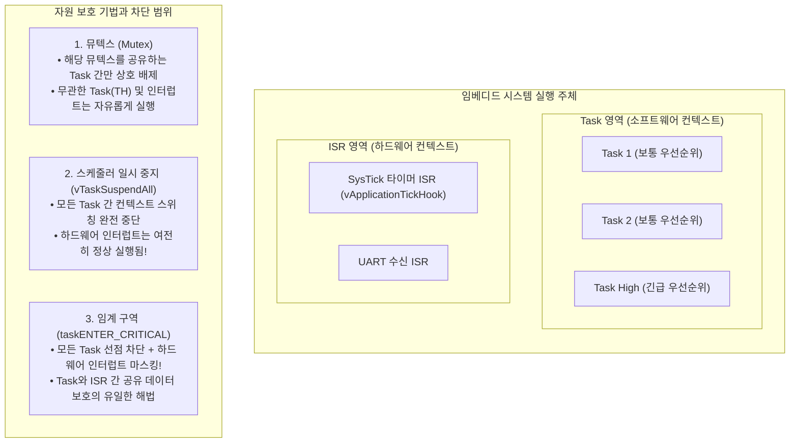
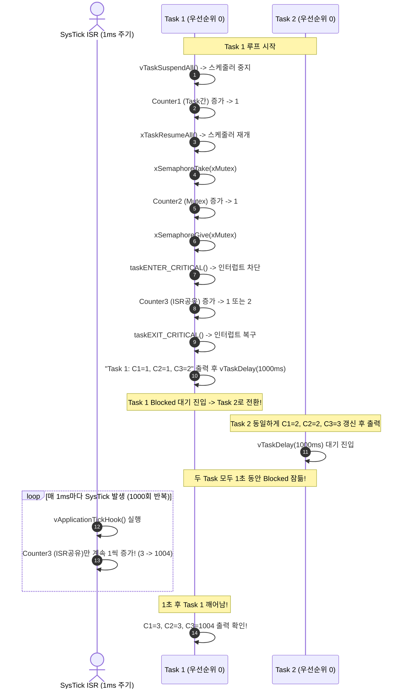

# Tutorial 21: 자원 관리 종합 비교 (Resource Management)

이 단원은 FreeRTOS 튜토리얼의 완결편으로, 다중 task와 하드웨어 인터럽트(ISR)가 공유 자원에 동시에 접근할 때 발생하는 데이터 경쟁(Race Condition)을 방지하기 위한 3대 핵심 보호 기법인 **스케줄러 일시 중지(`vTaskSuspendAll`), 상호 배제 뮤텍스(`Mutex`), 임계 구역(`taskENTER_CRITICAL`)**의 동작 메커니즘과 차이점을 종합적으로 비교 분석한다.

---

## 1. 이번 실습에서 할 일

* **해결하려는 문제**: 공유 변수를 여러 주체가 동시에 `읽기-수정-쓰기(Read-Modify-Write)`할 때 적절한 보호 기법을 적용하지 않으면 데이터가 손실된다. 어떤 상황에서 스케줄러 일시 중지를 쓰고, 언제 뮤텍스를 쓰며, 언제 인터럽트를 차단하는 임계 구역을 써야 하는지 명확한 선택 기준을 확립한다.
* **학습 목표**:
  1. `vTaskSuspendAll() / xTaskResumeAll()`이 task 간 선점은 막지만 하드웨어 인터럽트는 허용하는 동작을 확인한다.
  2. `xSemaphoreCreateMutex()` 기반 뮤텍스가 우선순위 상속을 제공하며 무관한 task의 실행을 방해하지 않는 원리를 되새긴다.
  3. `taskENTER_CRITICAL() / taskEXIT_CRITICAL()`이 하드웨어 인터럽트까지 차단하여 **task와 ISR 사이의 공유 자원**을 보호하는 유일한 수단임을 직접 관찰한다.

---

## 2. 시작 전 확인

### 2.1 C 언어 Read-Modify-Write 연산의 비원자성
* `counter++` 연산은 C 언어에서는 한 줄이지만, 컴파일된 어셈블리 레벨에서는 3단계로 분할된다:
  1. 메모리에서 레지스터로 변수 값을 읽어옴 (Read)
  2. 레지스터 값을 1 증가시킴 (Modify)
  3. 증가된 값을 다시 메모리에 기록함 (Write)
* 이 3단계 중간에 다른 task나 인터럽트가 개입하면 데이터 덮어쓰기(Data Corruption)가 발생한다. 이를 막는 것이 **상호 배제(Mutual Exclusion)**다.

### 2.2 확인할 소스 및 설정 파일
* 실습 코드: [`source/tutorials/tutorial_21/source/tutorial_21.c`](../../source/tutorials/tutorial_21/source/tutorial_21.c)
* 설정 파일: [`source/tutorials/tutorial_21/include/FreeRTOSConfig.h`](../../source/tutorials/tutorial_21/include/FreeRTOSConfig.h)

> **실습 형태**: `tutorial_21.c`는 **완성형 탐구 코드**이다. 빈칸을 채우는 실습이 아니라, 3가지 서로 다른 공유 카운터 변수와 보호 메커니즘의 차이를 실행 전 예측하고 출력 로그를 통해 추적·검증하는 **관찰 및 비교 분석 실습**이다.

---

## 3. 개념 이해

### 3.1 3대 자원 보호 기법의 영역 비교



### 3.2 3대 자원 보호 기법 종합 비교표
| 구분 | 1. 뮤텍스 (Mutex, T13) | 2. 스케줄러 일시 중지 (`vTaskSuspendAll`) | 3. 임계 구역 (`taskENTER_CRITICAL`) |
| :--- | :--- | :--- | :--- |
| **보호 대상** | task 간 공유 자원 | task 간 공유 자원 | **task와 ISR 간 공유 자원** (또는 task 간) |
| **ISR 사용 가능 여부** | 절대 불가 (블록 불가) | 절대 불가 | **ISR 내부에서도 사용 가능** (`...FromISR`) |
| **인터럽트 허용 여부** | 인터럽트 정상 실행 | **인터럽트 정상 실행** | **인터럽트 완전 차단 (지연 발생)** |
| **우선순위 상속** | 지원 (우선순위 역전 방지) | 해당 없음 (스위칭 자체 없음) | 해당 없음 |
| **시스템 영향도** | 매우 적음 (무관한 task 실행 가능) | 중간 (모든 task 실행 멈춤) | 가장 큼 (하드웨어 인터럽트 응답성 저하) |
| **권장 사용처** | 긴 시간 소요되는 I/O, 파일, 통신 | 여러 변수를 원자적으로 갱신하는 짧은 task 구간 | **ISR과 공유하는 초단시간 변수 연산** |

---

## 4. 실행 흐름 읽기

실습 코드에는 3개의 공유 카운터와 이를 갱신하는 주체가 배치되어 있다.



---

## 5. 코드와 API 이해

### 5.1 스케줄러 일시 중지: `vTaskSuspendAll` & `xTaskResumeAll`
```c
vTaskSuspendAll();
{
    ulSharedCounter1BetweenTasks++;
    ulLocalCounter1 = ulSharedCounter1BetweenTasks;
}
xTaskResumeAll();
```
* **동작**: FreeRTOS 커널 내부의 `uxSchedulerSuspended` 카운터를 증가시켜 컨텍스트 스위칭을 동결한다.
* **장점**: 뮤텍스 객체를 생성할 메모리가 없거나 생성 오버헤드를 피하고 싶을 때 매우 가볍게 사용할 수 있다.
* **핵심 유의점**: **하드웨어 인터럽트는 계속 발생하고 실행된다!** 따라서 ISR이 접근하는 데이터는 이 방법으로 보호할 수 없다.

### 5.2 상호 배제 뮤텍스: `xSemaphoreTake` & `xSemaphoreGive`
```c
xSemaphoreTake( xMutex, portMAX_DELAY );
{
    ulSharedCounter2BetweenTasks++;
    ulLocalCounter2 = ulSharedCounter2BetweenTasks;
}
xSemaphoreGive( xMutex );
```
* **동작**: 뮤텍스 토큰을 소유한 task만 코드 블록을 실행할 수 있다.
* **장점**: 이 뮤텍스와 상관없는 다른 높은 우선순위의 독립적인 task들은 정상적으로 선점하여 동작할 수 있으므로 시스템의 실시간성을 해치지 않는다. 우선순위 상속(T14)도 지원된다.

### 5.3 임계 구역: `taskENTER_CRITICAL` & `taskEXIT_CRITICAL`
```c
taskENTER_CRITICAL();
{
    ulSharedCounterBetweenTasksAndInterrupts++;
    ulLocalCounter3 = ulSharedCounterBetweenTasksAndInterrupts;
}
taskEXIT_CRITICAL();
```
* **동작**: 시스템의 하드웨어 인터럽트를 마스킹(비활성화)하여 어떤 인터럽트 서비스 루틴도 실행되지 못하게 막는다.
* **적용 이유**: 실습 코드의 `ulSharedCounterBetweenTasksAndInterrupts`는 1ms마다 발생하는 타이머 인터럽트 훅인 `vApplicationTickHook()`에서도 동시에 접근하여 수정된다.
* **규칙**: 임계 구역 내부 코드는 **수 마이크로초 이내로 가장 짧게 유지**해야 한다. 길어지면 시스템의 하드웨어 인터럽트 처리 지연(Interrupt Latency)이 발생한다.

---

## 6. 직접 구현 또는 관찰 준비

실습 파일: [`source/tutorials/tutorial_21/source/tutorial_21.c`](../../source/tutorials/tutorial_21/source/tutorial_21.c)

### 6.1 세 가지 공유 변수 선언 확인
파일 상단에 세 가지 서로 다른 목적으로 정의된 전역 카운터가 있다:
```c
static uint32_t ulSharedCounter1BetweenTasks = 0;
static uint32_t ulSharedCounter2BetweenTasks = 0;
static uint32_t ulSharedCounterBetweenTasksAndInterrupts = 0;
```

### 6.2 `vApplicationTickHook` 함수 확인
파일 하단에 틱 인터럽트 발생 시마다 커널이 자동 호출하는 훅 함수가 구현되어 있다:
```c
void vApplicationTickHook( void )
{
    ulSharedCounterBetweenTasksAndInterrupts++;
}
```
* 1초 동안 틱 인터럽트(`1000Hz` 기준)가 대략 1000번 발생하므로, 두 task가 1초 동안 `vTaskDelay`로 잠든 사이에 이 세 번째 카운터만 수치가 1000 가까이 급증하게 된다.

---

## 7. 빌드와 실행

저장소 루트에서 다음 명령을 실행한다:

```bash
# 1. CMake 빌드 구성 (Tutorial 21 지정)
cmake -B build -S source -DTUTORIAL=21

# 2. 컴파일 및 빌드
cmake --build build

# 3. 바이너리 실행
./build/freertos_example
```

* **종료 방법**: 터미널에서 **`Ctrl + C`**를 누른다.

---

## 8. 결과 해석

### 8.1 정상 실행 출력 화면
```text
Task 1 ulSharedCounter1BetweenTasks: 1.
Task 1 ulSharedCounter2BetweenTasks: 1.
Task 1 ulSharedCounterBetweenTasksAndInterrupts: 2.
Task 2 ulSharedCounter1BetweenTasks: 2.
Task 2 ulSharedCounter2BetweenTasks: 2.
Task 2 ulSharedCounterBetweenTasksAndInterrupts: 3.
Task 1 ulSharedCounter1BetweenTasks: 3.
Task 1 ulSharedCounter2BetweenTasks: 3.
Task 1 ulSharedCounterBetweenTasksAndInterrupts: 1004.
Task 2 ulSharedCounter1BetweenTasks: 4.
Task 2 ulSharedCounter2BetweenTasks: 4.
Task 2 ulSharedCounterBetweenTasksAndInterrupts: 1005.
```

### 8.2 판정 기준 및 단계별 상세 분석
1. **카운터 1과 2의 순차적 증가 (1 -> 2 -> 3 -> 4)**:
   * `ulSharedCounter1BetweenTasks`와 `ulSharedCounter2BetweenTasks`는 오직 Task 1과 Task 2에 의해서만 증가한다.
   * 따라서 Task 1 실행 시 1, Task 2 실행 시 2, 1초 후 Task 1 실행 시 3, Task 2 실행 시 4로 정확히 1씩 규칙적으로 증가한다.
2. **카운터 3의 폭발적 증가 (3 -> 1004)**:
   * `ulSharedCounterBetweenTasksAndInterrupts`는 처음에는 2, 3으로 찍히지만, 1초의 지연(`vTaskDelay(pdMS_TO_TICKS(1000))`)을 거친 후 갑자기 **`1004`**로 점프한다.
   * 이는 두 task가 잠들어 있는 1초 동안 CPU 하드웨어 타이머 인터럽트가 약 1,000회 발생하여 `vApplicationTickHook()`이 1,000번 이상 실행되었기 때문이다.
3. **보호 메커니즘의 차이 입증**:
   * 만약 세 번째 카운터를 `taskENTER_CRITICAL()` 대신 `vTaskSuspendAll()`이나 `xMutex`로 감쌌다면, task가 카운터를 증가시키는 찰나의 순간에 타이머 인터럽트가 발생하여 카운터 값이 유실되는 경쟁 상태가 발생했을 것이다.
   * 오직 **`taskENTER_CRITICAL()`만이 인터럽트의 진입을 막아 task와 ISR 사이의 완전한 원자성을 보장**함을 눈으로 확인한다.

---

## 9. 막혔을 때 (트러블슈팅)

| 증상 | 원인 | 해결 방법 |
| :--- | :--- | :--- |
| 임계 구역 내부에서 `vTaskDelay()`를 호출했더니 시스템이 멈춤(Crash/Assert) | 임계 구역 안에서 블록 대기 API 호출 금지 위반 | 인터럽트가 꺼진 상태에서는 절대 블록되는 FreeRTOS API를 호출하면 안 됨 |
| 인터럽트 서비스 루틴(ISR)에서 `xSemaphoreTake`를 호출하여 패닉 발생 | ISR은 뮤텍스를 획득할 수 없음 | ISR과 자원을 공유할 때는 반드시 `taskENTER_CRITICAL_FROM_ISR()` 사용 |
| 세 번째 카운터가 1000씩 증가하지 않음 | POSIX 시뮬레이션 환경의 타이머 주기 편차 | 실습 환경에 따라 약간의 오차(예: 990~1010)는 정상적인 인터럽트 타이밍 특성임 |

---

## 10. 혼자 확인하기 (자가 점검)

### 질문 1 (자원 보호 기법 선택)
어떤 임베디드 프로젝트에서 외부 센서의 통신 패킷을 수신하는 하드웨어 인터럽트(ISR)와 이를 가공하는 디스플레이 task가 전역 링 버퍼(Ring Buffer)를 공유하고 있습니다. 이 링 버퍼를 보호하기 위해 디스플레이 task에서 사용해야 할 올바른 보호 메커니즘은 무엇인가?

<details>
<summary>정답 및 해설 확인</summary>

* **정답**: `taskENTER_CRITICAL()`과 `taskEXIT_CRITICAL()`을 사용해야 한다.
* **해설**: 뮤텍스(`Mutex`)나 스케줄러 일시 중지(`vTaskSuspendAll`)는 task 간의 선점만 막을 뿐 하드웨어 인터럽트(ISR)의 진입을 막지 못한다. ISR과 task가 데이터를 공유할 때는 반드시 인터럽트를 차단하는 임계 구역(Critical Section)을 사용해야만 안전하다.
</details>

### 질문 2 (스케줄러 중지와 뮤텍스의 트레이드오프)
단순히 task 간 공유 변수 하나를 보호하려는 상황에서, 뮤텍스(`xSemaphoreCreateMutex`)를 쓰는 것과 `vTaskSuspendAll()`을 쓰는 것의 장단점은 무엇인가?

<details>
<summary>정답 및 해설 확인</summary>

* **정답**:
  * `vTaskSuspendAll()`은 뮤텍스 객체를 생성할 RAM 메모리가 들지 않고 동작이 매우 빠르지만, 시스템 내의 **모든 task의 스케줄링을 통째로 멈추므로** 긴급한 다른 높은 우선순위 task까지 멈추게 만든다.
  * 뮤텍스는 객체 생성 메모리와 우선순위 상속 처리 오버헤드가 있지만, **해당 뮤텍스를 쓰지 않는 다른 독립적인 task들은 정상적으로 선점되어 실행**되므로 시스템 전체의 실시간성에 미치는 영향이 최소화된다.
</details>

---

## 11. 다음 학습

축하합니다! FreeRTOS의 전 과정(Tutorial 01 ~ Tutorial 21)을 완주했다! 🎉

* **우리가 학습한 전체 여정**:
  1. **1단계 (기초 & 메모리)**: 베어메탈 통합, 동적/정적 task 생성, TCB와 스택 구조 (T01~T03)
  2. **2단계 (우선순위 & 스케줄링)**: 우선순위, 기아 상태, task 매개변수, 시분할/비시분할/협력형 스케줄러 (T04~T08)
  3. **3단계 (통신 & 동기화 & 자원 보호)**: 큐 통신, ISR-task 큐 연동, 소프트웨어 타이머, 이진 세마포어, 상호 배제 뮤텍스, 우선순위 역전과 상속 (T09~T14)
  4. **4단계 (이벤트 그룹 & 태스크 알림)**: 이벤트 그룹 복합 대기, 장벽 동기화, 초경량 태스크 알림의 세마포어/이벤트 그룹 에뮬레이션 (T15~T18)
  5. **5단계 (고급 버퍼 & 자원 관리 종합)**: 바이트 단위 스트림 버퍼, 가변 메시지 버퍼, 그리고 3대 자원 보호 기법의 총괄 비교 (T19~T21)

이제 여러분은 FreeRTOS의 모든 핵심 커널 객체와 동기화 메커니즘을 완벽하게 이해하고 실제 임베디드 프로젝트에 적재적소로 설계·적용할 수 있는 탄탄한 실력을 갖추었다.

* **한국어 커널북 심화 읽기**:
  * [7장: 자원 관리 (Resource Management) 전체](https://github.com/yunju-baek/FreeRTOS-Kernel-Book-ko/blob/27d03c61cd2a6cf5a6fa6333082218ef706f5b89/ko/ch07.md)
  * [6.7장: 인터럽트 중첩 및 임계 구역 (Critical Sections)](https://github.com/yunju-baek/FreeRTOS-Kernel-Book-ko/blob/27d03c61cd2a6cf5a6fa6333082218ef706f5b89/ko/ch06.md)
