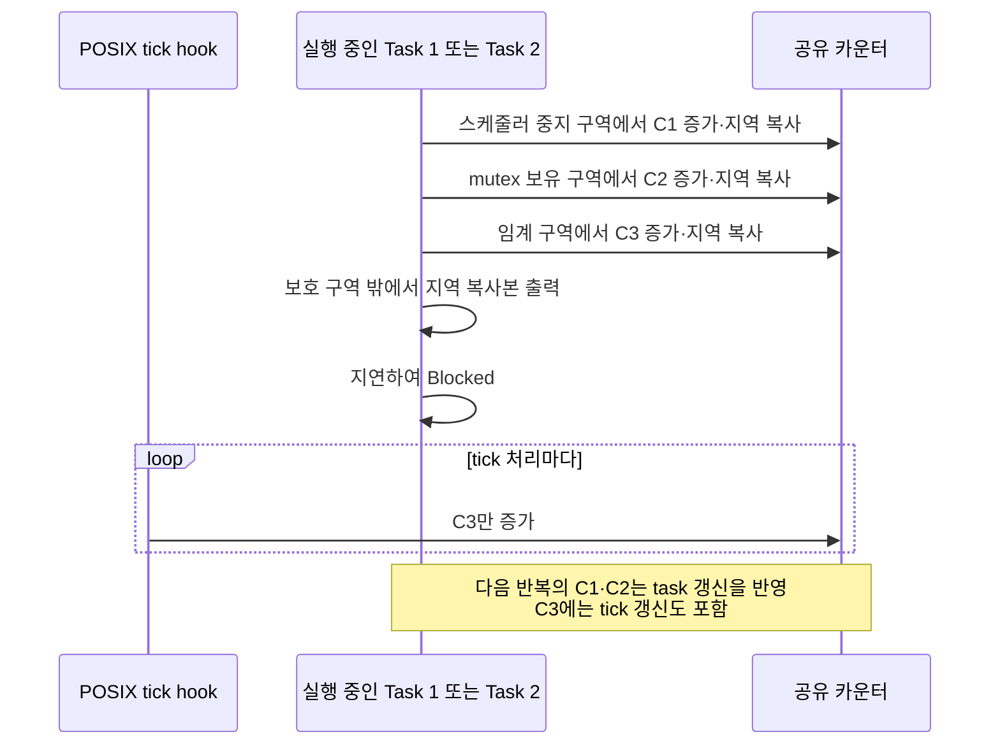

# Tutorial 21: 자원 관리 종합 비교 (Resource Management)

[학습 목차](README.md) · [공통 준비](getting-started.md) · [공식 튜토리얼 번역](../docs/tutorial_21/README.md) · [이전 단원](tutorial_20.md)

이 단원은 FreeRTOS 튜토리얼의 완결편으로, 다중 task와 하드웨어 인터럽트(ISR)가 공유 자원에 동시에 접근할 때 발생하는 데이터 경쟁(Race Condition)을 방지하기 위한 3대 핵심 보호 기법인 **스케줄러 일시 중지(`vTaskSuspendAll`), 상호 배제 뮤텍스(`Mutex`), 임계 구역(`taskENTER_CRITICAL`)**의 동작 메커니즘과 차이점을 종합적으로 비교 분석한다.

---

## 1. 이번 실습에서 할 일

* **해결하려는 문제**: 공유 변수를 여러 주체가 동시에 `읽기-수정-쓰기(Read-Modify-Write)`할 때 적절한 보호 기법을 적용하지 않으면 데이터가 손실된다. 어떤 상황에서 스케줄러 일시 중지를 쓰고, 언제 뮤텍스를 쓰며, 언제 인터럽트를 차단하는 임계 구역을 써야 하는지 명확한 선택 기준을 확립한다.
* **학습 목표**:
  1. `vTaskSuspendAll() / xTaskResumeAll()`이 task 간 선점은 막지만 하드웨어 인터럽트는 허용하는 동작을 확인한다.
  2. `xSemaphoreCreateMutex()` 기반 뮤텍스가 우선순위 상속을 제공하며 무관한 task의 실행을 방해하지 않는 원리를 되새긴다.
  3. `taskENTER_CRITICAL() / taskEXIT_CRITICAL()`이 해당 포트가 마스킹하는 인터럽트 경로와 **task 사이의 공유 자원**을 보호하는 원리를 설명한다.

---

## 2. 시작 전 확인

[T13의 mutex 소유권](tutorial_13.md#3-개념-이해)과 [T10의 ISR 문맥](tutorial_10.md#3-개념-이해)을 먼저 확인한다.

### 2.1 C 언어 Read-Modify-Write 연산의 비원자성
* `counter++` 연산은 C 언어에서는 한 줄이지만, 개념적으로 다음 읽기·수정·쓰기 단계를 포함한다. 실제 명령 수는 CPU와 컴파일러에 따라 다르며 일반 공유 변수의 `++`가 자동으로 동기화되는 것은 아니다:
  1. 메모리에서 레지스터로 변수 값을 읽어옴 (Read)
  2. 레지스터 값을 1 증가시킴 (Modify)
  3. 증가된 값을 다시 메모리에 기록함 (Write)
* 이 3단계 중간에 다른 task나 인터럽트가 개입하면 데이터 덮어쓰기(Data Corruption)가 발생한다. 이를 막는 것이 **상호 배제(Mutual Exclusion)**다.

### 2.2 확인할 소스 및 설정 파일
* 실습 코드: [`source/tutorials/tutorial_21/source/tutorial_21.c`](../../source/tutorials/tutorial_21/source/tutorial_21.c)
* 설정 파일: [`source/tutorials/tutorial_21/include/FreeRTOSConfig.h`](../../source/tutorials/tutorial_21/include/FreeRTOSConfig.h)

> **실습 형태**: `tutorial_21.c`는 **완성형 탐구 코드**이다. 빈칸을 채우는 실습이 아니라, 3가지 서로 다른 공유 카운터 변수와 보호 메커니즘의 차이를 실행 전 예측하고 출력 로그를 통해 추적·검증하는 **관찰 및 비교 분석 실습**이다.

---

## 3. 개념 이해

### 3.1 3대 자원 보호 기법의 영역 비교


### 3.2 3대 자원 보호 기법 종합 비교표
| 구분 | 1. 뮤텍스 (Mutex, T13) | 2. 스케줄러 일시 중지 (`vTaskSuspendAll`) | 3. 임계 구역 (`taskENTER_CRITICAL`) |
| :--- | :--- | :--- | :--- |
| **보호 대상** | task 간 공유 자원 | task 간 공유 자원 | **task와 ISR 간 공유 자원** (또는 task 간) |
| **ISR 사용 가능 여부** | 절대 불가 (블록 불가) | 절대 불가 | 포트가 제공하는 ISR용 진입·복원 쌍 사용 |
| **인터럽트 허용 여부** | 인터럽트 정상 실행 | **인터럽트 정상 실행** | 포트가 정한 범위 마스킹 (지연 발생) |
| **우선순위 상속** | 지원 (우선순위 역전 완화) | 해당 없음 (스위칭 자체 없음) | 해당 없음 |
| **시스템 영향도** | 매우 적음 (무관한 task 실행 가능) | 현재 task 계속 실행, 다른 task로의 전환 지연 | 가장 큼 (하드웨어 인터럽트 응답성 저하) |
| **권장 사용처** | 긴 시간 소요되는 I/O, 파일, 통신 | 여러 변수를 원자적으로 갱신하는 짧은 task 구간 | **ISR과 공유하는 초단시간 변수 연산** |

---

## 4. 실행 흐름 읽기

실습 코드에는 3개의 공유 카운터와 이를 갱신하는 주체가 배치되어 있다.



각 보호 구역과 출력 시점은 다르다. 두 task 중 첫 실행 대상이나 로그에 찍히는 특정 숫자를 고정하지 않는다.

---

## 5. 코드와 API 이해

### 5.1 스케줄러 일시 중지: `vTaskSuspendAll` & `xTaskResumeAll`
```c
vTaskSuspendAll();
{
    ulSharedCounter1BetweenTasks++;
    ulLocalCounter1 = ulSharedCounter1BetweenTasks;
}
xTaskResumeAll();
```
* **동작**: FreeRTOS 커널 내부의 `uxSchedulerSuspended` 카운터를 증가시켜 컨텍스트 스위칭을 동결한다.
* **장점**: 뮤텍스 객체를 생성할 메모리가 없거나 생성 오버헤드를 피하고 싶을 때 매우 가볍게 사용할 수 있다.
* **핵심 유의점**: **하드웨어 인터럽트는 계속 발생하고 실행된다** 따라서 ISR이 접근하는 데이터는 이 방법으로 보호할 수 없다.

### 5.2 상호 배제 뮤텍스: `xSemaphoreTake` & `xSemaphoreGive`
```c
xSemaphoreTake( xMutex, portMAX_DELAY );
{
    ulSharedCounter2BetweenTasks++;
    ulLocalCounter2 = ulSharedCounter2BetweenTasks;
}
xSemaphoreGive( xMutex );
```
* **동작**: 뮤텍스 토큰을 소유한 task만 코드 블록을 실행할 수 있다.
* **장점**: 이 뮤텍스와 상관없는 다른 높은 우선순위의 독립적인 task들은 정상적으로 선점하여 동작할 수 있으므로 이들의 실행 기회를 유지한다. 그래도 자원 보유 시간과 우선순위 상속에 따른 지연은 분석해야 한다. 우선순위 상속(T14)도 지원된다.

### 5.3 임계 구역: `taskENTER_CRITICAL` & `taskEXIT_CRITICAL`
```c
taskENTER_CRITICAL();
{
    ulSharedCounterBetweenTasksAndInterrupts++;
    ulLocalCounter3 = ulSharedCounterBetweenTasksAndInterrupts;
}
taskEXIT_CRITICAL();
```
* **동작**: 이 POSIX 포트에서는 호스트 스레드의 신호 마스크를 이용해 tick 처리 경로 등을 제한한다. MCU에서는 포트가 정한 인터럽트 우선순위 범위만 가릴 수 있으며 그보다 높은 인터럽트는 계속 실행할 수 있다. 모든 하드웨어 인터럽트가 항상 차단된다는 뜻은 아니다.
* **적용 이유**: 실습 코드의 `ulSharedCounterBetweenTasksAndInterrupts`는 1ms마다 발생하는 타이머 인터럽트 훅인 `vApplicationTickHook()`에서도 동시에 접근하여 수정된다.
* **규칙**: 필요한 갱신만 짧게 수행하고 길이는 시스템의 허용 지연으로 판단한다. 임계 구역과 스케줄러 중지 구역에서 Blocked로 대기하거나 yield하는 API를 호출하지 않는다.
* ISR에서는 지원되는 포트의 `taskENTER_CRITICAL_FROM_ISR()`가 반환한 마스크를 보관하고 대응하는 `taskEXIT_CRITICAL_FROM_ISR(savedMask)`로 복원한다. 이 예제의 tick hook에 임의로 task용 진입 코드를 추가하는 실습은 아니다.

---

## 6. 직접 구현 또는 관찰 준비

실습 파일: [`source/tutorials/tutorial_21/source/tutorial_21.c`](../../source/tutorials/tutorial_21/source/tutorial_21.c)

### 6.1 공유 카운터 3개의 선언 확인
파일 상단에는 용도가 서로 다른 전역 카운터 3개가 정의되어 있다:
```c
static uint32_t ulSharedCounter1BetweenTasks = 0;
static uint32_t ulSharedCounter2BetweenTasks = 0;
static uint32_t ulSharedCounterBetweenTasksAndInterrupts = 0;
```

### 6.2 `vApplicationTickHook` 함수 확인
파일 하단에 틱 인터럽트 발생 시마다 커널이 자동 호출하는 훅 함수가 구현되어 있다:
```c
void vApplicationTickHook( void )
{
    ulSharedCounterBetweenTasksAndInterrupts++;
}
```
* 1초 동안 틱 인터럽트(`1000Hz` 기준)가 대략 1000번 발생하므로, 두 task가 1초 동안 `vTaskDelay`로 잠든 사이에 이 세 번째 카운터만 수치가 1000 가까이 급증하게 된다.

---

## 7. 빌드와 실행

[공통 준비](getting-started.md)의 학습용 사본 루트에서 다음 명령을 실행한다:

```bash
# 1. CMake 빌드 구성 (Tutorial 21 지정)
cmake -S source -B build/tutorial_21 -DTUTORIAL=21

# 2. 컴파일 및 빌드
cmake --build build/tutorial_21

# 3. 바이너리 실행
./build/tutorial_21/freertos_example
```

* **종료 방법**: 터미널에서 **`Ctrl + C`**를 누른다.

---

## 8. 결과 해석

### 8.1 출력 예시

아래 숫자·첫 task 순서는 예시다. C1·C2와 C3의 갱신 주체를 구분하고 정확한 숫자 일치는 요구하지 않는다.

```text
Task 1 ulSharedCounter1BetweenTasks: 1.
Task 1 ulSharedCounter2BetweenTasks: 1.
Task 1 ulSharedCounterBetweenTasksAndInterrupts: 2.
Task 2 ulSharedCounter1BetweenTasks: 2.
Task 2 ulSharedCounter2BetweenTasks: 2.
Task 2 ulSharedCounterBetweenTasksAndInterrupts: 3.
Task 1 ulSharedCounter1BetweenTasks: 3.
Task 1 ulSharedCounter2BetweenTasks: 3.
Task 1 ulSharedCounterBetweenTasksAndInterrupts: 1004.
Task 2 ulSharedCounter1BetweenTasks: 4.
Task 2 ulSharedCounter2BetweenTasks: 4.
Task 2 ulSharedCounterBetweenTasksAndInterrupts: 1005.
```

### 8.2 판정 기준 및 해석

* **C1·C2의 갱신 주체**: 두 task가 각 루프에서 한 번씩 증가시킨다. 각 task는 보호 구역 안에서 지역 변수에 복사한 뒤 밖에서 출력하므로, 화면의 줄 순서가 모든 카운터의 갱신 순서와 같지는 않다.
* **C3의 갱신 주체**: 두 task 외에 tick hook도 증가시킨다. 따라서 같은 task의 연속 반복을 비교하면 C1·C2보다 증가 폭이 크게 나타난다. `1004` 같은 특정 값이나 고정 오차 범위를 요구하지 않는다.
* **확인 범위**: 실행 결과와 소스에서 갱신 주체의 차이를 연결한다. 경쟁이 로그에 드러나지 않았다는 사실만으로 보호의 필요성·충분성을 증명하거나, 보호를 빼면 반드시 손실이 재현된다고 주장하지 않는다. 정확성은 접근 주체와 각 보호 범위로 설명한다.

---

## 9. 막혔을 때 (트러블슈팅)

| 증상 | 원인 | 해결 방법 |
| :--- | :--- | :--- |
| 임계 구역 내부에서 `vTaskDelay()`를 호출했더니 시스템이 멈춤(Crash/Assert) | 임계 구역 안에서 블록 대기 API 호출 금지 위반 | 인터럽트가 꺼진 상태에서는 절대 블록되는 FreeRTOS API를 호출하면 안 됨 |
| ISR에서 mutex를 사용함 | mutex는 task 소유권을 전제로 함 | ISR용 큐로 작업을 넘기거나 해당 포트의 마스킹 범위·진입/복원 쌍에 맞게 설계 |
| 세 번째 카운터의 차이가 예상과 다름 | 로그 순서·취득 시점·tick 진행의 영향 가능성 | 같은 task의 연속 반복을 비교하고 configTICK_RATE_HZ와 hook을 확인. 특정 오차 범위를 합격 기준으로 삼지 않음 |

---

## 10. 혼자 확인하기 (자가 점검)

### 질문 1 (자원 보호 기법 선택)
어떤 임베디드 프로젝트에서 외부 센서의 통신 패킷을 수신하는 하드웨어 인터럽트(ISR)와 이를 가공하는 디스플레이 task가 전역 링 버퍼(Ring Buffer)를 공유한다. 이 링 버퍼를 보호하기 위해 디스플레이 task에서 사용해야 할 올바른 보호 메커니즘은 무엇인가?

<details>
<summary>정답 및 해설 확인</summary>

* **정답**: 해당 ISR이 포트의 마스킹 범위에 들어간다면 task 쪽의 짧은 갱신 구역을 `taskENTER_CRITICAL()`과 `taskEXIT_CRITICAL()`로 보호할 수 있다.
* **해설**: mutex와 스케줄러 중지만으로는 ISR의 접근을 막지 못한다. 그러나 임계 구역만이 유일한 설계는 아니다. ISR에서 큐로 데이터를 넘겨 task가 소유하도록 만들거나 적절한 단일 송수신자 구조로 공유 수정 자체를 줄일 수도 있다. 선택한 포트의 ISR 우선순위와 호출 계약을 함께 확인한다.

</details>

### 질문 2 (스케줄러 중지와 뮤텍스의 트레이드오프)
단순히 task 간 공유 변수 하나를 보호하려는 상황에서, 뮤텍스(`xSemaphoreCreateMutex`)를 쓰는 것과 `vTaskSuspendAll()`을 쓰는 것의 장단점은 무엇인가?

<details>
<summary>정답 및 해설 확인</summary>

* **정답**:
  * `vTaskSuspendAll()`은 뮤텍스 객체를 생성할 RAM 메모리가 들지 않고 동작이 매우 빠르지만, 시스템 내의 **모든 task의 스케줄링을 통째로 멈추므로** 긴급한 다른 높은 우선순위 task까지 멈추게 만든다.
  * 뮤텍스는 객체 생성 메모리와 우선순위 상속 처리 오버헤드가 있지만, **해당 뮤텍스를 쓰지 않는 다른 독립적인 task들은 정상적으로 선점되어 실행**되므로 시스템 전체의 실시간성에 미치는 영향이 최소화된다.
</details>

### 질문 3 (조건 변경과 결과 예측)
`prvTask1`의 지연값만 1000ms에서 500ms로 바꾸고 모든 보호 구역과 Task 2는 유지한다.

실행 전에 어떤 결과가 달라지고 어떤 동작이 그대로 유지될지 적는다. 직접 작성한 코드와 수정 전 파일은 [공통 보존·복구 절차](getting-started.md#solution-workflow)에 따라 보관한다. 위에서 지정한 조건 하나만 바꾸고 `cmake --build build/tutorial_21` 명령으로 다시 빌드한다. 실행 결과를 예측과 비교한 뒤 아래 해설을 확인한다. 해설은 예상 결과를 설명한 것이므로 직접 얻은 로그와 구분한다.

<details>
<summary>예상 결과와 해설 확인</summary>

Task 1 반복이 더 잦아져 C1·C2의 시간당 갱신도 늘어날 수 있다. C3에는 계속 tick 갱신이 포함된다. 같은 task의 연속 반복을 비교하며 특정 차이나 race 재현을 요구하지 않는다.
</details>

**복구와 재확인**: `prvTask1`의 지연 시간을 500ms에서 1000ms로 되돌린다. 같은 단원을 다시 빌드하고 실행하여 [8절의 결과](#8-결과-해석)와 비교한다. 결과를 설명하기 어려우면 [관련 개념 다시 읽기](#8-결과-해석)로 돌아간다.

---

## 11. 다음 학습

21개 튜토리얼에서 다룬 개념을 아래 순서로 되짚는다.

* **학습 내용 다시 보기**:
  1. **task 기초(T01–T05)**: 커널 빌드, 동적·정적 생성, 스택, 우선순위와 매개변수.
  2. **스케줄링(T06–T08)**: 선점·시분할·협력형 설정의 차이.
  3. **통신과 타이머(T09–T11)**: task·ISR의 큐 통신과 타이머 콜백.
  4. **동기화와 이벤트(T12–T16)**: 세마포어, mutex, 상속, 이벤트 그룹과 장벽.
  5. **알림·버퍼·자원 보호(T17–T21)**: task 알림, 스트림·메시지 버퍼와 보호 범위 비교.

다음 단계에서는 목표 MCU의 포트, 메모리, 인터럽트 우선순위와 입출력 조건을 확인하여 예제를 적용한다. 이 PC 실습의 빌드·출력 확인이 보드 동작이나 실시간 요구 충족을 대신하지는 않는다.

* **한국어 커널북 심화 읽기**:
  * [8.2절: 임계 구역과 스케줄러 중지](https://github.com/yunju-baek/FreeRTOS-Kernel-Book-ko/blob/27d03c61cd2a6cf5a6fa6333082218ef706f5b89/ko/ch08.md)
  * [7.8절: 인터럽트 중첩](https://github.com/yunju-baek/FreeRTOS-Kernel-Book-ko/blob/27d03c61cd2a6cf5a6fa6333082218ef706f5b89/ko/ch07.md)
