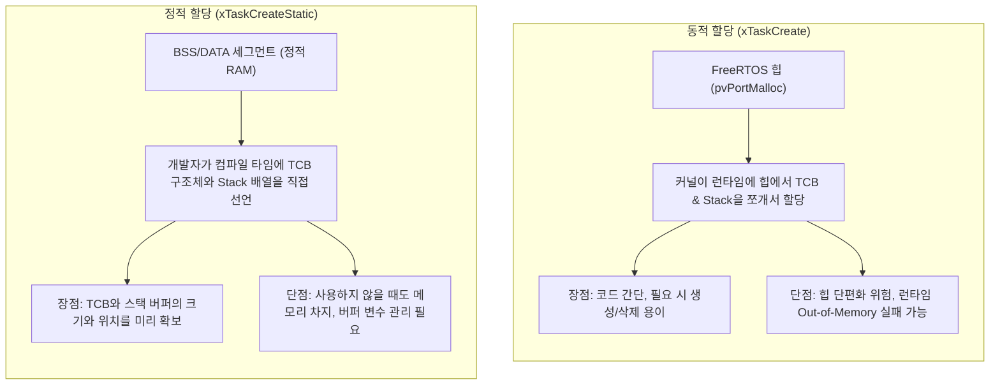
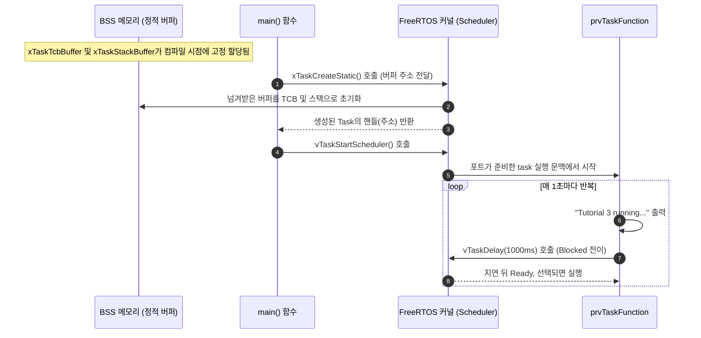

# Tutorial 3: 정적 메모리 할당 (Static Allocation)

[학습 목차](README.md) · [공통 준비](getting-started.md) · [공식 튜토리얼 번역](../docs/tutorial_3/README.md) · [이전 단원](tutorial_2.md)

이 단원에서는 사용자가 TCB와 스택 버퍼를 준비하여 task를 생성하는 **정적 메모리 할당(Static Allocation)** 기법을 배운다.

---

## 1. 이번 실습에서 할 일

* **해결하려는 문제**: 사용자가 TCB와 스택의 저장 공간을 미리 제공하여 커널이 이 버퍼들을 동적으로 할당할 필요가 없게 한다.
* **학습 목표**:
  1. 동적 할당(`xTaskCreate`)과 정적 할당(`xTaskCreateStatic`)의 메모리 관리 주체 차이를 설명할 수 있다.
  2. `StaticTask_t` 구조체와 `StackType_t` 배열을 선언하고 `xTaskCreateStatic()` API에 전달하는 방법을 익힌다.
  3. 반환값으로 전달되는 `TaskHandle_t`의 의미와 검증 방식을 이해한다.

---

## 2. 시작 전 확인

### 2.1 C 언어 핵심 복습
* **변수의 저장 기간 (Storage Duration)**:
  * **지역 변수 (자동 변수)**: 함수 내부에서 선언된 변수는 함수가 실행되는 동안에만 스택 프레임에 존재하며 함수가 종료되면 메모리에서 사라진다.
  * **전역/정적 변수 (`static`)**: 함수 외부 또는 `static` 키워드로 선언된 변수는 프로그램이 시작될 때 BSS 또는 DATA 메모리 영역에 고정 배치되며, 프로그램이 종료될 때까지 메모리에서 영구히 유지된다.
  * **중요**: task의 TCB와 스택은 task가 살아있는 동안 항상 메모리에 유지되어야 하므로, 그 수명을 보장해야 한다. 이 예제처럼 **정적(`static`) 변수**로 두면 그 조건을 명확히 만족한다.

### 2.2 확인할 소스 및 설정 파일
* 실습 코드: [`source/tutorials/tutorial_3/source/tutorial_3.c`](../../source/tutorials/tutorial_3/source/tutorial_3.c)
* 설정 파일: [`source/tutorials/tutorial_3/include/FreeRTOSConfig.h`](../../source/tutorials/tutorial_3/include/FreeRTOSConfig.h)
  * `configSUPPORT_STATIC_ALLOCATION`이 `1`로 설정되어 있어야 정적 할당 API를 사용할 수 있다.
* 참조 해답: [`ko/guides/solutions/tutorial_3.c`](solutions/tutorial_3.c)

> **실습 형태**: 이 단원은 `tutorial_3.c` 내부의 **`TODO 1`과 `TODO 2`를 완성하는 구현 실습**이다.

---

## 3. 개념 이해

### 3.1 동적 할당 vs 정적 할당 비교

FreeRTOS의 task에는 TCB(제어 블록)와 Stack(독립 스택)을 저장할 메모리 영역 2개가 필요하다. 이 저장 공간을 마련하는 방식에 따라 동적 할당과 정적 할당으로 구분한다.



### 3.2 정적 할당으로 확인할 수 있는 범위
TCB와 스택 배열을 미리 선언하면 두 버퍼의 크기와 저장 기간을 확인하기 쉽다. 그렇다고 전체 펌웨어의 RAM 사용량이나 런타임 안전성이 자동으로 보장되지는 않는다. 스택 초과, 잘못된 포인터, 다른 동적 할당은 별도로 점검해야 한다. 특히 이 POSIX 실습은 호스트 스레드와 이벤트 객체에서도 메모리를 사용한다.

---

## 4. 실행 흐름 읽기



---

## 5. 코드와 API 이해

### 5.1 정적 버퍼 선언 (`tutorial_3.c` 42~43행)
```c
static StaticTask_t xTaskTcbBuffer;
static StackType_t xTaskStackBuffer[ configMINIMAL_STACK_SIZE ];
```
* `StaticTask_t xTaskTcbBuffer`: task의 제어 블록(TCB) 크기만큼 메모리를 차지하는 구조체 변수다.
* `StackType_t xTaskStackBuffer[...]`: task의 스택 공간으로 쓰일 배열이다. `configMINIMAL_STACK_SIZE` 개수만큼의 워드가 할당된다.

### 5.2 `xTaskCreateStatic()` API 상세 분석
```c
TaskHandle_t xTaskCreateStatic( TaskFunction_t pxTaskCode,
                                const char * const pcName,
                                const configSTACK_DEPTH_TYPE ulStackDepth,
                                void * const pvParameters,
                                UBaseType_t uxPriority,
                                StackType_t * const puxStackBuffer,
                                StaticTask_t * const pxTaskBuffer );
```

앞의 5개 매개변수는 `xTaskCreate()`와 동일하며, 뒤에 2개의 버퍼 포인터가 추가되었다:

| 매개변수 | 예제에서 사용한 값 | 상세 설명 |
| :--- | :--- | :--- |
| `pxTaskCode` | `prvTaskFunction` | task 함수의 시작 주소. |
| `pcName` | `"Task1"` | 디버깅용 텍스트 이름. |
| `ulStackDepth` | `configMINIMAL_STACK_SIZE` | 스택 배열의 크기 (원소 개수 단위). |
| `pvParameters` | `NULL` | task에 넘길 인자 포인터. |
| `uxPriority` | `tskIDLE_PRIORITY` | task 우선순위 (`0`). |
| `puxStackBuffer` | `&( xTaskStackBuffer[ 0 ] )` | 준비한 스택 배열의 시작 주소 포인터. |
| `pxTaskBuffer` | `&( xTaskTcbBuffer )` | 준비한 `StaticTask_t` 구조체 변수의 주소 포인터. |

* **반환값 타입의 차이**:
  * `xTaskCreate()`는 성공/실패 여부인 `BaseType_t`(`pdPASS`/`errCOULD_NOT_ALLOCATE_REQUIRED_MEMORY`)를 반환했다.
  * 반면 `xTaskCreateStatic()`은 성공 시 **생성된 task의 핸들(`TaskHandle_t`)**을 반환하고, 유효하지 않은 버퍼 인자는 `NULL` 반환이나 assertion의 원인이 된다. 이 설정에서는 assertion으로 먼저 멈출 수 있다.
  * 따라서 검증 코드도 `configASSERT( xCreatedTaskHandle != NULL );`로 작성된다.

---

## 6. 직접 구현 또는 관찰 준비

전체 참조 해답은 [tutorial_3.c](solutions/tutorial_3.c)에 있다. 먼저 TODO별 힌트를 따라 작성하고, [자기 코드 보존·해답 적용·복구 절차](getting-started.md#solution-workflow)에 따라 비교한다.

`source/tutorials/tutorial_3/source/tutorial_3.c` 파일을 열고 두 개의 TODO를 완성한다.

### 6.1 TODO 1: `xTaskCreateStatic` 호출하기
`tutorial_3.c`의 53~66행 주석 부분을 찾는다:


* **TODO 1 힌트 1**: 커널이 버퍼를 새로 할당하는 대신 사용자가 준비한 두 버퍼를 제공한다.
* **TODO 1 힌트 2**: 앞의 다섯 인자 뒤에 스택 배열 시작 주소, TCB 주소 순서로 전달하고 반환 핸들을 `xCreatedTaskHandle`에 저장한다.

<details>
<summary>TODO 1 해답 코드 보기</summary>

```c
    xCreatedTaskHandle = xTaskCreateStatic( prvTaskFunction,
                                            "Task1",
                                            configMINIMAL_STACK_SIZE,
                                            NULL,
                                            tskIDLE_PRIORITY,
                                            &( xTaskStackBuffer[ 0 ] ),
                                            &( xTaskTcbBuffer ) );
```

**이유**: 커널이 버퍼를 새로 할당하는 대신 사용자가 준비한 두 버퍼를 제공한다.
</details>

### 6.2 TODO 2: `vTaskStartScheduler` 호출하기
`tutorial_3.c`의 69행 주석 부분을 찾는다:

* **TODO 2 힌트 1**: 정적 생성도 실행 시작에는 스케줄러가 필요하다.
* **TODO 2 힌트 2**: 핸들 검사를 통과한 뒤 인자 없는 스케줄러 시작 함수를 호출한다.

<details>
<summary>TODO 2 해답 코드 보기</summary>

```c
    vTaskStartScheduler();
```

**이유**: 정적 생성도 실행 시작에는 스케줄러가 필요하다.
</details>

> 전체 완성 코드는 [`ko/guides/solutions/tutorial_3.c`](solutions/tutorial_3.c)에서 확인할 수 있다.

---

## 7. 빌드와 실행

[공통 준비](getting-started.md)의 학습용 사본 루트에서 다음 명령을 실행한다:

```bash
# 1. 빌드 디렉터리 구성 (Tutorial 3 지정)
cmake -S source -B build/tutorial_3 -DTUTORIAL=3

# 2. 컴파일 및 빌드
cmake --build build/tutorial_3

# 3. 바이너리 실행
./build/tutorial_3/freertos_example
```

* **종료 방법**: 터미널에서 **`Ctrl + C`**를 누른다.

---

## 8. 결과 해석

### 8.1 출력 예시

정적 생성 뒤 task가 반복 실행되는지 확인한다. 화면 출력만으로 메모리 할당 경로 전체를 판별하지 않는다.

```text
Tutorial 3 running...
Tutorial 3 running...
Tutorial 3 running...
Tutorial 3 running...
```

### 8.2 판정 기준 및 해석
* **결과의 일관성**: Tutorial 2와 화면에 찍히는 로그(`Tutorial 3 running...`)의 주기나 외형은 비슷한하다.
* **핵심 차이**: Tutorial 2에서는 힙 메모리 관리자(`heap_x.c`)가 호출되어 힙 영역에서 메모리를 동적으로 떼어왔지만, Tutorial 3에서는 **이 task의 TCB와 스택 배열을 사용자가 제공한다**. POSIX 포트 내부의 이벤트와 스레드 구현은 별도 동적 메모리를 사용할 수 있어 전체 실행에서 힙을 전혀 쓰지 않는다는 뜻은 아니다.

---

## 9. 막혔을 때 (트러블슈팅)

| 증상 | 원인 | 해결 방법 |
| :--- | :--- | :--- |
| 출력 없이 멈춤 | 잘못된 버퍼 인자나 반환값 대입 누락으로 assertion에 도달할 수 있음 | 버퍼의 주소·크기·수명과 `xCreatedTaskHandle` 대입 확인. 이 설정의 assertion은 메시지를 출력하지 않음 |
| 컴파일 에러: `undefined reference to xTaskCreateStatic` | `FreeRTOSConfig.h`에서 정적 할당 미지원 설정 | `FreeRTOSConfig.h`의 `#define configSUPPORT_STATIC_ALLOCATION 1` 확인 |
| 컴파일 경고: `assignment to TaskHandle_t from incompatible pointer type` | 매개변수 순서 뒤바뀜 | 6번째가 스택 버퍼(`puxStackBuffer`), 7번째가 TCB 버퍼(`pxTaskBuffer`)인지 순서 재확인 |

---

## 10. 혼자 확인하기 (자가 점검)

### 질문 1 (개념)
정적 task 버퍼의 핵심 조건은 무엇인가? `main()` 지역 변수이면 언제나 스케줄러 시작과 동시에 사라지는가?

<details>
<summary>정답 및 해설 확인</summary>

TCB와 스택은 task가 사용하는 동안 유효해야 한다. 일반 함수가 반환하면 그 자동 변수의 수명이 끝나므로 이런 버퍼를 넘기면 안 된다. 그러나 스케줄러 호출만으로 모든 포트에서 `main()`의 지역 변수가 사라진다고 단정할 수도 없다. 이 예제는 포트의 스택 재사용 여부에 기대지 않도록 파일 범위 `static` 버퍼를 사용한다.
</details>

### 질문 2 (API 비교)
`xTaskCreate()`와 `xTaskCreateStatic()`의 반환값 타입과 성공 시 반환되는 값은 각각 무엇인가?

<details>
<summary>정답 및 해설 확인</summary>

* **정답**:
  * `xTaskCreate()`: 타입은 `BaseType_t`이며, 성공 시 `pdPASS`(1), 메모리 부족 시 `errCOULD_NOT_ALLOCATE_REQUIRED_MEMORY`을 반환한다.
  * `xTaskCreateStatic()`: 타입은 `TaskHandle_t`이며, 성공 시 생성된 task의 핸들 포인터, 유효하지 않은 버퍼는 assertion 또는 `NULL`의 원인이 된다.
</details>

### 질문 3 (설계 응용)
FreeRTOS 공통 커널의 동적 생성 API를 끄고 정적 생성 API만 제공하려면 `FreeRTOSConfig.h` 설정을 어떻게 구성해야 하는가?

<details>
<summary>정답 및 해설 확인</summary>

* **정답**:
  ```c
  #define configSUPPORT_STATIC_ALLOCATION   1
  #define configSUPPORT_DYNAMIC_ALLOCATION  0
  ```
* **범위**: 이 설정은 커널 API의 할당 방식을 제한한다. 애플리케이션, 라이브러리, POSIX 포트까지 동적 할당을 하지 않는다는 보장은 아니다. 정적 Idle task 버퍼 제공 등 포트·프로젝트 요구사항도 충족해야 한다.
</details>

### 질문 4 (조건 변경과 결과 예측)
`prvTaskFunction`의 `pdMS_TO_TICKS(1000)`만 `pdMS_TO_TICKS(500)`으로 바꾼다.

실행 전에 어떤 결과가 달라지고 어떤 동작이 그대로 유지될지 적는다. 직접 작성한 코드와 수정 전 파일은 [공통 보존·복구 절차](getting-started.md#solution-workflow)에 따라 보관한다. 위에서 지정한 조건 하나만 바꾸고 `cmake --build build/tutorial_3` 명령으로 다시 빌드한다. 실행 결과를 예측과 비교한 뒤 아래 해설을 확인한다. 해설은 예상 결과를 설명한 것이므로 직접 얻은 로그와 구분한다.

<details>
<summary>예상 결과와 해설 확인</summary>

출력 빈도가 늘어날 것으로 예상한다. TCB·스택 버퍼를 제공하는 정적 생성 방식과 생성 핸들은 바뀌지 않는다. 로그만으로 전체 힙 사용 여부를 판단할 수는 없다.
</details>

**복구와 재확인**: `prvTaskFunction`의 `pdMS_TO_TICKS(500)`을 `pdMS_TO_TICKS(1000)`으로 되돌린다. 같은 단원을 다시 빌드하고 실행하여 [8절의 결과](#8-결과-해석)와 비교한다. 결과를 설명하기 어려우면 [관련 개념 다시 읽기](#3-개념-이해)로 돌아간다.

---

## 11. 다음 학습

지금까지 단일 task를 생성하고 실행하는 기본 구조를 배웠다.
이제 **[Tutorial 4: task 우선순위 (Task Priorities)](tutorial_4.md)**로 넘어가서, 서로 다른 우선순위를 가진 여러 task가 존재할 때 FreeRTOS 스케줄러가 어떤 규칙으로 CPU를 배분하는지 배운다.

* **한국어 커널북 심화 읽기**:
  * [3.4장: 정적 메모리 할당 (Static Memory Allocation)](https://github.com/yunju-baek/FreeRTOS-Kernel-Book-ko/blob/27d03c61cd2a6cf5a6fa6333082218ef706f5b89/ko/ch03.md)
