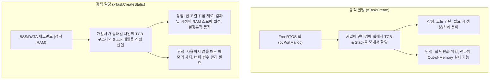
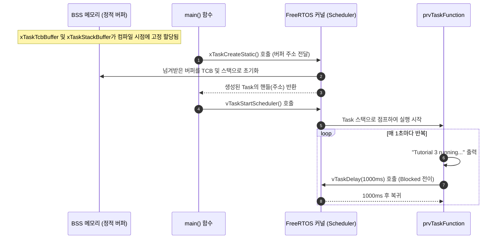

# Tutorial 3: 정적 메모리 할당 (Static Allocation)

이 단원에서는 힙(Heap) 메모리를 사용하지 않고, 컴파일 시점에 사용자가 직접 메모리 버퍼를 준비하여 task를 생성하는 **정적 메모리 할당(Static Allocation)** 기법을 배운다.

---

## 1. 이번 실습에서 할 일

* **해결하려는 문제**: 런타임 힙 고갈이나 메모리 단편화(Fragmentation) 위험이 없는 높은 신뢰성의 시스템을 구축하기 위해 task의 TCB와 스택을 정적으로 할당한다.
* **학습 목표**:
  1. 동적 할당(`xTaskCreate`)과 정적 할당(`xTaskCreateStatic`)의 메모리 관리 주체 차이를 설명할 수 있다.
  2. `StaticTask_t` 구조체와 `StackType_t` 배열을 선언하고 `xTaskCreateStatic()` API에 전달하는 방법을 익힌다.
  3. 반환값으로 전달되는 `TaskHandle_t`의 의미와 검증 방식을 이해한다.

---

## 2. 시작 전 확인

### 2.1 C 언어 핵심 복습
* **변수의 저장 기간 (Storage Duration)**:
  * **지역 변수 (자동 변수)**: 함수 내부에서 선언된 변수는 함수가 실행되는 동안에만 스택 프레임에 존재하며 함수가 종료되면 메모리에서 사라진다.
  * **전역/정적 변수 (`static`)**: 함수 외부 또는 `static` 키워드로 선언된 변수는 프로그램이 시작될 때 BSS 또는 DATA 메모리 영역에 고정 배치되며, 프로그램이 종료될 때까지 메모리에서 영구히 유지된다.
  * **중요**: task의 TCB와 스택은 task가 살아있는 동안 항상 메모리에 유지되어야 하므로, 반드시 **전역 변수** 또는 **정적(`static`) 변수**로 선언해야 한다!

### 2.2 확인할 소스 및 설정 파일
* 실습 코드: [`source/tutorials/tutorial_3/source/tutorial_3.c`](../../source/tutorials/tutorial_3/source/tutorial_3.c)
* 설정 파일: [`source/tutorials/tutorial_3/include/FreeRTOSConfig.h`](../../source/tutorials/tutorial_3/include/FreeRTOSConfig.h)
  * `configSUPPORT_STATIC_ALLOCATION`이 `1`로 설정되어 있어야 정적 할당 API를 사용할 수 있다.
* 참조 해답: [`ko/guides/solutions/tutorial_3.c`](solutions/tutorial_3.c)

> **실습 형태**: 이 단원은 `tutorial_3.c` 내부의 **`TODO 1`과 `TODO 2`를 완성하는 구현 실습**이다.

---

## 3. 개념 이해

### 3.1 동적 할당 vs 정적 할당 비교

FreeRTOS의 모든 task는 TCB(제어 블록)와 Stack(독립 스택)이라는 2개의 메모리 덩어리를 필요로 한다. 이 둘을 누가 어떻게 마련해 주느냐에 따라 동적과 정적으로 나뉜다.



### 3.2 안전 필수(Safety-critical) 시스템에서 정적 할당을 선호하는 이유
자동차 전장(ISO 26262), 항공우주(DO-178C), 의료기기 등 사람의 생명과 직결된 시스템에서는 런타임에 힙 메모리가 부족하여 task 생성이 실패하는 상황을 절대 허용하지 않는다.  
정적 할당을 사용하면 컴파일/링크 시점에 전체 펌웨어의 RAM 사용량이 100% 확정되므로, 링커 단계에서 메모리 초과 여부를 즉시 발견할 수 있어 런타임 안정성이 완벽하게 보장된다.

---

## 4. 실행 흐름 읽기



---

## 5. 코드와 API 이해

### 5.1 정적 버퍼 선언 (`tutorial_3.c` 42~43행)
```c
static StaticTask_t xTaskTcbBuffer;
static StackType_t xTaskStackBuffer[ configMINIMAL_STACK_SIZE ];
```
* `StaticTask_t xTaskTcbBuffer`: task의 제어 블록(TCB) 크기만큼 메모리를 차지하는 구조체 변수다.
* `StackType_t xTaskStackBuffer[...]`: task의 스택 공간으로 쓰일 배열이다. `configMINIMAL_STACK_SIZE` 개수만큼의 워드가 할당된다.

### 5.2 `xTaskCreateStatic()` API 상세 분석
```c
TaskHandle_t xTaskCreateStatic( TaskFunction_t pxTaskCode,
                                const char * const pcName,
                                const uint32_t ulStackDepth,
                                void * const pvParameters,
                                UBaseType_t uxPriority,
                                StackType_t * const puxStackBuffer,
                                StaticTask_t * const pxTaskBuffer );
```

앞의 5개 매개변수는 `xTaskCreate()`와 동일하며, 뒤에 2개의 버퍼 포인터가 추가되었다:

| 매개변수 | 예제에서 사용한 값 | 상세 설명 |
| :--- | :--- | :--- |
| `pxTaskCode` | `prvTaskFunction` | task 함수의 시작 주소. |
| `pcName` | `"Task1"` | 디버깅용 텍스트 이름. |
| `ulStackDepth` | `configMINIMAL_STACK_SIZE` | 스택 배열의 크기 (원소 개수 단위). |
| `pvParameters` | `NULL` | task에 넘길 인자 포인터. |
| `uxPriority` | `tskIDLE_PRIORITY` | task 우선순위 (`0`). |
| `puxStackBuffer` | `&( xTaskStackBuffer[ 0 ] )` | 준비한 스택 배열의 시작 주소 포인터. |
| `pxTaskBuffer` | `&( xTaskTcbBuffer )` | 준비한 `StaticTask_t` 구조체 변수의 주소 포인터. |

* **반환값 타입의 차이**:
  * `xTaskCreate()`는 성공/실패 여부인 `BaseType_t`(`pdPASS`/`pdFAIL`)를 반환했다.
  * 반면 `xTaskCreateStatic()`은 성공 시 **생성된 task의 핸들(`TaskHandle_t`)**을 반환하고, 버퍼 포인터가 잘못 전달된 경우 `NULL`을 반환한다.
  * 따라서 검증 코드도 `configASSERT( xCreatedTaskHandle != NULL );`로 작성된다.

---

## 6. 직접 구현 또는 관찰 준비

`source/tutorials/tutorial_3/source/tutorial_3.c` 파일을 열고 두 개의 TODO를 완성한다.

### 6.1 TODO 1: `xTaskCreateStatic` 호출하기
`tutorial_3.c`의 53~66행 주석 부분을 찾는다:

* **힌트 1**: 함수의 반환값을 `xCreatedTaskHandle` 변수에 저장해야 바로 아래의 `configASSERT( xCreatedTaskHandle != NULL );` 검증을 통과한다.
* **힌트 2**: 스택 버퍼에는 `&( xTaskStackBuffer[ 0 ] )`를, TCB 버퍼에는 `&( xTaskTcbBuffer )`를 전달한다.

<details>
<summary>TODO 1 해답 코드 보기</summary>

```c
    xCreatedTaskHandle = xTaskCreateStatic( prvTaskFunction,
                                            "Task1",
                                            configMINIMAL_STACK_SIZE,
                                            NULL,
                                            tskIDLE_PRIORITY,
                                            &( xTaskStackBuffer[ 0 ] ),
                                            &( xTaskTcbBuffer ) );
```
</details>

### 6.2 TODO 2: `vTaskStartScheduler` 호출하기
`tutorial_3.c`의 69행 주석 부분을 찾는다:

<details>
<summary>TODO 2 해답 코드 보기</summary>

```c
    vTaskStartScheduler();
```
</details>

> 전체 완성 코드는 [`ko/guides/solutions/tutorial_3.c`](solutions/tutorial_3.c)에서 확인할 수 있다.

---

## 7. 빌드와 실행

저장소 루트에서 다음 명령을 실행한다:

```bash
# 1. 빌드 디렉터리 구성 (Tutorial 3 지정)
cmake -B build -S source -DTUTORIAL=3

# 2. 컴파일 및 빌드
cmake --build build

# 3. 바이너리 실행
./build/freertos_example
```

* **종료 방법**: 터미널에서 **`Ctrl + C`**를 누른다.

---

## 8. 결과 해석

### 8.1 정상 실행 출력 화면
```text
Tutorial 3 running...
Tutorial 3 running...
Tutorial 3 running...
Tutorial 3 running...
```

### 8.2 판정 기준 및 해석
* **결과의 일관성**: Tutorial 2와 화면에 찍히는 로그(`Tutorial 3 running...`)의 주기나 외형은 완전히 동일하다.
* **핵심 차이**: Tutorial 2에서는 힙 메모리 관리자(`heap_x.c`)가 호출되어 힙 영역에서 메모리를 동적으로 떼어왔지만, Tutorial 3에서는 **힙 관리 함수가 단 한 번도 호출되지 않고** BSS 세그먼트에 고정된 전역 메모리 주소에서 task가 실행되었다.

---

## 9. 막혔을 때 (트러블슈팅)

| 증상 | 원인 | 해결 방법 |
| :--- | :--- | :--- |
| `assertion "xCreatedTaskHandle != NULL" failed` | 반환값 대입 누락 또는 버퍼 주소로 `NULL` 전달 | `xCreatedTaskHandle = xTaskCreateStatic(...)` 대입 확인 |
| 컴파일 에러: `undefined reference to xTaskCreateStatic` | `FreeRTOSConfig.h`에서 정적 할당 미지원 설정 | `FreeRTOSConfig.h`의 `#define configSUPPORT_STATIC_ALLOCATION 1` 확인 |
| 컴파일 경고: `assignment to TaskHandle_t from incompatible pointer type` | 매개변수 순서 뒤바뀜 | 6번째가 스택 버퍼(`puxStackBuffer`), 7번째가 TCB 버퍼(`pxTaskBuffer`)인지 순서 재확인 |

---

## 10. 혼자 확인하기 (자가 점검)

### 질문 1 (개념)
`tutorial_3.c`에서 선언한 `xTaskTcbBuffer`와 `xTaskStackBuffer`를 파일 상단의 `static` 변수가 아니라, `main()` 함수 내부의 지역 변수(`StaticTask_t xTaskTcbBuffer;`)로 선언하면 어떤 치명적인 문제가 발생하는가?

<details>
<summary>정답 및 해설 확인</summary>

* **정답**: 스택 오염 및 시스템 크래시(HardFault)가 발생한다.
* **이유**: `main()` 함수 내부의 지역 변수는 `main()` 함수의 스택 프레임에 위치한다. 스케줄러가 시작되어 다른 task로 문맥 전환이 일어나거나 `main()`의 스택 영역이 재사용되면, task의 TCB와 스택 내용이 다른 데이터로 덮어쓰여져 커널이 오작동하게 된다. 따라서 정적 할당 버퍼는 반드시 **영구히 존재하는 전역 또는 정적(`static`) 메모리 영역**에 선언해야 한다.
</details>

### 질문 2 (API 비교)
`xTaskCreate()`와 `xTaskCreateStatic()`의 반환값 타입과 성공 시 반환되는 값은 각각 무엇인가?

<details>
<summary>정답 및 해설 확인</summary>

* **정답**:
  * `xTaskCreate()`: 타입은 `BaseType_t`이며, 성공 시 `pdPASS`(1), 메모리 부족 시 `pdFAIL`(또는 `errCOULD_NOT_ALLOCATE_REQUIRED_MEMORY`)을 반환한다.
  * `xTaskCreateStatic()`: 타입은 `TaskHandle_t`이며, 성공 시 생성된 task의 핸들 포인터, 실패 시 `NULL`을 반환한다.
</details>

### 질문 3 (설계 응용)
만약 시스템에 동적 힙 할당을 완전히 배제하고 오직 정적 할당만 허용하고 싶다면 `FreeRTOSConfig.h` 설정을 어떻게 구성해야 하는가?

<details>
<summary>정답 및 해설 확인</summary>

* **정답**:
  ```c
  #define configSUPPORT_STATIC_ALLOCATION   1
  #define configSUPPORT_DYNAMIC_ALLOCATION  0
  ```
* **효과**: 힙 관리 파일(`heap_x.c`)을 프로젝트에서 완전히 제거할 수 있어 코드 크기를 줄이고 메모리 단편화 가능성을 원천 차단한다.
</details>

---

## 11. 다음 학습

지금까지 단일 task를 생성하고 실행하는 기본 구조를 배웠다.  
이제 **[Tutorial 4: task 우선순위 (Task Priorities)](tutorial_4.md)**로 넘어가서, 서로 다른 우선순위를 가진 여러 task가 존재할 때 FreeRTOS 스케줄러가 어떤 규칙으로 CPU를 배분하는지 배워보자!

* **한국어 커널북 심화 읽기**:
  * [3.4장: 정적 메모리 할당 (Static Memory Allocation)](https://github.com/yunju-baek/FreeRTOS-Kernel-Book-ko/blob/27d03c61cd2a6cf5a6fa6333082218ef706f5b89/ko/ch03.md)
