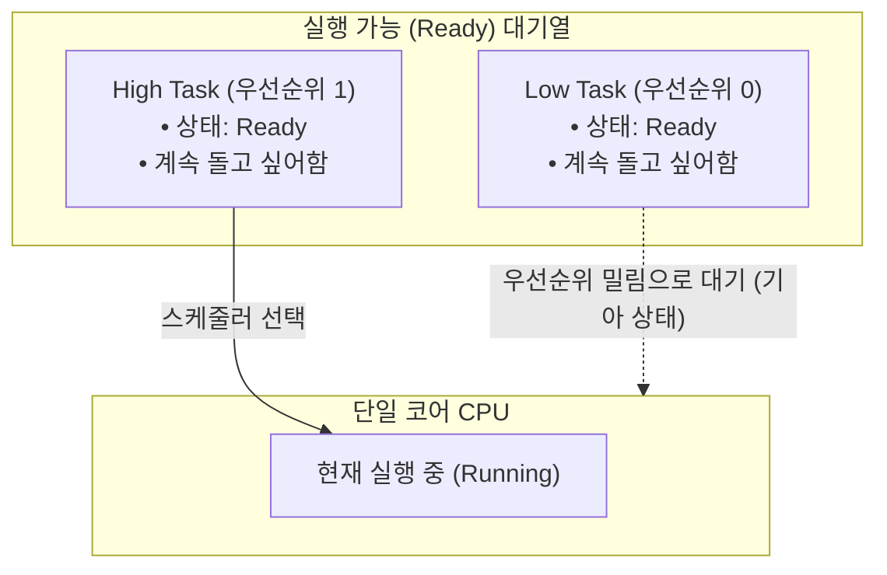
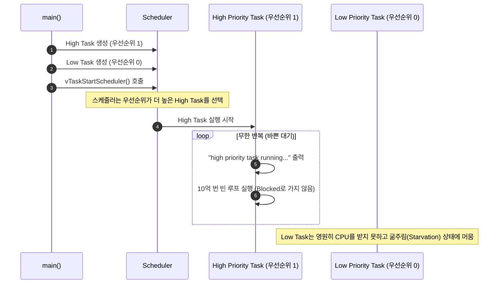

# Tutorial 4: task 우선순위 (Task Priorities)

[학습 목차](README.md) · [공통 준비](getting-started.md) · [공식 튜토리얼 번역](../docs/tutorial_4/README.md) · [이전 단원](tutorial_3.md)

이 단원에서는 FreeRTOS 스케줄러가 여러 task 중 어떤 task를 선택하여 CPU를 할당하는지 결정하는 **우선순위(Priority)**의 기본 원칙과, 상위 task가 CPU를 독점할 때 발생하는 **기아 상태(Starvation)**를 실습한다.

---

## 1. 이번 실습에서 할 일

* **해결하려는 문제**: 긴급하고 중요한 작업이 덜 중요한 작업보다 항상 먼저 실행되도록 우선순위를 지정하는 방법을 배운다.
* **학습 목표**:
  1. FreeRTOS의 우선순위 숫자 체계(숫자가 클수록 높은 우선순위)를 설명할 수 있다.
  2. 우선순위가 다른 두 task("High", "Low")를 생성하고, 스케줄러의 우선순위 기반 선점 동작을 관찰한다.
  3. 높은 우선순위 task가 CPU를 양보하지 않을 때 낮은 우선순위 task가 겪는 **기아 상태(Starvation)**의 원인과 해결책을 이해한다.

---

## 2. 시작 전 확인

### 2.1 C 언어 핵심 복습
* **바쁜 대기 (Busy Wait)**: 아무런 일도 하지 않는 빈 반복문(`for( i = 0; i < 1000000000; i++ );`)을 돌며 시간을 때우는 방식이다. FreeRTOS에 대기를 요청하지 않으므로 실행 가능 상태를 유지한다. 실행 중에는 Running이며, 더 높은 task나 같은 우선순위의 시분할에 의해 전환될 수 있다.
* **지연 함수와의 차이**: `vTaskDelay()`는 CPU를 즉시 양보하고 **Blocked 상태**로 들어가지만, 바쁜 대기 루프 자체는 task를 Blocked로 만들지 않는다.

### 2.2 확인할 소스 및 설정 파일
* 실습 코드: [`source/tutorials/tutorial_4/source/tutorial_4.c`](../../source/tutorials/tutorial_4/source/tutorial_4.c)
* 설정 파일: [`source/tutorials/tutorial_4/include/FreeRTOSConfig.h`](../../source/tutorials/tutorial_4/include/FreeRTOSConfig.h)
* 참조 해답: [`ko/guides/solutions/tutorial_4.c`](solutions/tutorial_4.c)

> **실습 형태**: 이 단원은 `tutorial_4.c` 내부의 **`TODO 1`과 `TODO 2`를 완성하는 구현 실습**이다.

---

## 3. 개념 이해

### 3.1 FreeRTOS의 우선순위 규칙
FreeRTOS 커널 스케줄러의 가장 기본적이고 확고한 철칙은 다음과 같다:

> **"스케줄러는 실행 가능한(Ready 상태인) task들 중 언제나 가장 높은 우선순위를 가진 task를 선택하여 실행(Running)한다."**



1. **숫자가 클수록 높은 우선순위**:
   * `0`은 유휴(Idle) task와 동일한 최하위 우선순위다 (`tskIDLE_PRIORITY = 0`).
   * `1`, `2`, `3` ... 숫자가 커질수록 더 긴급하고 높은 우선순위를 뜻한다.
   * 최대 우선순위는 `FreeRTOSConfig.h`의 `configMAX_PRIORITIES - 1`이다.
   > **주의 (ARM Cortex-M 하드웨어 인터럽트와의 혼동 금지)**: ARM Cortex-M 마이크로컨트롤러의 하드웨어 인터럽트 우선순위는 숫자가 작을수록 높은 우선순위이지만, **FreeRTOS task 우선순위는 숫자가 클수록 높은 우선순위**이다

2. **기아 상태 (Starvation)**:
   * 우선순위가 높은 task가 `vTaskDelay()` 등을 통해 스스로 Blocked 상태로 빠지지 않고 계속 실행 가능 상태라면, 우선순위가 낮은 task는 영원히 CPU를 할당받지 못한다. 이를 **기아 상태(Starvation)**라고 부른다.

---

## 4. 실행 흐름 읽기



---

## 5. 코드와 API 이해

`source/tutorials/tutorial_4/source/tutorial_4.c`의 핵심 구조:

### 5.1 task 함수 구조
```c
static void prvHighPriorityTaskFunction( void * pvParams )
{
    uint64_t i;
    ( void ) pvParams;

    for( ;; )
    {
        fprintf( stderr, "Tutorial 4 high priority task running...\r\n" );

        for( i = 0; i < 1000000000; i++ )
        {
            /* CPU를 양보하지 않고 시간만 끄는 바쁜 대기 */
        }
    }
}
```
* `prvLowPriorityTaskFunction`도 문자열 출력 내용만 다르고 동일한 busy-wait 루프를 돈다.
* 두 task 모두 `vTaskDelay()`를 호출하지 않으므로 **스스로 Blocked 상태가 되는 일이 절대 없다.**

---

## 6. 직접 구현 또는 관찰 준비

전체 참조 해답은 [tutorial_4.c](solutions/tutorial_4.c)에 있다. 먼저 TODO별 힌트를 따라 작성하고, [자기 코드 보존·해답 적용·복구 절차](getting-started.md#solution-workflow)에 따라 비교한다.

`source/tutorials/tutorial_4/source/tutorial_4.c` 파일을 열고 두 개의 TODO를 채운다.

### 6.1 TODO 1: High Priority Task 생성
47~59행 주석 부분을 찾는다:
* 함수 포인터: `prvHighPriorityTaskFunction`
* 이름: `"High"`
* 스택 깊이: `configMINIMAL_STACK_SIZE`
* 매개변수: `NULL`
* **우선순위: `1`**
* 태스크 핸들: `NULL`

* **TODO 1 힌트 1**: 먼저 높은 우선순위 task를 만든다. 우선순위 숫자가 클수록 먼저 선택된다.
* **TODO 1 힌트 2**: `main`에서 High 함수와 이름을 연결하고 다섯 번째 인자에 1을 준다. 반환값 검사를 위해 결과를 저장한다.

<details>
<summary>TODO 1 해답 코드 보기</summary>

```c
    xTaskCreationResult = xTaskCreate( prvHighPriorityTaskFunction,
                                       "High",
                                       configMINIMAL_STACK_SIZE,
                                       NULL,
                                       1,
                                       NULL );
```

**이유**: 먼저 높은 우선순위 task를 만든다. 우선순위 숫자가 클수록 먼저 선택된다.
</details>

### 6.2 TODO 2: Low Priority Task 생성
62~74행 주석 부분을 찾는다:
* 함수 포인터: `prvLowPriorityTaskFunction`
* 이름: `"Low"`
* 스택 깊이: `configMINIMAL_STACK_SIZE`
* 매개변수: `NULL`
* **우선순위: `0`**
* 태스크 핸들: `NULL`

* **TODO 2 힌트 1**: 비교할 낮은 우선순위 task도 생성되어 Ready가 되어야 한다.
* **TODO 2 힌트 2**: Low 함수·이름과 우선순위 0을 연결한다. 스택 깊이와 나머지 인자는 TODO 1과 같은 조건이다.

<details>
<summary>TODO 2 해답 코드 보기</summary>

```c
    xTaskCreationResult = xTaskCreate( prvLowPriorityTaskFunction,
                                       "Low",
                                       configMINIMAL_STACK_SIZE,
                                       NULL,
                                       0,
                                       NULL );
```

**이유**: 비교할 낮은 우선순위 task도 생성되어 Ready가 되어야 한다.
</details>

> 전체 완성 코드는 [`ko/guides/solutions/tutorial_4.c`](solutions/tutorial_4.c)에서 확인할 수 있다.

---

## 7. 빌드와 실행

[공통 준비](getting-started.md)의 학습용 사본 루트에서 다음 명령을 실행한다:

```bash
# 1. CMake 빌드 구성 (Tutorial 4 지정)
cmake -S source -B build/tutorial_4 -DTUTORIAL=4

# 2. 컴파일 및 빌드
cmake --build build/tutorial_4

# 3. 바이너리 실행
./build/tutorial_4/freertos_example
```

* **종료 방법**: 터미널에서 **`Ctrl + C`**를 누른다.

---

## 8. 결과 해석

### 8.1 출력 예시

High만 진행하는 것이 이 코드의 핵심이다. busy loop의 실제 소요 시간은 CPU와 빌드 옵션에 따라 다르다.

```text
Tutorial 4 high priority task running...
Tutorial 4 high priority task running...
Tutorial 4 high priority task running...
Tutorial 4 high priority task running...
```

### 8.2 판정 기준 및 해석
* **결과의 특징**: 화면에는 오직 `Tutorial 4 high priority task running...`만 계속 찍히고, `low priority task` 로그는 **단 한 줄도 출력되지 않는다.**
* **원인**:
  1. High Task(우선순위 1)와 Low Task(우선순위 0) 모두 Ready 상태다.
  2. 스케줄러는 항상 우선순위가 더 높은 High Task에게만 CPU를 준다.
  3. High Task가 지연 함수(`vTaskDelay`)를 쓰지 않고 busy wait 루프만 돌아 실행 가능 상태를 유지하므로, Low Task는 영원히 실행 기회를 얻지 못하는 **기아 상태(Starvation)**에 빠진다.

---

## 9. 막혔을 때 (트러블슈팅)

| 증상 | 원인 | 해결 방법 |
| :--- | :--- | :--- |
| `high`와 `low`가 번갈아 출력됨 | TODO 1과 TODO 2의 우선순위 숫자를 동일하게 주었음 | High는 `1`, Low는 `0`으로 차이를 두었는지 확인 |
| `low`만 출력됨 | TODO 1에 우선순위 0, TODO 2에 우선순위 1을 잘못 주었음 | 우선순위 인자 값 순서 확인 |
| 출력이 너무 늦게 찍힘 | busy-wait 루프 10억 번(`1000000000`) 연산이 PC 성능에 따라 시간이 다소 걸림 | 정상적인 동작이므로 2~3초 기다려 볼 것 |

---

## 10. 혼자 확인하기 (자가 점검)

### 질문 1 (개념)
Low Task(우선순위 0)가 단 한 줄도 실행되지 못한 근본적인 원인은 무엇인가?

<details>
<summary>정답 및 해설 확인</summary>

* **정답**: FreeRTOS 스케줄러의 엄격한 선점형 우선순위 정책 때문이다.
* **이유**: 상위 우선순위 task가 Blocked 상태로 진입하지 않고 계속 Ready/Running 상태를 유지하면, 하위 우선순위 task는 CPU를 전혀 할당받을 수 없다.
</details>

### 질문 2 (설계 해결책)
이 시스템에서 Low Task도 정상적으로 실행 기회를 얻게 하려면 High Task 코드를 어떻게 수정해야 하는가?

<details>
<summary>정답 및 해설 확인</summary>

* **정답**: High Task의 무의미한 빈 반복문(busy wait)을 제거하고, `vTaskDelay(pdMS_TO_TICKS(1000))` 같은 커널 지연 함수를 호출해야 한다.
* **효과**: High Task가 1초 동안 Blocked 상태로 들어가면, 스케줄러는 그 시간 동안 CPU가 비어있으므로 차순위인 Low Task에게 CPU를 넘겨 실행할 수 있게 된다.
</details>

### 질문 3 (조건 변경과 결과 예측)
`prvHighPriorityTaskFunction`의 busy loop 상한만 `1000000000`에서 `100`으로 줄인다.

실행 전에 어떤 결과가 달라지고 어떤 동작이 그대로 유지될지 적는다. 직접 작성한 코드와 수정 전 파일은 [공통 보존·복구 절차](getting-started.md#solution-workflow)에 따라 보관한다. 위에서 지정한 조건 하나만 바꾸고 `cmake --build build/tutorial_4` 명령으로 다시 빌드한다. 실행 결과를 예측과 비교한 뒤 아래 해설을 확인한다. 해설은 예상 결과를 설명한 것이므로 직접 얻은 로그와 구분한다.

<details>
<summary>예상 결과와 해설 확인</summary>

High 로그는 더 자주 나올 수 있지만 Low는 실행 기회를 얻지 못한다. 반복 횟수를 줄여도 High가 Blocked로 들어가지는 않는다.
</details>

**복구와 재확인**: `prvHighPriorityTaskFunction`의 반복 횟수 상한을 `100`에서 `1000000000`으로 되돌린다. 같은 단원을 다시 빌드하고 실행하여 [8절의 결과](#8-결과-해석)와 비교한다. 결과를 설명하기 어려우면 [관련 개념 다시 읽기](#3-개념-이해)로 돌아간다.

---

## 11. 다음 학습

우선순위의 원리와 기아 상태를 이해했다.
이제 **[Tutorial 5: task 매개변수 (Task Parameters)](tutorial_5.md)**로 넘어가서, 여러 task가 하나의 공통 함수를 공유하면서 서로 다른 고유 데이터(매개변수)를 넘겨받아 동작하는 코드 재사용 기법을 배운다.

* **한국어 커널북 심화 읽기**:
  * [4.5장: task 우선순위 (Task Priorities)](https://github.com/yunju-baek/FreeRTOS-Kernel-Book-ko/blob/27d03c61cd2a6cf5a6fa6333082218ef706f5b89/ko/ch04.md)
