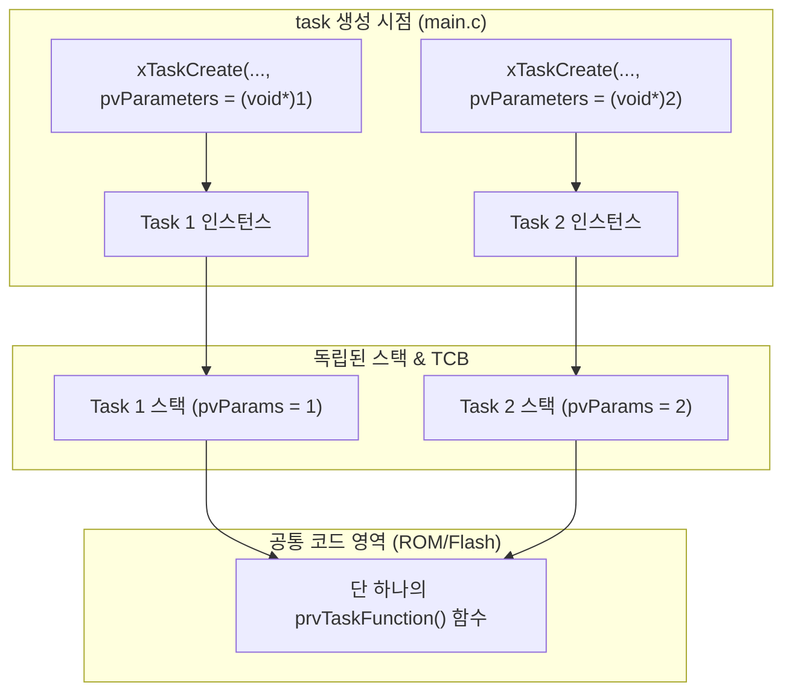
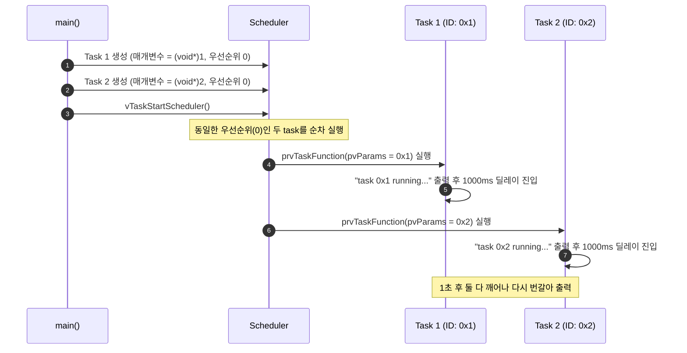

# Tutorial 5: task 매개변수 (Task Parameters)

이 단원에서는 task를 생성할 때 데이터를 전달하는 **`pvParameters` 매개변수** 활용법을 배우고, 동일한 task 함수를 여러 개의 task가 공유하여 코드를 재사용하는 패턴을 실습한다.

---

## 1. 이번 실습에서 할 일

* **해결하려는 문제**: 똑같은 동작을 하지만 제어 대상(핀 번호, 센서 채널, 주기 등)만 다른 여러 task를 만들 때, 코드를 복사-붙여넣기하지 않고 하나의 task 함수로 재사용한다.
* **학습 목표**:
  1. `xTaskCreate()`의 4번째 인자 `pvParameters`를 통해 task 함수로 데이터를 안전하게 전달하는 방법을 익힌다.
  2. 단 하나의 task 함수(`prvTaskFunction`)로 2개의 task를 생성하고, 서로 다른 인자(`0x1`, `0x2`)가 전달되어 출력되는 동작을 확인한다.
  3. 매개변수로 포인터를 넘길 때 주의해야 할 **메모리 유효 기간(생명주기)** 문제를 설명할 수 있다.

---

## 2. 시작 전 확인

### 2.1 C 언어 핵심 복습
* **`void *` 형 변환 (Casting)**:
  * 본래 포인터는 메모리 주소를 담는 변수다. 64비트 시스템에서 포인터는 8바이트, 32비트 시스템에서는 4바이트 정수와 크기가 같다.
  * 따라서 `(void *) 1`과 같이 작은 정수값을 직접 포인터 타입으로 강제 형 변환(Casting)하여 주소가 아닌 **값 자체**를 넘기는 기법이 임베디드에서 널리 쓰인다.
* **포인터와 변수 수명 (댕글링 포인터 방지)**:
  * 만약 어떤 구조체나 배열의 주소(`&my_data`)를 넘길 경우, 그 데이터는 task가 실행되는 동안 메모리에 계속 유지되어야 한다. 함수 내부의 지역 변수 주소를 넘기면 함수가 끝난 후 메모리가 파괴되어 치명적인 오류가 발생한다.

### 2.2 확인할 소스 및 설정 파일
* 실습 코드: [`source/tutorials/tutorial_5/source/tutorial_5.c`](../../source/tutorials/tutorial_5/source/tutorial_5.c)
* 설정 파일: [`source/tutorials/tutorial_5/include/FreeRTOSConfig.h`](../../source/tutorials/tutorial_5/include/FreeRTOSConfig.h)
* 참조 해답: [`ko/guides/solutions/tutorial_5.c`](solutions/tutorial_5.c)

> **실습 형태**: 이 단원은 `tutorial_5.c` 파일 내부의 **`TODO 1`과 `TODO 2`를 완성하는 구현 실습**이다.

---

## 3. 개념 이해

### 3.1 왜 task 함수 재사용이 중요한가?
예를 들어 보드에 LED가 3개 있고, 각각 500ms, 1000ms, 2000ms 주기로 깜빡여야 한다고 가정해 보자.
* **나쁜 방식**: `vLED1Task()`, `vLED2Task()`, `vLED3Task()` 3개의 함수를 복사-붙여넣기하여 각각 작성한다. (코드 메모리 낭비, 유지보수 불가)
* **좋은 방식**: 단 하나의 `vLEDToggleTask(void *pvParams)`를 작성하고, task를 생성할 때 핀 번호와 주기 정보가 담긴 설정 값을 `pvParameters`로 넘겨준다.



### 3.2 `pvParameters` 전달 방식 2가지

1. **정수 값 직접 전달 (이번 실습 방식)**:
   * `pvParameters = (void *) 1;`
   * 전달할 데이터가 단순 정수(ID, 채널 번호 등)일 때 사용한다. 별도 메모리 할당이 필요 없어 매우 안전하고 빠르다.

2. **구조체 포인터 전달 (실무 확장 방식)**:
   * 여러 개의 설정 데이터(핀 번호, 딜레이 시간, 이름 등)를 넘길 때는 전역 또는 정적 구조체를 선언하고 그 주소를 전달한다:
     ```c
     typedef struct {
         int pin;
         TickType_t delay;
     } LedConfig_t;

     static LedConfig_t xLed1 = { .pin = 13, .delay = 500 };
     xTaskCreate( prvLedTask, "LED1", 128, (void *)&xLed1, 1, NULL );
     ```

---

## 4. 실행 흐름 읽기



---

## 5. 코드와 API 이해

`source/tutorials/tutorial_5/source/tutorial_5.c`의 task 함수:

```c
static void prvTaskFunction( void * pvParams )
{
    for( ;; )
    {
        fprintf( stderr, "Tutorial 5 task %p running...\r\n", pvParams );

        vTaskDelay( pdMS_TO_TICKS( 1000 ) );
    }
}
```

* `void * pvParams`: task가 생성될 때 넘겨받은 `pvParameters` 값이 이 인자로 들어온다.
* `%p`: C 표준 포인터 서식 지정자다. `pvParams`에 들어 있는 주소(또는 정수 캐스팅 값)를 16진수 포인터 형식(`0x1`, `0x2`)으로 터미널에 출력한다.
* `vTaskDelay(...)`: 두 task 모두 1초 지연을 호출하여 스스로 Blocked 상태로 전환되므로, 동일한 우선순위를 가진 두 task가 사이좋게 번갈아 가며 실행될 수 있다.

---

## 6. 직접 구현 또는 관찰 준비

`source/tutorials/tutorial_5/source/tutorial_5.c` 파일을 열고 두 개의 TODO를 채운다.

### 6.1 TODO 1: Task 1 생성 (매개변수 1)
46~58행 주석 부분을 찾는다:
* 함수 포인터: `prvTaskFunction`
* 이름: `"Task1"`
* 스택 깊이: `configMINIMAL_STACK_SIZE`
* **매개변수: `( void * ) 1`**
* 우선순위: `tskIDLE_PRIORITY`
* 태스크 핸들: `NULL`

<details>
<summary>TODO 1 해답 코드 보기</summary>

```c
    xTaskCreationResult = xTaskCreate( prvTaskFunction,
                                       "Task1",
                                       configMINIMAL_STACK_SIZE,
                                       ( void * ) 1,
                                       tskIDLE_PRIORITY,
                                       NULL );
```
</details>

### 6.2 TODO 2: Task 2 생성 (매개변수 2)
61~73행 주석 부분을 찾는다:
* 함수 포인터: `prvTaskFunction`
* 이름: `"Task2"`
* 스택 깊이: `configMINIMAL_STACK_SIZE`
* **매개변수: `( void * ) 2`**
* 우선순위: `tskIDLE_PRIORITY`
* 태스크 핸들: `NULL`

<details>
<summary>TODO 2 해답 코드 보기</summary>

```c
    xTaskCreationResult = xTaskCreate( prvTaskFunction,
                                       "Task2",
                                       configMINIMAL_STACK_SIZE,
                                       ( void * ) 2,
                                       tskIDLE_PRIORITY,
                                       NULL );
```
</details>

> 전체 완성 코드는 [`ko/guides/solutions/tutorial_5.c`](solutions/tutorial_5.c)에서 확인할 수 있다.

---

## 7. 빌드와 실행

저장소 루트에서 다음 명령을 실행한다:

```bash
# 1. CMake 빌드 구성 (Tutorial 5 지정)
cmake -B build -S source -DTUTORIAL=5

# 2. 컴파일 및 빌드
cmake --build build

# 3. 바이너리 실행
./build/freertos_example
```

* **종료 방법**: 터미널에서 **`Ctrl + C`**를 누른다.

---

## 8. 결과 해석

### 8.1 정상 실행 출력 화면
```text
Tutorial 5 task 0x1 running...
Tutorial 5 task 0x2 running...
Tutorial 5 task 0x1 running...
Tutorial 5 task 0x2 running...
Tutorial 5 task 0x1 running...
Tutorial 5 task 0x2 running...
```

### 8.2 판정 기준 및 해석
* **결과의 특징**: `task 0x1 running...`과 `task 0x2 running...`이 1초마다 번갈아 가며 한 번씩 출력된다.
* **학습 핵심**: 실행 코드는 메모리 상에 `prvTaskFunction` 단 하나만 존재하지만, 스케줄러가 task를 교체할 때마다 각 task의 고유 스택에 저장된 `pvParams` 레지스터 값을 복원해 주기 때문에 하나의 함수로도 서로 다른 ID를 완벽하게 구별하여 동작한다.

---

## 9. 막혔을 때 (트러블슈팅)

| 증상 | 원인 | 해결 방법 |
| :--- | :--- | :--- |
| 컴파일 경고: `cast to pointer from integer of different size` | 32/64비트 크기 불일치 경고 | `( void * ) 1`과 같이 명시적으로 캐스팅했는지 확인 (실습 동작에는 문제 없음) |
| 둘 다 `0x1` 또는 둘 다 `0x2`로 출력됨 | TODO 1과 TODO 2에 동일한 매개변수를 넘겼음 | TODO 1은 `(void*)1`, TODO 2는 `(void*)2`로 지정했는지 확인 |

---

## 10. 혼자 확인하기 (자가 점검)

### 질문 1 (위험성 분석)
`main()` 함수 내부에서 다음과 같이 지역 변수를 선언하고 그 주소를 `xTaskCreate`로 넘기면 왜 심각한 버그가 되는가?
```c
int main( void )
{
    int taskId = 100;
    xTaskCreate( prvTask, "T", 128, (void *)&taskId, 1, NULL );
    vTaskStartScheduler();
    ...
}
```

<details>
<summary>정답 및 해설 확인</summary>

* **정답**: `taskId`는 `main()` 함수의 스택 프레임에 존재하는 지역 변수이기 때문이다.
* **원리**: 스케줄러가 시작되면 `main()`의 스택 공간은 인터럽트 스택이나 다른 용도로 재사용되거나 덮어쓰여질 수 있다. 이후 task가 뒤늦게 `*((int *)pvParams)`로 역참조하여 값을 읽으려 할 때 쓰레기 값(Garbage value)을 읽거나 크래시가 발생할 수 있다. 포인터를 전달할 때는 반드시 전역 변수, `static` 변수, 또는 `pvPortMalloc`으로 할당한 힙 메모리여야 한다.
</details>

### 질문 2 (출력 분석)
`tutorial_5.c`의 출력 로그에서 `0x1`과 `0x2` 형태로 16진수 접두사가 붙어 나오는 이유는 무엇인가?

<details>
<summary>정답 및 해설 확인</summary>

* **정답**: C 표준 출력 서식 지정자로 `%p`를 사용했기 때문이다.
* **설명**: `%p`는 포인터 주소를 아키텍처에 맞는 16진수 형식으로 출력한다. 만약 단순 10진수로 출력하고 싶다면 `(uintptr_t)pvParams`로 캐스팅한 뒤 `%lu` 등으로 출력하면 `1`, `2`로 깔끔하게 찍힌다.
</details>

### 질문 3 (조건 변형 실험)
Task 1은 500ms 지연, Task 2는 1000ms 지연으로 서로 다르게 깜빡이게 만들고 싶다. task 함수를 2개로 쪼개지 않고 `pvParameters`만을 활용하여 구현하려면 어떤 자료구조를 넘겨야 하는가?

<details>
<summary>정답 및 해설 확인</summary>

* **정답**: 주기 정보를 포함한 구조체(Struct)를 정의하고 각 task 생성 시 해당 구조체의 주소를 넘겨주면 된다.
* **예시**:
  ```c
  typedef struct {
      int id;
      TickType_t delayMs;
  } TaskParam_t;

  static TaskParam_t p1 = { 1, 500 };
  static TaskParam_t p2 = { 2, 1000 };

  xTaskCreate( prvTask, "T1", 128, &p1, 1, NULL );
  xTaskCreate( prvTask, "T2", 128, &p2, 1, NULL );
  ```
</details>

---

## 11. 다음 학습

지금까지 동일한 우선순위의 두 task가 `vTaskDelay()`를 통해 스스로 양보할 때의 동작을 보았다.  
만약 task들이 양보하지 않고 100% CPU를 쓰려고 경쟁한다면 스케줄러는 어떻게 처리할까?

이제 **[Tutorial 6: 시분할을 사용하는 우선순위 기반 선점형 스케줄링 (Prioritized Preemptive Scheduling with Time Slicing)](tutorial_6.md)**으로 넘어가서, FreeRTOS 커널의 기본 스케줄링 알고리즘인 선점과 시분할(Time Slicing)의 정수를 배워보자!

* **한국어 커널북 심화 읽기**:
  * [4.4장: task 생성 매개변수 활용](https://github.com/yunju-baek/FreeRTOS-Kernel-Book-ko/blob/27d03c61cd2a6cf5a6fa6333082218ef706f5b89/ko/ch04.md)
