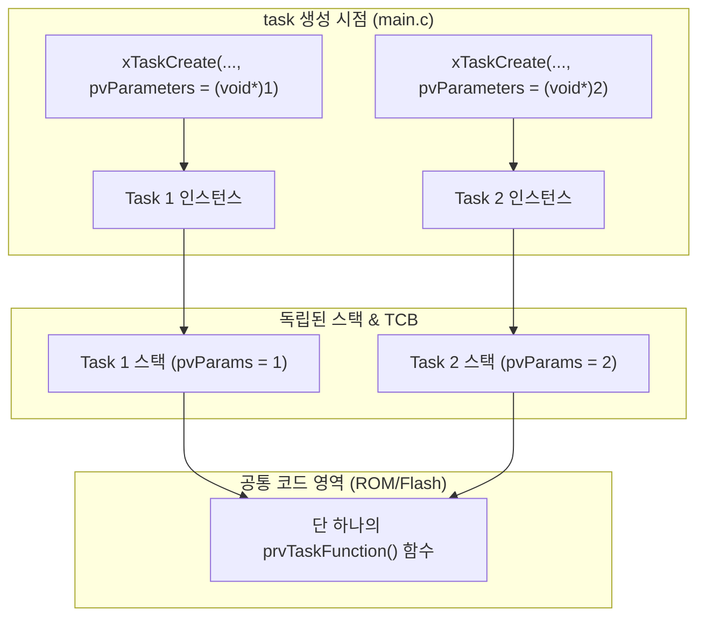
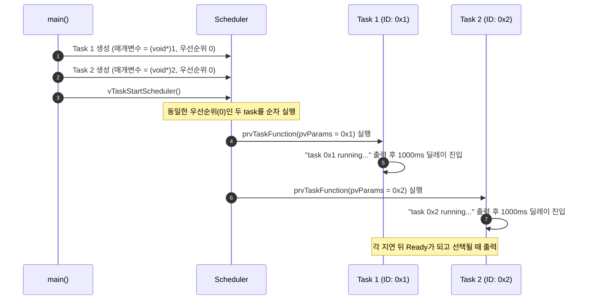

# Tutorial 5: task 매개변수 (Task Parameters)

[학습 목차](README.md) · [공통 준비](getting-started.md) · [공식 튜토리얼 번역](../docs/tutorial_5/README.md) · [이전 단원](tutorial_4.md)

이 단원에서는 task를 생성할 때 데이터를 전달하는 **`pvParameters` 매개변수** 활용법을 배우고, 동일한 task 함수를 여러 개의 task가 공유하여 코드를 재사용하는 패턴을 실습한다.

---

## 1. 이번 실습에서 할 일

* **해결하려는 문제**: 똑같은 동작을 하지만 제어 대상(핀 번호, 센서 채널, 주기 등)만 다른 여러 task를 만들 때, 코드를 복사-붙여넣기하지 않고 하나의 task 함수로 재사용한다.
* **학습 목표**:
  1. `xTaskCreate()`의 4번째 인자 `pvParameters`를 통해 task 함수로 데이터를 안전하게 전달하는 방법을 익힌다.
  2. 단 하나의 task 함수(`prvTaskFunction`)로 2개의 task를 생성하고, 서로 다른 인자(`0x1`, `0x2`)가 전달되어 출력되는 동작을 확인한다.
  3. 매개변수로 포인터를 넘길 때 주의해야 할 **메모리 유효 기간(생명주기)** 문제를 설명할 수 있다.

---

## 2. 시작 전 확인

### 2.1 C 언어 핵심 복습
* **`void *` 형 변환 (Casting)**:
  * 본래 포인터는 메모리 주소를 담는 변수다. 64비트 시스템에서 포인터는 8바이트, 32비트 시스템에서는 4바이트 정수와 크기가 같다.
  * 이 예제는 `(void *) 1`과 `(void *) 2`를 작은 식별값으로 전달하고 `%p`로 출력만 한다. 이를 실제 객체 주소처럼 역참조하면 안 된다. 정수와 포인터의 변환 결과는 구현에 의존하므로 임의 정수를 담는 일반적인 이식성 보장 기법은 아니다.
* **포인터와 변수 수명 (댕글링 포인터 방지)**:
  * 만약 어떤 구조체나 배열의 주소(`&my_data`)를 넘길 경우, 그 데이터는 task가 실행되는 동안 메모리에 계속 유지되어야 한다. 함수 내부의 지역 변수 주소를 넘기면 함수가 끝난 후 메모리가 파괴되어  오류가 발생한다.

### 2.2 확인할 소스 및 설정 파일
* 실습 코드: [`source/tutorials/tutorial_5/source/tutorial_5.c`](../../source/tutorials/tutorial_5/source/tutorial_5.c)
* 설정 파일: [`source/tutorials/tutorial_5/include/FreeRTOSConfig.h`](../../source/tutorials/tutorial_5/include/FreeRTOSConfig.h)
* 참조 해답: [`ko/guides/solutions/tutorial_5.c`](solutions/tutorial_5.c)

> **실습 형태**: 이 단원은 `tutorial_5.c` 파일 내부의 **`TODO 1`과 `TODO 2`를 완성하는 구현 실습**이다.

---

## 3. 개념 이해

### 3.1 왜 task 함수 재사용이 중요한가?
예를 들어 보드에 LED가 3개 있고, 각각 500ms, 1000ms, 2000ms 주기로 깜빡여야 한다고 가정해 보자.
* **나쁜 방식**: `vLED1Task()`, `vLED2Task()`, `vLED3Task()` 3개의 함수를 복사-붙여넣기하여 각각 작성한다. (코드 메모리 낭비, 유지보수 불가)
* **좋은 방식**: 단 하나의 `vLEDToggleTask(void *pvParams)`를 작성하고, task를 생성할 때 핀 번호와 주기 정보가 담긴 설정 값을 `pvParameters`로 넘겨준다.



### 3.2 `pvParameters` 전달 방식 2가지

1. **정수 값 직접 전달 (이번 실습 방식)**:
   * `pvParameters = (void *) 1;`
   * 전달할 데이터가 단순 정수(ID, 채널 번호 등)일 때 사용한다. 이 예제에서는 해당 값을 역참조하지 않는다. 주소를 전달하는 방식과 구별한다.

2. **구조체 포인터 전달 (설계 확장)**:
   * 핀 번호와 주기처럼 여러 값이 필요하면 구조체 객체의 주소를 전달한다. task에서는 올바른 구조체 타입으로 변환해 읽는다.
   * 이때 복사되는 것은 포인터 값뿐이므로 원본 객체가 task의 사용이 끝날 때까지 살아 있어야 한다. 여러 task가 수정한다면 동기화도 필요하다. 구조체 방식은 설계 개념이며 이 실습의 작은 식별값 코드를 그대로 역참조하도록 바꾸는 과제는 아니다.

---

## 4. 실행 흐름 읽기



---

## 5. 코드와 API 이해

`source/tutorials/tutorial_5/source/tutorial_5.c`의 task 함수:

```c
static void prvTaskFunction( void * pvParams )
{
    for( ;; )
    {
        fprintf( stderr, "Tutorial 5 task %p running...\r\n", pvParams );

        vTaskDelay( pdMS_TO_TICKS( 1000 ) );
    }
}
```

* `void * pvParams`: task가 생성될 때 넘겨받은 `pvParameters` 값이 이 인자로 들어온다.
* `%p`: C 표준 포인터 서식 지정자다. `pvParams`에 들어 있는 주소(또는 정수 캐스팅 값)를 16진수 포인터 형식(`0x1`, `0x2`)으로 터미널에 출력한다.
* `vTaskDelay(...)`: 두 task 모두 1초 지연을 호출하여 스스로 Blocked 상태로 전환되므로, 동일한 우선순위를 가진 두 task가 실행 기회를 얻는다. 출력의 엄격한 교대 순서는 보장하지 않는다.

---

## 6. 직접 구현 또는 관찰 준비

전체 참조 해답은 [tutorial_5.c](solutions/tutorial_5.c)에 있다. 먼저 TODO별 힌트를 따라 작성하고, [자기 코드 보존·해답 적용·복구 절차](getting-started.md#solution-workflow)에 따라 비교한다.

`source/tutorials/tutorial_5/source/tutorial_5.c` 파일을 열고 두 개의 TODO를 채운다.

### 6.1 TODO 1: Task 1 생성 (매개변수 1)
46~58행 주석 부분을 찾는다:
* 함수 포인터: `prvTaskFunction`
* 이름: `"Task1"`
* 스택 깊이: `configMINIMAL_STACK_SIZE`
* **매개변수: `( void * ) 1`**
* 우선순위: `tskIDLE_PRIORITY`
* 태스크 핸들: `NULL`

* **TODO 1 힌트 1**: 같은 함수라도 생성 시 넘긴 인자를 통해 task별 식별값을 유지한다.
* **TODO 1 힌트 2**: `main`의 첫 생성 호출에서 네 번째 인자로 식별값 1을 전달한다. 함수는 기존 `prvTaskFunction`을 쓴다.

<details>
<summary>TODO 1 해답 코드 보기</summary>

```c
    xTaskCreationResult = xTaskCreate( prvTaskFunction,
                                       "Task1",
                                       configMINIMAL_STACK_SIZE,
                                       ( void * ) 1,
                                       tskIDLE_PRIORITY,
                                       NULL );
```

**이유**: 같은 함수라도 생성 시 넘긴 인자를 통해 task별 식별값을 유지한다.
</details>

### 6.2 TODO 2: Task 2 생성 (매개변수 2)
61~73행 주석 부분을 찾는다:
* 함수 포인터: `prvTaskFunction`
* 이름: `"Task2"`
* 스택 깊이: `configMINIMAL_STACK_SIZE`
* **매개변수: `( void * ) 2`**
* 우선순위: `tskIDLE_PRIORITY`
* 태스크 핸들: `NULL`

* **TODO 2 힌트 1**: 두 번째 task도 같은 함수를 사용하고 식별값만 다르게 전달한다.
* **TODO 2 힌트 2**: 두 번째 생성 호출의 네 번째 인자를 식별값 2로 둔다. 이름도 Task2로 구분하고 생성 결과를 저장한다.

<details>
<summary>TODO 2 해답 코드 보기</summary>

```c
    xTaskCreationResult = xTaskCreate( prvTaskFunction,
                                       "Task2",
                                       configMINIMAL_STACK_SIZE,
                                       ( void * ) 2,
                                       tskIDLE_PRIORITY,
                                       NULL );
```

**이유**: 두 번째 task도 같은 함수를 사용하고 식별값만 다르게 전달한다.
</details>

> 전체 완성 코드는 [`ko/guides/solutions/tutorial_5.c`](solutions/tutorial_5.c)에서 확인할 수 있다.

---

## 7. 빌드와 실행

[공통 준비](getting-started.md)의 학습용 사본 루트에서 다음 명령을 실행한다:

```bash
# 1. CMake 빌드 구성 (Tutorial 5 지정)
cmake -S source -B build/tutorial_5 -DTUTORIAL=5

# 2. 컴파일 및 빌드
cmake --build build/tutorial_5

# 3. 바이너리 실행
./build/tutorial_5/freertos_example
```

* **종료 방법**: 터미널에서 **`Ctrl + C`**를 누른다.

---

## 8. 결과 해석

### 8.1 출력 예시

두 식별값이 모두 반복되어야 한다. 먼저 나오는 task와 포인터 표기·줄별 교대는 고정하지 않는다.

```text
Tutorial 5 task 0x1 running...
Tutorial 5 task 0x2 running...
Tutorial 5 task 0x1 running...
Tutorial 5 task 0x2 running...
Tutorial 5 task 0x1 running...
Tutorial 5 task 0x2 running...
```

### 8.2 판정 기준 및 해석
* **결과의 특징**: 두 식별값의 로그가 반복된다. 순서와 `%p`의 세부 표기, 정확한 출력 간격은 구현·호스트 부하에 따라 달라질 수 있다.
* **학습 핵심**: 실행 코드는 메모리 상에 `prvTaskFunction` 단 하나만 존재하지만, 각 task의 실행 문맥에는 생성 때 전달한 매개변수가 유지되므로 같은 함수에서도 서로 다른 식별값을 출력한다.

---

## 9. 막혔을 때 (트러블슈팅)

| 증상 | 원인 | 해결 방법 |
| :--- | :--- | :--- |
| 정수와 포인터 변환 경고 | 인자나 형식 변경 여부 확인 필요 | 원본의 작은 상수 전달인지 비교한다. 실제 데이터는 수명이 보장된 객체 주소로 전달하고 경고를 무조건 무시하지 않음 |
| 둘 다 `0x1` 또는 둘 다 `0x2`로 출력됨 | TODO 1과 TODO 2에 동일한 매개변수를 넘겼음 | TODO 1은 `(void*)1`, TODO 2는 `(void*)2`로 지정했는지 확인 |

---

## 10. 혼자 확인하기 (자가 점검)

### 질문 1 (위험성 분석)
함수 안에서 만든 지역 구조체의 주소를 task에 넘기고 그 함수가 반환했다. task가 나중에 이 주소를 읽어도 되는가?

<details>
<summary>정답 및 해설 확인</summary>

안 된다. 함수 반환으로 자동 변수의 수명이 끝났기 때문이다. 핵심은 지역 변수라는 이름 자체가 아니라 task가 사용할 때까지 대상 객체가 유효한가이다. 파일 범위 `static` 객체는 간단한 해결 방법이다. `main()`도 포트와 호출 흐름에 따라 수명을 판단해야 하며 스케줄러 시작만으로 모든 지역 변수가 사라지는 것은 아니다.
</details>

### 질문 2 (출력 분석)
두 task가 같은 `prvTaskFunction`을 실행하는데 서로 다른 식별값이 나오는 이유는 무엇인가?

<details>
<summary>정답 및 해설 확인</summary>

생성할 때 서로 다른 `pvParameters`를 전달했기 때문이다. 각 task의 실행 문맥에 해당 값이 유지되고 `%p`가 그 포인터 값을 출력한다. `%p`의 세부 문자열 형식은 C 구현에 의존하므로 모든 환경에서 `0x1`이라는 표기를 강제하지 않는다.
</details>

### 질문 3 (조건 변경과 결과 예측)
`main()`에서 Task 1 생성의 네 번째 인자만 `(void *) 1`에서 `(void *) 3`으로 바꾼다.

실행 전에 어떤 결과가 달라지고 어떤 동작이 그대로 유지될지 적는다. 직접 작성한 코드와 수정 전 파일은 [공통 보존·복구 절차](getting-started.md#solution-workflow)에 따라 보관한다. 위에서 지정한 조건 하나만 바꾸고 `cmake --build build/tutorial_5` 명령으로 다시 빌드한다. 실행 결과를 예측과 비교한 뒤 아래 해설을 확인한다. 해설은 예상 결과를 설명한 것이므로 직접 얻은 로그와 구분한다.

<details>
<summary>예상 결과와 해설 확인</summary>

Task 1의 출력 식별값만 3에 대응하는 포인터 표기로 바뀌고 Task 2의 식별값은 유지된다. 함수·우선순위·지연은 그대로다. 값은 역참조하지 않는다.
</details>

**복구와 재확인**: Task 1을 생성하는 호출의 네 번째 인자를 `(void *) 3`에서 `(void *) 1`로 되돌린다. 같은 단원을 다시 빌드하고 실행하여 [8절의 결과](#8-결과-해석)와 비교한다. 결과를 설명하기 어려우면 [관련 개념 다시 읽기](#5-코드와-api-이해)로 돌아간다.

---

## 11. 다음 학습

지금까지 동일한 우선순위의 두 task가 `vTaskDelay()`를 통해 스스로 양보할 때의 동작을 보았다.
만약 task들이 양보하지 않고 100% CPU를 쓰려고 경쟁한다면 스케줄러는 어떻게 처리할까?

이제 **[Tutorial 6: 시분할을 사용하는 우선순위 기반 선점형 스케줄링 (Prioritized Preemptive Scheduling with Time Slicing)](tutorial_6.md)**으로 넘어가서, FreeRTOS 커널의 기본 스케줄링 알고리즘인 선점과 시분할의 동작를 배운다.

* **한국어 커널북 심화 읽기**:
  * [4.4장: task 생성 매개변수 활용](https://github.com/yunju-baek/FreeRTOS-Kernel-Book-ko/blob/27d03c61cd2a6cf5a6fa6333082218ef706f5b89/ko/ch04.md)
