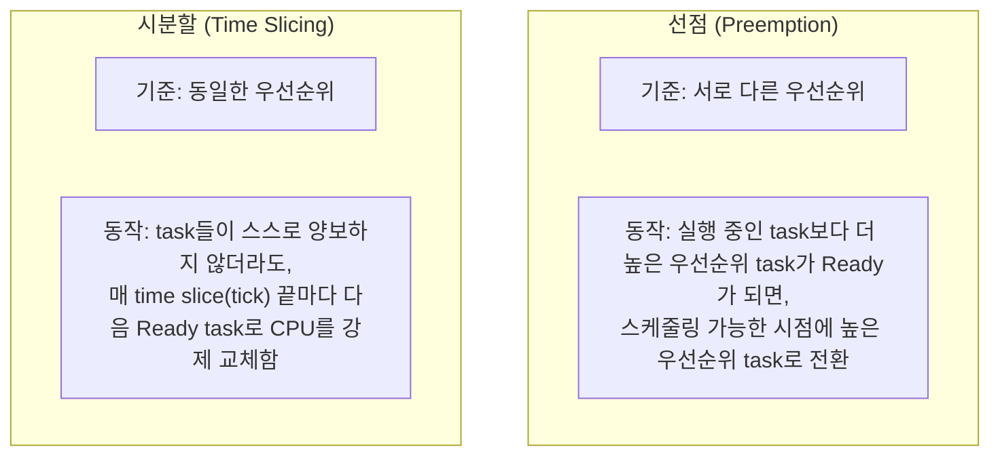
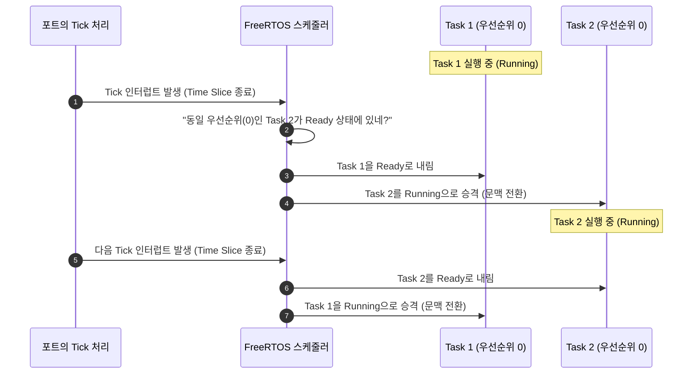

# Tutorial 6: 시분할을 사용하는 우선순위 기반 선점형 스케줄링 (Prioritized Preemptive Scheduling with Time Slicing)

[학습 목차](README.md) · [공통 준비](getting-started.md) · [공식 튜토리얼 번역](../docs/tutorial_6/README.md) · [이전 단원](tutorial_5.md)

이 단원에서는 FreeRTOS 커널의 기본이자 가장 대표적인 스케줄링 알고리즘인 **시분할을 사용하는 우선순위 기반 선점형 스케줄링(Prioritized Preemptive Scheduling with Time Slicing)**의 동작 원리를 관찰하고 이해한다.

---

## 1. 이번 실습에서 할 일

* **해결하려는 문제**: 동일한 우선순위를 가진 여러 task가 존재하고 어느 누구도 스스로 CPU를 양보하지 않을 때, 운영체제가 어떻게 공평하게 CPU를 분배하는지 확인한다.
* **학습 목표**:
  1. **선점(Preemption)**과 **시분할(Time Slicing)**의 개념적 차이를 명확히 구분하여 설명할 수 있다.
  2. `configUSE_PREEMPTION 1` 및 `configUSE_TIME_SLICING 1` 환경에서 동일 우선순위 task 간의 라운드 로빈(Round-Robin) 교대 실행을 관찰한다.
  3. time slice(시간 분할 구간)의 길이와 RTOS tick 인터럽트의 관계를 이해한다.

---

## 2. 시작 전 확인

### 2.1 핵심 용어 복습
* **RTOS Tick 인터럽트**: 커널의 시간 진행을 알리는 주기적 이벤트다. MCU에서는 보통 하드웨어 타이머를 쓰고 이 POSIX 포트에서는 호스트 스레드·신호로 구현한다.
* **Time Slice (시간 분할 구간)**: 두 번의 tick 인터럽트 사이의 시간 간격이다. `configTICK_RATE_HZ`가 1000이면 명목 tick 간격은 1ms다. 호스트에서의 실제 실행 시간과 로그 간격이 항상 1ms라는 뜻은 아니다.
* **라운드 로빈 (Round-Robin)**: 동일한 조건을 가진 주체들이 순서대로 돌아가며 공평하게 기회를 갖는 분배 방식이다.

### 2.2 확인할 소스 및 설정 파일
* 실습 코드: [`source/tutorials/tutorial_6/source/tutorial_6.c`](../../source/tutorials/tutorial_6/source/tutorial_6.c)
* 설정 파일: [`source/tutorials/tutorial_6/include/FreeRTOSConfig.h`](../../source/tutorials/tutorial_6/include/FreeRTOSConfig.h)

> **실습 형태**: 이 단원은 코드가 사전에 완성되어 있는 **관찰 및 분석 실습**이다. 소스를 수정하지 않고 스케줄링 동작을 집중 분석한다.

---

## 3. 개념 이해

### 3.1 FreeRTOS의 3대 스케줄링 알고리즘
FreeRTOS 커널은 `FreeRTOSConfig.h`의 설정 조합에 따라 다음 3가지 알고리즘을 지원한다:

| 알고리즘 | `configUSE_PREEMPTION` | `configUSE_TIME_SLICING` | 핵심 특징 |
| :--- | :---: | :---: | :--- |
| **1. 선점형 + 시분할 (현재 단원)** | **`1`** | **`1`** | 상위 우선순위 task가 Ready가 되면 스케줄링 가능한 시점에 선점 + 동일 우선순위의 Ready task를 tick 기준으로 교대 |
| **2. 선점형 (시분할 없음, T07)** | `1` | `0` | 상위 우선순위 task가 Ready가 되면 스케줄링 가능한 시점에 선점 + tick에 의한 동일 우선순위 자동 교대 없음 |
| **3. 협력형 스케줄링 (T08)** | `0` | 해당 없음 | task의 자동 선점 없음. 주로 자발적 양보나 대기로 전환; ISR의 명시적 전환 요청은 별도 |

### 3.2 선점 vs 시분할의 결정적 차이



* **선점된다는 것의 의미**: task가 스스로 원해서(`vTaskDelay` 호출 등) 물러나는 것이 아니라, 커널 스케줄러에 의해 **비자발적으로(involuntarily)** Running에서 Ready로 바뀌는 것(우선순위 자체는 변하지 않음)을 말한다.

---

## 4. 실행 흐름 읽기

`tutorial_6.c`에서는 두 개의 task("Task1", "Task2")가 동일한 우선순위(`tskIDLE_PRIORITY`)로 생성되며, 둘 다 `vTaskDelay()` 없이 busy wait 루프만 돈다.



---

## 5. 코드와 API 이해

### 5.1 `FreeRTOSConfig.h` 설정 확인
```c
#define configUSE_PREEMPTION    1
#define configUSE_TIME_SLICING  1
```
* `configUSE_PREEMPTION 1`: 선점형 스케줄러를 활성화한다.
* `configUSE_TIME_SLICING 1`: 동일 우선순위 task 간의 time slicing(시분할 라운드 로빈)을 활성화한다.

### 5.2 task 루프 구조
```c
static void prvTask1Function( void * pvParams )
{
    uint64_t i;
    for( ;; )
    {
        fprintf( stderr, "Tutorial 6 task 1 running...\r\n" );
        for( i = 0; i < 100000000; i++ ) { /* busy wait */ }
    }
}
```
* 두 task 모두 지연 함수(`vTaskDelay`)를 전혀 쓰지 않는다.
* Tutorial 4에서는 우선순위가 달라서 Low Task가 기아 상태에 빠졌지만, Tutorial 6에서는 **두 task의 우선순위가 동일**하다.
* `configUSE_TIME_SLICING 1`은 같은 우선순위의 Ready task 사이에 tick 기반 실행 기회를 만든다. Idle task도 우선순위 0이다. 위 그림은 두 사용자 task만 남긴 개념도이며, 한 로그 줄 사이에도 여러 tick과 전환이 일어날 수 있다.

---

## 6. 직접 구현 또는 관찰 준비

* **실행 전 예측 질문**:
  1. Task 1과 Task 2 중 어느 하나가 CPU를 영원히 독점할 것인가?
  2. 아니면 두 task의 출력 로그가 교대로 섞여서 나올 것인가?

---

## 7. 빌드와 실행

[공통 준비](getting-started.md)의 학습용 사본 루트에서 다음 명령을 실행한다:

```bash
# 1. CMake 빌드 구성 (Tutorial 6 지정)
cmake -S source -B build/tutorial_6 -DTUTORIAL=6

# 2. 컴파일 및 빌드
cmake --build build/tutorial_6

# 3. 바이너리 실행
./build/tutorial_6/freertos_example
```

* **종료 방법**: 터미널에서 **`Ctrl + C`**를 누른다.

---

## 8. 결과 해석

### 8.1 출력 예시

두 task의 진행을 확인한다. 줄별 교대·정확한 tick 수·CPU 분배 비율은 로그만으로 판정하지 않는다.

```text
Tutorial 6 task 1 running...
Tutorial 6 task 2 running...
Tutorial 6 task 1 running...
Tutorial 6 task 2 running...
Tutorial 6 task 1 running...
Tutorial 6 task 2 running...
```

### 8.2 판정 기준 및 해석
* **판정 기준**: 충분히 관찰하면 두 task의 로그가 모두 나타난다. 같은 task의 로그가 연속되어도 오류라고 단정하지 않는다.
* **해석**: 두 task가 대기·양보 호출 없이 모두 진행하는 결과를 시분할 설정과 연결한다. 긴 busy loop와 출력 처리 때문에 로그 한 줄은 tick 한 번에 대응하지 않으며, 로그만으로 정확한 전환 시점이나 공평한 CPU 비율을 측정할 수 없다.

---

## 9. 막혔을 때 (트러블슈팅)

| 증상 | 원인 | 해결 방법 |
| :--- | :--- | :--- |
| 한 task의 로그만 보임 | 관찰 시간이 짧거나 우선순위·설정·실행 대상이 다를 수 있음 | `build/tutorial_6` 실행 경로, 두 task 우선순위가 0이고 `configUSE_PREEMPTION`·`configUSE_TIME_SLICING`이 각각 1인지 확인하고 더 관찰 |
| 출력 간격이 불규칙함 | busy loop, 빌드 최적화, 호스트 부하의 영향을 받음 | 두 task가 모두 진행하는지 확인. 계속 멈추면 stderr와 프로세스 상태를 점검 |

---

## 10. 혼자 확인하기 (자가 점검)

### 질문 1 (개념 비교)
선점(Preemption)과 시분할(Time Slicing)의 차이를 우선순위의 관점에서 한 문장으로 명쾌하게 정의하라.

<details>
<summary>정답 및 해설 확인</summary>

* **정답**: 이 단원에서 **우선순위에 의한 선점**은 더 높은 우선순위 task가 Ready가 되었을 때 스케줄링 가능한 시점에 실행권을 넘기는 것이고, **시분할**은 같은 우선순위의 Ready task들이 tick을 기준으로 실행 기회를 교대하는 것이다. 임계 구역이나 스케줄러 중지 중에는 전환이 미뤄질 수 있으며, 출력 줄 수나 CPU 사용 비율이 같다는 뜻은 아니다.
</details>

### 질문 2 (한 조건 변형과 실행 추적)
`main()`의 Task 1 생성에서 우선순위만 `tskIDLE_PRIORITY`에서 `tskIDLE_PRIORITY + 1`로 바꾼다.

실행 전에 바뀔 결과와 유지될 조건을 각각 적는다. 자기 풀이와 변경 전 파일은 [공통 보존·복구 절차](getting-started.md#solution-workflow)로 남긴다. 한 조건만 수정하고 `cmake --build build/tutorial_6`으로 다시 빌드한 뒤 실행해 예측과 비교한다. 아래 해설은 변형의 예상 결과이며, 직접 얻은 로그와 구분한다.

<details>
<summary>예상 결과와 해설 확인</summary>

시분할 설정이 켜져 있어도 우선순위가 다른 Task 2에는 실행 기회가 주어지지 않는다. 시분할은 같은 우선순위에 적용된다.
</details>

**복구와 재확인**: 변경한 한 값(추가한 코드라면 그 한 줄)을 원래대로 돌리고 같은 단원을 다시 빌드·실행한다. 원래 조건의 8절 결과와 비교한다. 설명이 어려우면 [관련 개념 다시 읽기](#3-개념-이해)로 돌아간다.

### 질문 3 (시스템 파라미터)
Time slice 1구간의 길이를 1ms에서 10ms로 늘리고 싶다면 `FreeRTOSConfig.h`의 어떤 매크로를 어떻게 수정해야 하는가?

<details>
<summary>정답 및 해설 확인</summary>

* **정답**: `configTICK_RATE_HZ`를 `100`으로 변경한다.
* **원리**: 1초당 tick 수가 100회이므로 1 tick(1 time slice)은 `1000ms / 100 = 10ms`가 된다.
</details>

---

## 11. 다음 학습

시분할이 켜져 있을 때 같은 우선순위의 두 task가 모두 진행하는 것을 확인했다.
그렇다면 만약 시분할을 끈다면(`configUSE_TIME_SLICING 0`) 동일 우선순위 task들은 어떻게 될까?

이제 **[Tutorial 7: 시분할 없는 우선순위 기반 선점형 스케줄링 (Prioritized Preemptive Scheduling without Time Slicing)](tutorial_7.md)**으로 넘어가서 그 차이를 직접 확인한다.

* **한국어 커널북 심화 읽기**:
  * [4.12.3장: 시분할을 사용하는 우선순위 기반 선점형 스케줄링](https://github.com/yunju-baek/FreeRTOS-Kernel-Book-ko/blob/27d03c61cd2a6cf5a6fa6333082218ef706f5b89/ko/ch04.md)
