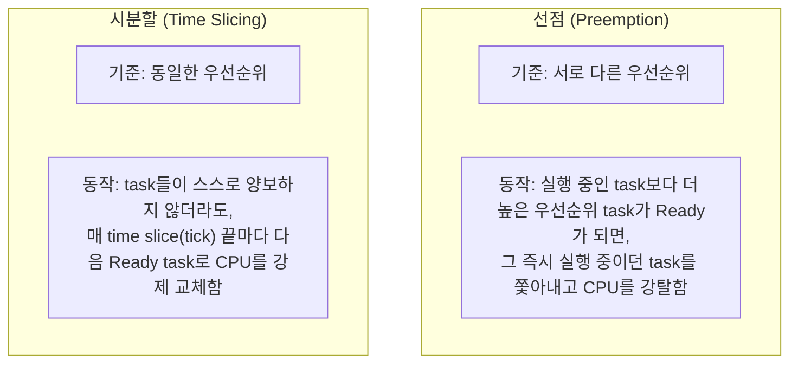
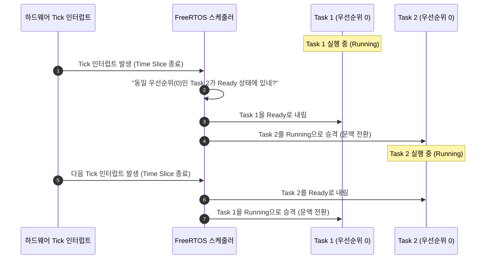

# Tutorial 6: 시분할을 사용하는 우선순위 기반 선점형 스케줄링 (Prioritized Preemptive Scheduling with Time Slicing)

이 단원에서는 FreeRTOS 커널의 기본이자 가장 대표적인 스케줄링 알고리즘인 **시분할을 사용하는 우선순위 기반 선점형 스케줄링(Prioritized Preemptive Scheduling with Time Slicing)**의 동작 원리를 관찰하고 이해한다.

---

## 1. 이번 실습에서 할 일

* **해결하려는 문제**: 동일한 우선순위를 가진 여러 task가 존재하고 어느 누구도 스스로 CPU를 양보하지 않을 때, 운영체제가 어떻게 공평하게 CPU를 분배하는지 확인한다.
* **학습 목표**:
  1. **선점(Preemption)**과 **시분할(Time Slicing)**의 개념적 차이를 명확히 구분하여 설명할 수 있다.
  2. `configUSE_PREEMPTION 1` 및 `configUSE_TIME_SLICING 1` 환경에서 동일 우선순위 task 간의 라운드 로빈(Round-Robin) 교대 실행을 관찰한다.
  3. time slice(시간 분할 구간)의 길이와 RTOS tick 인터럽트의 관계를 이해한다.

---

## 2. 시작 전 확인

### 2.1 핵심 용어 복습
* **RTOS Tick 인터럽트**: 하드웨어 타이머가 주기적으로(예: 1ms마다) 발생시키는 커널 심장 박동이다.
* **Time Slice (시간 분할 구간)**: 두 번의 tick 인터럽트 사이의 시간 간격이다. `configTICK_RATE_HZ`가 1000이면 1 time slice는 정확히 1ms다.
* **라운드 로빈 (Round-Robin)**: 동일한 조건을 가진 주체들이 순서대로 돌아가며 공평하게 기회를 갖는 분배 방식이다.

### 2.2 확인할 소스 및 설정 파일
* 실습 코드: [`source/tutorials/tutorial_6/source/tutorial_6.c`](../../source/tutorials/tutorial_6/source/tutorial_6.c)
* 설정 파일: [`source/tutorials/tutorial_6/include/FreeRTOSConfig.h`](../../source/tutorials/tutorial_6/include/FreeRTOSConfig.h)

> **실습 형태**: 이 단원은 코드가 사전에 완성되어 있는 **관찰 및 분석 실습**이다. 소스를 수정하지 않고 스케줄링 동작을 집중 분석한다.

---

## 3. 개념 이해

### 3.1 FreeRTOS의 3대 스케줄링 알고리즘
FreeRTOS 커널은 `FreeRTOSConfig.h`의 설정 조합에 따라 다음 3가지 알고리즘을 지원한다:

| 알고리즘 | `configUSE_PREEMPTION` | `configUSE_TIME_SLICING` | 핵심 특징 |
| :--- | :---: | :---: | :--- |
| **1. 선점형 + 시분할 (현재 단원)** | **`1`** | **`1`** | 상위 우선순위 즉시 선점 + 동일 우선순위 tick마다 교대 실행 |
| **2. 선점형 (시분할 없음, T07)** | `1` | `0` | 상위 우선순위 즉시 선점 + 동일 우선순위는 양보할 때까지 독점 |
| **3. 협력형 스케줄링 (T08)** | `0` | 해당 없음 | 선점 없음. 오직 자발적 양보(`taskYIELD`)나 대기 시에만 전환 |

### 3.2 선점 vs 시분할의 결정적 차이



* **선점된다는 것의 의미**: task가 스스로 원해서(`vTaskDelay` 호출 등) 물러나는 것이 아니라, 커널 스케줄러에 의해 **비자발적으로(involuntarily)** Running 상태에서 쫓겨나 Ready 상태로 강등되는 것을 말한다.

---

## 4. 실행 흐름 읽기

`tutorial_6.c`에서는 두 개의 task("Task1", "Task2")가 동일한 우선순위(`tskIDLE_PRIORITY`)로 생성되며, 둘 다 `vTaskDelay()` 없이 busy wait 루프만 돈다.



---

## 5. 코드와 API 이해

### 5.1 `FreeRTOSConfig.h` 설정 확인
```c
#define configUSE_PREEMPTION    1
#define configUSE_TIME_SLICING  1
```
* `configUSE_PREEMPTION 1`: 선점형 스케줄러를 활성화한다.
* `configUSE_TIME_SLICING 1`: 동일 우선순위 task 간의 time slicing(시분할 라운드 로빈)을 활성화한다.

### 5.2 task 루프 구조
```c
static void prvTask1Function( void * pvParams )
{
    uint64_t i;
    for( ;; )
    {
        fprintf( stderr, "Tutorial 6 task 1 running...\r\n" );
        for( i = 0; i < 100000000; i++ ) { /* busy wait */ }
    }
}
```
* 두 task 모두 지연 함수(`vTaskDelay`)를 전혀 쓰지 않는다.
* Tutorial 4에서는 우선순위가 달라서 Low Task가 기아 상태에 빠졌지만, Tutorial 6에서는 **두 task의 우선순위가 완벽히 동일**하다.
* 따라서 `configUSE_TIME_SLICING 1`에 의해 주기적인 tick 인터럽트가 발생할 때마다 Task 1과 Task 2가 번갈아 가며 실행권을 나눠 갖는다.

---

## 6. 직접 구현 또는 관찰 준비

* **실행 전 예측 질문**:
  1. Task 1과 Task 2 중 어느 하나가 CPU를 영원히 독점할 것인가?
  2. 아니면 두 task의 출력 로그가 교대로 섞여서 나올 것인가?

---

## 7. 빌드와 실행

저장소 루트에서 다음 명령을 실행한다:

```bash
# 1. CMake 빌드 구성 (Tutorial 6 지정)
cmake -B build -S source -DTUTORIAL=6

# 2. 컴파일 및 빌드
cmake --build build

# 3. 바이너리 실행
./build/freertos_example
```

* **종료 방법**: 터미널에서 **`Ctrl + C`**를 누른다.

---

## 8. 결과 해석

### 8.1 정상 실행 출력 화면
```text
Tutorial 6 task 1 running...
Tutorial 6 task 2 running...
Tutorial 6 task 1 running...
Tutorial 6 task 2 running...
Tutorial 6 task 1 running...
Tutorial 6 task 2 running...
```

### 8.2 판정 기준 및 해석
* **결과의 특징**: Task 1과 Task 2가 번갈아 가며 고르게 출력된다.
* **원리 확인**: task 스스로 `vTaskDelay()`나 `taskYIELD()`를 호출하지 않았음에도 불구하고, 커널의 tick 인터럽트 핸들러가 time slice가 끝날 때마다 자동으로 스케줄러를 가동하여 동일 우선순위 task 간 문맥 전환을 수행했음을 증명한다.

---

## 9. 막혔을 때 (트러블슈팅)

| 증상 | 원인 | 해결 방법 |
| :--- | :--- | :--- |
| 한 task만 출력되고 교대되지 않음 | 이전 단원의 빌드 캐시가 남아있음 | `rm -rf build` 후 다시 `cmake -B build -S source -DTUTORIAL=6` 빌드 |
| 출력이 수 초 동안 멈췄다가 몰아서 나옴 | busy wait 루프 횟수(`100000000`)에 따른 지연 | PC CPU 연산 시간에 따른 정상이므로 계속 지켜볼 것 |

---

## 10. 혼자 확인하기 (자가 점검)

### 질문 1 (개념 비교)
선점(Preemption)과 시분할(Time Slicing)의 차이를 우선순위의 관점에서 한 문장으로 명쾌하게 정의하라.

<details>
<summary>정답 및 해설 확인</summary>

* **정답**: **선점**은 **서로 다른 우선순위** 간에 상위 task가 하위 task를 즉시 중단시키는 메커니즘이고, **시분할**은 **동일한 우선순위**를 가진 task들 사이에서 tick마다 CPU를 공평하게 나눠 쓰는 메커니즘이다.
</details>

### 질문 2 (설정 분석)
만약 `tutorial_6.c`에서 Task 1의 우선순위를 `1`로 높이고 Task 2의 우선순위를 `0`으로 둔다면, `configUSE_TIME_SLICING`이 `1`로 켜져 있어도 시분할이 일어나는가?

<details>
<summary>정답 및 해설 확인</summary>

* **정답**: 일어나지 않는다. (Tutorial 4와 동일하게 Task 1만 독점 실행된다.)
* **이유**: 시분할(Time Slicing)은 **오직 동일한 우선순위를 가진 task들 사이에서만** 동작한다. 더 높은 우선순위 task가 Ready 상태로 존재하는 한, 낮은 우선순위 task는 시분할 대상에조차 오르지 못한다.
</details>

### 질문 3 (시스템 파라미터)
Time slice 1구간의 길이를 1ms에서 10ms로 늘리고 싶다면 `FreeRTOSConfig.h`의 어떤 매크로를 어떻게 수정해야 하는가?

<details>
<summary>정답 및 해설 확인</summary>

* **정답**: `configTICK_RATE_HZ`를 `100`으로 변경한다.
* **원리**: 1초당 tick 수가 100회이므로 1 tick(1 time slice)은 `1000ms / 100 = 10ms`가 된다.
</details>

---

## 11. 다음 학습

시분할이 켜져 있을 때 동일 우선순위 task들이 공평하게 교대 실행되는 것을 보았다.  
그렇다면 만약 시분할을 끈다면(`configUSE_TIME_SLICING 0`) 동일 우선순위 task들은 어떻게 될까?

이제 **[Tutorial 7: 시분할 없는 우선순위 기반 선점형 스케줄링 (Prioritized Preemptive Scheduling without Time Slicing)](tutorial_7.md)**으로 넘어가서 그 차이를 직접 확인해 보자!

* **한국어 커널북 심화 읽기**:
  * [4.12.3장: 시분할을 사용하는 우선순위 기반 선점형 스케줄링](https://github.com/yunju-baek/FreeRTOS-Kernel-Book-ko/blob/27d03c61cd2a6cf5a6fa6333082218ef706f5b89/ko/ch04.md)
