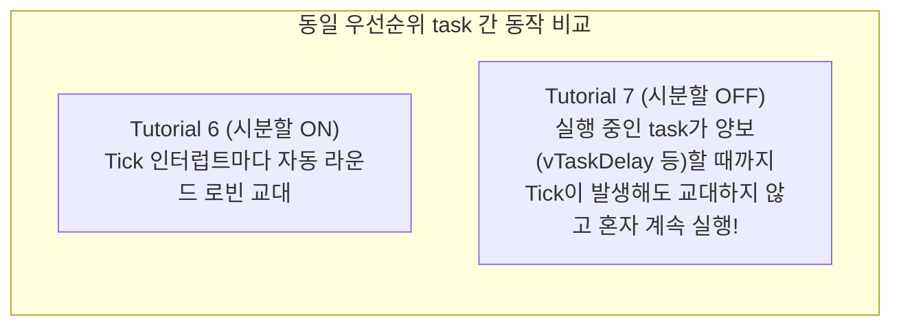
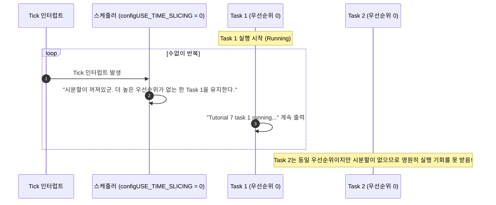

# Tutorial 7: 시분할 없는 우선순위 기반 선점형 스케줄링 (Prioritized Preemptive Scheduling without Time Slicing)

이 단원에서는 선점형 스케줄러를 유지하면서도 **시분할(Time Slicing)만 비활성화(`configUSE_TIME_SLICING 0`)**했을 때, 동일한 우선순위를 가진 task들의 실행 양상이 어떻게 달라지는지 비교 관찰한다.

---

## 1. 이번 실습에서 할 일

* **해결하려는 문제**: 시분할을 끄면 동일 우선순위 task 간의 자동 교대 실행이 중단되는 현상을 관찰하고, 시분할 비활성화와 선점 비활성화의 개념 차이를 올바르게 이해한다.
* **학습 목표**:
  1. `configUSE_PREEMPTION 1`과 `configUSE_TIME_SLICING 0` 설정이 의미하는 바를 정확히 설명할 수 있다.
  2. 동일 우선순위의 두 task 중 먼저 실행권을 쥔 task가 CPU를 양보하지 않을 때 발생하는 독점 현상을 확인한다.
  3. 시분할을 껐을 때 문맥 전환이 발생하는 유일한 조건(상위 task 선점 또는 자발적 대기/양보)을 이해한다.

---

## 2. 시작 전 확인

### 2.1 개념 비교 복습
* **Tutorial 6**: `configUSE_PREEMPTION 1`, `configUSE_TIME_SLICING 1`  
  → 동일 우선순위 task라도 매 tick마다 강제로 CPU를 번갈아 사용함.
* **Tutorial 7 (현재)**: `configUSE_PREEMPTION 1`, `configUSE_TIME_SLICING 0`  
  → **선점(더 높은 우선순위로의 교체)은 여전히 살아있지만**, 동일한 우선순위 task 간의 tick 기반 자동 라운드 로빈은 완전히 꺼짐!

### 2.2 확인할 소스 및 설정 파일
* 실습 코드: [`source/tutorials/tutorial_7/source/tutorial_7.c`](../../source/tutorials/tutorial_7/source/tutorial_7.c)
* 설정 파일: [`source/tutorials/tutorial_7/include/FreeRTOSConfig.h`](../../source/tutorials/tutorial_7/include/FreeRTOSConfig.h)

> **실습 형태**: 이 단원은 코드가 사전에 완성되어 있는 **관찰 및 비교 분석 실습**이다.

---

## 3. 개념 이해

### 3.1 흔히 하는 오해: "시분할을 끄면 선점이 꺼진다?"
절대 아니다!
* **선점(`configUSE_PREEMPTION 1`)**: 여전히 켜져 있다. 만약 지금 실행 중인 task보다 우선순위가 더 높은 task가 Ready 상태가 되면 1마이크로초의 망설임도 없이 즉시 선점한다.
* **시분할 꺼짐(`configUSE_TIME_SLICING 0`)**: 오직 **동일한 우선순위 task들 사이에서만** 적용된다. 우선순위가 같은 다른 task가 대기하고 있더라도, 커널은 tick 인터럽트가 발생했다고 해서 실행 중인 task의 실행권을 빼앗지 않는다.



### 3.2 왜 굳이 시분할을 끄는 경우가 있는가?
* **문맥 전환 오버헤드 절감**: 1ms마다 CPU 레지스터를 저장하고 복원하는 문맥 전환 비용을 줄여 순수 연산 처리 효율을 극대화하고 싶을 때.
* **캐시 적중률(Cache Hit) 향상**: 고성능 프로세서에서 실행 중인 작업의 캐시를 불필요하게 날리지 않고 하나의 작업을 끝까지 밀어붙여 처리하고자 할 때.

---

## 4. 실행 흐름 읽기



---

## 5. 코드와 API 이해

### 5.1 `FreeRTOSConfig.h` 핵심 설정
```c
#define configUSE_PREEMPTION    1
#define configUSE_TIME_SLICING  0
```
* `configUSE_TIME_SLICING`이 `0`으로 정의되어 있다.
* 이것이 Tutorial 6과의 유일한 설정 차이점이다.

### 5.2 `tutorial_7.c` 코드 분석
* Task 1과 Task 2는 Tutorial 6과 완전히 똑같이 동일 우선순위(`tskIDLE_PRIORITY`)로 생성되며, 둘 다 `vTaskDelay()` 없이 busy-wait 루프를 돈다.
* 하지만 `configUSE_TIME_SLICING 0` 때문에 스케줄러는 tick 인터럽트가 와도 Task 1에서 Task 2로 문맥 전환을 일으키지 않는다.

---

## 6. 직접 구현 또는 관찰 준비

* **실행 전 예측 질문**:
  * Tutorial 6에서는 두 task가 1줄씩 번갈아 가며 출력되었다.
  * Tutorial 7에서는 어떻게 출력될 것인가? Task 1만 나올까, 아니면 여전히 번갈아 나올까?

---

## 7. 빌드와 실행

저장소 루트에서 다음 명령을 실행한다:

```bash
# 1. CMake 빌드 구성 (Tutorial 7 지정)
cmake -B build -S source -DTUTORIAL=7

# 2. 컴파일 및 빌드
cmake --build build

# 3. 바이너리 실행
./build/freertos_example
```

* **종료 방법**: 터미널에서 **`Ctrl + C`**를 누른다.

---

## 8. 결과 해석

### 8.1 정상 실행 출력 화면
```text
Tutorial 7 task 1 running...
Tutorial 7 task 1 running...
Tutorial 7 task 1 running...
Tutorial 7 task 1 running...
Tutorial 7 task 1 running...
```

### 8.2 판정 기준 및 해석
* **결과의 특징**: Tutorial 6과 달리 `task 2`는 단 한 줄도 출력되지 않고, 오직 **`task 1`만 계속해서 출력**된다!
* **핵심 분석**:
  1. 두 task의 우선순위는 `0`으로 동일하다.
  2. 선점형(`configUSE_PREEMPTION 1`)이 켜져 있으므로, 만약 Task 2의 우선순위가 `1`이었다면 Task 1을 즉시 선점했을 것이다.
  3. 하지만 두 task의 우선순위가 같고, 시분할(`configUSE_TIME_SLICING 0`)이 꺼져 있으므로 tick 인터럽트가 발생해도 스케줄러는 실행 중인 Task 1을 교체하지 않는다.
  4. Task 1이 스스로 `vTaskDelay()`를 부르거나 `taskYIELD()`를 하지 않는 한 Task 2는 실행되지 못한다.

---

## 9. 막혔을 때 (트러블슈팅)

| 증상 | 원인 | 해결 방법 |
| :--- | :--- | :--- |
| Tutorial 6처럼 번갈아 출력됨 | 빌드 캐시 문제로 Tutorial 6 바이너리가 실행됨 | `rm -rf build` 후 다시 `cmake -B build -S source -DTUTORIAL=7` 빌드 |
| 컴파일 에러 발생 | 소스 코드를 임의로 수정했음 | 원본 코드로 복구 후 빌드 |

---

## 10. 혼자 확인하기 (자가 점검)

### 질문 1 (개념)
`configUSE_TIME_SLICING 0`으로 설정했을 때, 동일한 우선순위를 가진 Task A와 Task B 사이에서 문맥 전환이 일어날 수 있는 조건 2가지는 무엇인가?

<details>
<summary>정답 및 해설 확인</summary>

* **정답**:
  1. 현재 실행 중인 Task A가 스스로 `vTaskDelay()`나 큐/세마포어 대기 등을 호출하여 **Blocked 상태**로 진입할 때.
  2. 현재 실행 중인 Task A가 스스로 `taskYIELD()`를 호출하여 다른 동일 우선순위 task에게 **실행권을 명시적으로 양보**할 때.
</details>

### 질문 2 (오해 바로잡기)
"시분할을 끄면(`configUSE_TIME_SLICING 0`) 높은 우선순위 task가 나타나도 선점하지 못한다"라는 주장은 참인가 거짓인가?

<details>
<summary>정답 및 해설 확인</summary>

* **정답**: 거짓(False)이다.
* **이유**: `configUSE_PREEMPTION 1`이 유지되는 한, 더 높은 우선순위 task가 Ready가 되면 즉시 선점이 일어난다. 시분할 비활성화는 오직 '동일한 우선순위' 간의 자동 교대만 끄는 것이다.
</details>

### 질문 3 (비교 요약)
T04, T06, T07의 실행 결과를 비교하여 스케줄러 동작 차이를 요약하라.

<details>
<summary>정답 및 해설 확인</summary>

* **T04**: 우선순위가 다름(1 vs 0) → 선점에 의해 우선순위 1만 독점 실행 (기아 발생).
* **T06**: 우선순위가 같음(0 vs 0) + 시분할 켬 → Tick마다 라운드 로빈으로 번갈아 실행.
* **T07**: 우선순위가 같음(0 vs 0) + 시분할 끔 → 먼저 시작한 task가 양보할 때까지 계속 독점 실행.
</details>

---

## 11. 다음 학습

선점형 스케줄러에서 시분할이 있고 없을 때의 차이를 명확히 이해했다.  
그렇다면 만약 **선점 기능 자체를 아예 꺼버린다면(`configUSE_PREEMPTION 0`)** 어떻게 될까? 상위 우선순위 task가 나타나도 가로채지 못할까?

이제 **[Tutorial 8: 협력형 스케줄링 (Co-operative Scheduling)](tutorial_8.md)**으로 넘어가서 협력형 스케줄링의 진정한 동작을 확인해 보자!

* **한국어 커널북 심화 읽기**:
  * [4.12.4장: 시분할 없는 우선순위 기반 선점형 스케줄링](https://github.com/yunju-baek/FreeRTOS-Kernel-Book-ko/blob/27d03c61cd2a6cf5a6fa6333082218ef706f5b89/ko/ch04.md)
