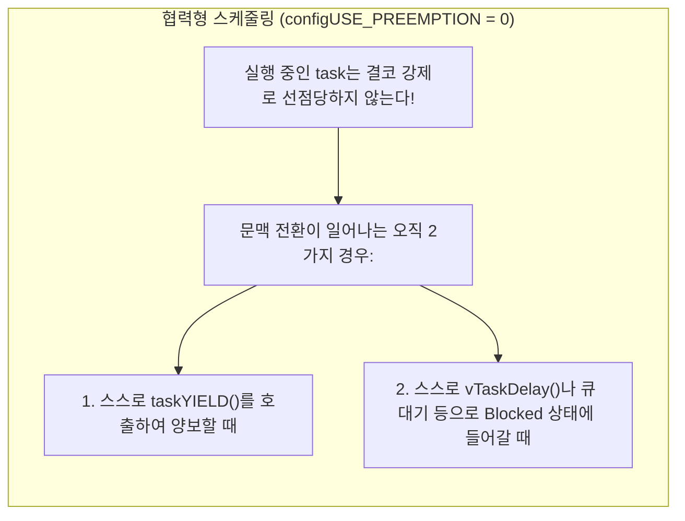
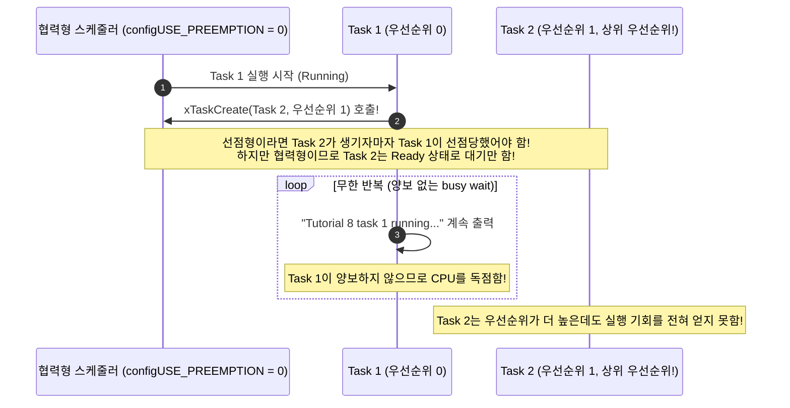

# Tutorial 8: 협력형 스케줄링 (Co-operative Scheduling)

이 단원에서는 선점 기능을 완전히 비활성화하는 **협력형 스케줄링(Co-operative Scheduling, `configUSE_PREEMPTION 0`)**의 원리와 특징을 배우고, 더 높은 우선순위 task가 생성되어도 현재 task가 양보하지 않으면 실행되지 못하는 현상을 직접 확인한다.

---

## 1. 이번 실습에서 할 일

* **해결하려는 문제**: 선점(Preemption)이 완전히 꺼진 환경에서 문맥 전환이 발생하는 유일한 규칙을 확인하고, 실시간 운영체제에서 선점형과 협력형의 트레이드오프를 이해한다.
* **학습 목표**:
  1. `configUSE_PREEMPTION 0`으로 설정된 협력형 스케줄러의 동작 메커니즘을 설명할 수 있다.
  2. 우선순위가 낮은 task가 실행 중에 **더 높은 우선순위 task를 동적으로 생성해도 선점되지 않고 계속 실행되는 과정**을 관찰한다.
  3. 협력형 스케줄링에서 문맥 전환이 발생하기 위해 필요한 2가지 조건(`taskYIELD()` 또는 Blocked 상태 진입)을 이해한다.

---

## 2. 시작 전 확인

### 2.1 개념 비교 복습
* **선점형 (T04, T06, T07)**: 커널이 언제든 필요할 때(우선순위 역전, tick 만료 등) 실행 중인 task의 뒤통수를 치고 CPU를 빼앗아 올 수 있다.
* **협력형 (T08, 현재 단원)**: **커널이 강제로 CPU를 빼앗지 못한다.** 실행 중인 task가 "나 다 썼으니 다음 task 실행해"라고 스스로 말해주기 전까지는 다른 task가 아무리 우선순위가 높아도 얌전히 기다려야 한다.

### 2.2 확인할 소스 및 설정 파일
* 실습 코드: [`source/tutorials/tutorial_8/source/tutorial_8.c`](../../source/tutorials/tutorial_8/source/tutorial_8.c)
* 설정 파일: [`source/tutorials/tutorial_8/include/FreeRTOSConfig.h`](../../source/tutorials/tutorial_8/include/FreeRTOSConfig.h)

> **실습 형태**: 사전 완성된 코드를 통해 협력형 스케줄러의 동작을 분석하는 **관찰 및 비교 실습**이다.

---

## 3. 개념 이해

### 3.1 협력형 스케줄링이란?
협력형 스케줄링에서는 모든 task가 **신사적으로 협력**한다고 가정한다. 하나의 task가 CPU를 쥐고 무한 루프를 돌며 양보하지 않으면 시스템 전체가 먹통이 될 수 있다.



### 3.2 협력형 스케줄링의 장단점
* **장점**:
  * 어떤 코드를 실행하는 도중에 불시에 다른 task로 스위칭되지 않으므로, 데이터 불일치(Race condition)가 발생할 위험이 적고 Mutex나 Critical Section 같은 복잡한 동기화 메커니즘의 필요성이 줄어든다.
  * 문맥 전환 횟수가 적어 시스템 오버헤드가 적다.
* **치명적 단점 (실시간성 결여)**:
  * 긴급한 외부 이벤트가 발생하여 높은 우선순위 task가 깨어났더라도, 현재 실행 중인 덜 중요한 task가 양보하지 않으면 응답 시간(Latency)이 무한정 길어질 수 있어 엄격한 실시간(Hard Real-time) 시스템에는 부적합하다.

---

## 4. 실행 흐름 읽기

`tutorial_8.c`에서는 매우 흥미로운 실험이 진행된다:
1. `main()`은 우선순위 `0`(`tskIDLE_PRIORITY`)인 **Task 1**만 생성하고 스케줄러를 시작한다.
2. 실행을 시작한 Task 1은 자신의 내부에서 **우선순위가 더 높은(`tskIDLE_PRIORITY + 1` = 우선순위 1) Task 2를 동적으로 생성**한다!



---

## 5. 코드와 API 이해

### 5.1 `FreeRTOSConfig.h` 핵심 설정
```c
#define configUSE_PREEMPTION    0
```
* 선점 기능을 끈다.
* `configUSE_PREEMPTION`이 `0`이면 `configUSE_TIME_SLICING` 설정은 아무런 의미를 갖지 못한다 (선점할 수 없으므로 time slice로 자를 수도 없음).

### 5.2 `tutorial_8.c` 핵심 코드 분석
```c
static void prvTask1Function( void * pvParams )
{
    uint64_t i;
    BaseType_t xTaskCreationResult = pdFAIL;

    /* 우선순위가 더 높은 Task 2 생성 (우선순위: tskIDLE_PRIORITY + 1) */
    xTaskCreationResult = xTaskCreate( prvTask2Function,
                                       "Task2",
                                       configMINIMAL_STACK_SIZE,
                                       NULL,
                                       tskIDLE_PRIORITY + 1,
                                       NULL );
    configASSERT( xTaskCreationResult == pdPASS );

    for( ;; )
    {
        fprintf( stderr, "Tutorial 8 task 1 running...\r\n" );

        for( i = 0; i < 100000000; i++ )
        {
            /* 양보 없이 계속 시간 끄는 busy wait */
        }
    }
}
```

* Task 2가 성공적으로 생성되어 Ready 상태가 되었음에도 불구하고, Task 1이 `taskYIELD()`나 `vTaskDelay()`를 호출하지 않기 때문에 제어권이 넘어가지 않는다.

---

## 6. 직접 구현 또는 관찰 준비

* **실행 전 예측 질문**:
  * Task 2는 우선순위 1이고, Task 1은 우선순위 0이다.
  * 보통의 RTOS 상식으로는 상위 우선순위인 Task 2가 실행되어야 마땅하다.
  * 과연 `task 2 running...` 로그가 한 줄이라도 출력될 것인가?

---

## 7. 빌드와 실행

저장소 루트에서 다음 명령을 실행한다:

```bash
# 1. CMake 빌드 구성 (Tutorial 8 지정)
cmake -B build -S source -DTUTORIAL=8

# 2. 컴파일 및 빌드
cmake --build build

# 3. 바이너리 실행
./build/freertos_example
```

* **종료 방법**: 터미널에서 **`Ctrl + C`**를 누른다.

---

## 8. 결과 해석

### 8.1 정상 실행 출력 화면
```text
Tutorial 8 task 1 running...
Tutorial 8 task 1 running...
Tutorial 8 task 1 running...
Tutorial 8 task 1 running...
Tutorial 8 task 1 running...
```

### 8.2 판정 기준 및 해석
* **결과의 특징**: 우선순위가 더 높은 Task 2가 엄연히 생성되었음에도 불구하고, 화면에는 오직 **`Tutorial 8 task 1 running...`만 계속해서 출력**된다!
* **이유**:
  * 협력형 스케줄링(`configUSE_PREEMPTION 0`)에서는 아무리 높은 우선순위 task가 Ready 상태가 되어도, 현재 Running 상태인 task를 **비자발적으로 중단시킬 수 없다.**
  * Task 1이 양보 없이 busy-wait 루프를 돌고 있으므로 Task 2는 Ready 큐에 묶인 채 대기만 하게 된다.

---

## 9. 막혔을 때 (트러블슈팅)

| 증상 | 원인 | 해결 방법 |
| :--- | :--- | :--- |
| `task 2`가 출력되는 현상 | `FreeRTOSConfig.h`에서 `configUSE_PREEMPTION`이 1로 되어 있음 | `source/tutorials/tutorial_8/include/FreeRTOSConfig.h`의 설정 값 확인 |
| 이전 단원 빌드가 실행됨 | CMake 캐시 충돌 | `rm -rf build` 후 다시 빌드 |

---

## 10. 혼자 확인하기 (자가 점검)

### 질문 1 (핵심 개념)
협력형 스케줄링(`configUSE_PREEMPTION 0`) 환경에서 문맥 전환(Context Switch)이 일어날 수 있는 2가지 경우는 무엇인가?

<details>
<summary>정답 및 해설 확인</summary>

* **정답**:
  1. 실행 중인 task가 스스로 `taskYIELD()`를 호출하여 다른 task에게 실행권을 양보할 때.
  2. 실행 중인 task가 `vTaskDelay()`를 호출하거나, 비어 있는 큐에서 데이터를 읽으려 하거나, 이미 획득된 세마포어를 얻으려 하여 스스로 **Blocked 상태**로 진입할 때.
</details>

### 질문 2 (코드 수정 실험)
`tutorial_8.c`의 Task 1 무한 루프 내부에 `taskYIELD();`를 한 줄 추가하면 실행 결과는 어떻게 변할까?
```c
for( ;; )
{
    fprintf( stderr, "Tutorial 8 task 1 running...\r\n" );
    taskYIELD(); /* 자발적 양보! */
    for( i = 0; i < 100000000; i++ ) { }
}
```

<details>
<summary>정답 및 해설 확인</summary>

* **정답**: `taskYIELD()`가 호출되는 순간, 대기 중이던 상위 우선순위의 **Task 2가 즉시 실행권을 넘겨받는다.**
* **이유**: Task 1이 자발적으로 재스케줄링을 요청했으므로, 스케줄러가 Ready 큐를 검사하여 가장 우선순위가 높은 Task 2를 Running으로 승격시키기 때문이다.
</details>

### 질문 3 (스케줄링 3종 알고리즘 총정리 표)
지금까지 배운 T06, T07, T08의 스케줄링 방식을 비교 표로 정리하라.

<details>
<summary>정답 및 해설 확인</summary>

| 구분 | T06 (선점 + 시분할) | T07 (선점 + 시분할 없음) | T08 (협력형) |
| :--- | :---: | :---: | :---: |
| **선점 활성 여부** | O (`1`) | O (`1`) | **X (`0`)** |
| **시분할 활성 여부**| O (`1`) | **X (`0`)** | 해당 없음 |
| **상위 task 발생 시** | **즉시 선점** | **즉시 선점** | 현재 task가 양보할 때까지 대기 |
| **동일 우선순위 task**| **Tick마다 교대** | 양보할 때까지 독점 | 양보할 때까지 독점 |
</details>

---

## 11. 다음 학습

지금까지 task의 생성, 메모리 할당, 우선순위, 그리고 3대 스케줄링 알고리즘(T01~T08)을 모두 마스터했다!  
이제 단일 task의 실행을 넘어, **서로 다른 task 간에 데이터를 주고받는 통신(Communication)과 동기화(Synchronization)**의 세계로 진입한다.

다음 단계인 **[Tutorial 9: queue를 통한 task 간 통신 (Using Queues for Inter-Task Communication)](tutorial_9.md)**으로 넘어가서, FreeRTOS 통신의 대동맥인 **Queue(큐)**의 생성과 데이터 전송을 배워보자!

* **한국어 커널북 심화 읽기**:
  * [4.12.5장: 협력형 스케줄링 (Co-operative Scheduling)](https://github.com/yunju-baek/FreeRTOS-Kernel-Book-ko/blob/27d03c61cd2a6cf5a6fa6333082218ef706f5b89/ko/ch04.md)
