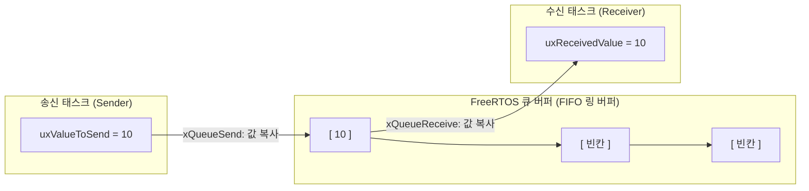
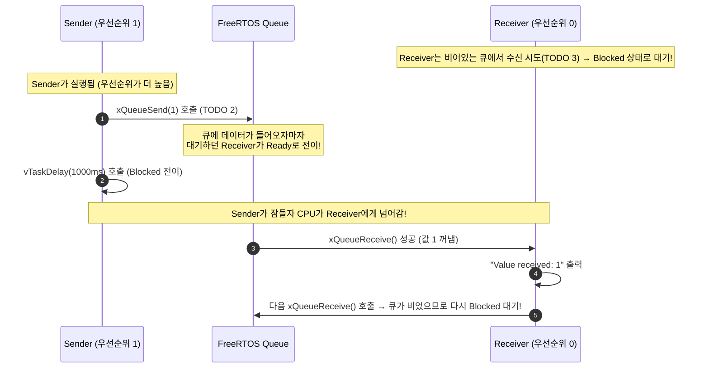

# Tutorial 9: queue를 통한 task 간 통신 (Using Queues for Inter-Task Communication)

이 단원에서는 FreeRTOS에서 task 간에 데이터를 안전하게 주고받는 가장 핵심적인 메커니즘인 **Queue(큐)**의 동작 원리와 생성, 송수신 API 사용법을 실습한다.

---

## 1. 이번 실습에서 할 일

* **해결하려는 문제**: 전역 변수를 무방비하게 공유할 때 발생하는 경쟁 상태(Race Condition)를 방지하고, task 간에 스레드 안전(Thread-safe)한 FIFO 방식으로 데이터를 전달한다.
* **학습 목표**:
  1. `xQueueCreate()` API를 사용하여 고정 크기 항목을 저장하는 큐를 생성할 수 있다.
  2. `xQueueSend()`와 `xQueueReceive()`를 이용해 송신자 task와 수신자 task 간에 데이터를 송수신한다.
  3. FreeRTOS 큐의 **값 복사(Pass by Copy)** 방식과, 큐가 비어있을 때의 **Blocked 대기 메커니즘**을 설명할 수 있다.

---

## 2. 시작 전 확인

### 2.1 C 언어 핵심 복습
* **`sizeof` 연산자**: 특정 데이터 타입이나 변수가 메모리에서 차지하는 바이트(Byte) 크기를 계산한다. 큐를 만들 때 각 항목의 크기를 `sizeof( UBaseType_t )`와 같이 지정한다.
* **주소 연산자 `&`**: 변수의 메모리 주소를 얻는다. 큐에 데이터를 넣거나 꺼낼 때, 변수 자체가 아니라 **데이터가 위치한 주소(포인터)**를 커널에 넘겨주어야 커널이 그 메모리에서 큐 버퍼로 바이트 단위 복사를 수행한다.

### 2.2 확인할 소스 및 설정 파일
* 실습 코드: [`source/tutorials/tutorial_9/source/tutorial_9.c`](../../source/tutorials/tutorial_9/source/tutorial_9.c)
* 설정 파일: [`source/tutorials/tutorial_9/include/FreeRTOSConfig.h`](../../source/tutorials/tutorial_9/include/FreeRTOSConfig.h)
* 참조 해답: [`ko/guides/solutions/tutorial_9.c`](solutions/tutorial_9.c)

> **실습 형태**: 이 단원은 `tutorial_9.c` 내부의 **`TODO 1`, `TODO 2`, `TODO 3`을 완성하는 구현 실습**이다.

---

## 3. 개념 이해

### 3.1 왜 전역 변수 대신 Queue를 쓰는가?
여러 task가 아무런 보호 장치 없이 전역 변수를 읽고 쓰면, 한 task가 값을 절반만 썼을 때 다른 task가 선점하여 값을 읽어가는 데이터 오염이 발생한다.
FreeRTOS의 **Queue**는 커널 내부에서 인터럽트를 끄거나 락을 걸어 처리하므로 완벽한 **스레드 안전성(Thread-safety)**을 보장한다.



### 3.2 큐의 2대 핵심 특성

1. **값 복사 전송 (Pass by Copy)**:
   * 포인터만 달랑 전달하는 것이 아니라, 전달하려는 데이터의 바이트들을 큐 내부 메모리로 **직접 복사**해 넣는다.
   * **장점**: 송신자가 지역 변수를 큐에 넣고 그 변수가 사라지거나 값을 나중에 바꾸더라도, 이미 큐 안에 복사된 데이터는 안전하게 보존된다.
   * *(단, 대용량 버퍼는 복사 오버헤드가 크므로 포인터 자체를 큐 항목으로 만들어 전달하는 기법을 쓴다.)*

2. **블로킹 대기 (Blocking on Queues)**:
   * **수신 대기**: 큐가 비어있을 때 수신자가 읽으려고 하면, 수신자는 CPU를 쓰지 않는 **Blocked 상태**로 들어간다. 나중에 송신자가 데이터를 큐에 넣는 순간 커널이 수신자를 즉시 깨워준다(Unblock).
   * **송신 대기**: 큐가 가득 차 있을 때 송신자가 쓰려고 하면, 빈 공간이 생길 때까지 송신자가 Blocked 상태로 대기한다.

---

## 4. 실행 흐름 읽기



---

## 5. 코드와 API 이해

### 5.1 `xQueueCreate()` API
```c
QueueHandle_t xQueueCreate( UBaseType_t uxQueueLength, UBaseType_t uxItemSize );
```
* `uxQueueLength`: 큐에 동시에 담을 수 있는 최대 항목 수 (이번 실습: `5`).
* `uxItemSize`: 각 항목 1개의 바이트 크기 (`sizeof( UBaseType_t )`).
* **반환값**: 성공 시 `QueueHandle_t`, 힙 메모리 부족 시 `NULL`.

### 5.2 `xQueueSend()` API
```c
BaseType_t xQueueSend( QueueHandle_t xQueue,
                       const void * pvItemToQueue,
                       TickType_t xTicksToWait );
```
* `xQueue`: 대상 큐 핸들.
* `pvItemToQueue`: 큐로 복사해 넣을 데이터의 **메모리 주소 포인터** (`&( uxValueToSend )`).
* `xTicksToWait`: 큐가 꽉 찼을 때 대기할 시간. `portMAX_DELAY`를 주면 빈자리가 날 때까지 무기한 Blocked 상태로 대기한다.
* **반환값**: 성공 시 `pdPASS`, 타임아웃 만료 시 `errQUEUE_FULL`.

### 5.3 `xQueueReceive()` API
```c
BaseType_t xQueueReceive( QueueHandle_t xQueue,
                          void * pvBuffer,
                          TickType_t xTicksToWait );
```
* `pvBuffer`: 큐에서 꺼낸 데이터를 복사받을 **수신 버퍼 주소 포인터** (`&( uxReceivedValue )`).
* `xTicksToWait`: 큐가 비어있을 때 대기할 시간 (`portMAX_DELAY`).

---

## 6. 직접 구현 또는 관찰 준비

`source/tutorials/tutorial_9/source/tutorial_9.c` 파일을 열고 세 개의 TODO를 완성한다.

### 6.1 TODO 1: 큐 생성 (`main` 함수)
70~78행 주석 부분을 찾는다:
* 항목 수 5개, 크기는 `sizeof( UBaseType_t )`

<details>
<summary>TODO 1 해답 코드 보기</summary>

```c
    xQueue = xQueueCreate( 5, sizeof( UBaseType_t ) );
```
</details>

### 6.2 TODO 2: 데이터 송신 (`prvSenderTask`)
108~116행 주석 부분을 찾는다:
* `uxValueToSend` 변수의 주소를 전달하고 대기 시간은 `portMAX_DELAY`로 설정한다.

<details>
<summary>TODO 2 해답 코드 보기</summary>

```c
        xQueueSendResult = xQueueSend( xQueue, &( uxValueToSend ), portMAX_DELAY );
```
</details>

### 6.3 TODO 3: 데이터 수신 (`prvReceiverTask`)
134~141행 주석 부분을 찾는다:
* `uxReceivedValue` 변수의 주소로 데이터를 복사받는다.

<details>
<summary>TODO 3 해답 코드 보기</summary>

```c
        xQueueReceive( xQueue, &( uxReceivedValue ), portMAX_DELAY );
```
</details>

> 전체 완성 코드는 [`ko/guides/solutions/tutorial_9.c`](solutions/tutorial_9.c)에서 확인할 수 있다.

---

## 7. 빌드와 실행

저장소 루트에서 다음 명령을 실행한다:

```bash
# 1. CMake 빌드 구성 (Tutorial 9 지정)
cmake -B build -S source -DTUTORIAL=9

# 2. 컴파일 및 빌드
cmake --build build

# 3. 바이너리 실행
./build/freertos_example
```

* **종료 방법**: 터미널에서 **`Ctrl + C`**를 누른다.

---

## 8. 결과 해석

### 8.1 정상 실행 출력 화면
```text
Value received from the queue: 1
Number of items in the queue: 0.
Value received from the queue: 2
Number of items in the queue: 0.
Value received from the queue: 3
Number of items in the queue: 0.
```

### 8.2 판정 기준 및 해석
* **결과의 특징**: 1초마다 송신자가 값을 1씩 증가시키며 보내고, 수신자가 즉시 그 값을 받아 출력한다.
* `Number of items in the queue: 0`: 수신자가 데이터를 꺼내가자마자 큐에는 남아있는 항목 수가 0개가 됨을 보여준다.

---

## 9. 막혔을 때 (트러블슈팅)

| 증상 | 원인 | 해결 방법 |
| :--- | :--- | :--- |
| `assertion "xQueue != NULL" failed` | TODO 1에서 큐를 생성하지 않았거나 반환값을 `xQueue`에 넣지 않음 | `xQueue = xQueueCreate(...)` 대입 확인 |
| `assertion "xQueueSendResult == pdPASS" failed` | 큐 송신 실패 | 큐 핸들이 유효한지 확인 |
| 이상한 큰 숫자가 출력됨 | 수신 버퍼 포인터에 `&`를 붙이지 않고 쓰레기 주소에 씀 | `&( uxReceivedValue )` 주소 전달 확인 |

---

## 10. 혼자 확인하기 (자가 점검)

### 질문 1 (원리)
FreeRTOS 큐가 데이터를 전송할 때 "Pass by Copy" 방식을 기본으로 채택한 가장 큰 안전상의 이유는 무엇인가?

<details>
<summary>정답 및 해설 확인</summary>

* **정답**: 송신 task가 전송 직후 해당 변수를 덮어쓰거나, 송신 task의 스코프를 벗어나 메모리가 해제되더라도 수신자가 안전하게 독립된 복사본을 읽을 수 있도록 보장하기 위함이다.
</details>

### 질문 2 (상태 전이)
수신 task(`prvReceiverTask`)의 무한 루프에는 `vTaskDelay()`가 전혀 없는데도, 왜 CPU를 100% 점유하지 않고 1초에 한 번만 실행되는가?

<details>
<summary>정답 및 해설 확인</summary>

* **정답**: `xQueueReceive(..., portMAX_DELAY)` 때문이다.
* **원리**: 큐가 비어 있으면 `xQueueReceive()` 내부에서 수신 task를 **Blocked 상태**로 전환시켜 CPU를 즉시 양보한다. 이후 송신 task가 1초 뒤 데이터를 큐에 넣을 때까지 수신 task는 CPU 시간을 1%도 소모하지 않고 잠들어 있는다.
</details>

---

## 11. 다음 학습

지금까지는 두 task 사이의 큐 통신을 배웠다.  
그런데 만약 데이터를 보내는 주체가 일반 task가 아니라 **하드웨어 인터럽트(ISR)**라면 어떻게 해야 할까? ISR에서도 `xQueueSend()`를 그대로 부르면 될까?

이제 **[Tutorial 10: 인터럽트와 task 간의 queue 통신 (Using Queues for Communication between Interrupts and Tasks)](tutorial_10.md)**으로 넘어가서 ISR 전용 API인 `FromISR`의 엄격한 규칙을 배워보자!

* **한국어 커널북 심화 읽기**:
  * [5장: queue 관리 (Queue Management)](https://github.com/yunju-baek/FreeRTOS-Kernel-Book-ko/blob/27d03c61cd2a6cf5a6fa6333082218ef706f5b89/ko/ch05.md)
